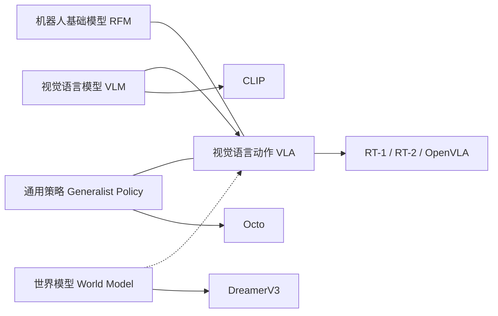
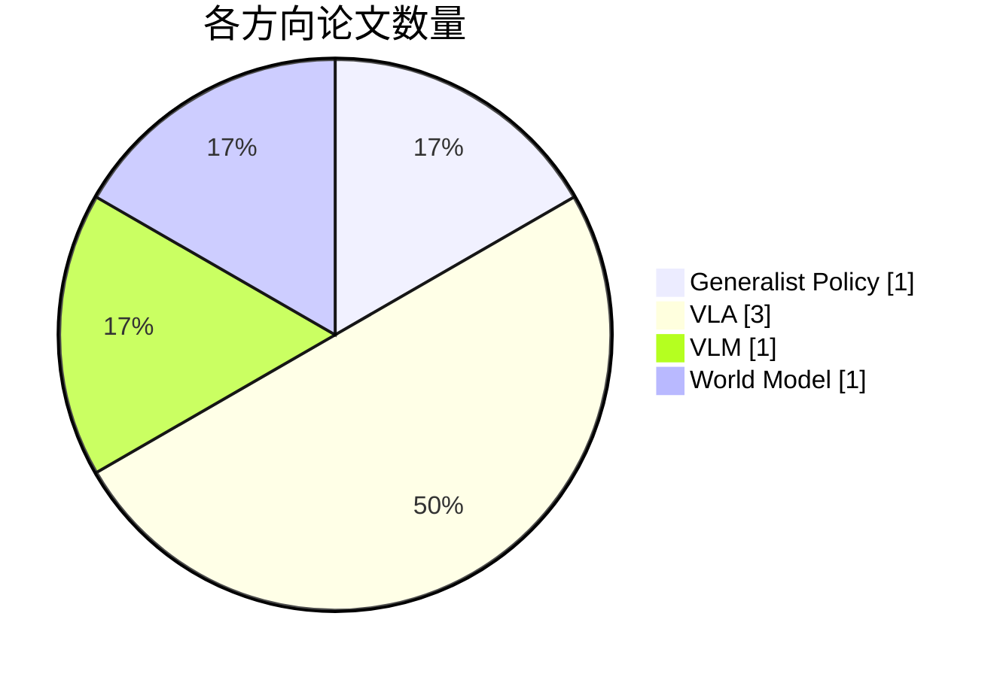

# Embodied AI & VLA · Research Learning Log

> 从读懂论文到复现实验：个人科研学习仓库（示例初始状态均为**待读/未复现**，请据实更新）。

**研究主题：** 具身智能、VLM、Vision-Language-Action (VLA)、Robot Foundation Models、World Models、Generalist Policies。

🔎 [可筛选的文献看板](docs/index.html) ｜ 📄 [阅读方法](references/reading-guide.md) ｜ 🧪 [复现实验指南](experiments/README.md) ｜ 🗓️ [每周进度](weekly/)

## 学习知识地图

> 这是研究主题的关联图，并不表示各概念之间存在固定的单向技术演化关系。



<!-- DASHBOARD_START -->
## 学习进度看板


**共收录 6 篇论文** · 已精读 **0** / 6（0%） · 阅读中 **0** · 复现成功 **0** / 6（0%）

> 统计均来自 `data/papers.csv`；“复现成功”需在实验目录留下结果证据；阅读和复现两种进度分开计算。

### 文献 × 阅读笔记 × 官方代码 × 我的实验

| 方向 | 论文 | 阅读 | 复现 | 六要素笔记 | 官方代码 | 我的实验 |
|---|---|---|---|---|---|---|
| VLM | [CLIP（2021）](https://arxiv.org/abs/2103.00020) | 待读 | 未开始 | [📝 笔记](notes/papers/CLIP.md) | [💻 源码](https://github.com/openai/CLIP) | [🧪 记录](experiments/CLIP/README.md) |
| VLA | [RT-1（2022）](https://arxiv.org/abs/2212.06817) | 待读 | 未开始 | [📝 笔记](notes/papers/RT-1.md) | [💻 源码](https://github.com/google-research/robotics_transformer) | [🧪 记录](experiments/RT-1/README.md) |
| VLA | [RT-2（2023）](https://arxiv.org/abs/2307.15818) | 待读 | 未开始 | [📝 笔记](notes/papers/RT-2.md) | — | [🧪 记录](experiments/RT-2/README.md) |
| VLA | [OpenVLA（2024）](https://arxiv.org/abs/2406.09246) | 待读 | 未开始 | [📝 笔记](notes/papers/OpenVLA.md) | [💻 源码](https://github.com/openvla/openvla) | [🧪 记录](experiments/OpenVLA/README.md) |
| Generalist Policy | [Octo（2024）](https://arxiv.org/abs/2405.12213) | 待读 | 未开始 | [📝 笔记](notes/papers/Octo.md) | [💻 源码](https://github.com/octo-models/octo) | [🧪 记录](experiments/Octo/README.md) |
| World Model | [DreamerV3（2023）](https://arxiv.org/abs/2301.04104) | 待读 | 未开始 | [📝 笔记](notes/papers/DreamerV3.md) | [💻 源码](https://github.com/danijar/dreamerv3) | [🧪 记录](experiments/DreamerV3/README.md) |

### 研究方向分布



<!-- 提示：以上表格/统计/饼图由脚本自动生成，请勿手改；请编辑 data/papers.csv。 -->
<!-- DASHBOARD_END -->

## 每周执行流程

1. **选论文**：在 `data/papers.csv` 中新增一行，或把现有论文设为 `reading`。
2. **读文献**：在 `notes/papers/论文ID.md` 用六要素模板记录可验证的知识点。
3. **做复现**：在 `experiments/论文ID/README.md` 记录官方仓库、环境、操作、日志和真实结果。
4. **更新进度**：修改两种状态后运行 `python scripts/update_dashboard.py`，然后提交到 GitHub。
5. **周复盘**：复制 `weekly/TEMPLATE.md`，总结本周产出和下周计划。

## 更新命令

```bash
python scripts/update_dashboard.py
# 首次推送可参考 HOW_TO_UPLOAD.md；以后在项目目录运行：
git add .
git commit -m "docs: update paper notes and research progress"
git push
```

**阅读状态：** `todo` 待读 / `reading` 阅读中 / `done` 已精读。
**复现状态：** `not_started` 未开始 / `running` 进行中 / `success` 成功 / `blocked` 遇阻。

> 本仓库记录学习过程，不托管论文 PDF、受版权保护的数据或大模型权重。复现成功应保留命令、环境、日志和结果证据。
