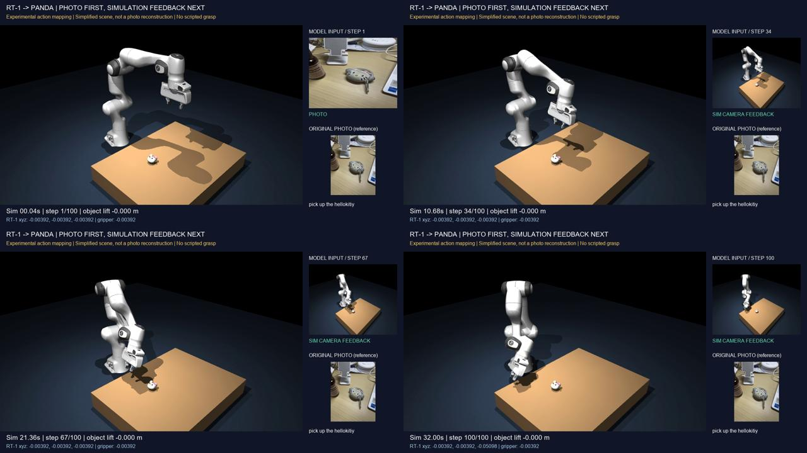

# RT-1：50 步与 100 步闭环仿真对照

实验与归档日期：2026-10-30。**两次均未抓起挂件。增加步数后短暂更接近目标，随后逐渐远离。** 本次归档已有实际运行结果，没有为了上传再次运行模型。

## 视频与证据

| 记录 | 50 步 | 100 步 |
|---|---|---|
| 视频 | [16 秒视频](run-50/rt1_closed_loop.mp4) | [32 秒视频](run-100/rt1_closed_loop.mp4) |
| 关键帧预览 | [四阶段预览](run-50/contact_sheet.jpg) | [四阶段预览](run-100/contact_sheet.jpg) |
| 动作与执行结果 | [inference.json](run-50/inference.json) | [inference.json](run-100/inference.json) |
| 仿真位置与接触 | [telemetry.json](run-50/telemetry.json) | [telemetry.json](run-100/telemetry.json) |
| 输入与动作映射配置 | [config.json](run-50/config.json) | [config.json](run-100/config.json) |
| 全部模型输入及最后一帧 | [policy_inputs](run-50/policy_inputs/) | [policy_inputs](run-100/policy_inputs/) |
| 结果指标 | [metrics.json](run-50/metrics.json) | [metrics.json](run-100/metrics.json) |
| 校验记录 | [verification.json](run-50/verification.json) | [verification.json](run-100/verification.json) |
| 运行日志 | [rt1_worker.log](run-50/rt1_worker.log) | [rt1_worker.log](run-100/rt1_worker.log) |

GitHub 若不直接播放 MP4，可打开视频文件页后下载原文件观看。视频和首帧输入包含用户照片的预览，已按用户追加要求一并归档。

## 实验设置与控制变量

- 模型：官方 `rt1main` SavedModel；语言编码器为本地 USE Large v5，与原始 rt1main 的精确匹配尚未确认。
- 原始指令：`pick up the hellokitiy`，保留拼写。
- 首帧：昨天提供的照片，经 EXIF 方向修正、RGB 转换、缩放到宽 320、高 256；与昨天推理输入的 SHA-256 一致。
- 后续输入：上一动作执行后的干净仿真相机图像。视频上的文字、参考照片和数值面板不反馈给模型。
- 历史：仅第一步使用 FIRST，随后使用 MID 并保留 `result.state`；没有训练或更新模型参数。
- 仿真：MuJoCo 3.3.7、Panda、手工简化挂件外观与盒形碰撞代理。不是照片的精确三维重建。
- 每次预测推进 0.32 秒仿真，视频 1280×720、25 fps；仿真在模型计算期间暂停，不代表实时控制性能。

100 步从同一初始状态重新运行，唯一配置差异为 `requested_steps: 50 → 100`。原始场景 XML 相同，前 50 步的输入哈希、动作、历史计数、映射控制和执行位置逐项一致，最大末端位置差为 0。证据见 [comparison.json](comparison.json)。

## 结果

| 指标 | 50 步 | 100 步 |
|---|---:|---:|
| 视频/仿真时长 | 16 秒 | 32 秒 |
| 抓取成功 | 否 | 否 |
| 最终抓取参考点到物体中心距离 | 18.42 厘米 | 28.56 厘米 |
| 全程最近距离 | 18.42 厘米 | 17.93 厘米 |
| 最近距离所在预测步 | 50 | 57 |
| 任一夹指接触采样帧数 | 0 | 0 |
| 双指接触且抬高超过 5 厘米的帧数 | 0 | 0 |
| 工作范围截断步数 | 0 | 15（第 86～100 步） |

抓取判据为至少一个记录帧中，物体比初始静置高度上升超过 5 厘米且双指接触。两次物体均未抬起；原始最大高度变化约 `-9.9e-8` 米，属于静置沉降量级。距离为抓取参考点到物体刚体中心的欧氏距离，不是夹指表面间隙。接触约每 0.04 秒采样，帧数不是独立试验次数。

100 步运行在第 57 步最近，之后远离目标。第 86 步开始，末端目标触发原有高度下限 0.17 米；该下限未因本次对照改变。新增 50 步没有带来接触或抬升。

## 动作适配限制与结论

这是实际 RT-1 输出驱动的诊断运行，没有脚本抓取序列、失败后的抓取替代、物体瞬移或焊接。逆运动学将模型映射后的末端目标转换为关节目标，低层使用位置执行器与机械臂偏置力补偿。

| 原始字段 | 当前演示映射（未验证与原训练语义一致） |
|---|---|
| `world_vector` | 暂按 Panda 世界轴下米制位移解释，每步向量限长 0.02 米 |
| `rotation_delta` | 暂按世界坐标旋转向量、弧度解释，每步限长 0.10 弧度 |
| `gripper_closedness_action` | 暂按绝对闭合度映射：`255*(1-value)/2` |
| 底座动作 | 固定底座，记录但不执行 |
| `terminate_episode` | 模式语义未核实，记录但不据此终止；使用固定步数 |

末端目标工作范围为 `[0.18,-0.35,0.17]` 到 `[0.70,0.35,0.65]` 米。其他观测补零，原照片与仿真缺少空间标定，机器人形态、动作单位/坐标、夹爪语义、相机和文本编码器适配均有限制。

因此，本次支持的结论是：**在这套固定接入配置下，把 50 步延长到 100 步没有获得抓取成功。** 不能据此断言任意更长运行必然失败，也不能将失败单独归因于步数、模型或某个映射字段。视频/接口校验 PASS 与任务成功是两个独立结论，不能用本次诊断评价 RT-1 论文性能。

学习上新增了：观察闭环反馈与历史传递、控制变量比较、区分模型输出/实际运动/任务成功，以及记录未成功实验。此次为辅助搭建与运行，尚不能记为独立掌握全部源码。下一步优先核查动作坐标、夹爪语义和机器人适配。

## 归档范围与来源

两组视频、输入帧、预览和数值证据已上传；本机绝对路径已改为相对路径或占位符，具体变更见各组 `archive-info.json`。视频、图片、原始动作和仿真数值未修改。文件校验清单见 [artifact-manifest.json](artifact-manifest.json)。

完整可执行仿真工程、虚拟环境、模型网格和权重仍在本地，本目录是结果与运行记录归档。`scene.xml` 中的相对模型路径仅为可移植记录，不表示仓库已包含模型资产。环境版本见 [requirements-lock.txt](requirements-lock.txt)，本地运行脚本指纹见 [local-code-fingerprints.json](local-code-fingerprints.json)。

Panda 来源为 [MuJoCo Menagerie 固定提交](https://github.com/google-deepmind/mujoco_menagerie/tree/f3b6013629c7b94f8ee93fd977b161fa8350f9bc/franka_emika_panda)，模型文件指纹见 [model-manifest.json](model-manifest.json)，原许可证见 [MODEL-LICENSE](MODEL-LICENSE)。未接入或执行真实机器人。
