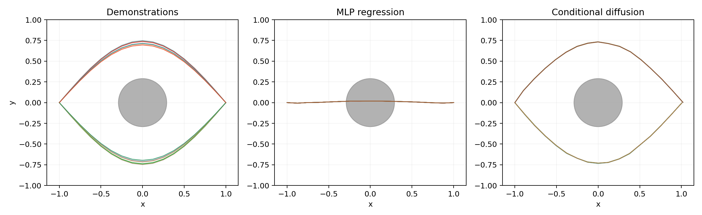

# 随包 Linux CPU 正式样例（seed=42）

来自用户附件 `mini_rdt_cpu_windows.zip!/mini_rdt_cpu/sample_outputs/`；2026-11-07 仅归档，没有重跑这次训练。原说明报告 Linux CPU / PyTorch 2.10.0+cpu，未提供完整 Python 版本、CPU 型号或依赖锁，不能将其标为严格环境复现。

配置：seed=42，MLP=900 步，Diffusion=2400 步，batch=128，train=4000，eval=256 条轨迹（128 个成对场景），sample_steps=30。

| 模型 | 成功率 | 碰撞率 | 到达率 |
|---|---:|---:|---:|
| Expert | 100% | 0% | 100% |
| MLP | 0% | 100% | 100% |
| Conditional diffusion | 100% | 0% | 100% |

[CSV 指标](metrics.csv) · [JSON 配置与指标](metrics.json) · [训练历史](training_history.csv) · [数据图](dataset.png) · [损失图](loss_curves.png)

这是固定合成任务的一次样例，不代表真实机器人表现，也不证明扩散普遍优于回归。源文件的 SHA-256 见[来源清单](../../archive-manifest.json)；权重保留于原附件，也可按[项目说明](../../README.md)重新训练生成。
