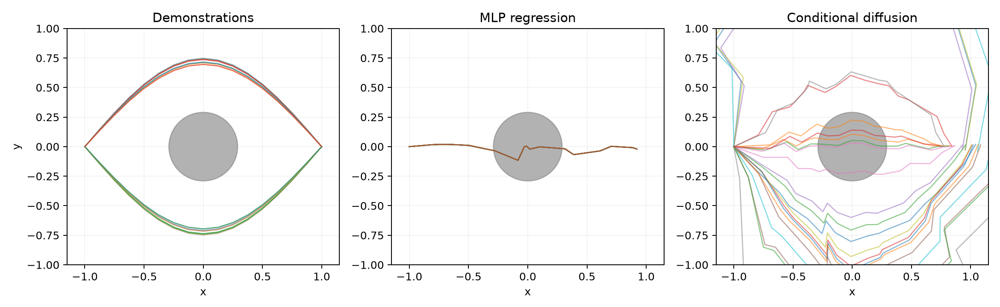

# 2026-11-07 Windows CPU 辅助快速验证

由 Codex 在当前 Windows 电脑执行一次 `--quick`，退出码 0；8 个预期输出全部生成，CSV 与 JSON 指标一致，`pip check` 通过。仅验证程序可运行；本人独立安装、正式训练和科研消融仍待完成确认。

环境：Python 3.11.7（64 位）、PyTorch 2.10.0+cpu、NumPy 2.4.6、Matplotlib 3.11.2；CPU，4 线程。操作系统/处理器信息见 [verification.json](verification.json)。源码保持附件原版，运行时尚未提交，故记录了父提交 `90a84f8`、工作区变更标志与实际源码 SHA-256，以源码哈希确定本次执行内容。

```powershell
# 在 experiments/mini-rdt-cpu 中，使用已安装依赖的 .venv
.\.venv\Scripts\python.exe run_and_record.py --quick --seed 42 --out results/windows_smoke_seed42
# 再次执行时换为全新目录，例如 --out quick_outputs_recheck
```

快速配置：MLP=20 步，Diffusion=40 步，batch=128，train=256 条轨迹，eval=32 条轨迹（16 个成对场景），sample_steps=10。

| 模型 | 成功率 | 碰撞率 | 到达率 |
|---|---:|---:|---:|
| Expert | 100% | 0% | 100% |
| MLP | 0% | 100% | 100% |
| Conditional diffusion | 50% | 28.125% | 65.625% |

[运行日志](run.log) · [环境与输出校验](verification.json) · [依赖锁](requirements-lock.txt) · [CSV](metrics.csv) · [JSON](metrics.json) · [训练历史](training_history.csv) · [数据图](dataset.png) · [损失图](loss_curves.png)



quick 未收敛，图中部分轨迹超出固定绘图范围；这是保留的原始输出，不作质量修饰。数值与随包 Linux quick 不同，不能据此归因于操作系统，更不能用于正式模型效果结论。本次没有运行 900/2400 步正式配置。

在新 Python 3.11 虚拟环境中，先按[项目说明](../../README.md)安装官方 CPU PyTorch 2.10.0，再运行以下命令恢复本次 Python 依赖：

```powershell
.\.venv\Scripts\python.exe -m pip install -r results/windows_smoke_seed42/requirements-lock.txt
.\.venv\Scripts\python.exe -m pip check
```

原始权重保留本机并被 Git 忽略；验证 JSON 记录其哈希，但远端只保留小型结果。重跑能重新生成权重，跨机器数值和文件哈希不保证完全相同。
