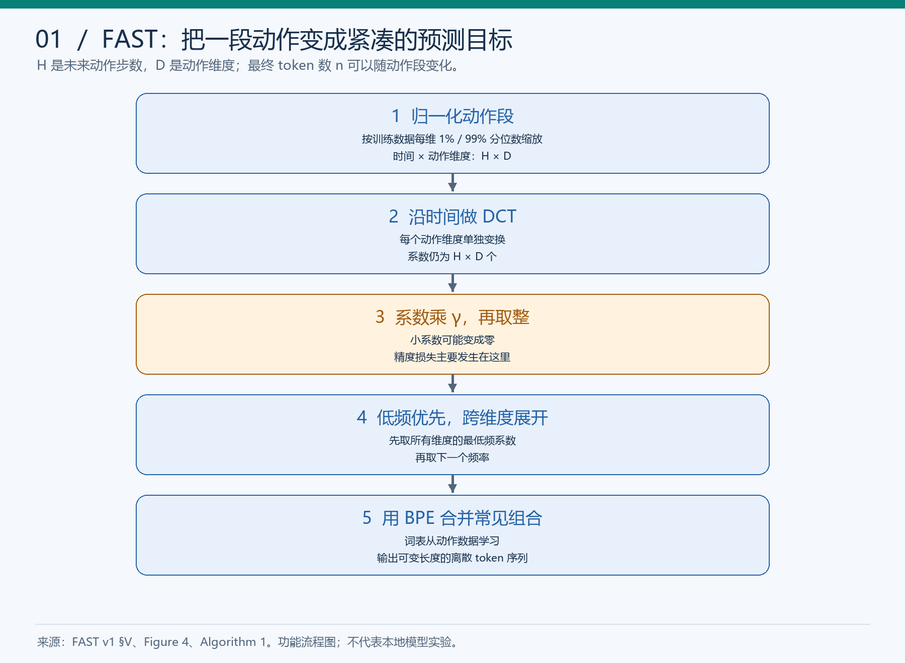
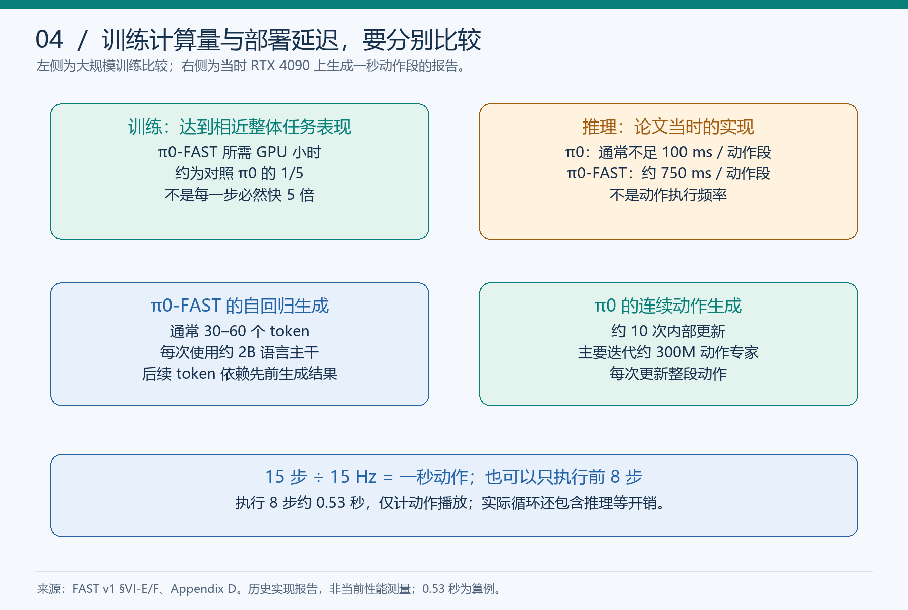

# FAST 快速复习卡

更新：2026-11-10。用于第一轮引导阅读后的复习；以下题目未全部独立通过。

[详细笔记](papers/FAST.md) · [真实回答与纠错](FAST学习进度.md) · [教学运行记录](../experiments/FAST/README.md) · [论文 v1](https://arxiv.org/abs/2501.09747v1)

## 一分钟主线

逐点离散化把高频平滑动作写成长且冗余的 token 序列。FAST 对动作段沿时间做 DCT，再缩放取整、低频优先展开、BPE 合并，让 VLA 学习紧凑的动作标签。FAST+ 是通用 tokenizer，π0-FAST 是使用这种表示的策略。

## 三个步骤，三种作用

| 步骤 | 记住什么 |
|---|---|
| DCT | 换表示，信息集中，全部系数保留时可逆；数量尚未减少 |
| 量化 | q=round(γc)，小系数可能变零，通常引入误差 |
| BPE | 合并常见整数序列，可逆；不额外改变正确系数的重建精度 |

解码顺序：BPE 展开 → 恢复矩阵 → 除以 γ → 逆 DCT → 反归一化。

## 数字必须带条件

| 数字 | 条件与单位 |
|---|---|
| 700→53 | 一秒、14 维、50 Hz 的折衬衫数据，平均 token 数，重建精度可比 |
| 约 100 万 | FAST+ 训练的一秒动作段，不是百万完整任务轨迹 |
| 最高约 5 倍 | 大规模实验达到相近表现所需 GPU 小时，不是每一步或推理快 5 倍 |
| 约 750 ms / 不足 100 ms | 当时 RTX 4090 的 π0-FAST / π0 每动作段推理报告 |
| 15 步 / 8 步 / 15 Hz | DROID 的预测长度 / 一种执行窗口 / 动作频率，8/15≈0.53 秒不含推理开销 |

## 看见这些说法时，核对证据

- token 更少：是否在可比重建精度与词表大小下比较？
- 任务效果更好：纵轴是任务进度还是完整成功率？
- 泛化更好：是新动作数据的编码，还是新场景中的策略执行？
- 主干无关：只验证了哪些主干，是否做了输入和动作段适配？
- DCT 必不可少：有没有替代变换、时域+BPE等适当对照？
- 本地已复现：是教学数值、官方 tokenizer 调用，还是策略训练与环境评估？

## 五分钟闭卷题

先独立写答案，再打开[参考答案](papers/FAST.md#s17)。

1. 采样点增加为什么不保证有效监督信息同比增加？
2. 50 Hz 的动作数据一定具有很大的高频 DCT 系数吗？
3. DCT 是否直接缩短序列？整体 FAST 的误差主要从哪里进入？
4. 去掉 BPE，会改变同一组正确整数系数的重建结果吗？
5. 为什么 BPE token 不固定对应一个物理动作时刻？
6. 编码器在人形数据上压缩良好，能否证明已有策略会控制人形？
7. 训练快与推理慢为什么能同时出现？
8. 旧策略输出后才做 FAST 编码解码，为什么没有训练收益？
9. 完整方法有效，能否立即分清 DCT、BPE、主干各自贡献？
10. 本次 8→3 的数值例子能支持什么，不能支持什么？

## 本人的重点复习项

去 BPE 的题目最初回答“会造成精度损失”；已经讲解，但需闭卷重答。旧模型后处理题的“不能”答对，原因主要谈部署条件，尚需独立说出监督目标未变。对“整体结果无法隔离组件作用”的质疑则是本轮正确的主动判断。

本次模型训练对照只有设计；数值验证由助手运行。不要把看懂示例、读过参考答案记成独立完成。
