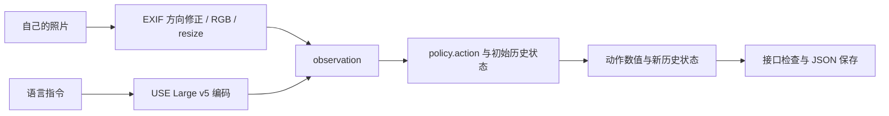

# RT-1 代码学习记录：输入自己的图片与指令

实践日期：2026-10-29；整理入库：2026-10-30。属于辅助运行与学习记录，尚未确认能够独立复现全流程。

## 本次做了什么

使用本机 `rt1/infer.py`、官方 `rt1main` 预训练 SavedModel，以及自己提供的 Hello Kitty 挂件照片，执行一次离线动作预测。指令保留输入原文 `pick up the hellokitiy`，未自动纠正拼写。

与之前合成图像、零语言向量的测试相比，本次实际读取了照片，并用本地 Universal Sentence Encoder Large v5 编码自然语言。程序退出码为 0，输出 `PASS: 1 inference steps`。

## 按代码串起数据流

1. 加载官方策略，读取 observation/action 的规格。
2. 图片先用 `ImageOps.exif_transpose` 按 EXIF 方向旋转，再转 RGB，缩放到模型要求的宽 320、高 256；该缩放会改变原图宽高比。
3. 将指令编码为 512 维语言向量，填入 `natural_language_embedding`。其他未提供的观测补零。
4. 初始化策略历史，构造第一步观测，调用 `policy.action(step, state)`。
5. 读取 `result.action`，验证字段、形状、类型、有限值及规格范围；保留 `result.state`，写入 JSON。

推理过程中更新的是历史状态，没有训练或更新模型权重。本次只有一张图片、一个动作输出，尚未形成“执行动作—拍摄新图像—再次预测”的闭环。

## 实际结果

证据见 [脱敏后的数值摘要](../rt1/outputs/2026-10-29-real-input/summary.json)。环境为 Windows CPU、Python 3.11.7、TensorFlow 2.15.0。策略加载 22.744 秒，单次 `policy.action` 调用 0.5183 秒；后者不含文本编码与加载时间，不能当成完整控制周期的耗时。

| 字段 | 输出 |
|---|---|
| `world_vector` | `[-0.0039215088, -0.0039215088, -0.0039215088]` |
| `rotation_delta` | `[-0.0061599016, -0.0061599016, -0.0061599016]` |
| `gripper_closedness_action` | `[-0.0039215088]` |
| `base_displacement_vector` | `[-0.0039215088, -0.0039215088]` |
| `base_displacement_vertical_rotation` | `[-0.0123198032]` |
| `terminate_episode` | `[0, 1, 0]` |

表格为便于阅读的小数近似，JSON 保留原值。状态计数 `step_num=[1]`、`t=[1]`。

## 这次可以得出什么结论

已跑通“自带图片＋实际文本编码→官方策略→动作数值”的接口，修正了手机图片 EXIF 方向处理。不能仅凭数值输出判断模型识别了 Hello Kitty、理解了该指令或能够抓取成功，也不能直接把数值解释为厘米或发送给任意机器人。

文本编码器来自 [USE Large v5](https://tfhub.dev/google/universal-sentence-encoder-large/5)。本地保存的官方 RT-1-X 示例来源显示使用了它，但这不证明它与原始 `rt1main` 训练时的编码器完全一致；该匹配关系尚未验证。照片场景、视角、其他观测补零和初始历史也限制了结果的解释。

接近零的输出不能单独证明成功或失败。当前没有真实机器人执行、闭环仿真评估、训练收敛或任务成功率证据。

## 代码学习进度与下一步

- 已学过推理主线、动作编码；本次实践补充图片预处理、语言编码、输出保存及其限制。
- FiLM 零初始化仍待通过问答确认理解；TokenLearner、Transformer、掩码、训练链路继续按原顺序学习。
- 下一步先能够自己复跑并说明每个输入字段的来源，再核查编码器匹配、机器人动作坐标与控制接口。

原始照片、输入预览、完整日志、模型权重保留本地。按用户要求，仿真视频演示及真实机器人相关准备也在本地维护，不纳入本次仓库提交。
