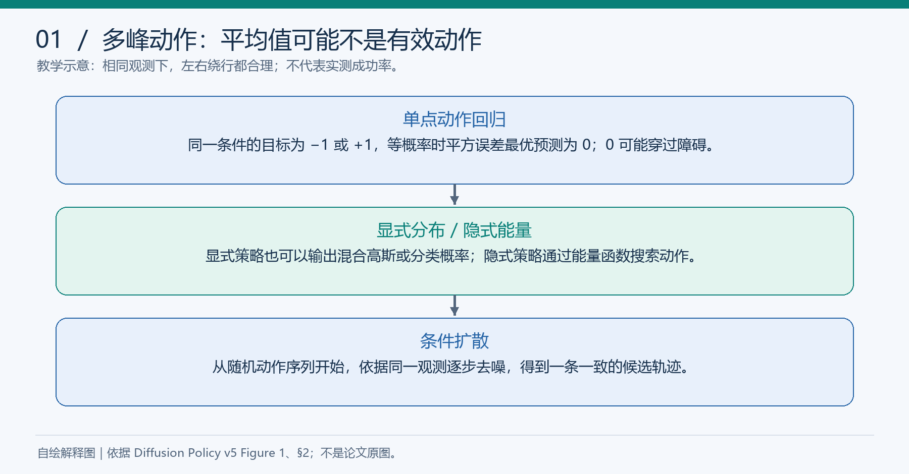
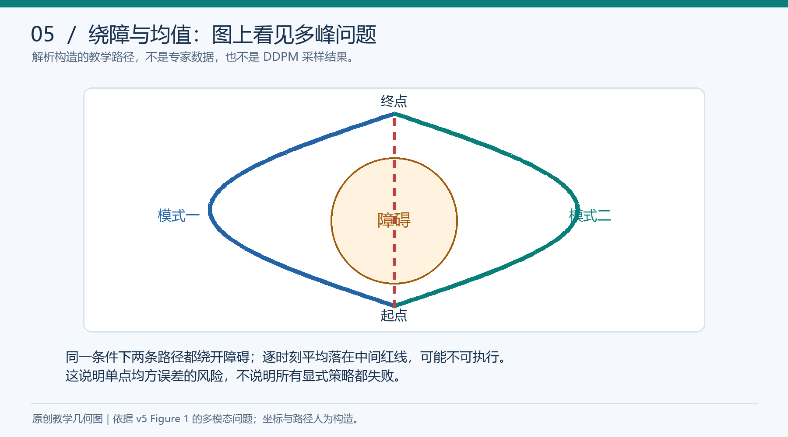
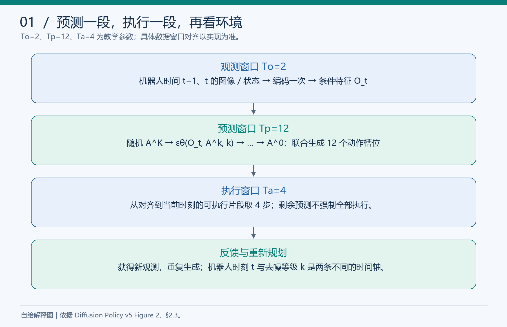
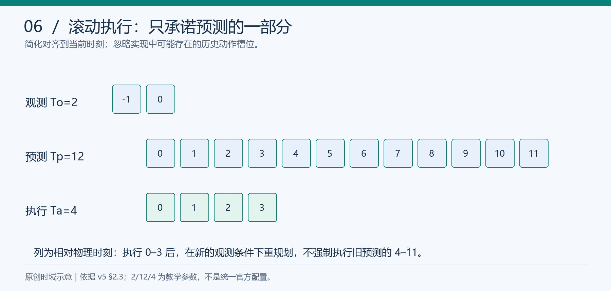
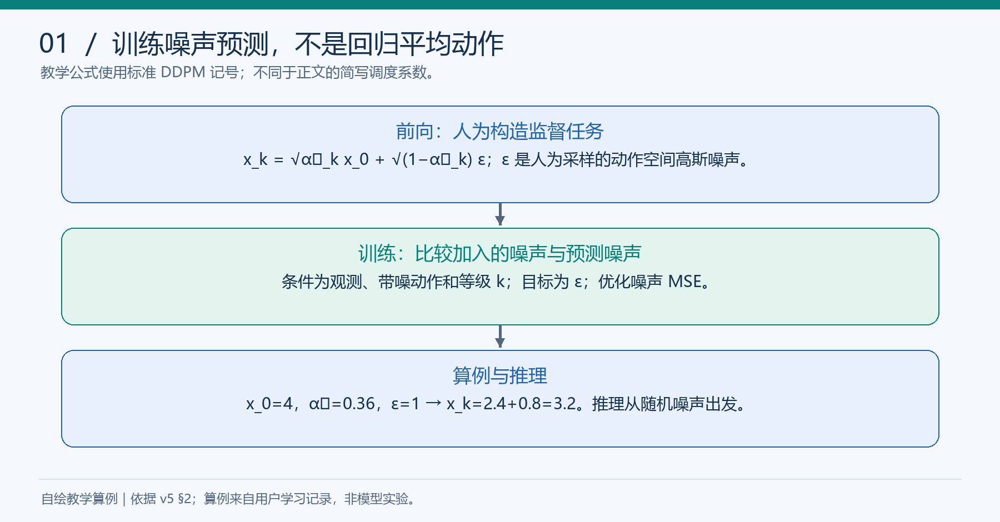
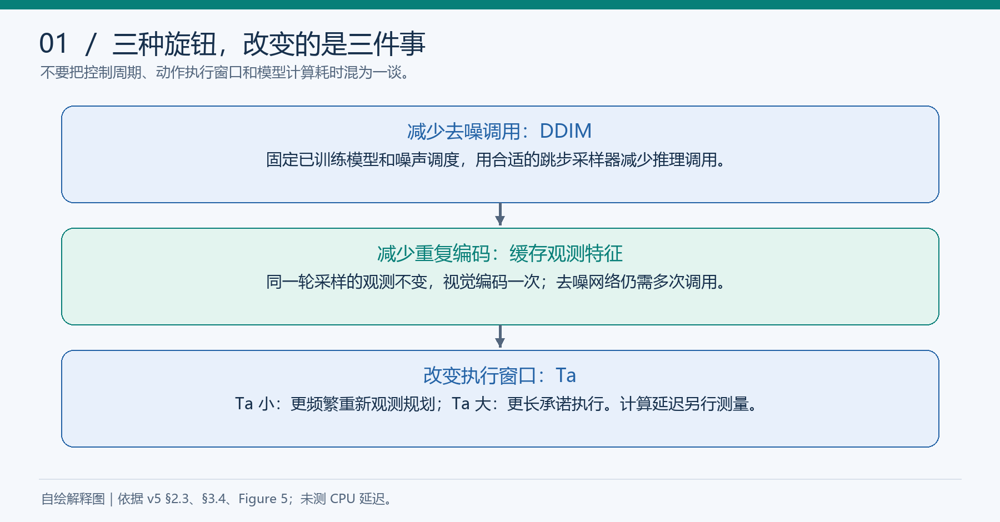

# Diffusion Policy：用条件扩散生成一致的动作序列

> 阅读中：已引导学习至第七讲；第五讲补救未完成，第六讲未独立考核。归档日期：2026-11-20。助手依据用户记录整理，新增解释不视为用户作答；未进行官方模型复现。

固定版本：[arXiv v5（2024-03-14）](https://arxiv.org/abs/2303.04137v5) · [PDF](https://arxiv.org/pdf/2303.04137v5) · [HTML](https://arxiv.org/html/2303.04137v5) · [官方代码](https://github.com/real-stanford/diffusion_policy)。以下页码为该 PDF 的 1 起始页码。

[七讲作答与进度](../Diffusion-Policy学习进度.md) · [原有实验入口](../../experiments/Diffusion-Policy/README.md) · [跨论文对照与研究计划](Diffusion-Policy与pi0.5对照与研究计划.md) · [图源](../../assets/diffusion-policy/README.md)

## 1. 研究问题：为什么平均动作可能不可执行？

定位：Figure 1，p.1；§1–2。输入为观测历史，输出为条件动作序列分布；重点是动作生成与控制，不是大型语言模型语义理解。

**教学推导：** 同一观测下，示范动作等概率取 −1、+1，确定性预测 z 的期望平方误差是 `0.5(z+1)²+0.5(z−1)²=z²+1`，最小值在 0。若两个模式是左右绕障，均值可能穿过障碍。这依赖“同一条件、单点输出、平方损失”的假设。显式混合高斯或分类策略也能表达多模态，不能一概否定显式策略。

此处多模态是动作分布的多个高密度模式，与“图像+语言”输入模态不同。扩散能表达多种动作，不保证采样轨迹满足碰撞、动力学与任务成功约束。

| 六要素 | 阅读结论 |
|---|---|
| 研究问题 | 连续、高维、多峰且有时序关联的动作建模 |
| 方法 | 观测条件 DDPM 生成动作块 |
| 改进点 | 序列生成、视觉条件、滚动执行及两种去噪骨干 |
| 实现原理 | 学习噪声预测，通过调度和迭代采样生成动作 |
| 效果来源 | 原文对照和消融，不等于本仓库复现 |
| 后续启示 | 同时评价分布表达、反馈及时性和推理成本 |

## 2. 从观测到闭环执行

定位：Figure 2，p.2；§2.3、§3.1–3.2。

图像编码与机器人状态等构成条件 `O_t`，去噪网络读取 `O_t`、带噪动作块与等级 k，输出同形状噪声预测。`To` 是观测历史长度，`Tp` 是预测动作长度，`Ta` 是重规划前执行长度。教学例 `To=2,Tp=12,Ta=4` 不代表所有任务配置；实际执行须按数据窗口对齐当前时刻，而非无条件取预测块开头。

| 去噪网络 | 条件注入 | 边界 |
|---|---|---|
| 时间 1D CNN | FiLM | 与视觉编码器不同，可能倾向平滑快速变化信号 |
| 时间序列 Transformer | 观测 cross-attention、动作侧因果遮蔽 | 仍是扩散网络，不是自回归输出最终动作的语言模型 |

原文采用改造的 ResNet-18，包含 spatial softmax 与 GroupNorm。同一轮观测不变，视觉特征可复用；执行后得到新观测再规划。

## 3. 公式：两种 MSE 与两条时间轴

定位：§2，Equations (1)–(5)，p.3。下式以标准 DDPM 记号作教学展开：

$$
\bar\alpha_k=\prod_{i=1}^{k}(1-\beta_i),\quad A_t^k=\sqrt{\bar\alpha_k}A_t^0+\sqrt{1-\bar\alpha_k}\epsilon,\quad\epsilon\sim\mathcal N(0,I).
$$

$$
\mathcal L_{noise}=\mathbb E\left[\|\epsilon-\epsilon_\theta(O_t,A_t^k,k)\|_2^2\right].
$$

`t` 为机器人时刻，`k` 为噪声等级；`A_t^0` 为干净动作块，`β_i` 为前向调度。此处 `ᾱ_k` 不等于正文式 (1)/(4) 的简写 α。噪声 MSE 与直接动作 MSE 的标签、条件、推理过程都不同，所以“扩散也使用 MSE”不矛盾。

训练六步：取示范窗口 → 采样 k → 采样 ε → 构造带噪动作 → 预测 ε → 反传。推理没有真实未来动作，从高斯动作块出发，不要求恢复某条指定示范。

| 原文公式 | 含义 | 易错点 |
|---|---|---|
| (1) | 无条件迭代去噪，含 α、γ、σ | 系数随 k 调度，简写不是完整实现 |
| (2) | 能量梯度下降的解释 | 不是说模型训练只做动作搜索 |
| (3) | 无条件噪声 MSE | 加性简写与标准缩放公式需区分 |
| (4) | 观测条件动作块采样 | 同一轮 O_t 固定 |
| (5) | 条件噪声 MSE | 人工动作噪声不等于真实传感器噪声 |

用户算对的例子：`x0=4, ᾱ=.36, ε=1`，信号项 2.4、噪声项 .8，总和 3.2。算题正确是理解证据，不是训练证据。

## 4. 一致性、响应与计算成本

定位：§3.4、§4.3；Figure 5，p.5。

逐步独立抽取不同模式可能导致左右切换，联合生成序列有助于短期一致性；单步策略并非必然抖动。Ta 大意味着较长时间不重规划，Ta 小意味着更频繁反馈。约 8 步的经验不是普适最优。

DDIM 减少去噪调用；缓存减少视觉编码调用；Ta 调整执行窗口。教学成本模型为 `一次编码耗时 + K×一次去噪耗时 + 其他开销`，不是已测延迟。训练等级与推理调用可通过合适采样器分开，不能任意删除 DDPM 步骤。论文 GPU 速度不能当成本机 CPU 速度。

## 5. 结果精读：先识别指标，再读数字

定位：[PDF pp.7–8](https://arxiv.org/pdf/2303.04137v5#page=7)，Tables 1–4、§5.2–5.3。下列为核对原表后的作者结果，不是本仓库重跑。

| 对照 | CNN（C） | Transformer（T） | 定量比较 |
|---|---:|---:|---|
| Table 1，State Push-T | .95 / .91 | .95 / .79 | 最佳相同；后期平均覆盖度差 .12 |
| Table 2，Visual ToolHang | .95 / .73 | .76 / .47 | C 最佳高 19 个百分点，后期平均高 26 个百分点 |
| Table 4，BlockPush p2 | .11 | .94 | T 的两块完成频率高 83 个百分点 |

`.91−.79=.12` 是 12 个百分点，相对提高为 `.12/.79≈15.2%`。不同例子说明架构优劣依赖任务和观测，不能从单任务宣布全面获胜。

### Tables 1、2：checkpoint 与指标

斜线表示最大表现 / 最后十个 checkpoint 平均表现，不是训练 / 测试，也不是均值 / 标准差。Push-T 使用目标区域覆盖度，其他多数任务使用成功率，表题不能代替逐任务定义。

**评估脚注：** §5.2 通常采用 3 个训练种子、50 个环境初始状态、最后 10 个 checkpoint；p.7 脚注披露 robomimic 因代码问题实际只用了 22 个初始状态。作者称基线同样评估，不改变结论。本次未重跑验证此判断；共同设置有助于比较，但样本覆盖与不确定性仍需审视。

### Table 3：任务清单，不是成绩榜

p.7 列机器人、物体、动作维度、示范数、步数上限、图像输入与高精度需求。示范数不是评估试验数，步数上限不是推理耗时；ph/mh 的示范者设置也应保持一致。

### Table 4：阶段完成频率

BlockPush p2 是两块都推入目标；Kitchen px 是与至少 x 个对象交互。两个任务的 p2 不能直接合并排名。结果支持特定设置中的能力，不保证任意家庭成功率。

### Figures 4、5、6：不同证据问题

| 图与页码 | 条件 / 坐标 | 证据边界 | 下一步验证 |
|---|---|---|---|
| Figure 4，p.5 | Square、Kitchen p4 与不同方法；纵轴为速度改位置控制的相对表现变化 | 主比较为各方法选择较好动作空间，变化不止生成机制；此图不是绝对成功率 | 固定动作空间、编码器、数据、预算 |
| Figure 5，p.5 | 左 Ta（步），右 Latency（步）；纵为相对最佳表现差 | 左右变量不同；延迟从最后观测到首个可执行动作 | 固定 To/Tp、采样器与硬件分别消融 |
| Figure 6，p.6 | 随训练变化的误差与评估表现 | 能量损失、动作误差、环境表现不能互换 | 多种子、统一 checkpoint 选择和外部评估 |

摘要及 §5.3 的 **46.9%** 是作者报告的模拟基准平均改善（Tables 1、2、4），不是成功率或统一百分点提升。本次未逐项复算聚合公式、基线选择和权重，保留作者口径，不当作独立验证总效应。

## 6. 局限与科研问题

贡献是把动作分布、序列一致性和滚动控制组织起来，不只是换网络。结构分析提示：迭代有成本，固定时域有反馈折中，示范覆盖限制分布外表现，扩散不自带碰撞安全保证。

**待验证假设：** 固定模型减少采样调用，失效来自模式丢失还是终点精度下降？动态 Ta 能否在相同计算预算下改善突发扰动？见[研究计划](Diffusion-Policy与pi0.5对照与研究计划.md)。

优先完成第五讲补救及第六讲无提示复述。附件提及 CPU ZIP 和历史数值，但本次两份记录不含原代码及 metrics.json，因此没有把转述数字列为已核验本地结果。
