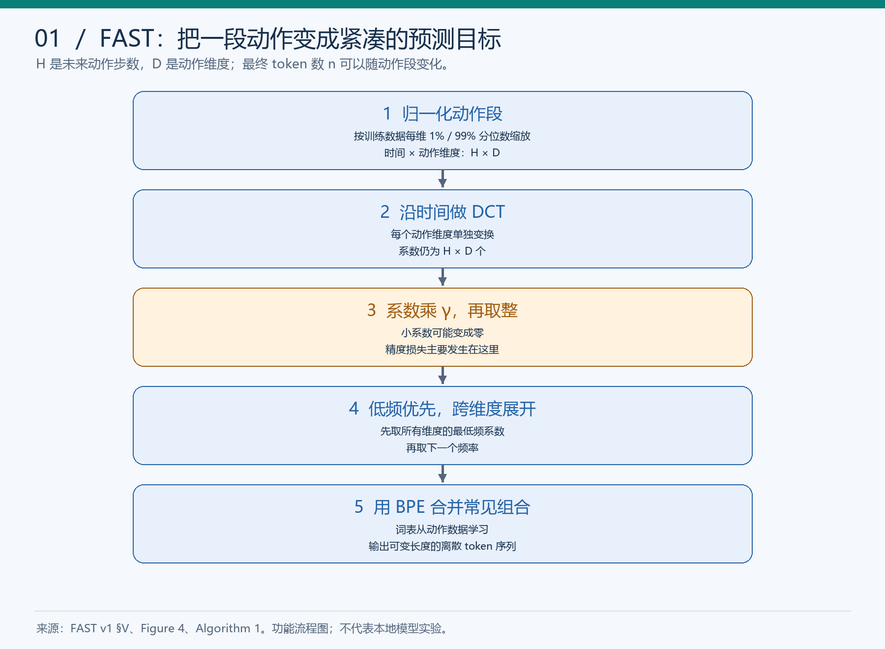
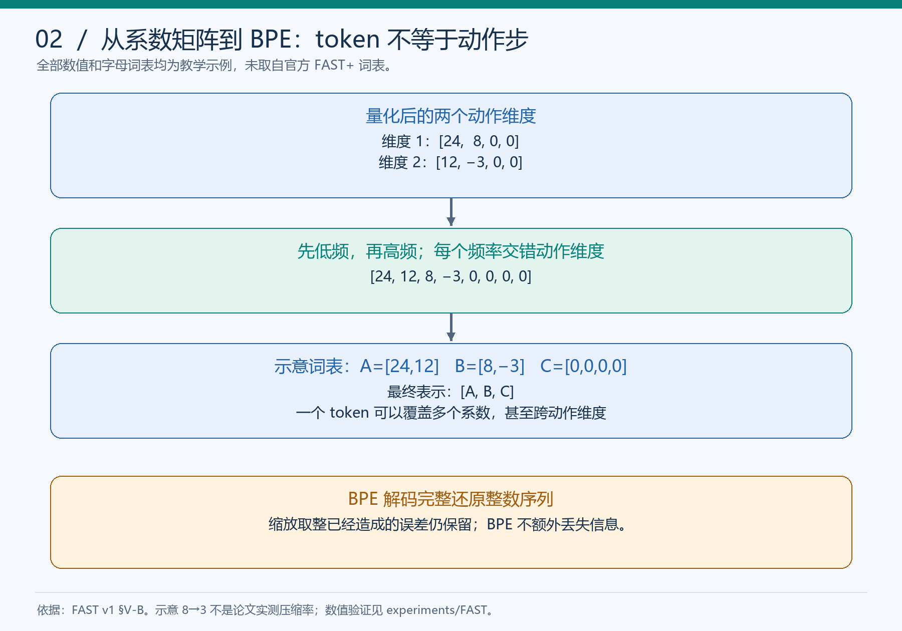
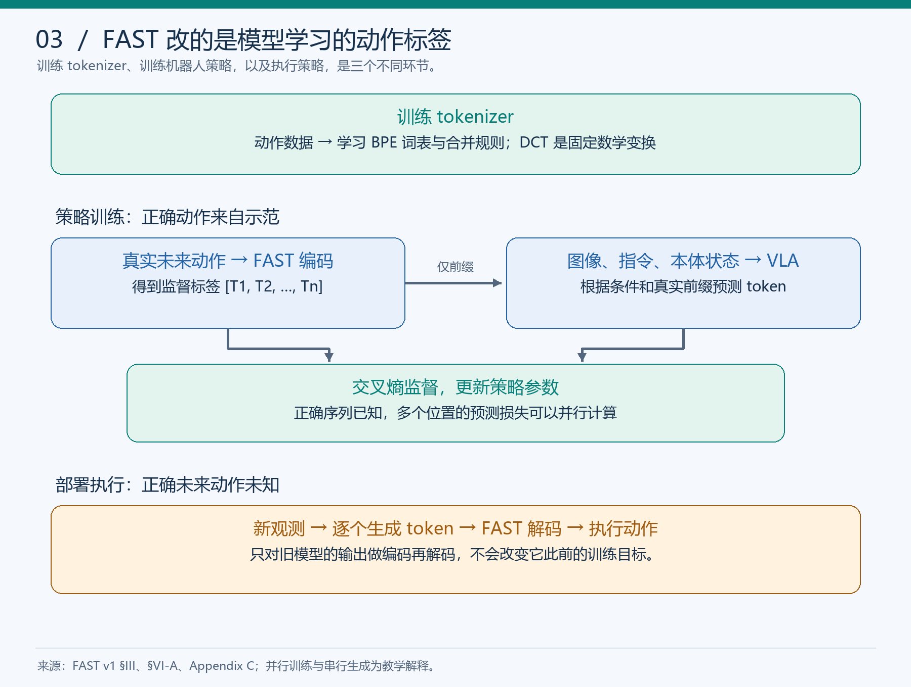
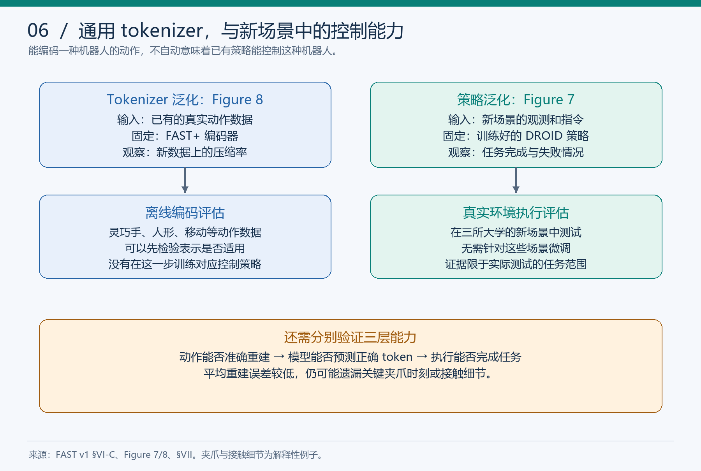
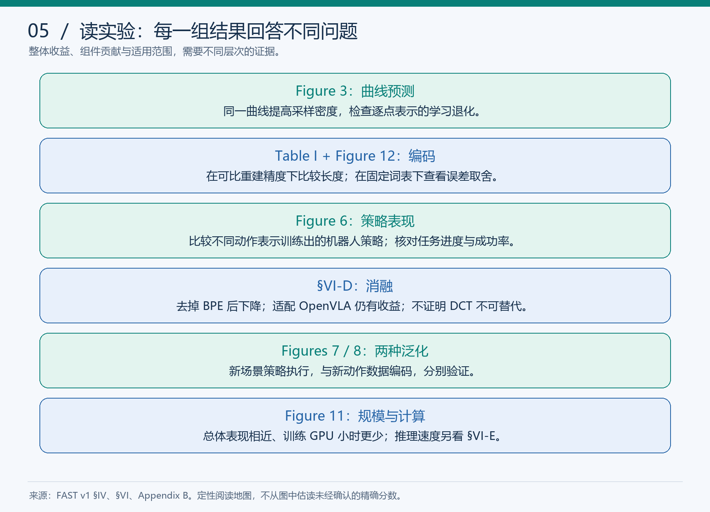
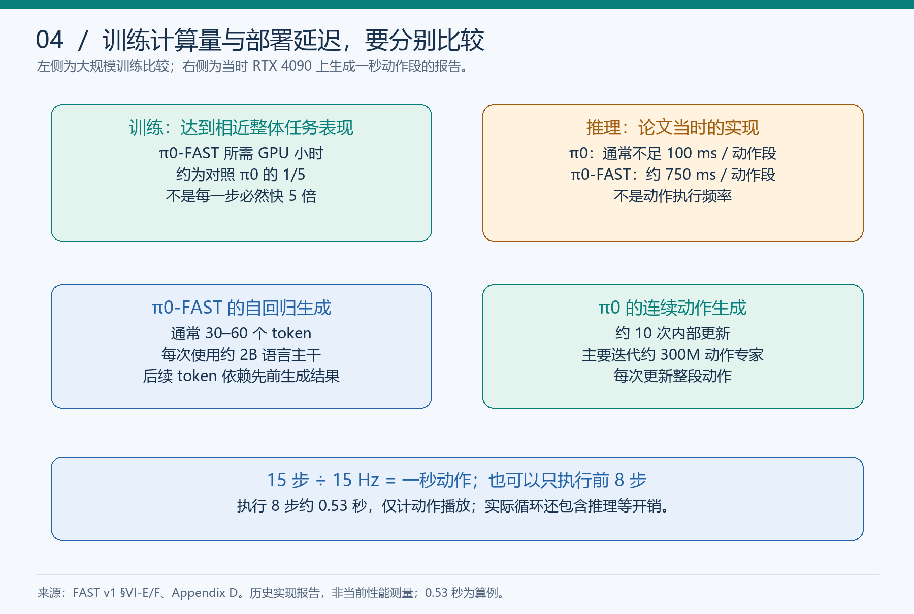

# FAST 图文学习笔记：从动作离散化到频域序列压缩

> **已读完：完成一轮正文主线、主要实验和关键附录的引导阅读。** 归档：2026-11-10（北京时间）。已开展部分问答与纠错；没有完成整篇独立复述、延迟自测或官方模型复现。
>
> 论文：*FAST: Efficient Action Tokenization for Vision-Language-Action Models*，Karl Pertsch、Kyle Stachowicz 等，Physical Intelligence / UC Berkeley / Stanford。以本地 19 页 PDF 对应的 **arXiv:2501.09747v1，2025-01-16** 为准；下文页码均指此版本。
>
> [原文 v1](https://arxiv.org/abs/2501.09747v1) · [PDF v1](https://arxiv.org/pdf/2501.09747v1) · [作者项目页](https://www.pi.website/research/fast) · [学习进度与实际回答](../FAST学习进度.md) · [快速复习卡](../FAST复习卡.md) · [教学验证](../../experiments/FAST/README.md) · [当日记录](../../weekly/2026-11-10.md#fast)

**使用方式：先看一页速览，再按图复述，最后合上答案自测。** 六张图是依据原文与教学例子原创绘制的示意图。论文结果、助手执行的数值验证、学习者回答和未执行的实验设计分别标注；不把整理笔记或生成图片计为模型实验。

## 导航

| 复习目标 | 入口 |
|---|---|
| 三分钟找回主线 | [1. 一页速览](#s1) |
| 理解高频采样为什么可能更难学 | [2. 问题与 Figure 3](#s2) |
| 掌握符号、归一化和 DCT | [3. 符号与归一化](#s3) · [4. DCT](#s4) |
| 区分取整误差与 BPE 压缩 | [5. 量化](#s5) · [6. 展开与 BPE](#s6) |
| 看清训练目标和执行流程 | [7. 训练与推理](#s7) |
| 区分 FAST / FAST+ / π0-FAST | [8. 通用 tokenizer 与泛化](#s8) |
| 按证据读实验和消融 | [9. 主要实验](#s9) · [10. 消融边界](#s10) |
| 分清训练快、推理快和控制频率 | [11. 效率与时序](#s11) |
| 理解重建误差及实现配方 | [12. 压缩与重建](#s12) · [13. 附录实现细节](#s13) |
| 查看实际算过的例子 | [14. 数值验证](#s14) |
| 回看个人易错点与研究设计 | [15. 问答纠错](#s15) · [16. 未执行的训练对照](#s16) |
| 闭卷复习和查原文 | [17. 自测答案](#s17) · [18. 来源与范围](#s18) |

<a id="s1"></a>
## 1. 一页速览

**一句话：FAST 将未来动作段转为频域系数，再量化并通过 BPE 压缩，让自回归 VLA 学习更紧凑的动作监督目标。**

| 问题 | 核心回答 |
|---|---|
| 研究对象 | 连续动作段如何变成适合自回归预测的离散 token |
| 原有瓶颈 | 逐时刻、逐维度分箱产生长且冗余的序列，高频平滑动作尤其明显 |
| 方法 | 归一化 → 沿时间 DCT → 缩放取整 → 低频优先展开 → BPE |
| 训练目标 | 给定观测、语言、状态与前缀，预测下一个动作 token |
| 主要可学习部分 | tokenizer 中学习 BPE 词表和合并规则；机器人策略另行训练 |
| FAST+ | 在约 100 万个一秒动作段上训练的通用 tokenizer |
| π0-FAST | 使用这种表示、自回归生成动作的机器人策略 |
| 主要证据 | 可比精度下更短的表示、高频任务学习改善、跨主干验证和大规模训练效率 |
| 关键局限 | 表示通常有损；当时自回归推理较慢；编码泛化与策略泛化须分开验证 |

FAST 全称 **Frequency-space Action Sequence Tokenization**。DCT 和 BPE 本身是已有技术；论文的贡献包括面向动作的组合方式、学习瓶颈分析、通用 tokenizer 和机器人实验验证。

与前序论文的连接：RT-1 帮助理解逐维动作离散化；OpenVLA 帮助理解 VLM 的动作预测训练；π0 帮助比较连续动作生成与自回归生成。本文数字以 FAST v1 中的比较设置为准，不混入后续 π0 版本的新结果。

<a id="s2"></a>
## 2. 高频动作为什么可能更难学：Figure 3

### 2.1 长度与冗余是两个问题

设一段动作有 H 个时间步、每步 D 维。逐维逐时刻用一个 token 编码时，长度为 H×D。双臂 14 维、50 Hz、一秒动作段就有 700 个 token；这是高频动作段示例，不是 RT-1 原模型的具体配置。

平滑动作在密集采样时相邻数值接近，分箱后可能重复。用一维教学例子说明：

```text
真实 token：41 41 41 42 42 42 43 43
复制式生成：41 41 41 41 41 41 41 41
```

训练时依赖真实前缀，可以在大量位置靠局部重复获得正确预测；自行生成时却可能偏离全局变化。多维交错序列里，“复制”应理解为相应维度的历史值，不机械等同于复制紧邻的另一个维度。

### 2.2 作者怎样简化问题？

随机生成 4 个条件点，以经过这些点的三次样条为目标。小型自回归 Transformer 根据条件点预测曲线；把同一类曲线从每条 25 个采样点加密到 800 个点，底层任务分布不变。

Figure 3 上图：普通分箱的预测误差随采样密度上升而明显增加，DCT 表示保持较低误差。下图：普通表示在密集采样时可退化为近似水平线，而 DCT 表示的预测更贴近目标。

作者用相邻 token 的条件新增信息解释这种退化。这是特定任务、模型与训练设置下的实验及机制解释，不能写成所有自回归模型在高频数据上必然失败的定理。

### 2.3 本轮回答的精确化

学习者回答：“增加的是采样点……并不代表模型有更多的监督信息。”方向正确。精确表述是：**监督标签的数量增加，但新增的非重复信息不一定增加很多。** 不能说新增采样点完全不是监督，也不能泛化为提高采样密度永远没有价值。

来源：§III–IV、Figure 3，第 3–4 页。

<a id="s3"></a>
## 3. 符号、形状与归一化



| 符号 | 含义 | 易混点 |
|---|---|---|
| H | 动作段的未来时间步数 | 不等于最终 token 数 |
| D | 每个时刻的动作维度 | 不等于相机数量或机器人关节数的固定常量 |
| n | FAST 输出 token 数 | 相同 H、D 的不同动作段也可能不同 |
| V | 词表 | 词表大小与一次输出长度是两件事 |
| γ | DCT 系数量化前的缩放因子 | 不表示控制频率 |
| f | 每秒动作执行步数，Hz | 不等于每秒重新调用 VLA 的次数 |

动作段可写为 A∈R^(H×D)。FAST 定义动作段到离散序列的映射：

$$
\mathcal T(A)=[T_1,\ldots,T_n],\qquad
\hat A=\mathcal T^{-1}([T_1,\ldots,T_n]).
$$

逆向解码得到的是重建动作，量化后通常不等于原动作。

论文把训练数据每个动作维度的第 1、99 百分位映射到 −1、1。线性缩放可用下面的教学写法理解：

$$
x'=2\frac{x-q_{0.01}}{q_{0.99}-q_{0.01}}-1.
$$

它减少极端值对尺度的影响，也方便处理不同动作单位。仅凭这个公式不能保证所有离群值都在 [−1,1]；是否裁剪、常量维度怎样处理，属于实现时需核对的细节，本轮未审计官方代码。

来源：§III、§V-B，第 3–5 页。

<a id="s4"></a>
## 4. DCT：把时间曲线改写为频率系数

### 4.1 直觉与两个“频率”

DCT 用不同频率的余弦分量表示一段时间序列。低频分量描述整体形状，高频分量描述较快变化；平滑动作的信息常集中在较少系数中。

**数据以 50 Hz 采样**描述每秒取多少个点；**DCT 中的高频分量**描述曲线变化快慢。高采样率下记录的动作完全可以很平滑，不能把两个“高频”混为一谈。

### 4.2 本次数值验证采用的数学约定

教学脚本使用正交归一化 DCT-II。对一个维度的 H 个样本：

$$
c_k=\alpha_k\sum_{t=0}^{H-1}x_t\cos\left[\frac{\pi}{H}(t+\tfrac12)k\right],
\quad \alpha_0=\sqrt{1/H},\quad \alpha_{k>0}=\sqrt{2/H}.
$$

矩阵写成 C=QA，则逆变换为 A=QᵀC。这是用于说明和验证的明确约定；论文 Algorithm 1 以 DCT 抽象算子表示，本文不据此声称已核对官方处理器的全部默认参数。

例如 [1,1,1,1] → [2,0,0,0]：恒定分量承载这段不变的数值，其他变化分量为零。2 来自归一化约定。

### 4.3 DCT 做到什么、尚未做到什么？

- 保留全部系数时变换可逆，数值实现只存在浮点误差。
- 变换前 H 个数，变换后仍是 H 个系数；没有直接缩短序列。
- 信息集中有利于后续量化压缩；不保证所有动作都同样稀疏。
- 重要的快速变化也可以由高频系数表示；FAST 不固定删除全部高频分量。

来源：§V-A/B，第 4–5 页。完整正交 DCT 公式是本次教学补充，尚未由学习者独立推导。

<a id="s5"></a>
## 5. 量化：误差从哪里进入？

$$
q_k=\operatorname{round}(\gamma c_k),\qquad
\hat c_k=q_k/\gamma.
$$

教学算例：

```text
c             = [2.36, 0.82, 0.04, -0.03]
γ=10，乘 γ    = [23.6, 8.2, 0.4, -0.3]
取整 q        = [24, 8, 0, 0]
解码系数 q/γ  = [2.4, 0.8, 0, 0]
```

原来的小数细节已无法从整数中恢复。整体 FAST 通常是有损表示，损失主要来自系数量化。

| γ 的变化 | 通常的影响 |
|---|---|
| 增大 | 量化网格更细，保留更多细节，往往更难压缩 |
| 减小 | 更多小系数变零，通常更易压缩，但重建误差增大 |

“通常”不表示对任意有限样本、任意 BPE 词表都严格单调。零系数数量本身也不能决定重建误差或最终 token 数。

论文单数据集实验采用相同超参数：缩放取整的 scale=10、BPE 词表大小 1024。不同应用仍应评估精度与压缩取舍，不能把这些数当作普适最优配置。

来源：§V-B、Algorithm 1，第 4–5 页。

<a id="s6"></a>
## 6. 展开顺序与 BPE



### 6.1 先频率，后动作维度

对每个动作维度沿时间做 DCT、量化后，按下面的顺序展开：

```text
维度 1：24   8  0  0
维度 2：12  -3  0  0

展开：[24, 12, 8, -3, 0, 0, 0, 0]
       最低频  下一频率   …    …
```

先预测所有维度的最低频分量，再预测较高频分量。论文报告，这种先描述整体形状的顺序比先完整展开单个动作维度更稳定。矩阵画成 H×D 或 D×H 会改变“行/列”的叫法，因此应记住语义顺序，而非机械记忆按行展开。

### 6.2 BPE 学习的是常见相邻组合

BPE 反复统计相邻符号对，把高频组合合并为新符号。最终 token 可以代表多个量化系数，可能跨动作维度，也不固定对应某个物理时间步。

示意词表 A=[24,12]、B=[8,−3]、C=[0,0,0,0]，可把上述 8 个整数表示为 [A,B,C]。这只是解释合并的人工例子；实际验证中学习出的四条规则见[数值验证](#s14)。

### 6.3 去掉 BPE 会怎样？

对同一组正确的量化系数，用不用 BPE，解码出的动作相同。BPE 不额外改变重建精度，也不恢复取整时丢失的小数。

但不用 BPE 时，模型仍需预测大量零和重复组合：训练监督更冗余，自回归生成步骤更多。论文消融中，去掉 BPE 后策略表现下降，仍优于普通离散化。

必须区分：**编码本身的重建误差**，以及**模型预测错 token 造成的误差**。BPE 保持前者不变，却可能通过改变学习问题影响后者。

来源：§V-B、Figure 4、§VI-D，第 5、9 页。

<a id="s7"></a>
## 7. 训练 tokenizer、训练策略、执行策略



训练 tokenizer 使用动作数据学习 BPE 词表；DCT 是固定变换，缩放因子是超参数。训练策略则要根据图像、指令和本体状态决定动作。

真实示范动作经 FAST 编码为 T₁…Tₙ。标准自回归训练可写成：

$$
\mathcal L(\theta)=-\sum_{i=1}^{n}\log p_\theta(T_i\mid o,\ell,s,T_{<i}).
$$

这里 o 表示图像等观测，ℓ 为语言，s 为本体状态；实现中也可把它们统一记为观测条件。损失求和的归一化细节不是本轮审计对象。

| 阶段 | 已知什么？ | 网络做什么？ |
|---|---|---|
| 训练 | 条件和正确未来动作 token | 用真实前缀监督预测，更新参数 |
| 推理 | 当前条件；未知未来正确动作 | 自回归生成 token，解码并执行 |

训练时正确序列已知，因果掩码允许多个预测位置并行计算损失；推理时后一个 token 依赖前面已经生成的 token。不能把自回归推理的串行次数直接当作训练阶段运行次数。

论文在 VLM 词表中用动作 token 替换较少使用的 token，并微调整个策略，不冻结权重。多数实验使用基于 PaliGemma-3B 的 π0 主干，也验证基于 Prismatic 7B 的 OpenVLA。

### 接入旧模型时的关键变化

需要使用新动作表示制作标签，再让策略学习这些标签。仅对旧模型已输出的动作进行 FAST 编码再解码，不改变它此前的监督目标，也不会减少它原本的生成步骤。即使假设后处理完全无损且零耗时，也无法获得论文所说的训练收益。

来源：§III、§VI-A，第 3、6 页；教师强制与后处理反例为课堂解释。

<a id="s8"></a>
## 8. FAST+：编码泛化与策略泛化



| 名称 | 准确含义 |
|---|---|
| FAST | 一种动作序列编码方法；实验中可针对数据集训练 BPE |
| FAST+ | 约 100 万个一秒动作段上训练的通用 tokenizer |
| π0-FAST | 使用 FAST 表示进行自回归动作预测的策略模型 |

百万数据单位在正文 §V-C 中具体为一秒动作段，不应与 OXE 的百万完整 episode 直接比较。训练混合覆盖单臂、双臂、移动操作、关节和末端动作空间以及不同控制频率；附录 A 还说明训练混合中将动作填充到 32 维。这是该训练配方的预处理记录，不能据此推断方法只支持 32 维。

### Figure 8：固定编码器测试新动作数据

输入是已经记录好的动作，考察压缩能力，涉及单臂、灵巧手、人形、移动等数据。作者说明这些评估数据集未参与 tokenizer 训练。它是离线表示测试，不能直接证明已有策略能控制这些新身体。

### Figure 6：通用编码器能否替代数据集专用编码器

FAST+ 的策略训练结果与各数据集单独训练的 FAST 整体接近。需注意，FAST+ 的训练混合包含本文真实机器人评估任务的数据来源，所以不能把 Figure 6 的所有任务称为“对 tokenizer 完全未见”。不要由此推断具体评估试验泄漏；论文描述的是训练数据混合的任务覆盖。

### Figure 7：固定 DROID 策略测试新场景

同一检查点在 Berkeley、Stanford、University of Washington 的新场景中执行桌面操作，不针对这些场景微调。这里检验策略能否根据新观测与指令生成有效动作，也报告了失败案例。

作者在 §VII 明确表示，移动机器人、灵巧手和人形的离线压缩结果有前景，实际策略性能仍需进一步测试。

来源：§V-C、§VI-B/C、§VII、Appendix A/Table III，第 5–9、11、16、19 页。

<a id="s9"></a>
## 9. 主要实验证据：先看指标，再看结论



### 9.1 Table I：可比重建精度下的 token 数

统一采用一秒动作段：

| 数据 | 维度 | 频率 | 普通离散化 | FAST 平均 token 数 | 原文压缩比 |
|---|---:|---:|---:|---:|---:|
| BridgeV2 | 7 | 5 Hz | 35 | 20 | 1.75 |
| DROID | 7 | 15 Hz | 105 | 29 | 3.6 |
| Table Bussing | 7 | 20 Hz | 140 | 28 | 5.0 |
| T-Shirt Folding | 14 | 50 Hz | 700 | 53 | 13.2 |

13.2 是 token 数之比，不是速度倍数。表中采用可比 tokenization error 的配置；如果只追求极少 token 而忽略动作失真，比较没有意义。

### 9.2 Figure 6：压缩是否改善策略表现？

比较 Naive、FSQ、FAST、FAST+。FSQ 是额外学习的压缩表示基线；FAST 的 tokenizer 不需要另训神经编码器—解码器。

在本文高频清桌和折衬衫设置下，Naive 几乎无法推进任务；FAST/FAST+ 能学到有效行为。FSQ 也带来改进，说明有益的动作压缩并不只存在于 DCT 这条路线。

**纵轴不同：LIBERO、折衬衫看成功率；DROID、清桌看任务进度。** 原文图注报告均值与 95% CI；本笔记不将所有柱高称作成功率，不从低清图估读精确小数，也不把所有小差异当作统计显著。

### 9.3 Figure 9：单任务下与连续 π0 比较

小数据集 LIBERO、折衬衫上整体表现可比；较大清桌数据上 FAST 收敛更快，原文报告达到较高表现需要约少 3 倍训练步数。DROID 中作者观察到 FAST 变体更遵循语言，完整机制研究留作后续，不能直接推成所有自回归架构都更懂语言。

### 9.4 Figure 11：扩展到通用策略

使用 π0 的跨机器人数据混合，包含作者数据约 903M 个时间步；训练混合的 9.1% 来自 Bridge V2、DROID、OXE 等公开数据。不要把时间步、动作段、完整轨迹和数据小时当作同一单位。

π0-FAST 在折衬衫、清桌、装购物袋、取吐司、整理衣物上与 π0 的整体表现接近，各任务有强弱。达到该总体表现的训练 GPU 小时约少 5 倍；不能写成每个任务都更好。论文另给计算预算匹配的比较，支持其更快收敛。

来源：§VI、Table I、Figures 6/9/11，第 6–10 页。

<a id="s10"></a>
## 10. 消融：哪些因素有贡献，哪些仍未分清？

学习者主动指出：“从这个结果来看看不出来，效果究竟依赖 DCT、BPE，还是某个特定的模型主干。”这一判断成立：整套方法的有效性，不等于组件因果贡献已分离。

| 对照 | 结果 | 支持的结论 | 尚不能推出 |
|---|---|---|---|
| 适配后的 OpenVLA：普通表示 vs FAST+ | 折衬衫明显改善 | 收益不局限于 π0 | 任意主干都有效 |
| 完整 FAST vs 去掉 BPE | 去掉后下降，仍优于 Naive | DCT 配套表示已有收益，BPE 有额外作用 | 精确分配 DCT/BPE 的收益比例 |
| FSQ vs Naive / FAST | 压缩基线也有收益，精细任务上 FAST 更好 | 压缩目标的一般价值 | DCT 不可替代、FSQ 永远较差 |

OpenVLA 被改为多图像输入和一秒动作段输出；不能误写成完全未改的原始 OpenVLA 部署比较。

本轮提出但**未执行**的补充对照：

| 表示 | 不使用 BPE | 使用 BPE |
|---|---|---|
| 时域逐点数值 | 普通离散化 | 直接对时域离散动作做 BPE |
| DCT 频域系数 | FAST 去掉 BPE | 完整 FAST |

比较时需控制重建精度、模型、数据、词表与训练预算，并记录真实计算量。§VI-D 没有提供这套完整四组合；去 BPE 还同时改变序列长度、学习问题与推理成本，不能从一组最终任务分数完全拆开这些机制。

来源：§VI-D，第 9 页；四组合表是课堂研究设计。

<a id="s11"></a>
## 11. 训练效率、推理延迟与执行时序



### 11.1 “5 倍”到底是什么？

大规模实验中，接受评估的 π0-FAST 使用约五分之一的 GPU 小时达到相近整体任务表现。GPU 小时可粗略记作设备数×运行小时；设备型号等设置仍影响可比性。

不能由 token 压缩比推导训练加速比，也不能把五分之一总训练计算写为单次迭代固定快五倍。教师强制允许并行计算损失，解释了训练与推理的计算过程不同；它本身不是“必然 5 倍”的证明。

### 11.2 当时实现中的推理比较

| 模型 | 一秒动作段的生成耗时 | 主要计算 |
|---|---|---|
| 连续 π0 | 通常不足 100 ms | 约 10 次更新，主要迭代约 300M 动作专家 |
| π0-FAST | 约 750 ms | 约 30–60 次 token 生成，使用约 2B 语言主干 |

这是 FAST v1 在 RTX 4090 上报告的实现性能，不是本机测量或最新优化结果。两种方法的每步网络大小也不同，不能只数“10 次 vs 30 次”就算准确速度比。

### 11.3 DROID 的执行窗口

15 Hz 下预测 15 步，对应一秒动作；推理时执行 8 或 15 步，再使用新观测。执行 8 步的纯动作时间为 8/15≈0.53 秒，实际循环还包含推理等开销。

```text
读取观测 → 预测 15 步 → 执行前 8 步 → 新观测 → 再预测
```

动作段之间有观测反馈，段内由 VLA 开环执行；底层关节控制器仍可有自己的反馈。动作执行频率、图像采集频率、策略重规划频率、token 生成速度是不同概念。

作者报告静态操作任务中未观察到该推理延迟损害表现，但高度动态任务仍需进一步验证。

来源：§VI-E/F、§VII、Appendix D，第 9–11、17 页。

<a id="s12"></a>
## 12. 附录 B：压缩率与重建质量

Figure 12 在六个数据集上改变各 tokenizer 的压缩配置，同时固定词表大小。横轴为 token 数，纵轴为重建误差，采用对数刻度。

| 图例 | 改变的配置或含义 |
|---|---|
| FAST 绿色曲线 | 量化缩放因子 |
| FSQ 黄色曲线 | 潜在 token 数 |
| 蓝色曲线 | 普通离散化的时间下采样程度 |
| 黑色星号 | 固定配置 FAST+ |
| 黑色圆点 | 不进行时间下采样的普通离散化 |

固定误差看横向，比较谁需要更少 token；固定 token 数看纵向，比较谁还原更准。低保真、极少 token 区域，FSQ 等方法可能更有效；要求高保真时，FAST 随 token 增加能继续明显降低误差。不能总结为所有预算下 FAST 都占优。

### 不把教学指标误写成原文明确公式

原文此处图注仅标 Reconstruction Error，没有展开具体误差公式、归一化和聚合细节。本轮用常见的 MSE 解释概念，并在自己的数值验证中明确定义：

$$
\mathrm{MSE}(A,\hat A)=\frac{1}{HD}\sum_{t,d}(A_{t,d}-\hat A_{t,d})^2.
$$

本轮未通过官方评估代码确认 Figure 12 是否完全使用这一口径，不能把这个教学公式直接署名为该图精确实现。

### 三层能力

1. 真实动作编码再解码：测试表示的重建能力。
2. 模型从条件自行生成 token：测试预测能力。
3. 把预测动作放进环境执行：测试控制能力。

平均重建误差小仍可能遗漏关键夹爪时刻；模型也可能生成错误动作。夹爪例子是解释性情境，不是这里报告的具体失败试验。

来源：Appendix B、Figure 12，第 16 页。

<a id="s13"></a>
## 13. 附录 C、D：实现配方与复现边界

| 项目 | 论文记录 |
|---|---|
| 图像 | 按任务使用 2/3 视角，外部相机+各机械臂腕部相机，224×224 |
| 图像编码 | 每张分别经过预训练视觉编码器，再拼接 token |
| 语言与状态 | 语言 tokenizer；本体状态先分成 256 桶，再把整数作为文本输入 |
| 优化 | 1k 步线性 warm-up，之后学习率 5e−5；AdamW β₁=0.9、β₂=0.95，无 weight decay |
| 其他训练配置 | 梯度裁剪 1，EMA 权重 0.999 |
| 解码 | 通常 greedy；部分双臂任务用温度 0.7，帮助离开数据中的静止初始状态 |

简单分箱用于状态输入，与长动作输出序列的自回归预测问题不同。作者认为状态输入用简单分箱已足够；不要推广成“所有连续输入也必须 FAST”。

DROID 额外配方：

- 两个外部视角中训练时随机取一个，再加腕部图像；三条语言标注中随机取一条。
- 不使用相机标定信息。
- 动作空间为关节速度与夹爪绝对位置，不可误执行为关节绝对角度。
- 选择约 75k 条标记成功的 episode，过滤全零空闲动作。
- 预测 15 步，执行 8 或 15 步。
- 作者报告训练 3 epochs / 240k iterations / batch 256，3B VLA 在 8×H100 上约 4 天。

以上为作者设置，不是本次运行成本。本文系统表现还依赖数据与训练配方；未分别消融的做法不能凭描述定量归因。

来源：Appendix C/D，第 16–17 页。

<a id="s14"></a>
## 14. 已运行的辅助数值验证

**来源：本轮由助手在本机执行，归档时保存脚本并重新运行。** 只验证 DCT、量化、简化整数符号 BPE 与重建；没有加载官方 FAST+，没有训练 Transformer 或执行机器人。

[运行说明](../../experiments/FAST/README.md) · [脚本](../../experiments/FAST/tokenizer_demo.py) · [实际 JSON](../../experiments/FAST/results/2026-11-10_tokenizer_demo.json)

先选定系数 [0.8,−0.6,0.12,0,0.06,0,0,0]，通过逆 DCT 构造 8 步一维动作。显示值四舍五入为：

```text
[0.0653, 0.0351, 0.0720, 0.1901, 0.3072, 0.4053, 0.5340, 0.6537]
```

正向/逆向 DCT 最大误差约 10⁻¹⁵，属于浮点误差。量化结果：

| γ | 整数系数 | 零数 | 动作 MSE |
|---:|---|---:|---:|
| 2 | [2,−1,0,0,0,0,0,0] | 6 | 0.0085 |
| 10 | [8,−6,1,0,1,0,0,0] | 4 | 0.00025 |
| 100 | [80,−60,12,0,6,0,0,0] | 4 | 0 |

γ=100 无误差是因为刻意选取的系数恰好落在量化网格上；不是 FAST 在真实动作上无损的证据。

小型 BPE 在 16 条人为构造、共享后缀的整数序列上学习四次合并。待编码示例本身在这组数据中，不是测试集泛化评估：

```text
A = [1,0]
B = [A,A] = [1,0,1,0]
C = [B,0] = [1,0,1,0,0]
D = [C,0] = [1,0,1,0,0,0]

[8,-6,1,0,1,0,0,0] → [表示8的token, 表示−6的token, D]
长度：8 → 6 → 5 → 4 → 3
```

BPE 解码精确还原所有整数；γ=10 的动作 MSE 仍为 0.00025。该例说明量化与 BPE 的不同职责，不支持任何真实数据压缩率、策略学习提升或推理加速结论。

<a id="s15"></a>
## 15. 本轮真实问答、纠错与掌握程度

| 问题 | 学习者实际表现 | 本轮整理应怎样记录 |
|---|---|---|
| 增密采样是否带来更多有效监督？ | 指出增加采样点不代表更多监督信息 | 方向正确；补充“标签更多、非重复信息未必更多” |
| 去掉 BPE 为什么有问题？ | 回答“会造成精度损失？我不太清楚” | 解释量化有损、BPE 可逆；随后表示明白，未再独立作答 |
| 整体结果能否区分 DCT/BPE/主干？ | 主动指出看不出来 | 正确识别因果证据不足；已学习实际消融和边界 |
| 旧模型只在部署后编码解码是否有效？ | 结论“不能”，理由主要谈精度与实时性 | 结论正确，核心理由需补充“监督目标和原生成过程未改变” |

最后一题经讲解补充后没有再次独立复述，不能记录为已通过该原因辨析。多次“明白了、继续”只记录为即时自述理解，不等于闭卷掌握。

助手在问答末尾曾使用“已经区分开了”等肯定表述；归档按实际回答证据收紧，不据此虚构整篇独立复述、全部自测通过或完整代码能力。

详细原话与待巩固事项见[学习进度](../FAST学习进度.md)。

<a id="s16"></a>
## 16. 下一层训练对照：已讨论，未执行

研究问题：更紧凑的表示，是否让同样规模的模型用更少计算学会同一条曲线？

1. 固定由四个条件点生成的训练/测试曲线，使用 25、100、400 等采样密度；这里是教学设计，不是声称复现论文全部配置。
2. 制作逐点离散标签与 FAST 标签，尽量匹配重建精度；BPE 只使用训练集拟合。
3. 控制主干规模、输入、数据划分与训练设置，记录词表和序列长度的差异。
4. 测试时从条件自行生成完整序列，不能只在真实前缀下计算一步预测表现。
5. 还原到共同动作空间、统一比较网格，记录预测误差、训练步数、实际计算时间和生成延迟；同样步数不等于同样计算量。
6. 使用多个随机种子，分别比较相同计算预算的质量，以及达到目标质量所需的计算。

两种 tokenizer 的原始交叉熵不能单独决定谁更会控制，因为符号含义、序列长度和冗余程度都不同。若只有编码短、重建准，只证明编码效果；若自行生成的测试曲线更准且训练计算更少，才支持学习效率收益；机器人控制还需环境中的任务验证。

本方案尚未创建训练工程、运行 Transformer 或得到训练曲线，不能把计划中的参数与结论写为实测。

<a id="s17"></a>
## 17. 闭卷自测与可展开答案

以下题目用于后续独立复习，**不代表已经全部答过**。

<details>
<summary>1. 为什么采样点更多，模型反而可能更难学？</summary>

同一平滑信号采样更密时，相邻值更接近，逐点分箱产生长且重复的序列。局部复制容易，整体变化未必学好。新增标签数量与新增非重复信息不同；这是本文条件下的实验解释，不是普适失败定理。
</details>

<details>
<summary>2. 50 Hz 采样与 DCT 高频系数有什么区别？</summary>

前者是每秒记录/执行多少个动作点；后者刻画一段信号里的快速变化。密集采样可以记录非常平滑的信号。
</details>

<details>
<summary>3. DCT 会直接把 700 个数变成 53 个数吗？</summary>

不会。DCT 保留系数数量；量化使一些小系数变零，BPE 才把重复结构编码成较短的 token 序列。53 是 Table I 中特定数据和配置的平均 token 数。
</details>

<details>
<summary>4. c=0.04、γ=10，量化与还原各是多少？</summary>

0.04×10=0.4，取整为 0，除以 10 仍为 0。信息在取整时丢失；后续 BPE 不能恢复 0.04。
</details>

<details>
<summary>5. 去掉 BPE 会增加编码本身的重建误差吗？</summary>

对同一组正确整数系数不会。BPE 可逆。但序列更长更冗余，模型学习、生成成本与最终策略表现可能变差。
</details>

<details>
<summary>6. FAST+ 在人形动作数据上压缩良好，能说明什么？</summary>

支持该 tokenizer 的离线编码适用性；不直接证明已有策略能控制人形机器人。需另做策略训练与执行评估。
</details>

<details>
<summary>7. “最高 5 倍”与“约 750 ms”是否矛盾？</summary>

不矛盾。前者是大规模训练达到相近任务表现所需 GPU 小时的比较；后者是当时实现生成一个动作段的推理延迟，衡量阶段不同。
</details>

<details>
<summary>8. 15 Hz、预测 15 步、执行 8 步，怎样理解？</summary>

预测窗口一秒，实际播放前 8 步约 0.53 秒后再观测与重规划；实际循环还受推理等延迟影响。15 和 8 都不是 BPE token 数。
</details>

<details>
<summary>9. OpenVLA 消融证明 FAST 与所有主干无关吗？</summary>

它支持收益不局限于 π0。该 OpenVLA 还适配了多图像和一秒动作段；不能泛化到所有架构，也不能由此证明 DCT 不可替代。
</details>

<details>
<summary>10. 为什么 Figure 12 中误差更低，仍需机器人任务评估？</summary>

编码实验输入正确示范；策略必须从观测生成正确动作。平均误差也可能掩盖少数关键时刻的差异，因此需测试自行生成与实际任务表现。
</details>

<details>
<summary>11. 给旧模型输出套上 FAST 编码解码，为什么不会获得训练收益？</summary>

监督目标和旧模型的生成过程都没有改变，原训练计算已经发生。需在新表示上训练策略；重建精度和实时性是另外需要评估的部署条件。
</details>

<details>
<summary>12. 本次到底运行了什么，哪些仍没有证据？</summary>

助手运行了单维合成动作的 DCT、量化、简化 BPE 与重建，并保存数值；生成了文档与图解。没有运行官方 FAST+、VLA 训练/推理、机器人评估或训练收益对照，学习者尚未独立复现。
</details>

<a id="s18"></a>
## 18. 原文定位、当前范围与续学

| 内容 | v1 PDF 位置 |
|---|---|
| 问题、动作段与分箱 | 第 1–4 页，§I/III/IV |
| 曲线预测 | 第 3–4 页，Figure 3 |
| 算法 | 第 4–6 页，§V、Figure 4、Algorithm 1 |
| 实验设置与压缩表 | 第 6–7 页，§VI-A/B、Table I |
| 任务表现与泛化 | 第 8–9 页，Figures 6/7/8 |
| 消融与连续 π0 比较 | 第 9 页，§VI-D/E、Figure 9 |
| 大规模训练 | 第 10 页，§VI-F、Figure 11 |
| 局限与未来工作 | 第 10–11 页，§VII |
| 数据混合、重建和训练 | 第 16 页，Appendix A/B/C、Figure 12 |
| DROID 与任务细则 | 第 17–18 页，Appendix D/E |
| tokenizer 泛化数据清单 | 第 19 页，Table III |

原始 PDF 保留本地，不上传仓库。主线、主要实验与关键附录已引导阅读；没有逐项独立掌握全部附录、统计细节与官方实现。第 17–18 页全部评分细则及计算预算匹配的补充图还可进一步逐项核查，不能把本轮记为所有材料无遗漏的逐字精读。

下次优先：闭卷复述量化/BPE区别、两个泛化层面、后处理无训练收益的原因；之后按研究需要开展受控训练实验，另行记录环境、随机种子和实测结果。

## 历史辅助整理（保留原文）

以下为 2026-10-15 总结、2026-10-25 归档时的辅助笔记。当时状态为待读；当前状态以上方正文及独立学习进度为准。

### 原标题：FAST——问题可能出在动作的“写法”

阅读状态：待读；已有辅助整理笔记，尚无独立精读完成或复现实验证据。

[原文 / 项目页](https://www.pi.website/research/fast) · [完整比较笔记](../../研/13篇文献详细总结_基础知识与方法对比_2026-10-15.md)

来源：2026-10-15 本地文献总结的第 3.8 节；2026-10-25 整理上传，未新增论文实验。


**论文问题。** 高频动作序列每一步变化很小。逐维、逐时刻离散，会制造大量冗余 token，让自回归模型容易学会复制相邻值，却不容易学到真正的轨迹结构。

例如双臂 14 维动作，每秒 50 步，一秒就有 `14×50=700` 个数。如果每个数都独立变成 token，输出非常长。

**具体改进。** FAST 全称 Frequency-space Action Sequence Tokenization，处理过程为：

```text
连续动作段
  → 按动作维度归一化
  → 每个维度沿时间做离散余弦变换 DCT
  → 缩放并取整，得到稀疏频域系数
  → 按低频优先、交错动作维度的次序展开
  → 用 BPE 合并常见系数组合
  → 更短的动作 token 序列
```

**直观理解。** 与其逐时刻说“手在这里、稍微前一点、再前一点”，不如用几个系数概括一段轨迹的主要变化形状，再补必要细节。DCT 可表示低频趋势与高频变化，不等于固定丢掉全部高频信号。

**有损和无损要分开。** DCT 变换本身可逆；系数量化会引入误差；BPE 对量化后的离散序列做无损压缩。因此整个 FAST 流程一般是有损表示，不能因为 BPE 无损就说机器人动作被完全无损压缩。

**FAST、FAST+、π0-FAST 的区别。** FAST 是方法；FAST+ 是在约 100 万个一秒动作段上训练的通用 tokenizer；π0-FAST 是使用这种动作表示进行自回归动作预测的策略。这里的百万数据单位是动作段，不能与 OXE 的百万完整轨迹直接相加或比较。

**证据。** 第 7 页 Table I，在一秒动作段、可比重建精度下：

| 数据 | 原始逐维逐步 token 数 | FAST 平均 token 数 | 压缩比 |
|---|---:|---:|---:|
| BridgeV2，7 维，5 Hz | 35 | 20 | 1.75 倍 |
| DROID，7 维，15 Hz | 105 | 29 | 3.6 倍 |
| 清桌，7 维，20 Hz | 140 | 28 | 5.0 倍 |
| 折衬衫，14 维，50 Hz | 700 | 53 | 13.2 倍 |

第 9 页消融显示，去掉 BPE 后表现下降；把 FAST 应用于改造为多图像、动作段输出的 OpenVLA，也能改善高频任务训练。因此贡献主要在表示方法，不局限于一种主干。

**“训练快”不等于“推理快”。** 第 10 页报告通用 π0-FAST 达到相近任务表现所用 GPU 小时可约少 5 倍；第 9 页同时报告，当时实现中自回归 FAST 每动作段约 750 ms，而连续 π0 通常不足 100 ms。前者解码 30–60 个 token 需多次运行较大的语言主干，后者主要迭代较小动作专家。

**研究意义。** 大模型训练失败不一定说明网络不够大，也可能是监督目标表示得不好。这是很适合入门者学习的科研思路：先设计一个简单可控的信号预测实验，把原因讲清楚，再去机器人任务验证。

**定位。** 高频失败案例：第 3–4 页、Figure 3；算法：第 4–6 页、Figure 4、Algorithm 1；对比及局限：第 7–10 页；重建误差：第 16 页。
