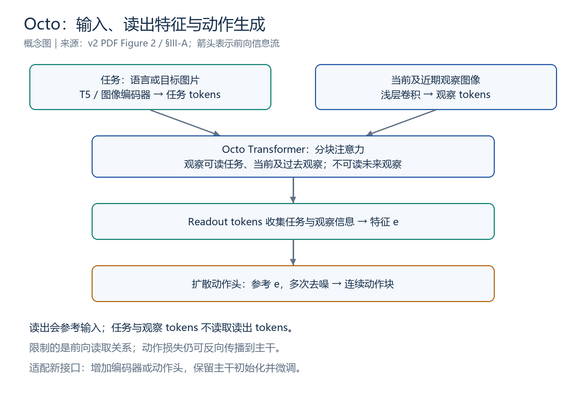
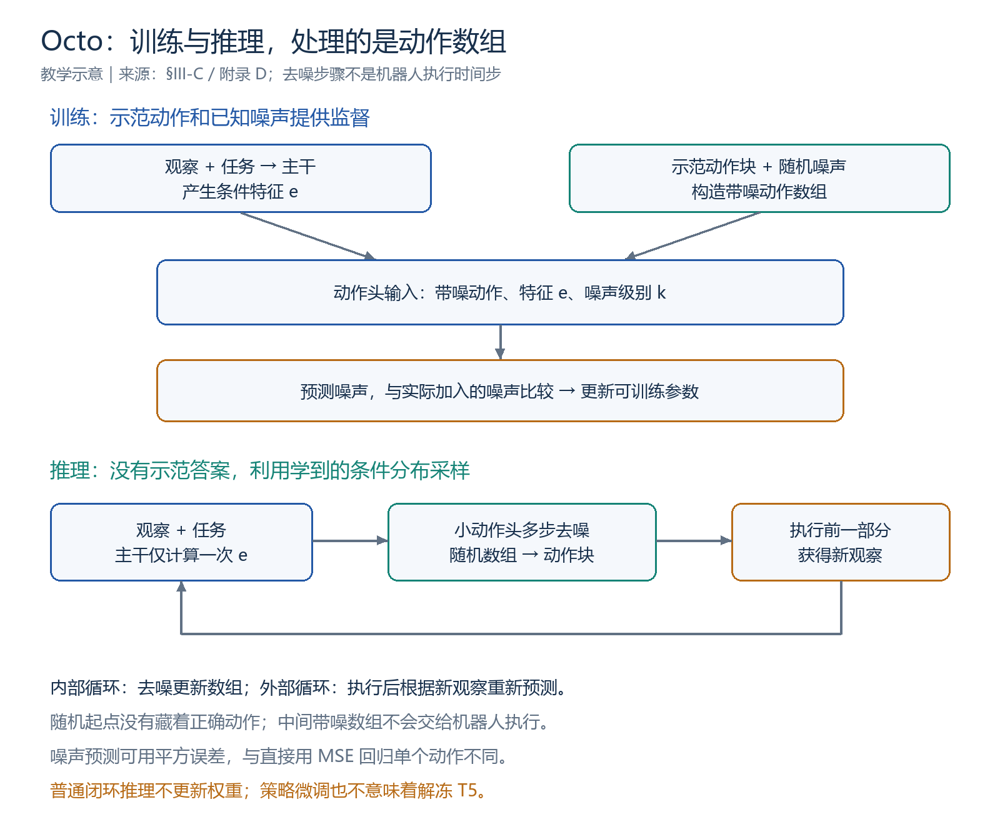
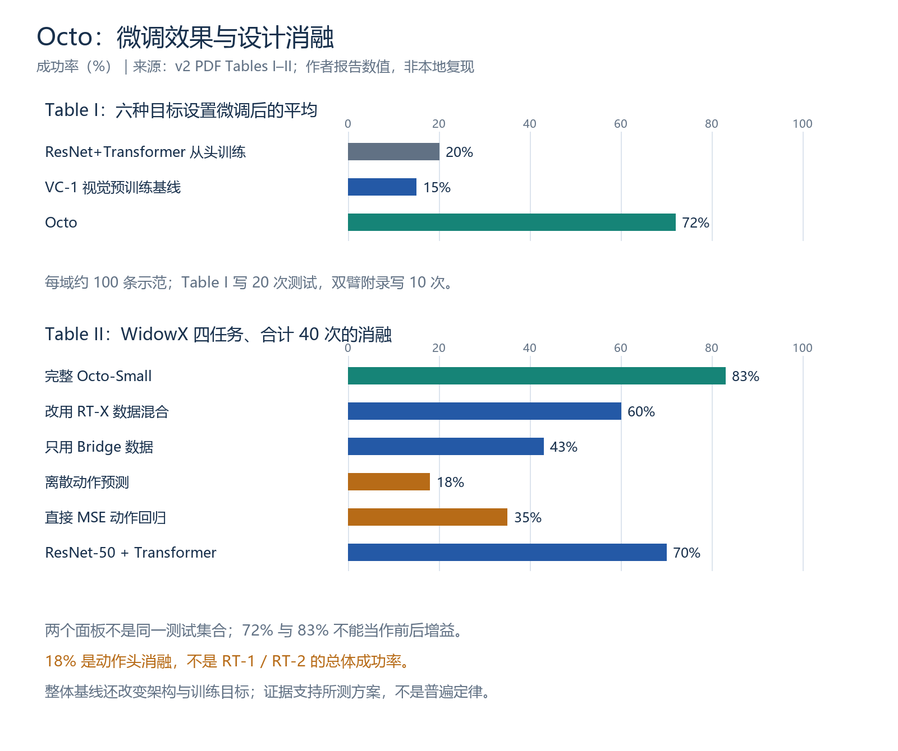

# Octo 详细读书笔记：可迁移的机器人策略与条件扩散动作生成

> **阅读状态：已读完，完成一轮正文主线、核心公式、主要实验及附录 E 的引导阅读与问答。** 独立复述与延迟自测待巩固；按学习者要求，暂不进入具体代码。
>
> 更新：2026-10-31。论文：**Octo: An Open-Source Generalist Robot Policy**，RSS 2024；本页以本地 arXiv:2405.12213v2（2024-05-26，17 页）为准。
> [论文](https://arxiv.org/abs/2405.12213v2) · [在线正文](https://arxiv.org/html/2405.12213v2) · [项目页](https://octo-models.github.io/) · [官方代码入口（尚未学习）](https://github.com/octo-models/octo) · [学习进度](../Octo学习进度.md) · [当天记录](../../weekly/2026-10-31.md)

本页扩充原 2026-10-15 简要总结，保留其重要边界说明。数字来自论文作者；教学例子、重绘图和公式解释不代表本地模型实验。PDF 留在本地。图号与页码按本地 PDF：架构是 Figure 2，部分 HTML 图号可能不同，回查时同时看章节名。

## 阅读导航

| 想回看什么 | 入口 |
|---|---|
| 三分钟恢复主线 | [1. 一页速览](#s1) |
| 与 RT-1、RT-2、RT-X 的关系 | [2. 问题与定位](#s2) |
| 观察空间、动作空间与三个部件 | [3. 输入输出与架构](#s3) |
| readout token 与信息流方向 | [4. 注意力掩码](#s4) |
| 为什么选择扩散、离散输出能否多模态 | [5. 三种动作预测方法](#s5) |
| 去噪训练、公式（1）和闭环 | [6. 扩散公式与完整流程](#s6) |
| 轨迹、目标重标记、训练配置 | [7. 数据与训练](#s7) |
| 新接口如何适配、T5 是否冻结 | [8. 微调](#s8) |
| 整体效果、消融、泛化细分 | [9. 实验证据](#s9) |
| 附录 E 全部经验条目 | [10. 有效做法](#s10) · [11. 未奏效的做法](#s11) |
| 局限和研究启发 | [12. 讨论](#s12) |
| 本轮纠错与自测 | [13. 复习卡](#s13) |
| 阅读边界及原文定位 | [14. 学习状态](#s14) · [15. 回查索引](#s15) |

## 1. 一页速览

**Octo 将多来源机器人示范用于策略预训练，以模块化输入输出、分块注意力和条件扩散动作头，为多种机器人设置提供可微调的策略起点。**

| 问题 | 回答 |
|---|---|
| 为什么做？ | 新机器人有不同传感器和控制接口，希望复用经验，减少从头采集和学习 |
| 输入什么？ | 近期图像观察；语言指令或目标图片；新传感器可在适配时加入 |
| 主干输出什么？ | 供动作头使用的读出特征，不是已完成的物理指令 |
| 动作如何生成？ | 条件扩散头生成一段连续未来动作 |
| 从什么学习？ | OXE 中筛选的 25 个数据集、约 80 万条示范轨迹 |
| 主要贡献？ | 可复用开源策略、灵活接口、数据高效微调及设计经验 |
| 不代表什么？ | 任意新机器人无需适配即可控制，或所有新技能都能零样本完成 |

| 数字 | 正确含义 |
|---|---|
| 800k | 轨迹数，不是图片数或训练步数 |
| 27M / 93M | Small / Base 的论文策略规模；跨论文比较应对齐冻结编码器等统计口径 |
| 2 帧 | 当前加一帧历史，不是两帧过去再加当前 |
| 20 步 | 附录 D 的扩散去噪次数，不是机器人执行 20 步 |
| 约 100 条 | 微调目标域示范量，不是每项恰好 100 条 |
| 72% / 20% / 15% | Table I：Octo、从头训练、VC-1 的跨设置平均成功率 |
| 83% / 18% / 35% | Table II：完整 Octo-Small、离散动作消融、MSE 动作消融 |

## 2. 引言与相关工作：它在解决哪个问题？

传统做法为每个机器人和任务单独采集示范、训练策略。换相机、控制接口或机器人形态后，原模型不一定容易复用。Octo 希望让预训练策略成为实际可使用、可修改、可微调的起点。

| 工作 | 本轮关注的主线 | 与 Octo 的联系 |
|---|---|---|
| RT-1 | 机器人多任务示范、离散动作输出 | 仍解决视觉到动作问题，但改变架构与动作生成方式 |
| RT-2 | 生成式 VLM 接入动作 token、共同微调 | Octo 使用语言预训练组件，却不是把完整生成式 VLM 直接改为动作模型 |
| OXE / RT-X | 跨机器人数据与经验共享 | Octo 使用 OXE 筛选数据，进一步关注下游输入输出适配 |
| 扩散策略、动作分块相关工作 | 连续多模态分布、多步动作预测 | Octo 将已有组件组合到跨机器人预训练体系中 |

Policy 是从观察和任务到动作的策略；Generalist 指跨任务、场景与机器人设置的适用目标；Open-source 指公开权重、训练与微调资源等。贡献包括系统组合、预训练策略及实证分析，不只是一个新算子。

**零样本使用与微调迁移是两类证据。** 对已覆盖接口直接运行，与新接口加模块后继续训练，不能混为一谈。

## 3. §III-A：输入输出与三个部件

### 3.1 观察空间和动作空间

观察空间描述接收信息的类型、形状和含义；动作空间描述输出控制量的类型、维度、范围和含义。

| 变化 | 属于什么变化 |
|---|---|
| 增加手腕相机或力传感器 | 观察空间变化 |
| 从末端位移控制改为关节目标角度 | 动作空间变化 |
| 同为 6 维，一个是末端平移旋转增量，一个是 6 个关节角度 | 维度相同，语义不同，动作空间仍然变化 |

学习者用“输出维度变化”判断动作空间变化，方向正确；需要补充：**维度变化只是表现之一，相同维度也不保证接口相同。**

### 3.2 三个部件的职责

*依据 PDF Figure 2 和 §III-A 重绘；教学概念图，不是逐层实现图。*

| 部件 | 作用 | 易混点 |
|---|---|---|
| Input tokenizers | 将文字、图像等转为特征向量序列 | token 不一定是词或离散编号 |
| Transformer backbone | 综合任务和观察，更新特征 | 读出特征还不是物理动作 |
| Readout / action head | 根据读出特征进一步生成动作 | 不只是拿出已预测好的结果 |

语言经预训练 T5-base；图像经浅层卷积并形成图像块 tokens，加上可学习位置嵌入。向量格式统一不代表语义相同。

~~~mermaid
flowchart LR
    L[语言指令] --> T[冻结的 T5 编码器]
    O[近期观察图像] --> I[浅层卷积与图像 tokens]
    G[目标图片：另一种任务条件] --> I
    T --> B[Octo Transformer]
    I --> B
    B --> R[读出 token 的输出特征 e]
    R --> H[扩散动作头]
    H --> A[连续动作块]
~~~

图中语言与目标图片表示支持的任务类型，不要求每次同时提供。观察回答“现在是什么样”，目标图片回答“希望变成什么样”。

## 4. 读出 token 与分块注意力：谁参考谁？

### 4.1 token 和 head 不是同一个东西

Readout token 是插入序列的可学习向量，其初始参数参与训练；每次前向计算读取本次任务和观察，形成新的特征。Readout head 是用这个特征生成输出的网络。

**“读取”是参考其他向量更新自己，不是截取几个数字，也不是直接修改被读取者。**

| 前向计算中的关系 | 规则 |
|---|---|
| 时刻 t 的观察读取任务 | 允许 |
| 时刻 t 的观察读取同一时刻或更早的观察 | 允许 |
| 时刻 t 的观察读取未来观察 | 不允许 |
| 时刻 t 的读出 token 读取任务及截至当前的观察 | 允许 |
| 任务或观察读取 readout token | 不允许 |
| 不存在输入的对应 tokens | 用 mask 排除 |

教学类比：读出 token 根据“书”做笔记，笔记更新不会直接改写书。观察 token 自身仍然更新，但不参考读出 token。

### 4.2 两种“更新”必须分开

1. 环境产生新图像，编码器生成新观察 tokens。
2. 一次模型计算中，tokens 在 Transformer 各层间更新；不是每层又去拍一次环境。

信息流规则**不阻断动作损失对主干的反向传播**。普通推理中的向量变化不等于参数在学习。

### 4.3 接口扩展

新增输出读出模块不要求输入 tokens 读取它，输入表示与输出模块因而解耦。新传感器可加编码器和位置嵌入，新动作空间可加输出头，保留主干作为初始化。

这不保证任意输入都会被正确利用，也不代表新增输入不改变计算。**保留参数 ≠ 冻结参数；支持接口 ≠ 已学会该接口。**

## 5. 为什么用扩散？先分清三类动作预测

| 方法 | 学习方式 | 关键性质 |
|---|---|---|
| 单个动作的直接 MSE 回归 | 预测向量，最小化示范平方误差 | 多种方案下，最优确定性预测趋向条件均值 |
| 离散概率预测 | 分箱后用交叉熵学习概率 | 可以有多个高概率区间并选择或采样；固定分箱有量化限制 |
| 条件扩散 | 学习动作去噪，再采样动作块 | 表达连续多模态分布，需要多步生成计算 |

**本轮最重要的纠错：离散输出不必然取平均。** 左右区间各有 50% 概率时，选择或采样会得到某个区间；若对类别对应数值求期望，那是另外选择的解码规则。

“左右两条绕障路线，平均可能撞障碍”是解释直接 MSE 回归的教学例子，不是离散策略必然失败的证据。

RT-1 将动作映射到档位；RT-2 进一步让动作编码对应到 VLM 可输出的 tokens。256 档指连续维度的取值划分，不是 256 种技能；终止/模式字段的离散含义应另行理解。参见 [RT-1](RT-1.md)、[RT-2 动作表示](RT-2.md#s4)。

如果教学控制器只允许 0.10、0.20、0.30 cm，而目标是 0.13 cm，就存在量化误差。连续输出没有该固定分箱限制，却仍可能预测错误。增加档位或改进离散表示也可以改善精度。

多模态**动作分布**指多种合理动作模式，区别于图像和文字等多模态**输入**。扩散不是唯一能表达多个模式的方法；选择依据包括连续表示和具体实验，不能推成所有离散 VLA 都较差。

## 6. §III-C：扩散训练、公式（1）与闭环

*处理的是动作数组，不是给摄像头图像去噪。*

### 6.1 训练：已知示范，构造带噪任务

观察和任务先得到特征 e。给示范动作块加已知噪声，让网络结合带噪动作、e、噪声级别预测噪声。真实噪声是监督答案，不直接作为输入。

教学算术：0.4 + 0.2 = 0.6；若预测噪声为 0.18，简单相减得到 0.42。它只解释修正方向；真实 DDPM 使用缩放和噪声日程。

下面是标准噪声预测 DDPM 的辅助解释，不是原文另外编号的公式：

$$
x^k=\sqrt{\bar\alpha_k}\,a+\sqrt{1-\bar\alpha_k}\,\epsilon,
\qquad \epsilon\sim\mathcal N(0,I)
$$

$$
\mathcal L_{\mathrm{noise}}=
\mathbb E\left[\|\epsilon-\epsilon_\theta(x^k,e,k)\|_2^2\right].
$$

a 是示范动作块，k 为抽取的噪声级别。累计系数 $\bar\alpha_k$ 不应直接等同下文简写的 $\alpha$。原文采用 DDPM 目标，并从动作恢复角度描述训练；具体实现本轮未读。

**噪声预测的平方误差不等于直接回归动作均值。** 网络额外接收带噪动作与噪声级别，最终动作由反向采样生成。不能把 MSE 本身说成不适合机器人。

### 6.2 原文公式（1）：一次反向更新

$$
x^{k-1}=\alpha\left(x^k-\gamma\epsilon_\theta(x^k,e,k)
+\mathcal N(0,\sigma^2I)\right).
$$

| 符号 | 含义 |
|---|---|
| $x^k$ | 第 k 个噪声级别的动作数组；上标是编号，不是幂次 |
| $e$ | 主干读出特征，提供任务与观察条件 |
| $\epsilon_\theta$ | 可训练去噪网络，预测噪声 |
| $k$ | 去噪阶段，不是机器人执行时间 t |
| $\alpha,\gamma,\sigma$ | 噪声日程的系数；原文省略步骤下标 |
| $\mathcal N(0,\sigma^2I)$ | 更新的随机采样项，不是传感器误差 |

“当前数组 − 缩放的预测噪声 + 规定的随机项，再缩放”构成一次更新。随机项属于采样规则，不要求每个数值每一步都更接近已知答案。系数不是机器人速度或优化器学习率。

### 6.3 推理：生成，而非恢复藏着的答案

$$
x^K\sim\mathcal N(0,I),\qquad x^K\rightarrow x^{K-1}\rightarrow\cdots\rightarrow x^0.
$$

随机起点没有藏着正确动作。模型利用条件分布将随机数组转为动作样本；不同起点可能得到不同方案，但不保证每个样本都成功。

预测 H 步、每步 d 维时，可理解为 H×d 数组。这里 H 是教学动作块长度，不要与原文其他位置表示观察历史的符号混用。去噪不改变数组形状。

每次预测主干只运行一次，多步去噪在小动作头内完成。附录 D 的动作头为 3 层 MLP、隐藏维度 256，带残差与 LayerNorm；余弦噪声日程、20 步去噪。这是论文配置，不是所有后续发布版本的保证。

### 6.4 预测一段，执行一部分，再观察

~~~mermaid
flowchart TD
    O[新观察与任务] --> B[编码器和主干生成 e]
    B --> H[小动作头：参考 e 多步去噪]
    N[随机动作数组] --> H
    H --> A[未来动作块]
    A --> C[转换控制接口并执行前一部分]
    C --> O
~~~

教学例子“预测 4 步、执行 1 步再预测”不是统一默认配置。中间带噪数组不交给机器人执行。

| 过程 | 改变什么 |
|---|---|
| 去噪循环 | 模型内部动作数组 |
| 环境闭环 | 获得新观察后重新预测 |
| 参数训练 | 根据损失更新权重 |

普通闭环不自动更新参数。

## 7. §III-B/D、附录 C/D：数据与训练

### 7.1 筛选、混合与对齐

一条轨迹包含多个时间步。作者筛选约 80 万条轨迹、25 个数据集；移除无图像、不使用末端增量控制、重复过多、分辨率过低或任务过窄的数据。

较多样的数据提高采样权重，部分大量重复数据降权。缺失相机零填充并用掩码排除；夹爪统一为 1 张开、0 闭合。零填充不是补出真实图像，数值归一化也不自动统一全部物理语义。

附录 C 百分比是采样权重：Fractal、Kuka、Bridge 各 17.0%，BC-Z 9.1%；不是原始轨迹数量占比。数据多样性、权重和打乱方式都影响训练。

### 7.2 目标重标记

从同一轨迹当前时刻之后均匀选取状态作目标图，再用示范动作监督。目标可以是未来中间状态，不一定是最后一帧。

例如 A 为杯子在桌上，C 为杯子在盘子里：以 A 为观察、C 为任务目标，学习示范后续动作。目标图定义任务，示范动作提供动作监督，不是只靠结果照片学会操作。

未来图作为已给定目标，与偷看未来真实观察不同；部署需外部给出目标或指令。训练随机去掉语言或目标图，使二者均可用；无语言标注数据始终用目标图。

### 7.3 关键配置

| 项目 | 论文配置 |
|---|---|
| 优化器 | AdamW |
| 预训练学习率 / warmup | 3e-4 / 2000 步 |
| 预训练调度 | inverse square-root；weight decay 0.1；梯度裁剪阈值 1 |
| Base 预训练 | 300k 步，batch 2048，TPU v4-128，约 14 小时 |
| 微调 | 约 100 条轨迹，50k 步，线性 warmup 与余弦学习率衰减 |
| 微调硬件报告 | 单张 24GB A5000，约 5 小时；不是本机实测或时间保证 |
| 观察历史 | 当前加一帧历史 |
| 图像 | 第三人称裁剪、缩放 256×256、颜色扰动；手腕 128×128、无随机裁剪 |
| 像素 | 归一化到 −1 到 1 |
| 图像块 | 16×16；第三人称 256 个、手腕 64 个图像 tokens |

| 模型 | 层数 | 隐藏维度 | MLP 维度 | 注意力头 | 参数量 |
|---|---:|---:|---:|---:|---:|
| Small | 12 | 384 | 1536 | 6 | 27M |
| Base | 12 | 768 | 3072 | 12 | 93M |

余弦**噪声日程**控制扩散，余弦**学习率调度**控制参数更新，两者不同。T5-base 的 111M 编码组件与策略规模分别列示，跨论文比较应对齐口径。

## 8. 新机器人怎样微调？

1. 明确新观察、任务与动作接口。
2. 为新传感器增加编码器及必要的位置嵌入；为新动作配置输出头。
3. 以保留的主干权重为起点，用目标示范继续训练。
4. 在目标设置上评估任务成功和恢复行为。

这是概念流程，不是本轮执行的代码。预训练筛选末端增量数据，关节控制、双臂动作等需适配；不是预训练已覆盖全部接口。

§III-C 的策略微调更新整个策略，比冻结部分策略参数更好；附录 E 的语言组件则选择**冻结 T5-base**。“全策略微调”不能无限扩大为所有外部组件都更新。

附录 F 的 ALOHA 双臂任务新增 14 维头：两臂各 6 个关节位置，加两个夹爪量。该任务报告预测 64 步、执行 12 步再预测；它是任务特定配置，不是全 Octo 默认值。

## 9. §IV、附录 F：如何阅读实验证据？

### 9.1 三个问题与零样本范围

论文在四家机构、九种机器人设置上考察：直接使用、少量示范微调、设计选择消融。九种设置不等于九个完全不同的硬件型号。

零样本实验使用与预训练数据相匹配的机器人设置，在物体位置、背景、光照和干扰物变化下测试。Figure 5 中 Octo 超过 RT-1-X，在所测 WidowX 与 RT-1 Robot 任务上与 RT-2-X 相近。

Octo 使用约 800k 机器人轨迹，RT-X 对照使用约 350k，架构、预训练和规模也不同。不能把整体比较的差距全归因于扩散。WidowX 的 RT-2-X 数字引用先前工作；RT-1 Robot 的 RT-2-X 测试由其作者协助完成，并非所有模型统一在本地重跑。

### 9.2 Table I：新设置微调

*来源为论文 Tables I–II；两个面板使用不同测试集合，不能跨面板直接相减。*

| 方法 | 插入 | 咖啡 | 烘焙 | Pick-Up | Coke | 双臂 | 平均 |
|---|---:|---:|---:|---:|---:|---:|---:|
| ResNet+Transformer 从头训练 | 10% | 45% | 25% | 0% | 20% | 20% | 20% |
| VC-1 | 5% | 0% | 30% | 0% | 10% | 50% | 15% |
| Octo | 70% | 75% | 50% | 60% | 100% | 80% | 72% |

插入新增力/力矩信息；Pick-Up 改用关节控制；Coke 测试预训练未见 ViperX 的微调；双臂测试新形态与 14 维动作。每项约 100 条目标示范，具体如 Baking 120 条、Coffee 118 条、Coke 115 条。

从头训练对照使用约 28M 的 ResNet+FiLM、小 Transformer 与扩散目标；VC-1 使用预训练视觉表示和 MLP 动作解码，采用 MSE。**该表支持 Octo 整套微调方案有效，不是仅改变预训练权重的纯单变量实验。**

72% 是作者取整后的平均数，不是任意新机器人可达到的概率。对照平均 20% 到约 72% 是约 **52 个百分点**，不是相对提高 52%。按取整数值计算，相对增幅约 260%；不把原文宽泛的“52%”措辞当作严格相对比例。

**原文报告差异：** Table I 图注统一写每域 20 次，但附录 F 双臂部分写 10 次。本页保留差异，不补造统一样本量，也不据此重算置信区间。

### 9.3 Table II 与 VI：设计消融

| 设置 | 总体成功率 |
|---|---:|
| 完整 Octo-Small | 83% |
| 改用 RT-X 数据混合 | 60% |
| 只用 Bridge 数据 | 43% |
| 离散动作头 | 18% |
| MSE 动作回归头 | 35% |
| ResNet-50 + Transformer | 70% |

四个 WidowX 任务、共 40 次试验；两项语言条件、两项目标图条件。18% 是 Octo 的离散头消融，不是 RT-1 或 RT-2 的总体成绩。“RT-X 数据混合”是替换数据，不是替换为 RT-X 模型。83% 等为表中取整结果。

| 对照 | 支持的结论 | 不能推出 |
|---|---|---|
| 83 / 60 / 43 | 该设置下广泛数据混合更好 | 任何新增数据都有效；收益仅由机器人数量决定 |
| 83 / 18 / 35 | 该扩散配置优于所测输出替代方案 | 一切离散方法都差；每项收益机制已被隔离 |
| 83 / 70 | 较浅视觉前端、较大 Transformer 在该预训练条件下更好 | 小数据从头训练也一定更好 |

附录 Table VI 分项还表明，ResNet 对照在“面包放盘子”上为 100%，Octo 为 70%；总体最优不等于逐任务全部最优。分项任务少、样本有限，也不适合过度解释小差异。

Figure 6 的 Tiny（10M）、Small（27M）、Base（93M）比较支持更大模型在所测 UR5/WidowX 任务上的收益；每机器人一个语言任务、10 次试验，不是所有任务的规模定律。不同设计收益也不能直接相加。

### 9.4 Table VII：泛化到底跨越了什么？

| 类型 | 两项任务成功率 | 类别平均 |
|---|---|---:|
| 分布内 | 胡萝卜放盘子 80%；茄子放锅 90% | 85% |
| 新物体 | 面包放盘子 70%；勺子放手套 90% | 80% |
| 新环境 | 蘑菇放锅 20%；勺子放布上 60% | 40% |
| 新技能 | 杯子侧翻 10%；方块插槽 0% | 5% |

Octo-Small、WidowX，每类两任务合计 20 次。不能只依据正文“稍有下降”等概括淡化新环境的 40%；也不能把这些类别理解为控制了所有因素的严格单变量比较，因为具体任务有差异。

这说明新物体、环境变化、新技能是不同泛化要求。新技能的失败不与前述微调插入成功矛盾：一个是不微调测试，一个是收集目标示范后再训练。

## 10. 附录 E 全部有效做法：现象、解释与边界

以下四项均来自附录 E。作者的经验不等于跨任务定律；本页的生活例子是教学解释。

### 10.1 加入一帧历史

当前加一帧历史优于只看当前；进一步增加长度，在少数所测任务上没有观察到收益。两帧变化可能提供运动方向与进展，这是一种理解方式，不是机制已被单独证明。

**例子：** 单张画面显示夹爪在杯边，两张画面还能显示它是接近还是离开。长历史增加 token 和计算，是否需要应由具体任务验证。

### 10.2 动作分块与滚动执行

预测多个未来动作使运动更连贯。滚动时域控制执行前一部分后重观察、重新预测。时间集成则融合不同预测时刻对同一执行时刻的动作建议，是另一种处理方式。

作者没有发现时间集成比滚动控制额外带来收益，不意味着融合永远没用，也不意味着 Octo 必须开环执行完整动作块。观察历史是往过去看，动作分块是预测未来，两者不是同一个长度。

### 10.3 减小图像块

16×16 比 32×32 更有利于抓取等精细任务。256×256 图像对应 256 个与 64 个块，tokens 变为四倍；原图分辨率没有因此提高。

更细空间表示可能有助于定位，但计算随之增加。token 四倍不等于整个系统运行时间精确四倍；注意力、其他模块与硬件均影响耗时。

### 10.4 增大 shuffle buffer：数据管线也是方法的一部分

小缓冲区（20k）配合轨迹级交错时，零样本表现明显较差。作者在解码图像前打乱并交错不同轨迹的帧，使缓冲区可增大到约 500k；每条轨迹最多随机取 100 个时间步，避免长轨迹占满缓冲区。

**教学直觉：** 如果连续批次总在看同一段抓取，即使数据总量很大，模型短期看到的内容仍然很单一。打乱改善采样混合；它不是制造新数据，也不能代替合理的数据权重。

这里打乱的是训练样本的抽取顺序，不能把样本内部观察历史、动作块的时序对应随意破坏。20k / 500k 是缓冲规模，100 是每轨迹抽取上限，都不是训练 batch size。

## 11. 附录 E 全部未奏效做法：保留作者的“尚未”

### 11.1 MSE 动作头

替换为直接 L2 回归后，策略表现犹豫、移动慢，WidowX 上有时无法正确旋转夹爪。这是所测策略的现象；均值倾向是解释动机，不能说所有回归模型都失败，更不能否定噪声预测中的平方误差。

### 11.2 离散动作头

每维 256 档、交叉熵训练后，动作比 MSE 更果断，但精度不足，常错过抓取位置。连续扩散保留多模态能力并避免固定分箱；这个结果不排除更细分箱、自回归依赖建模或其他离散编码的改进。

### 11.3 ResNet 编码器

在大规模数据混合上不如作者的 ViT 风格架构，但在约 100 条示范的小数据从头训练中反而更好。架构选择要结合数据量和初始化；不能脱离训练条件排绝对名次。

### 11.4 ImageNet 预训练编码器

ImageNet 预训练 ResNet 没有改善零样本结果。作者明确提示，这与 ResNet 架构本身在该设置下表现欠佳可能混杂，不能推成“视觉预训练无用”。比较一种初始化的作用，需留意架构和训练方式是否同时变化。

### 11.5 相对夹爪编码

| 表示 | 含义 |
|---|---|
| 绝对式 | 1 表示张开，0 表示闭合 |
| 作者所测相对式 | 打开时 1，关闭时 0，其余保持状态时 0.5 |

相对式中大量标签是“保持”，策略因此更少切换夹爪；抓取成功率略高，却在失败后更少重试，整体更差，作者选绝对式。

这里的相对式是作者定义的事件编码，不应直接等同连续夹爪位置增量。评价应包括失败后的恢复与整任务完成，而非只看一次抓取。

### 11.6 加入本体感知

加入本体感知的策略看起来总体更差。作者提出状态与未来动作强相关造成因果混淆的假设，未单独证实。

**教学例子：** 示范里“到某关节姿态”经常对应“闭合夹爪”，模型可能过度依赖姿态，而忽略杯子是否真的在夹爪之间。换杯子位置后，关联失效。这不是论文已经定位的唯一失败原因。

不能据此删除所有机器人状态信息：插入、关节控制等微调设置确实使用相关传感器。架构支持、预训练数据是否有效利用、目标任务是否需要，是三个不同问题。

### 11.7 更大或微调的语言编码器

作者比较 T5-small（30M）、base（111M）、large（386M），并尝试微调编码器最后两层；冻结 base 得到最好的语言条件策略。更大或微调没有改善，作者推测与机器人指令不够丰富多样有关。

这不是说语言编码器永远应冻结；也不是说 Octo 策略主干被冻结。两个网络的角色和训练选择必须分别记录。

## 12. §V：能力边界与值得继续研究的问题

| 现象或限制 | 作者解释 / 本页理解 | 证据边界 |
|---|---|---|
| 加手腕图像有时反而不如单第三人称图像 | 仅约 27% 预训练数据有手腕图像，可能利用不足 | 频率不足是作者推测，不是已隔离的唯一原因 |
| 语言与目标图效果有差距 | 仅约 56% 数据有语言；目标图可能提供更多具体信息 | 模态能力和条件信息量不能混为一谈 |
| 新技能零样本较弱 | 经验覆盖不足，需要目标数据适配 | 不能由新物体泛化推广到新技能 |
| 主要从示范模仿 | 未来可利用非最优与在线交互数据 | 执行失败不会自动更新当前模型 |
| 单臂、双臂机械臂为主 | 导航与移动操作有待拓展 | 不声称控制任意机器人形态 |

可继续思考的研究问题：缺失模态如何影响训练；采样权重如何设置；新接口需要多少示范；如何兼顾精度、计算和闭环频率；如何评价重试与恢复。这些是阅读引出的方向，尚无本地实验或新颖性验证。

## 13. 本轮纠错与自测

| 最初容易形成的理解 | 修正后的理解 |
|---|---|
| 只有输出维度变才叫动作空间变化 | 数值含义、控制方式变化也算 |
| 主干已预测动作，head 只读结果 | 主干产特征，动作头继续计算生成动作 |
| 读出 token 不反向影响观察，所以主干不能训练 | 前向读取限制与反向梯度不同 |
| 离散概率预测必然输出平均动作 | 取平均倾向主要对应直接确定性 MSE 回归；离散分布能多峰 |
| 有多种方案就必须扩散 | 不是唯一选择；还要比较连续精度、计算及实证 |
| 去噪从随机数找回藏着的正确答案 | 利用学到的分布生成动作样本 |
| 扩散不能用 MSE | 噪声预测可以用平方误差，对象与条件不同 |
| 去噪 20 步等于机器人动 20 步 | 内部计算步、动作块长度、执行步数不同 |
| 全策略微调包含更新 T5 | 本文语言编码器保持冻结 |
| 83% 与 72% 是同一测试的前后结果 | 分别属于消融与跨域微调集合 |

### 三句话复述

> **问题：** 多机器人示范如何形成可适配新输入、动作接口的策略起点？
>
> **方法：** 模块化 token 输入、分块注意力与读出特征，加上条件扩散动作块，在 OXE 混合数据上预训练并微调。
>
> **证据与边界：** 零样本、微调及消融支持方案有效；新技能、模态覆盖、接口适配与计算仍构成限制。

先独立作答再展开参考；整理题目不等于已完成自测。

12 道复习题与参考答案

1. **六维末端增量变成六维关节角，动作空间变了吗？** 变了，维度相同但控制语义不同。
2. **readout token 与 head 的区别？** 前者是信息向量，后者是生成输出的网络。
3. **为什么观察不读 readout，主干还能训练？** mask 管前向依赖，梯度仍可由动作损失回传。
4. **离散动作能表示左右各 50% 吗？** 能，选择或采样不必取数值平均。
5. **去噪网络三个输入是什么？** 当前带噪动作、条件特征 e、噪声级别 k。
6. **为什么训练时知道噪声？** 自己采样并加到示范上；它是监督而非直接输入。
7. **噪声级别与执行时间是否同一轴？** 不是；一次动作块生成内部有多个去噪级别。
8. **目标重标记是否偷看未来？** 未来状态被指定为任务目标，不伪装成当前观察；部署需给定目标。
9. **为什么主干只跑一次？** 本次条件 e 固定，后续去噪只更新动作数组。
10. **微调 72% 和消融 83% 能相减吗？** 不能当成同任务增益，测试集合不同。
11. **附录 E 哪四项有效？** 短历史、动作分块、更小 patch、更充分数据打乱。
12. **相对夹爪编码为何弃用？** 较少切换但也较少失败重试，整体表现更差。

## 14. 阅读与实践状态

| 项目 | 实际状态 |
|---|---|
| 正文主线、关键实验、公式（1） | 完成一轮引导阅读，学习者多次表示理解 |
| 问答与复述 | 主动解释观察/动作空间、token 分工和扩散；纠正了离散输出取平均的误解 |
| 附录 E | 已引导阅读重点；本次笔记补齐全部 4 项有效、7 项未奏效经验 |
| 附录 C/D/F | 本次补充配置、分项结果和报告差异；不记为全部逐页独立掌握 |
| 独立复述、延迟自测、数学推导 | 尚无完成记录 |
| 代码、数据加载、权重推理、训练及机器人评估 | 未开始；按要求暂不读具体实现 |

文档生成、表格核对、链接检查不算 Octo 模型复现，RT-1 的实践也不作为 Octo 证据。下一步优先回看纠错和独立复述；代码学习另行安排。

## 15. 原文回查索引与资料

| 内容 | 本地 PDF 位置 | 回看问题 |
|---|---|---|
| 动机与相关工作 | 第 1–3 页，§I–II | 系统贡献、开源、迁移接口 |
| 架构 | 第 3 页 Figure 2；第 4 页 §III-A | tokens、掩码、读出与适配 |
| 数据 | 第 4–5 页 §III-B；第 14 页附录 C | 筛选、采样权重、夹爪对齐 |
| 扩散公式 | 第 5 页 §III-C、公式（1） | 条件、去噪步与参数更新 |
| 训练与开放资源 | 第 5 页 §III-D/E | 历史、目标重标记、预算 |
| 零样本 | 第 6–7 页 §IV-A、Figure 5 | 覆盖设置与对照来源 |
| 微调 | 第 7 页 Table I | 六种设置、基线、样本量差异 |
| 消融与规模 | 第 7–8 页 Table II、Figure 6 | 数据、头、架构、规模 |
| 局限 | 第 8 页 §V | 模态覆盖、新技能、在线学习 |
| 超参数 | 第 14–15 页附录 D | 图像、模型、扩散头配置 |
| 经验条目 | 第 15 页附录 E | 四项有效、七项尚未奏效 |
| 评估细节 | 第 15–17 页附录 F；第 17 页 Tables VI–VII | 分项、泛化、双臂 64/12 与 10 次测试 |
| 附录 A/B | 第 14 页 | 团队贡献、代码入口；不展开代码学习 |

三张图由[重绘脚本](../../scripts/render_octo_figures.py)生成，沿用已有 RT-2 绘图样式，不运行策略。[历史 13 篇比较笔记](../../研/13篇文献详细总结_基础知识与方法对比_2026-10-15.md)保留原日期。

外部回查：[Octo v2 PDF](https://arxiv.org/pdf/2405.12213v2) · [项目](https://octo-models.github.io/) · [RT-1 原文](https://arxiv.org/abs/2212.06817) · [RT-2 原文](https://arxiv.org/abs/2307.15818) · [Diffusion Policy](https://arxiv.org/abs/2303.04137)。后者仅作延伸入口，不标记为已读。
