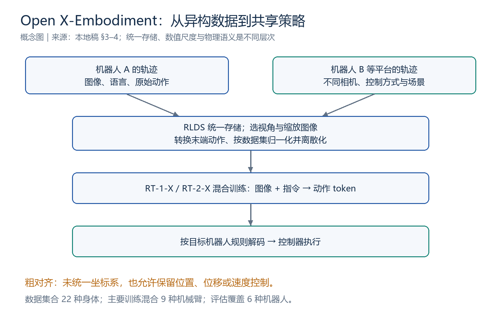
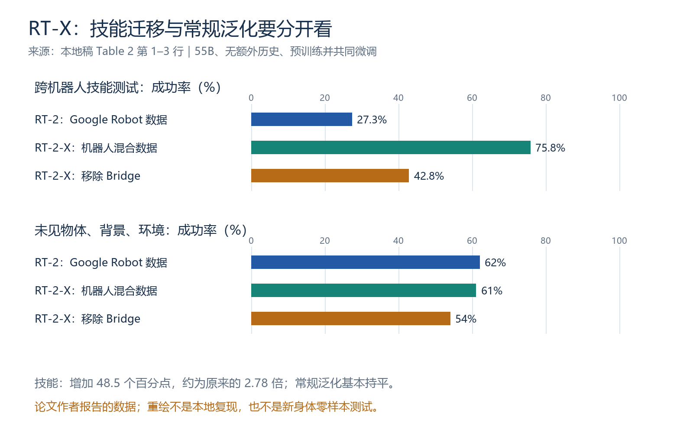
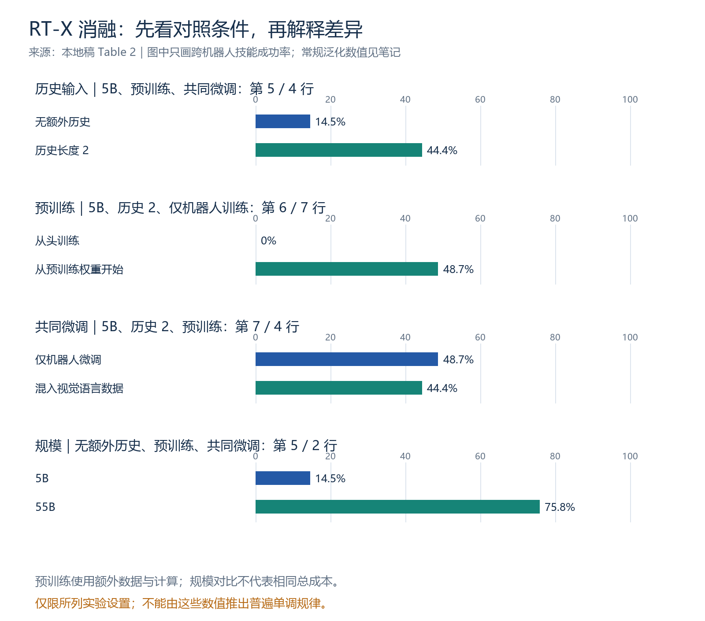

# Open X-Embodiment / RT-X 详细读书笔记：不同机器人如何共享经验

> **阅读状态：已读完，2026-10-30 完成一轮正文主线、主要实验与消融的引导阅读。** 学习者已表示理解；尚无独立复述或源码、训练、机器人评估记录。
>
> 论文：**Open X-Embodiment: Robotic Learning Datasets and RT-X Models**，Open X-Embodiment Collaboration。
> [原论文与版本记录](https://arxiv.org/abs/2310.08864) · [官方项目](https://robotics-transformer-x.github.io/) · [官方仓库](https://github.com/google-deepmind/open_x_embodiment) · [学习进度](../Open-X-Embodiment学习进度.md) · [当天记录](../../weekly/2026-10-30.md)

本笔记按本地 `37_Open_X_Embodiment_Robotic_L.pdf` 的章节、表号与 PDF 页码整理。本地为有匿名投稿标记的 16 页版本，可能与正式公开版本不同。PDF 留在本地，仓库提供公开入口。成功率均为**原论文报告**，图表重绘与教学示例不是本地模型实验。

## 阅读导航

| 内容 | 入口 |
|---|---|
| 主线与前三篇的关系 | [1. 一页速览](#s1) · [2. 问题与术语](#s2) |
| 数据与动作怎样共同训练 | [3. 数据集合](#s3) · [4. 粗对齐](#s4) |
| 模型、训练与部署 | [5. RT-X](#s5) |
| 正迁移与技能证据 | [6. 小/大数据场景](#s6) · [7. 跨机器人技能](#s7) |
| 历史、预训练、规模 | [8. 消融](#s8) |
| 边界与复习 | [9. 局限](#s9) · [10. 自测](#s10) |
| 学习状态与原文定位 | [11. 阅读与实践](#s11) · [12. 回查索引](#s12) |

<a id="s1"></a>
## 1. 一页速览

**核心问题：把不同机器人的操作数据放在一起训练，能否让各机器人从其他平台的经验中获益？**

| 名称 | 含义 |
|---|---|
| OXE / Open X-Embodiment | 汇集并标准化不同机器人的数据资源 |
| RT-1-X | 使用跨机器人混合数据训练的 RT-1 策略 |
| RT-2-X | 使用跨机器人混合数据的 RT-2 策略；主方案保留视觉语言共同微调 |
| RT-X | 上述策略的统称，不是另一个全新网络架构 |

**主线：多来源轨迹 → 统一存储与粗对齐 → 混合训练 → 多机器人评估 → 消融检验迁移来源。**

| 数字 | 原文含义 | 不要误读 |
|---|---|---|
| 100 万以上轨迹、22 种机器人 | 本地稿 OXE 数据集合规模 | 不是全部身体都参与主要训练评估 |
| 9 种机械臂 | 主要 RT-X 训练混合覆盖的身体 | 不是 9 个数据集 |
| 约 3600 次、6 种机器人 | 整体评估试验规模 | 不是每行都有 3600 次试验 |
| 平均相对提高约 50% | 小数据域 RT-1-X 的结果概括 | 不是增加 50 个百分点 |
| 27.3% → 75.8% | Table 2 的跨机器人技能测试 | 不是全部泛化都提升约三倍 |

<a id="s2"></a>
## 2. 研究问题与术语

| 论文 | 核心关注 |
|---|---|
| RT-1 | 从图像与语言直接预测机器人动作 |
| RT-2 | 把互联网视觉语言知识用于机器人控制 |
| Open X-Embodiment / RT-X | 不同机器人的真实操作数据能否共享并产生正迁移 |

**Embodiment** 可理解为机器人的身体与感知、执行配置：关节数量、臂长、夹爪、相机和控制方式可能不同。X-embodiment 表示跨身体。

**正迁移（positive transfer）**：加入其他来源的数据后，目标机器人上的性能改善。示意：只用 A 的数据成功率为 60%，加入 B 的数据后达到 75%；这些数字仅说明概念。

动机来自大规模预训练：单个实验室的数据覆盖有限，联合数据可能覆盖更丰富的环境和任务。但机器人数据的异构性使联合并不简单，甚至可能导致性能下降。

<a id="s3"></a>
## 3. OXE 数据集合：存储格式统一

第 3 节报告超过 100 万条真实轨迹、22 种身体、来自 34 个实验室的 60 个已有数据集；摘要描述 21 家机构、527 种技能与 160266 个任务。实验室、机构、数据集、身体、技能和轨迹是不同统计维度。以上是本地稿统计，不是持续增长的资源集合的实时规模。

作者采用 **RLDS**，以序列化 TFRecord 存储，容纳不同观测模态与动作空间。可以把数据理解为完整 episode 下的一系列时间步，每步包含相关观测和动作等信息；下面不是逐字段 API 定义：

```text
一次拿起杯子的示范
  时间步 1：观测、动作……
  时间步 2：观测、动作……
  ……
```

**统一文件组织不等于统一物理意义。** 速度与位移换成相同文件格式后，控制含义仍不同。

<a id="s4"></a>
## 4. 第 4.1 节：粗对齐



*依据第 3、4 节重绘的概念图，不表示所有机器人具有完全相同的控制接口。*

| 部分 | 处理方式 | 剩余差异 |
|---|---|---|
| 图像 | 每个数据集选择一个代表性视角，缩放至共同分辨率 | 相机位姿、成像属性、场景 |
| 语言 | 使用任务指令 | 任务与描述覆盖 |
| 动作 | 转换为末端平移、旋转、夹爪的 7 维表示 | 控制语义不完全相同 |
| 数值 | 按数据集归一化，再离散化 | 反归一化规则依赖目标机器人/数据集 |

概念表示为 `a = (x, y, z, roll, pitch, yaw, gripper)`。末端表示更容易容纳关节数不同的机械臂，这是帮助理解表示选择的解释，不表示底层关节控制自动解决。

原文明确：**不统一末端控制坐标系，允许沿用绝对位置、相对位置或速度控制。** 不能把全部 `x, y, z` 一律解释成位移增量。

例如相同归一化数值 `0.5`，在 A 的规则下可能对应位置增量，在 B 的规则下对应速度。这只是示意；归一化处理尺度，不自动统一坐标系和物理含义。

~~~mermaid
flowchart LR
    A[不同机器人的原始轨迹] --> B[RLDS 统一存储]
    B --> C[选相机视角与缩放]
    B --> D[末端动作转换与归一化]
    C --> E[跨机器人混合训练]
    D --> E
    E --> F[共享策略输出动作 token]
    F --> G[按目标机器人规则解码]
    G --> H[控制器执行]
~~~

论文检验的是：保留这些差异时，模型仍能否共享有用规律。它未证明对齐已完全解决，也不能由成功率直接推断模型内部采用了何种身体识别机制。

<a id="s5"></a>
## 5. RT-X 架构、训练与推理

第 4.2 节沿用 RT-1、RT-2：输入视觉观测与语言，输出离散动作。本文 RT-2-X 主要采用 RT-2-PaLI-X，其基础组件包括 ViT 与 UL2。

| 项目 | RT-1-X | RT-2-X 主方案 |
|---|---|---|
| 机器人数据 | 9 种机械臂的混合数据 | 同一机器人混合数据 |
| 训练阶段的数据 | 此阶段只用机器人混合数据 | 约 1∶1 混合原 VLM 数据与机器人数据 |
| 输出 | 离散动作桶 | 以语言 token 表示动作 |
| 目标 | 分类交叉熵 | 分类交叉熵 |
| 部署 | 本地运行 | 云端服务，经网络请求 |

RT-1-X 此阶段只用机器人数据，不等于完全没有预训练，其视觉编码器仍利用已有预训练。RT-2-X 的仅机器人微调变体也可以从互联网预训练权重开始。

第 4.2 节描述 **7 个末端动作维度加上终止维度**，采用 256 档离散表示。连续动作离散化和终止信号的含义应分别理解，示例数字串不能代替字段定义。

混合来源包括 RT-1、QT-Opt、Bridge、Task Agnostic Robot Play、Jaco Play、Cable Routing、RoboTurk、NYU VINN、Austin VIOLA、Berkeley Autolab UR5、TOTO、Language Table。数据集与身体不一一对应。作者解释，主要实验使用当时的数据，资源集合随后继续扩展。

第 4.3 节报告按机器人需求以 3–10 Hz 运行。这是论文系统条件下的策略频率，不是底层电机伺服频率，也不是本地速度保证。

~~~mermaid
flowchart TD
    I[当前或近期图像与指令] --> P[固定参数的策略]
    P --> T[动作 token]
    T --> D[按目标机器人规则解码]
    D --> C[控制器执行一步]
    C --> O[获得新观测]
    O --> I
~~~

闭环是执行后重新观察；历史输入是一次决策参考多个时间点。模型可以闭环运行却只看当前图像；输入变化导致输出变化不等于参数更新。

<a id="s6"></a>
## 6. 小数据与大数据：正迁移并非必然

### 6.1 小数据场景（Figure 3）

| 模型 | 训练数据 | 用途 |
|---|---|---|
| Original Method | 各自数据集 | 原方法基线 |
| RT-1 | 单独目标数据集 | 相同架构的基线 |
| RT-1-X | 跨机器人混合数据 | 检查联合训练效果 |

相同架构有利于评估改变数据的作用，但不代表数据量和计算预算完全相同。论文报告 RT-1-X 在五个小数据场景中的四个超过 Original Method，Figure 3 概括平均成功率相对提高约 50%。

示意：40% 到 60% 是增加 20 个百分点，相对提高 `(60−40)/40 = 50%`；这些数字不是 Figure 3 的分项结果。

### 6.2 大数据场景（Table 1）

| 模型 | Bridge：IRIS / Stanford | Bridge：RAIL / UCB | Google Robot：6 项技能 |
|---|---:|---:|---:|
| Original Method（LCBC） | 13% | 13% | — |
| RT-1 | 40% | 30% | 92% |
| RT-1-X | 27% | 27% | 73% |
| RT-2-X，55B | 50% | 30% | 91% |

**观察：** RT-1-X 低于单独训练的 RT-1。**作者解释：** 小模型难以吸收异构数据，出现欠拟合。RT-2-X 恢复较强表现，但它还改变架构、预训练等，不能把收益全部归因于参数量。

**本地稿措辞校正：** Table 1 图注称 RT-1-X 低于 Original Method 与 RT-1，但 Bridge 的 27% 实际高于 Original Method 的 13%；正文也将 RT-2-X 概括为超过两种基线。按表内数字，RT-2-X 相对 RT-1 是一项更高、一项持平、一项略低，不写成全面胜出。

<a id="s7"></a>
## 7. Table 2：跨机器人技能迁移



*按 Table 2 第 1–3 行重绘，均为论文成功率。*

测试使用 Google Robot 执行一组相关任务：这些物体与技能未出现在它原来的机器人训练数据中，却出现在另一种机器人 WidowX 的 Bridge 数据中。Google Robot 本身已有训练数据，因此不是全新身体零样本评估。

| 行 | 模型与机器人训练数据 | 跨机器人技能 | 常规泛化 |
|---:|---|---:|---:|
| 1 | RT-2：Google Robot 数据 | 27.3% | 62% |
| 2 | RT-2-X：机器人混合数据 | 75.8% | 61% |
| 3 | RT-2-X：混合数据去掉 Bridge | 42.8% | 54% |

三组都是 55B、无额外图像历史、从互联网预训练开始，并保留视觉语言共同微调。

27.3% → 75.8% 是增加 **48.5 个百分点**，成功率约为原来的 **2.78 倍**。去掉 Bridge 后降至 42.8%，支持其他机器人的经验贡献了有用技能。但移除 Bridge 同时改变数据量与组成，未隔离全部因素或证明内部机制。

常规泛化覆盖未见物体、背景和环境，62% 对 61% 基本持平。不能把技能结果写成全部泛化提升三倍。作者认为 VLM 基础已有较强的此类泛化，这是对现象的解释。

<a id="s8"></a>
## 8. 消融：历史、预训练、共同微调与规模



*按 Table 2 重绘。无额外历史仍然有当前图像，各比较只代表所列设置。*

### 8.1 Table 2 第 4–7 行

以下均为 5B，使用同一机器人数据混合。

| 行 | 历史长度 | 初始化 | 混入视觉语言数据 | 跨机器人技能 | 常规泛化 |
|---:|---|---|---|---:|---:|
| 4 | 2 | 互联网预训练 | 是 | 44.4% | 52% |
| 5 | 无额外历史 | 互联网预训练 | 是 | 14.5% | 30% |
| 6 | 2 | 从头训练 | 否 | 0% | 1% |
| 7 | 2 | 互联网预训练 | 否 | 48.7% | 47% |

### 8.2 历史：第 4 与第 5 行

技能 14.5% → 44.4%，常规泛化 30% → 52%。历史可能提供运动方向与进展，这是直观解释。实验支持这组短时历史有用，不能推出历史越长越好。

### 8.3 预训练：第 6 与第 7 行

二者均不混入视觉语言数据、均使用历史长度 2。预训练后微调为 48.7% / 47%，从头训练为 0% / 1%，支持预训练的重要性。

原文比较第 4 与第 6 行，但也改变了共同微调条件；本笔记补充第 6 与第 7 行作为条件更一致的对照。预训练本身仍使用额外数据与计算，不是相同总预算实验，也不能推出从头训练永远不可行。

### 8.4 共同微调：第 4 与第 7 行

共同微调为 44.4% / 52%，仅机器人微调为 48.7% / 47%，两类指标各有高低。作者推测多样机器人数据减弱了继续混入视觉语言数据的额外收益，未单独隔离数据多样性来证明机制。

**预训练权重与后续训练继续混入互联网数据是两个变量。** 仅机器人微调不是从头训练，成功率也不是遗忘程度的直接测量。

### 8.5 规模：第 2 与第 4 / 5 行

作者主要比较 55B 无额外历史的 75.8% / 61% 与 5B 历史长度 2 的 44.4% / 52%；历史设置不同，需要说明。

也可看同样无额外历史的第 2 与第 5 行：55B 为 75.8% / 61%，5B 为 14.5% / 30%。支持大模型在这些设置中的优势，不代表相同总成本或参数量与成功率的普遍规律。

<a id="s9"></a>
## 9. 第 6 节：局限与后续问题

| 作者列出的局限 | 对结论的影响 |
|---|---|
| 未充分研究感知与执行模态差异非常大的机器人 | 不能由机械臂结果推广到所有形态 |
| 未研究全新机器人泛化 | 已知身体学到新技能不等于陌生身体直接可用 |
| 未给出正迁移判据 | 训练前无法仅凭本文可靠判断数据会帮助还是拖累 |

可继续研究数据选择、混合比例、动作物理意义对齐和迁移收益预测。这些是阅读引出的研究问题，未进行实验或新颖性检索。

下一篇 Octo 的阅读衔接：从“共享数据可以有效”继续追问“预训练策略如何适配具体机器人的输入、动作与任务”。这里只说明阅读问题，不提前标记 Octo 为已读。

<a id="s10"></a>
## 10. 易混点与复习卡

| 易混点 | 准确理解 |
|---|---|
| RLDS 统一了所有控制 | 存储组织、数值尺度与物理语义要分开 |
| 相同 7 维能直接互换 | 坐标、控制含义和反归一化仍可能不同 |
| 数据有 22 种身体就全部训练评估了 | 主要训练覆盖 9 种，评估覆盖 6 种 |
| 数据越多一定越好 | 部分大数据域 RT-1-X 下降 |
| 技能约三倍就是全面泛化三倍 | 常规泛化为 62% 对 61% |
| 仅机器人微调没有互联网知识 | 仍可以使用互联网预训练权重 |
| 跨身体技能成功就是新身体零样本 | 测试身体本身出现在训练中 |

### 三句话复述

> **问题：** 单个平台的数据有限，能否借助其他机器人的经验提高控制能力？
>
> **方法：** 汇集 OXE 数据，通过存储统一和观测、动作粗对齐，在混合数据上训练 RT-1-X 与 RT-2-X。
>
> **证据与边界：** 小数据域、跨机器人技能与 Bridge 消融支持正迁移；收益依赖模型和数据条件，尚未解决新身体泛化及迁移条件预测。

先独立回答，再展开核对；本次整理不代表已经完成自测。

<details>
<summary>复习题与参考答案</summary>

1. **OXE 与 RT-X 的区别？** 数据资源与策略统称。
2. **归一化能统一动作含义吗？** 不能自动统一坐标系与位置/速度控制。
3. **相同 token 能直接给所有机器人吗？** 需按字段和目标机器人的规则解码。
4. **为什么比较 RT-1 与 RT-1-X？** 架构相同，更有助于观察混合数据的作用。
5. **Table 1 是否全面胜出？** RT-2-X 对 RT-1 是提高、持平、略低各一项。
6. **Bridge 消融支持什么？** 其他身体的经验有用，但数据量等因素也变化。
7. **更直接的预训练对照？** 第 6 与第 7 行，后续训练条件更一致，总预算仍不同。
8. **共同微调始终更好吗？** 本文 5B 两类指标各有高低。
9. **历史输入就是闭环吗？** 不是；一个是时间信息，一个是执行后重观察。
10. **新机器人可以直接使用吗？** 本文未研究，不能推断。

</details>

<a id="s11"></a>
## 11. 阅读与实践状态

2026-10-30 已完成摘要与引言、第 3–4 节方法、第 5 节主要实验及消融、第 6 节局限的引导阅读；学习者表示“我明白了这个”。这支持记录为一轮正文主线阅读完成，不代表独立复述、逐页精读或独立掌握全部细节。

| 项目 | 实际状态 |
|---|---|
| 正文主线与主要实验 | 完成一轮引导阅读 |
| 图表 | 核对 Figure 3、Tables 1–2 的解释，本次补充重绘图 |
| 全部相关工作与附录 | 未逐页独立精读 |
| 自测与独立复述 | 题目已整理，尚未记录独立完成 |
| 数据加载、官方代码、权重与训练 | 未开始 |
| 仿真或真机评估 | 未开始，无新增模型实验 |

RT-1 运行证据不算作 RT-X 复现。图表生成、数值核对和链接检查属于文档整理。下一步可独立复述粗对齐与 Table 2 对照，再按顺序进入 Octo。

<a id="s12"></a>
## 12. 原文回查索引

| 内容 | 本地 PDF 位置 | 核对重点 |
|---|---|---|
| 动机与贡献 | 第 1–2 页，摘要与引言 | 正迁移和公共资源 |
| 数据集合 | 第 3 页，第 3 节 | RLDS、轨迹与身体统计 |
| 模型概念 | 第 3 页，Figure 2 | RT-1-X / RT-2-X |
| 粗对齐 | 第 4 页，第 4.1 节 | 坐标和位置/速度差异 |
| 架构与训练 | 第 4–5 页，第 4.2–4.3 节 | 7 维末端加终止、混合数据 |
| 小数据结果 | 第 4 页 Figure 3；第 5–6 页第 5.1 节 | 相对提升与分项结果 |
| 大数据结果 | 第 5 页 Table 1；第 6 页正文 | 表内数字和措辞差别 |
| 技能迁移 | 第 6 页 Figure 4；第 7 页 Table 2 | Bridge 与 Google Robot |
| 消融 | 第 7 页，第 5.3 节 | 历史、预训练、规模、共同微调 |
| 局限 | 第 7–8 页，第 6 节 | 新身体、模态差异、迁移判据 |

三张图由[重绘脚本](../../scripts/render_oxe_figures.py)生成，使用 Pillow 并复用现有 RT-2 绘图辅助函数；不运行机器人模型。[历史 13 篇比较笔记](../../研/13篇文献详细总结_基础知识与方法对比_2026-10-15.md)保留原日期，本页为本轮详细更新。

**2026-10-31 阅读衔接更新：** 上述“下一篇 Octo”是 10 月 30 日的续学计划；现已完成 Octo 一轮引导阅读，见 [Octo 详细笔记](Octo.md)及[学习进度](../Octo学习进度.md)。OXE 自身的代码与实验状态未改变。
