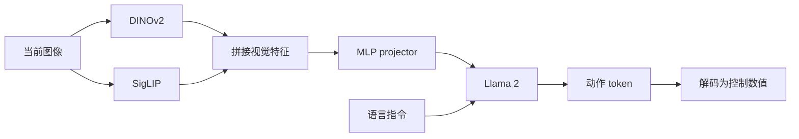

# OpenVLA 详细读书笔记：从视觉语言模型到机器人动作

> **阅读状态：已读完（完成一轮正文主要方法、实验与局限的引导阅读）。** 更新：2026-11-06。已补上 §3.3–3.5、§6、动作范围截断与全文复述；方法选型题已回答并纠错。独立复述与延迟自测继续巩固，Appendix E / LIBERO 和完整代码尚未系统学习。
>
> 论文：**OpenVLA: An Open-Source Vision-Language-Action Model**。本轮以 arXiv:2406.09246v3（2024-09-05）为准。
> [论文](https://arxiv.org/abs/2406.09246v3) · [在线正文](https://arxiv.org/html/2406.09246v3) · [项目页](https://openvla.github.io/) · [官方代码（未系统学习）](https://github.com/openvla/openvla) · [学习进度与本轮总结](../OpenVLA学习进度.md) · [11 月 1 日历史记录](../../weekly/2026-11-01.md)

本页保留 2026-10-15 初始整理，汇总 11 月 1 日及 5—6 日引导阅读、问答和纠错。论文结果、教学例子与本地实践分别记录；图表重绘不是模型实验。“笔记已整理”“讲解已覆盖”“能独立复述”不等同。

## 阅读导航

| 回看内容 | 入口 |
|---|---|
| 三分钟恢复主线 | [1. 一页速览](#s1) |
| 图像、语言如何变成动作 | [2. 三个部件](#s2) |
| 动作 token、示范与自回归 | [3. 表示与训练](#s3) |
| 泛化与语言响应实验 | [4. 直接评测](#s4) |
| 数据、DINOv2 与冻结 | [5. 消融](#s5) |
| LoRA 为什么省资源 | [6. 微调与显存](#s6) |
| 精度、速度与真实成功率 | [7. 量化](#s7) |
| 方法选型与经验迁移 | [8. 新设置适配与纠错](#s8) |
| 本轮理解、复习与续学 | [9. 理解记录](#s9) · [10. 复习卡](#s10) · [11. 断点与来源](#s11) |
| 数据比例、epoch 与训练资源 | [12. 数据和训练配置](#s12) |
| 单帧信息、反馈间隔与任务恢复 | [13. 控制局限](#s13) |
| 尚未完成的原有预备资料 | [历史简要整理](#historical) |

<a id="s1"></a>
## 1. 一页速览

**从已训练的 Prismatic VLM 出发，用机器人示范学习动作 token 预测，得到可使用和微调的开源通用策略。**

| 问题 | 回答 |
|---|---|
| 为什么需要机器人数据？ | 理解对象和指令，还需要学会当前观察对应的控制动作 |
| 输入什么？ | 原始模型使用单张 RGB 图像和语言指令 |
| 模型主体？ | DINOv2 + SigLIP、MLP projector、Llama 2 |
| 输出什么？ | 自回归生成动作 token，解码为一个时刻的控制动作 |
| 数据规模？ | 约 97 万条真实机器人示范轨迹，来自 OXE 的筛选混合 |
| 贡献？ | 开放模型、操作表现、适配方法及训练 / 推理效率分析 |
| 能否直接控制任意机器人？ | 不能据此推断；新设置、输入与动作接口需要适配和评测 |

97 万是轨迹数，不是图像数。7B 表示约 70 亿参数的模型规模，具体变体需查实验说明。

与 Octo 的主要区别：Octo 使用机器人策略主干和扩散动作头；OpenVLA 直接从生成式 VLM 出发预测动作 token。与 RT-2 的区别之一是 OpenVLA 的机器人训练阶段只用机器人动作数据，但仍继承此前互联网视觉、语言及图文预训练的能力。

来源：[摘要、§1–3](https://arxiv.org/html/2406.09246v3#S3)、[Octo 项目页](https://octo-models.github.io/)。

<a id="s2"></a>
## 2. §3.1 / Figure 2：三个组成部分


*依据 Figure 2、§3.1–3.2 重绘的教学概念图，不是逐层实现图。*

**架构来源纠正：Prismatic VLM 本身已经包含以下视觉编码器、投影模块与 Llama 2。** OpenVLA 在这个已有 VLM 基础上学习机器人动作，不能把三个部件的组合全部写成 OpenVLA 新提出的架构。

1. **视觉编码器：** 同一图像分别通过 DINOv2 和 SigLIP，对应图像块特征沿通道拼接。两者提供互补特征，不能绝对分成只管几何和只管语义。
2. **Projector：** 两层 MLP 将视觉特征映射到语言模型输入空间。输出仍是向量，不是先将画面写成文字描述。
3. **Llama 2：** 结合视觉、语言指令和此前生成的动作 token，预测后续动作 token。



学习者能说明：图像不变、指令改变时，Llama 的语言输入变化，融合结果和动作预测可以改变。这里改变的是输入条件，不是推理时自动更新权重。

来源：[§3.1](https://arxiv.org/html/2406.09246v3#S3.SS1)。

<a id="s3"></a>
## 3. §3.2：动作表示、示范监督与自回归

每个动作维度分别划分为 256 个区间，以动作 token 表示区间编号。原论文的 7 维动作对应同一时刻的控制分量，7 个 token 不是未来 7 个执行时间步。

### 四分箱教学例子

以下只为解释量化，不是论文的实际动作范围或 token ID：

| 归一化区间 | 教学符号 | 中点解码 |
|---|---|---:|
| [-1, -0.5) | A | -0.75 |
| [-0.5, 0) | B | -0.25 |
| [0, 0.5) | C | 0.25 |
| [0.5, 1] | D | 0.75 |

0.6 → D → 0.75，产生量化误差。范围不变、区间减少，会降低表示分辨率；学习者能用精细插孔说明影响。实际执行精度还受定位、接口和机器人控制影响。

每维区间由动作第 1 / 99 百分位数界定，减少异常值拉宽范围对常见动作分辨率的影响。该原理已于 11 月 6 日讲解。使用词表中最少使用的 256 个 token 属于已有原文整理；分箱编号、词表 ID 与真实物理单位不同，完整词表与解码链路尚未系统读代码。

### 分箱范围、截断与拟合不足

固定分箱数量时，范围越大，每格越宽。用分位数集中表示常见动作，可以减少极端值的影响，但会牺牲部分少见大幅动作的幅度信息。

官方实现核对：`BOUNDS_Q99` 用 `q01` / `q99` 归一化，并截断到 [-1, 1]；动作 tokenizer 也将输入限制到配置的范围。这里只核对了与解释相关的函数，没有开展完整源码学习或模型运行。

```text
教学例子：选定原始动作范围 [-0.05, 0.05]
示范数值 0.20 → 超出上界并截断 → 边界动作 token → 解码约 0.05
```

即使模型完全正确地预测处理后的标签，也不能恢复原始的 0.20。这是表示范围受限和预处理信息损失，不能直接称为模型对训练标签“拟合不足”。

| 问题 | 区别 | 优先检查 |
|---|---|---|
| 拟合不足 | 可表达的训练目标仍保留，但模型预测不好 | 数据、模型能力和优化过程 |
| 截断损失 | 原始幅度在进入训练前被改写 | 表示范围、归一化和动作编码 |

学习者最初用“拟合程度不够”解释，经过具体例子后表示理解。单纯增加 epoch 不能恢复已被截断的信息；这个区别仍需延迟自测。

来源：[论文 §3.2](https://arxiv.org/html/2406.09246v3#S3.SS2)、[归一化实现](https://github.com/openvla/openvla/blob/main/prismatic/vla/datasets/rlds/utils/data_utils.py)、[动作 tokenizer](https://github.com/openvla/openvla/blob/main/prismatic/vla/action_tokenizer.py)。代码核对日期：2026-11-06，链接为当时查阅的官方 main 分支。

### 示范怎样提供监督

示范轨迹拆成各时刻的“当前图像、任务指令、示范动作”。动作离散化后成为预测目标：

```text
图像 + 指令                   → 第 1 个动作 token
图像 + 指令 + 第 1 个 token    → 第 2 个动作 token
……
图像 + 指令 + 前 6 个 token    → 第 7 个动作 token
```

采用下一 token 预测，交叉熵损失仅计算动作 token 部分。正确目标的预测概率越低，损失越大。训练会更新参数，普通闭环推理根据新观察重新预测，不自动学习新权重。

**动作 token 准确率不等于任务成功率。** 学习者已指出必须实际执行测试；补充原因包括误差影响后续观察、多步误差传播、成功路径不唯一。偏离某条示范的 token 也不必然失败。

来源：[§3.2](https://arxiv.org/html/2406.09246v3#S3.SS2)。

<a id="s4"></a>
## 4. §5.1：泛化与语言指令响应

直接在 WidowX 与 Google Robot 上评测，不额外针对所测任务微调。这些机器人平台已有数据参与预训练；“直接使用”不等于首次见到该类机器人。

| 评测维度 | 变化 |
|---|---|
| 视觉 | 背景、干扰物、颜色与外观 |
| 运动 | 物体位置和朝向 |
| 物理 | 物体大小和形状 |
| 语义 | 未见目标、指令与相关概念 |
| 语言响应 | 相同初始场景改变指令，检查选择的对象或行为 |

学习者自主提出多颜色杯子、相同颜色不同位置及左右指令。补充控制：固定场景换指令，交换物体位置保持指令；空间指令要保持参照一致。

- WidowX：OpenVLA 总体更好，语义泛化类别 RT-2-X 更好。
- Google Robot：两者总体接近。
- 29 项任务、两个平台汇总中，OpenVLA 比 RT-2-X 高 16.5 个百分点。50% → 66.5% 只是解释单位的例子，不是论文原始均值。
- 两者的数据量、混合、处理与视觉组件均不同；整体比较无法分离某一组件的贡献。

RT-2-X 的互联网预训练规模和共同微调有助保留语义知识，是作者对结果的解释，不能写成直接测量了遗忘。

来源：[§5.1、Figures 3–4](https://arxiv.org/html/2406.09246v3#S5.SS1)、[官方演示](https://openvla.github.io/)。

<a id="s5"></a>
## 5. 附录 D：数据、DINOv2 与视觉冻结

学习者选对“加入 / 不加入 DINOv2”两组；补充要求是训练数据、训练设置、评测任务和初始条件尽量一致，分别训练对应版本。直接从已训练模型删除分支，还会引入输入特征变化。

Table 9 在相同 8 个 Bridge 任务上比较：

| 版本 | 机器人训练数据 | 视觉编码器 | 成功率（原表误差项） |
|---|---|---|---:|
| OpenVLA | OpenX 混合 | SigLIP + DINOv2 | 76.3 ± 4.8% |
| OpenVLA-Bridge | 仅 BridgeData V2 | SigLIP + DINOv2 | 45.6 ± 5.6% |
| OpenVLA-Bridge-SigLIP | 仅 BridgeData V2 | 仅 SigLIP | 40.6 ± 5.5% |

后两行是视觉编码器消融，均值差 5 个百分点；前两行是数据方案比较，按表中均值约差 30.7 个百分点，作者概括约 30。不能把数据方案的作用单独归因为规模或多样性，也不能把有限评测中的均值差写成所有任务的普遍收益。

### 冻结还是微调视觉编码器

学习者认为精确对准需要更细视觉信息，同时提出冻结节省资源。经讨论补上判断条件：**已有特征是否足以支持目标操作，应通过成功率和成本验证。**

物体移动几毫米，“这是杯子”的分类可以不变，但控制目标会改变。冻结不更新参数，却仍执行前向计算。附录 D.3 的两种 VLM 骨干对照支持视觉微调；这不意味着任何任务一律解冻。

来源：[附录 D.1–D.3、Tables 9–10](https://arxiv.org/html/2406.09246v3#A4)。

<a id="s6"></a>
## 6. §5.3：LoRA 与训练显存


忽略缩放系数时，一层线性变换可写为：

$$y=W_0x+BAx$$

原权重 $W_0$ 冻结但仍参与计算；小矩阵 $A,B$ 接受训练，乘积提供低秩调整量，中间维度为 rank $r$。原分支输出 6、调整量输出 0.3、总输出 6.3 是教学例子；只留调整量不能得到原模型加调整后的结果。

| Table 1 方法 | 可训练参数（百万） | 显存，batch=16 | 成功率 ± 标准误差 |
|---|---:|---:|---:|
| 全量微调 | 7188.1 | 163.3 GB | 69.7 ± 7.2% |
| 冻结视觉，其余微调 | 6760.4 | 156.2 GB | 47.0 ± 6.9% |
| LoRA，rank=32 | 97.6 | 59.7 GB | 68.2 ± 7.5% |
| LoRA，rank=64 | 195.2 | 60.5 GB | 68.2 ± 7.8% |

前两行显存跨两张 GPU，使用 FSDP 分片；每种方案在选定 Franka-Tabletop 任务上评测 33 次。LoRA 应用于所有线性层；rank=32 约训练 1.4% 参数，在这些评测上与全量微调接近。

**脚注 4：§5.3–5.4 使用较小机器人数据混合、仅 SigLIP 视觉编码器的变体。** 不把这些数据直接当作最终双编码器版本或任意 batch 的显存要求。

### 为什么显存不只剩 1.4%？

| 显存用途 | LoRA 的影响 |
|---|---|
| 原模型权重 | 仍保留并用于计算 |
| 可训练参数的梯度与优化器状态 | 大幅减少，主要为 LoRA 参数保存 |
| 中间激活、临时计算空间 | 仍需要，不随可训练参数同比例减少 |

70 亿参数 × 每个 2 字节 ≈ 14 GB 是权重存储量级的算术例子，不是完整训练显存。

学习者知道冻结权重仍需要，但表示不能独立解释原因。已讲公式和显存构成，**下次需独立复述确认**。

来源：[§5.3、Table 1](https://arxiv.org/html/2406.09246v3#S5.SS3)、[LoRA 原论文](https://arxiv.org/abs/2106.09685)。

<a id="s7"></a>
## 7. §5.4：量化、速度与执行表现

动作离散化改变控制数值到 token 的表示；模型量化改变权重等数值的存储精度。LoRA 减少需要更新的参数，量化减少数值表示的空间，两者不同。


Table 2：8 个代表性 Bridge 任务、每种方法 80 次评测，沿用单编码器效率实验版本。

| 推理精度 | 显存 | 成功率 ± 标准误差 |
|---|---:|---:|
| bfloat16 | 16.8 GB | 71.3 ± 4.8% |
| int8 | 10.2 GB | 58.1 ± 5.1% |
| int4 | 7.0 GB | 71.9 ± 4.7% |

4 位推理以不到一半显存取得接近成功率；均值高 0.6 个百分点不证明优于 bfloat16。7.0 GB 是此处推理显存，不能混成 LoRA 训练显存。

论文 A5000 上 int8 约 1.2 Hz、int4 约 3 Hz；训练数据对应 5 Hz 非阻塞控制。量化额外运算与内存传输影响实际速度，动作更新变慢会改变执行过程，与训练条件形成差异。

附录 D.4 改用阻塞控制，减弱速度差异对执行过程的影响后，三者成功率接近，支持速度因素解释。不能断言任何硬件上 int8 都更慢或更差。

学习者认为换硬件同频后不能照搬排序、需要更多信息。进一步需固定任务、初始状态和频率，再比较成功率、延迟与显存。

来源：[§5.4、Table 2](https://arxiv.org/html/2406.09246v3#S5.SS4)、[附录 D.4、Table 11](https://arxiv.org/html/2406.09246v3#A4.SS4)。

<a id="s8"></a>
## 8. §5.2：适配新设置与经验迁移

作者在 Franka-Tabletop 与 Franka-DROID 设置上，用每项任务 10–150 条目标示范适配。

| 方法 | 起点与训练方式 |
|---|---|
| Diffusion Policy | 目标数据从头训练策略 |
| Octo | 机器人预训练模型 → 目标数据微调 |
| OpenVLA | OpenX 机器人预训练模型 → 目标数据微调 |
| OpenVLA（scratch） | 预训练 Prismatic VLM → 直接用目标机器人数据训练 |

**OpenVLA（scratch）不是全网络随机初始化。** 它保留 VLM 预训练，跳过的是大规模机器人预训练。

狭窄、单指令任务上 Diffusion Policy 有竞争力；多物体、多指令和语言响应任务上预训练通用策略更有优势。OpenVLA 综合平均最好，但精细任务中 Diffusion Policy 仍有更平滑、准确的轨迹。

完整 Diffusion Policy 使用历史图像、本体状态、动作块和绝对位置控制；论文另设 matched 版本，对齐单图像、无本体状态 / 历史、单步相对动作。不能把所有差异直接归因于动作头。

来源：[§5.2、Figure 5、脚注 3](https://arxiv.org/html/2406.09246v3#S5.SS2)。11 月 1 日保留、11 月 5 日已回答并纠正的题目：

> A：机器人反复完成一种固定的精细装配操作。
>
> B：桌上有多种物体，用户不断改变语言指令，让机器人选择不同目标。
>
> 根据论文结果，分别优先考察 Diffusion Policy 还是 OpenVLA？为什么？

学习者最初选 A 用 OpenVLA、B 用从头训练的 Diffusion Policy，认为固定操作能复用经验、物体变化就难以复用。纠正为：按论文趋势，A 优先认真考察 Diffusion Policy，B 优先考察 OpenVLA 等预训练通用策略；新任务仍需对照验证。精细装配是迁移思考例子，不是本论文已经完成的该项装配实验。

**不同物体不等于已有知识无用。** 视觉识别、指令理解及抓取放置规律可以复用；当前目标的位置、姿态与具体动作需要重新判断。学习者随后能说明抓取和放置经验可复用，颜色、目标位置等根据当前图像识别；讲解补充目标选择同时受语言指令约束。

从头训练的 Diffusion Policy 也会通过示范学习并保留经验，并不是每执行一次任务都重新训练。不能只凭“重复执行”推断大型预训练策略必然更适合。

<a id="s9"></a>
## 9. 本轮理解与纠错记录

| 主题 | 本轮证据 | 需继续 |
|---|---|---|
| VLM 到控制的差距 | 能解释示范补充动作各维度信息 | 巩固观察—指令—动作对应 |
| 语言变化 | 能指出 Llama 输入及动作变化 | 有即时复述 |
| 动作分箱 | 用插孔解释分辨率影响 | 有应用例子 |
| 预测与执行 | 明确必须实际任务测试 | 多步误差、有效动作不唯一由讲解补充 |
| 语言响应 | 自主提出多颜色与左右位置实验 | 控制变量已补充 |
| DINOv2 消融 | 选择加入 / 不加入两组 | 其他控制条件由讲解补齐 |
| 冻结视觉 | 理解更细视觉需求，提出省资源 | 经讲解表示理解，条件待复述 |
| LoRA 显存 | 知道原权重需要，不能独立解释 | 已讲解，待自测 |
| 量化同频 | 知道不能照搬排序 | 需具体列出评测条件 |
| 方法适用性 | 11 月 5 日回答 A/B 题，初始选择与论文趋势相反；已纠错 | 能说出经验复用，但选型与对照仍需复述 |
| 信息缺失 | 能指出遮挡时应补充夹爪状态，扩大模型不能保证解决 | 区分闭合与抓稳 |
| 反馈时序 | 能识别旧动作滞后，但一度归为推理慢 / 执行慢 | 精确区分推理延迟与重新观察、决策的间隔 |
| 失败恢复 | 提出根据当前情况判断、重新张开夹爪并抓取 | 已补充验证抓取成功后再搬运 |
| 数据混合 | 重视多样性，提出 A/B 各一半并承认不知最佳比例 | 等比例是候选，需比较任务表现和数据质量 |
| epoch 与更新次数 | 最初认为 A 训练轮数多可能学得更多；计算总更新次数后表示理解 | 同样处理次数不保证相同能力 |
| 推理与训练成本 | 能解释损失、反向传播和优化器开销 | 不能把消费显卡可推理推广为相近成本的大规模训练 |
| 截断与拟合 | 最初用拟合不足解释极端动作丢失，已通过例子纠正 | 延迟自测表示范围与训练目标的区别 |
| 全文串联 | 11 月 6 日复述研究问题、方法和局限，整体准确 | Prismatic 已含所述组件；复述不等于全部实现已掌握 |

这些是即时学习证据，不等于全部内容已独立掌握。学习者明确要求以后遇到错误表述时及时指出并解释原因，见[学习方式约定](../OpenVLA学习进度.md#学习方式约定)。

<a id="s10"></a>
## 10. 复习卡（参考答案不代表学习者已作答）

<details>
<summary>1. Projector 是否先将图片写成文字？</summary>

不是，它映射特征向量到语言模型输入空间。
</details>

<details>
<summary>2. 7 个动作 token 是否是未来 7 个执行步？</summary>

不是，本轮原始模型例子中表示同一时刻动作的 7 个分量。
</details>

<details>
<summary>3. token 准确率 95% 是否代表任务成功率 95%？</summary>

不能，两者判据不同，并存在多步误差和多种有效动作。
</details>

<details>
<summary>4. Table 9 哪两行才是 DINOv2 消融？</summary>

Bridge-only 双编码器与 Bridge-only 单 SigLIP 版本。
</details>

<details>
<summary>5. 冻结是否意味着不使用该模块？</summary>

不是，权重继续前向计算，只是不更新。
</details>

<details>
<summary>6. LoRA 为什么仍占用大量显存？</summary>

原权重、中间激活及计算空间仍存在，主要节省大量原参数对应的梯度和优化器状态等更新开销。
</details>

<details>
<summary>7. 7 GB 是否是 LoRA 训练显存？</summary>

不是，这是 Table 2 的 int4 推理显存；Table 1 rank=32、batch=16 训练约 59.7 GB。
</details>

<details>
<summary>8. 高位数量化为什么不保证更高机器人成功率？</summary>

实际硬件和实现的速度、控制频率也会影响执行，应控制条件后评测。
</details>

<details>
<summary>9. OpenVLA（scratch）是否没有任何预训练？</summary>

仍使用预训练 VLM，只跳过 OpenX 机器人预训练。
</details>

<details>
<summary>10. 固定精细任务与多物体语言任务如何选比较方法？</summary>

依据论文趋势，前者认真考察 Diffusion Policy，后者优先考察 OpenVLA 等通用策略；仍需对齐数据、输入输出、预算和评测，不能预先保证新任务结果。
</details>

<details>
<summary>11. 推理从 20 ms 加速到 1 ms，就能消除连续执行 1 秒旧动作的问题吗？</summary>

不能。推理延迟缩短了，但重新观察与决策的间隔仍然很长；需要调整反馈与执行安排，不能简单归因为机械臂运动速度慢。
</details>

<details>
<summary>12. 1 万样本训练 10 轮，比 10 万样本训练 1 轮更新参数更多吗？</summary>

若 batch=100、每批更新一次，两者均更新 1000 次。前者重复更多，后者可覆盖更广经验，实际能力仍需同条件评测。
</details>

<details>
<summary>13. 超范围动作被截断后，多训练几个 epoch 就能恢复原值吗？</summary>

不能。训练标签中的原始幅度信息已经改变；即使准确预测该标签，也不能从边界 token 恢复被截掉的极端值。
</details>

<details>
<summary>14. 能在消费级显卡推理，是否能以相近成本完成大规模训练？</summary>

不能推出。训练还有反向传播、梯度与优化器等成本。不过某些小批次、LoRA 等微调可能可行，不能把“大规模训练成本不同”说成“完全不能训练”。
</details>

<details>
<summary>15. Prismatic 与 DINOv2、SigLIP、projector、Llama 2 是什么关系？</summary>

本论文使用的 Prismatic VLM 已由这些部件组成，OpenVLA 在此基础上训练动作预测；不能将这些部件视为在 Prismatic 之外另加的一套完整模型。
</details>

<a id="s11"></a>
## 11. 下一步、实践边界与原文定位

**2026-11-06：完成正文核心内容的一轮引导阅读与整体复述。** §5.2 保留题已回答并纠错，§3.3–3.5 与 §6 已补学。后续按以下重点巩固：

1. 延迟复述表示截断与拟合不足、推理延迟与反馈间隔、epoch 与总更新次数。
2. 独立解释 LoRA 显存构成、量化评测的控制条件及模型版本脚注。
3. 复查不同任务下的方法选型与数据混合，避免把观察到的趋势写成必然规律。
4. Appendix E / LIBERO、Appendix A 完整混合表和完整代码按需要继续，不记为已完成。

**系统代码学习与模型实验未开始。** 本轮仅为确认截断解释核对了官方归一化与 tokenizer 函数；未安装 / 运行 OpenVLA、加载权重、微调或评估。源码事实核对、图表与文档检查不计为独立代码掌握或模型复现。

| 内容 | 原文位置 |
|---|---|
| 动机、结构、动作训练 | §1–3.2、Figure 2 |
| 数据 / 配置（主线已学，混合表未逐项读） | §3.3–3.5、Appendix A |
| 直接评测 / 新设置适配 | §5.1–5.2、Figures 3–5、脚注 3 |
| LoRA 与模型版本 | §5.3、Table 1、脚注 4 |
| 量化 | §5.4、Table 2、Appendix D.4 / Table 11 |
| 数据与视觉消融 | Appendix D.1–D.3、Tables 9–10 |
| 局限（已学）/ 模拟评估（未系统学习） | §6、Appendix E |

[图表脚本](../../scripts/render_openvla_figures.py)使用 Pillow 与仓库已有绘图模块，可重生成三张图。[历史综述](../../研/13篇文献详细总结_基础知识与方法对比_2026-10-15.md)保留原日期；优先按原文章节和表号回查，避免混用 PDF 页码。

<a id="s12"></a>
## 12. §3.3–3.5：数据比例、训练轮次与资源

本节为 2026-11-06 续读补充。

### 12.1 数据类型相容与混合权重

论文写作时 OXE 已有超过 200 万条轨迹。作者筛选至少有一台第三视角相机、使用单臂末端控制的操作数据，再平衡任务和场景的覆盖，得到约 97 万条的训练混合。数量更多不自动意味着适合当前输入输出接口。

教学例子：A 有 10 万条同类桌面操作，B 有 1 万条多场景任务。直接按轨迹均匀混合会使 A 占约 10/11。A/B 各一半可作为候选采样比例，不需要删掉 A 的其余数据或把 B 补齐；B 会被更频繁地重复抽样。

学习者重视多样性，提出等比例并坦诚不知最佳数量。补充判断因素为数据质量、目标任务相关性、重复程度和固定测试集上的泛化。论文借鉴 Octo 的启发式权重，并未证明一个普适最优比例；重复采样不创造独立场景。

已见任务提高、未见物体表现下降时，学习者能指出泛化退步，不能直接认为新配比更好。进一步的原因判断仍需实验，不仅凭这一现象断言某一种机制。

来源：[§3.3](https://arxiv.org/html/2406.09246v3#S3.SS3)。

### 12.2 分辨率、epoch 和更新次数

作者先用 BridgeData V2 做较小规模的设计比较，再开展大规模训练。224×224 与 384×384 在其评测中未表现出性能差别，后者训练约慢三倍，因此使用 224×224。这不是高分辨率在所有任务都无用的结论。

最终训练 27 个 epoch，是同一数据方案下继续优化的经验结果，不是所有任务的最佳轮次。epoch 指相对于数据集的一次遍历；跨数据规模比较时，不能只看轮数。

| 教学方案 | 样本数 | epoch | 每轮更新数，batch=100 | 总更新数 |
|---|---:|---:|---:|---:|
| A | 10,000 | 10 | 100 | 1,000 |
| B | 100,000 | 1 | 1,000 | 1,000 |

假设每批更新一次、无额外梯度累积，两者处理样本数和更新次数相同。A 重复已有经验更多，B 可以覆盖更多场景；不同样本也会共享规律，不能断定 A 因轮数更多就学到更多能力，或 B 因只有一轮就能力有限。

学习者初始出现上述轮数判断，计算总更新数后表示理解，并要求今后的学习继续直接纠正此类表述。

来源：[§3.4](https://arxiv.org/html/2406.09246v3#S3.SS4)。表中算例不是论文实验。

### 12.3 大规模训练、目标微调与推理

| 阶段 | 起点与工作 | 参数更新 |
|---|---|---|
| 机器人预训练 | 从已有 Prismatic VLM 出发，用多机器人示范学习动作 | 更新 |
| 目标任务微调 | 从 OpenVLA 出发，使用目标设置示范 | 全量或 LoRA 等部分更新 |
| 推理 | 根据当前图像和指令生成动作 | 通常不更新 |

相对于基础 VLM，第一阶段也可称微调；相对于下游任务，它是机器人预训练。不是从随机权重重新训练所有基础组件。

论文 §3.5 报告最终机器人训练使用 64 张 A100、约 14 天，约 21,500 A100 小时；不包含更早的基础模型预训练成本。同节报告当时配置下一张 RTX 4090 约 6 Hz 推理。论文还提供远程推理服务器，完整周期需包括采集、网络和控制执行。

学习者能解释推理只计算输出，而训练还需损失、反向传播和优化器更新。因而推理可运行不代表可用相近成本完成论文的大规模训练；也不代表消费显卡完全不能做较小批次或参数高效微调。

来源：[§3.5](https://arxiv.org/html/2406.09246v3#S3.SS5)。这些是论文当时的设置和报告，不是本地性能测试。

<a id="s13"></a>
## 13. §6：输入信息、反馈时序与执行可靠性

### 13.1 单图像不能提供全部状态

原始 OpenVLA 的视觉观察是单张图像，同时接收语言指令；缺少观察历史与本体状态。不是“仅有图像、没有语言”。

教学例子：当前杯子位置都是 10 cm，但前一时刻是 8 cm 或 12 cm，对应不同运动趋势。只知道当前位置不足以确定变化方向；历史观察可以提供变化线索。

夹爪被遮挡时，学习者正确提出补充夹爪开合状态，扩大语言模型不能保证恢复缺失信息。夹爪闭合不等于已抓稳，还可能需要接触、力或后续图像等信息。

### 13.2 推理时间、运动速度和反馈间隔不同

| 概念 | 含义 |
|---|---|
| 推理延迟 | 从输入到得到动作预测所需时间 |
| 物理执行速度 | 机器人运动本身的快慢 |
| 重新观察 / 决策间隔 | 多久利用新状态修正下一段动作 |

50 Hz 意味着每 20 ms 更新一次。若一次模型预测需 200 ms，串行最多约 5 次/秒，是吞吐限制的教学例子。论文将提高吞吐量与动作分块列为后续方向，不能将动作分块记为原版基础模型已采用的设计。

另一个例子：20 ms 就预测出 10 步动作，每步执行 100 ms；第 3 步后杯子移动，如果仍执行剩余旧动作就可能滞后。即使推理缩短到 1 ms，也不能自动消除整段执行期间缺少更新的问题。学习者最初将原因说成推理太慢，后又称执行慢；已纠正为本例主要是反馈与重决策间隔较长。


图为动作分块与滚动执行的教学流程。预测多少步与执行多少步后再规划是两个选择：执行较少步可更快响应，但模型调用更频繁；较多步减少调用，但延后反馈。完整 Diffusion Policy 的相关设置见 §5.2 脚注 3。

### 13.3 可靠性与失败恢复

作者指出模型在所测任务上的成功率通常不足 90%。单步动作合理不能保证整个操作成功，还需考虑抓空、滑落和多步过程。

假设抓取、搬运、放置各有 90% 成功率，且相互独立、失败不重试，则全程成功率为 0.9³=72.9%。这是带明确假设的教学计算，不是论文实测或真实任务必然规律。

对于空抓，学习者提出根据当前情况重新判断、张开夹爪后重抓。讲解补充了确认抓取成功再搬运。这个恢复流程是系统设计思路，不能写成 OpenVLA 已实现独立的故障检测器、规划器和通用重试模块；论文只展示了部分恢复行为。

来源：[§6](https://arxiv.org/html/2406.09246v3#S6)、[§5.2 脚注 3](https://arxiv.org/html/2406.09246v3#S5.SS2)、[§5.1 恢复行为](https://arxiv.org/html/2406.09246v3#S5.SS1)。

### 13.4 本轮整体复述

11 月 6 日学习者能串联开放、可适配的 VLA 问题，从 Prismatic 出发、用示范训练动作 token，以及单帧输入、缺少历史 / 本体信息、动作生成速度和可靠性等限制。复述整体准确。

最后校正：Prismatic 已包含 DINOv2、SigLIP、projector 与 Llama 2；“动作的生成”应明确为“动作生成速度”。正文主线完成一轮引导阅读，不能据此认定全部附录、代码及实现细节已独立掌握。

<a id="historical"></a>
## 原有简要整理（2026-10-15，保留作预备资料）

以下保留原始整理文本；局限主线已在 11 月续读中覆盖，后续方法关系等仍未专题学习。架构来源以第 2 节的澄清为准。历史页码仅作原版本线索，以以上 v3 章节 / 表号索引为准。


**论文问题。** RT-2 证明 VLM 可以帮助机器人，但模型不易获得，面向新任务如何高效微调也缺少充分研究。

**具体改进。** 基于 Prismatic VLM，组合 DINOv2 与 SigLIP 视觉特征，经投影连接 Llama 2；在 97 万条机器人示范上训练动作预测。直观上，DINOv2 提供有用的视觉结构特征，SigLIP 提供图文对齐特征，但不能把这两者理解成绝对分工的“几何模块”和“语义模块”。

动作仍采用每维 256 桶，但用训练数据 1%–99% 分位数确定范围，减少异常值拉宽区间造成的精度损失。数据混合借鉴 Octo，并调查视觉编码器是否需要更新、LoRA 微调、量化推理等实际问题。

**LoRA 的直观理解。** 不是重写整个大模型，而是训练较小的低秩权重增量来适应任务。它减少可训练参数与相关状态的开销，但计算仍会经过大模型。

**证据。** 在论文选定的 29 个任务、两个机器人设置的汇总比较中，相比 RT-2-X 报告高 16.5 个百分点；但语义泛化类别仍有 RT-2-X 更强的情况。不能把汇总胜出改写成每个维度都更强。

第 34 页 Table 9 的一个重要消融：OpenVLA 76.3%，只用 Bridge 数据训练的变体 45.6%，再去掉 DINOv2 为 40.6%。在这组 80 次评估中，多机器人训练带来的差异大于双视觉编码器带来的差异。写创新总结时不应只盯着“多加一个编码器”。

**显存数字怎样读。** 第 10 页 Table 1，rank 32 的 LoRA 成功率 68.2±7.5%，全参数微调 69.7±7.2%；LoRA 训练约 1.4% 参数。该表 batch=16 时显存仍约 59.7 GB。Table 2 的 int4 约 7 GB 是推理，不是这个微调实验的显存需求。脚注还说明，这些效率实验用的是较小数据混合、仅 SigLIP 的变体。

**边界。** 原始 OpenVLA 只使用单帧图像，不包含完整的多相机、本体状态与动作段设计。低频单步自回归动作不适合直接承担所有高频灵巧任务。狭窄、精细的单指令任务上，从头训练的 Diffusion Policy 仍可能更好。

**与后续关系。** FAST 改它所代表路线的动作编码瓶颈；SpatialVLA 显式补空间信息；π0 把预训练语义主干与连续动作专家结合。后续代码新增功能不能倒写成这篇原论文已有的贡献。

**定位。** 方法：第 4–6 页；主实验：第 7–9 页；高效适应及脚注：第 10–11 页；消融：第 33–35 页；LIBERO：第 36–37 页。
