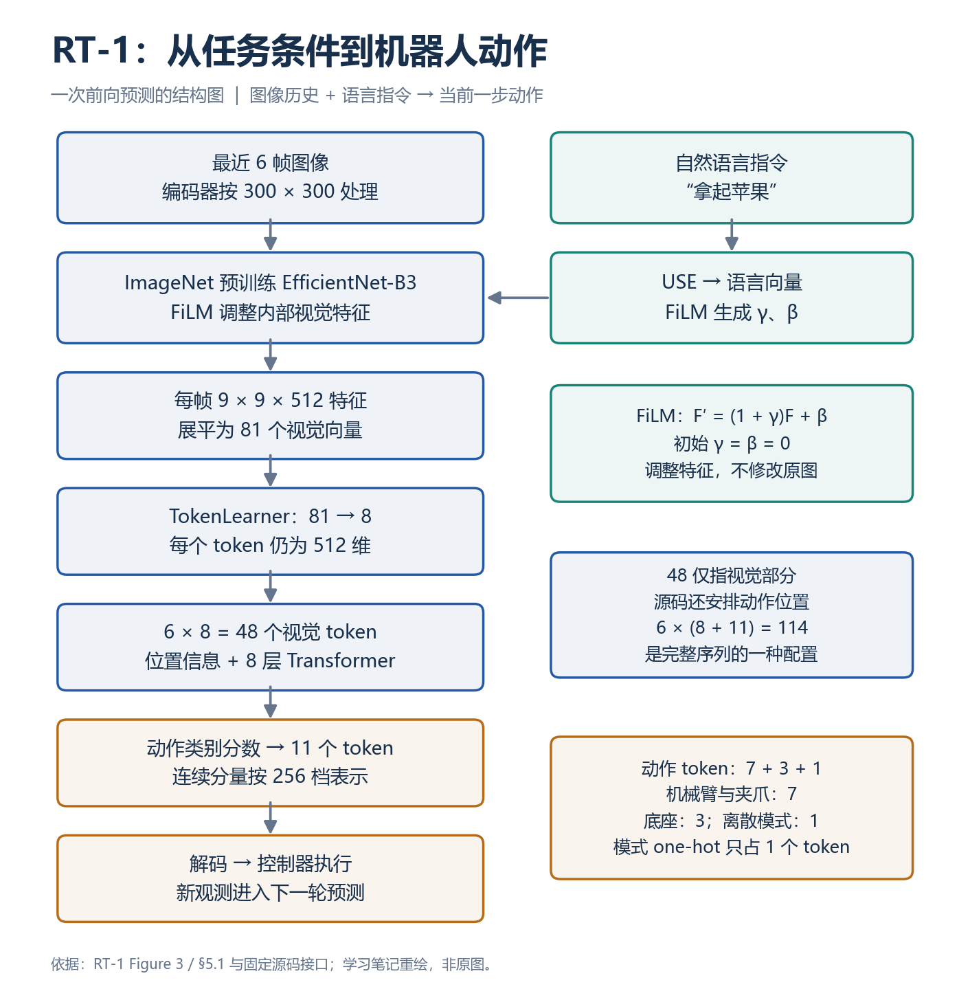
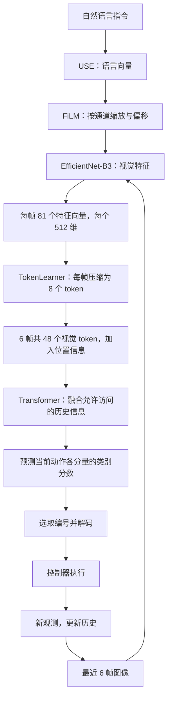
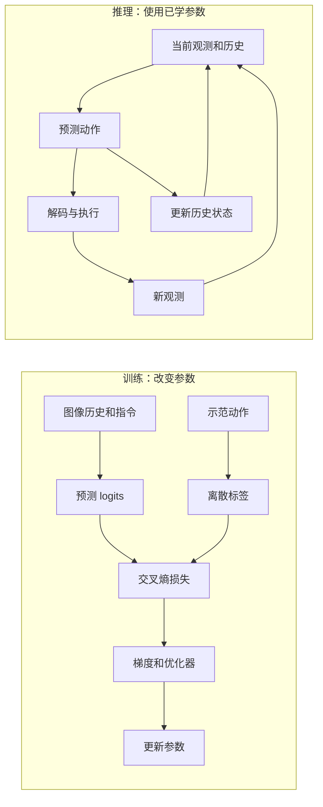
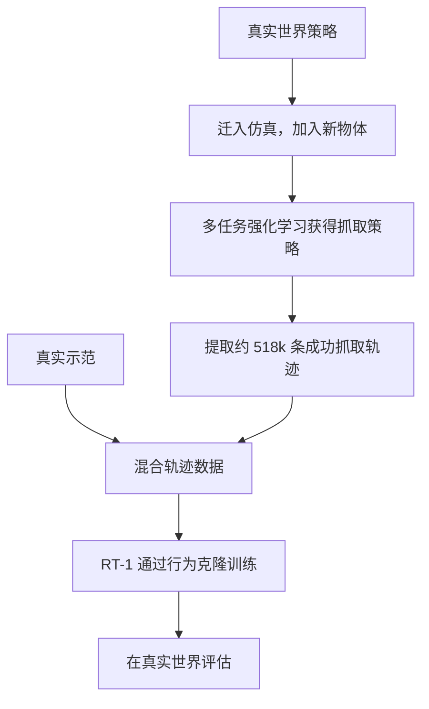
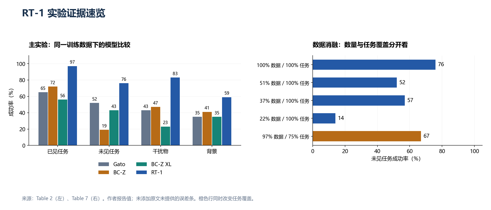
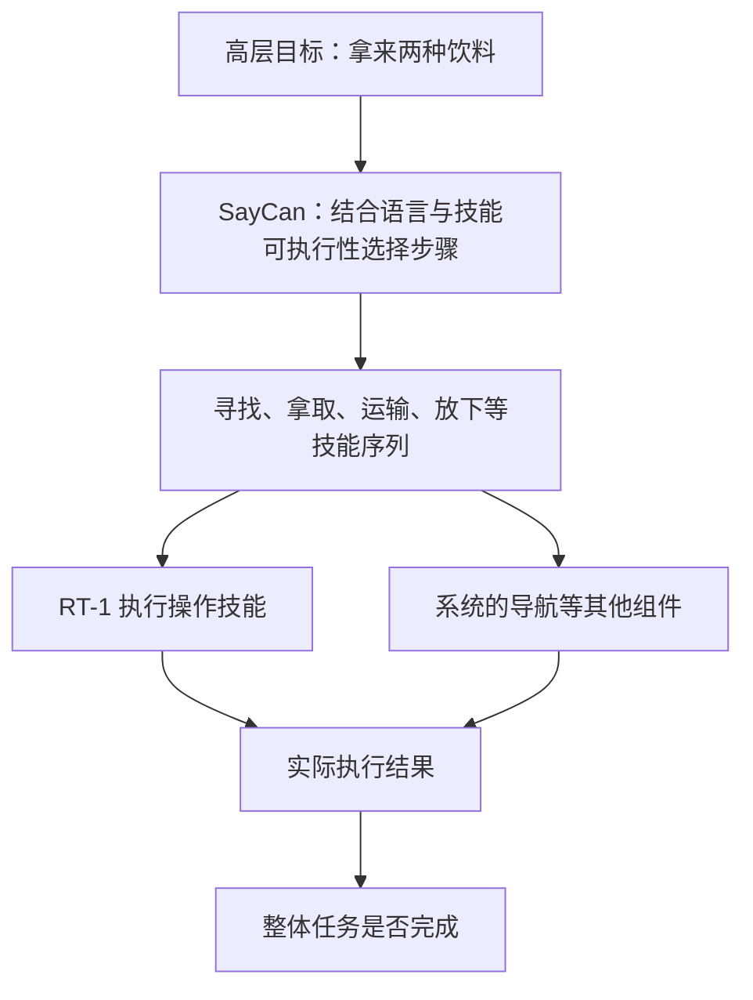
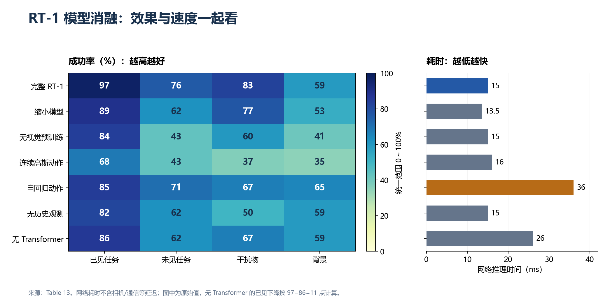

# RT-1 详细读书笔记：从多任务示范到实时机器人控制

> **阅读状态：已读完，完成一轮引导阅读与问答梳理。** 独立复述和源码理解继续巩固；这不是完整论文实验复现。
>
> 更新：2026-10-28。论文：**RT-1: Robotics Transformer for Real-World Control at Scale**，2022。
> [原论文](https://arxiv.org/abs/2212.06817) · [项目页](https://robotics-transformer1.github.io/) · [官方代码](https://github.com/google-research/robotics_transformer) · [学习进度](../RT-1学习进度.md) · [实践记录](../../experiments/RT-1/README.md)

本文依据学习时使用的 **31 页本地 PDF**，引用章节和图表号；在线版本分页可能不同。表中成功率均为**作者报告的百分数**，我的本地运行结果单独列在第 12 节。流程图、重绘图表和教学例子是本笔记整理内容，不是新增模型实验。

## 阅读导航

| 想回看什么 | 入口 |
|---|---|
| 三分钟恢复主线 | [1. 一页速览](#s1) |
| 为什么做、解决什么 | [2. 问题与贡献](#s2) |
| 模型怎样工作 | [3. 结构与张量](#s3) |
| 训练与推理的区别 | [4. 两条流程](#s4) |
| 实时控制怎样实现 | [5. 速度与时序](#s5) |
| 数据怎样收集与使用 | [6. 数据工程](#s6) |
| 实验支持哪些结论 | [7. 实验证据](#s7) · [8. 消融](#s8) |
| 有什么局限、我能学到什么 | [9. 局限](#s9) · [10. 研究启发](#s10) |
| 易错概念与复习题 | [11. 纠错与自测](#s11) |
| 代码与原文在哪里 | [12. 实践与源码](#s12) · [13. 原文索引](#s13) |

## 1. 一页速览：先记住六件事

**一句话概括：RT-1 用语言条件化视觉编码、紧凑视觉 token 和 Transformer，把大量多任务示范转化为一个可实时执行的机器人策略，并检验泛化和吸收异构数据的能力。**

| 问题 | 最重要的回答 |
|---|---|
| 想解决什么？ | 单个策略能否从大量、多样的机器人经验中学习多种任务，并适应部分新指令与场景？ |
| 输入什么？ | 最近 6 帧图像与当前自然语言指令 |
| 怎样处理？ | USE 编码语言 → FiLM 调节 EfficientNet-B3 特征 → TokenLearner 压缩 → Transformer |
| 输出什么？ | 当前一步动作的离散 token，再还原成机械臂、夹爪、底座和模式控制量 |
| 怎样学习？ | 行为克隆：示范动作为监督，优化动作分类交叉熵 |
| 证明到哪里？ | 支持多任务执行、部分组合/环境泛化和异构数据利用，未证明任意新动作或通用灵巧操作 |

**记忆链：语言定任务，图像给状态，FiLM 调特征，TokenLearner 做压缩，Transformer 预测动作。**

| 关键数字 | 含义 | 不要误读成 |
|---|---|---|
| 约 13 万条、13 台、17 个月 | 真实示范回合数、采集机器人数量和时间跨度 | 13 万张独立图片 |
| 744 | 数据集的任务指令数 | 744 种完全不同的底层运动技能 |
| 6 × 8 = 48 | 6 帧，每帧 8 个视觉 token | 完整源码序列永远只有 48 个位置 |
| 11 | 主模型动作 token 数：7 + 3 + 1 | 常见单臂任务的 7 维接口 |
| 97 / 76 / 83 / 59 | Table 2 已见、未见、干扰物、背景成功率 | 任意场景的成功保证 |
| 3 Hz | 论文机器人系统的控制频率 | 网络推理只花 3 毫秒 |

## 2. 研究问题：瓶颈在哪里，作者怎样回应？

逐任务策略容易把经验分散在不同模型中。RT-1 研究的不是“从一个样本学会很多动作”，而是**大量任务是否能共享一个模型，以及什么数据能继续扩大能力**。

“拿苹果”和“拿饮料罐”可以共享接近、调整夹爪、抓取等经验，但具体动作仍受形状、位置和环境影响。图像帮助辨认物体和位置；两种物体都在画面里时，语言指定本次目标。

| 研究问题 | 做法 | 证据与边界 |
|---|---|---|
| 多种技能能否共同学习？ | 统一语言条件策略，混合多任务示范 | Table 2；能力仍受数据覆盖限制 |
| 哪些视觉信息与任务有关？ | USE + FiLM 在视觉编码阶段注入语言 | 架构明确；注意力图不单独证明因果 |
| 序列计算慢，如何实时控制？ | TokenLearner、历史 token 缓存、避免动作自回归开销 | 第 5.1 节、Table 13；还要计入相机/通信延迟 |
| 动作有多种合理选择怎么办？ | 按分量离散分类，表达多峰分布 | 优于本实验连续高斯方案，不代表优于所有连续策略 |
| 新任务和环境能否适应？ | 分开评估组合泛化、干扰物、背景，再测试综合变化 | Tables 2～3；完全新动作仍受限 |
| 不同来源的数据是否有用？ | 对齐动作表示、补齐语言标签、混合训练 | Tables 4～5；不是任意机器人即插即用 |

**贡献是模型设计、规模化采集、实时控制工程和多维评估的组合。** EfficientNet、FiLM、TokenLearner、Transformer 都有前序工作，不能逐一写成 RT-1 首创。

## 3. 模型细节：从图像与语言到动作

### 3.1 总流程图

*依据原文 Figure 3、第 5.1 节与主模型接口重绘。图中展示一次预测；执行后重新观察，形成闭环。*

语言影响的是网络内部特征，不是直接修改摄像头原图。模型预测控制量，控制器落实到硬件；一次预测不等于完成整个抓取技能。

### 3.2 图像与语言编码

- **视觉主干：** ImageNet 预训练 EfficientNet-B3。论文编码器使用 `300×300` 图像，输出 `9×9×512` 特征图。
- **展平：** 81 个空间位置，每个位置 512 维；不是先把原始图像切成 patch 再直接交给主 Transformer。
- **语言：** Universal Sentence Encoder（USE）编码指令；本地源码和 SavedModel 接口使用 512 维语言向量。
- **规模：** 第 5.1 节给出视觉语言 tokenizer 约 16M、Transformer 约 19M，总计约 35M 参数。

编码器分辨率与外部接口要区分：本地官方 SavedModel 接收 `256×320×3` RGB 图，不能把接口尺寸与内部处理尺寸混为一谈。

### 3.3 FiLM：语言怎样调整视觉？

本地实现的核心计算：

$$
F'_{b,h,w,c}=(1+\gamma_{b,c})F_{b,h,w,c}+\beta_{b,c}
$$

`F` 是视觉特征；`c` 是特征通道，并非固定物体类别。语言向量通过两个可学习投影得到 `γ`、`β`；将 `[B,C]` 扩为 `[B,1,1,C]`，广播到各空间位置。

**零初始化为什么重要？** 两个投影初始权重、偏置均为零，于是 `γ=β=0`，最初 `F'=F`，避免刚加入 FiLM 就破坏视觉预训练表示。之后参数可以学习，不是永久为零。

教学例子：`F=4、γ=0.5、β=1`，则 `F'=7`。刚初始化时，相同视觉特征搭配不同语言仍可能输出相同；不能据此说训练后的 FiLM 不利用语言。**零初始化也不等于冻结参数。**

### 3.4 TokenLearner：81 → 8 压缩什么？

每个输出 token 对 81 个位置学习一组权重，汇总原特征：

$$
z_k=\sum_{j=1}^{81}\alpha_{k,j}f_j,\qquad \sum_j\alpha_{k,j}=1
$$

本地实现用 MLP 产生分数，沿空间位置 softmax，再加权求和。输出 `8×512`：**位置数量减少，特征宽度仍为 512。**

不是取前 8 个位置，也不规定一个 token 对应一个物体。目标是在保留任务相关信息的同时减少计算；不能保证任何被压缩的信息都无关。6 帧由 `486` 个视觉位置降至 `48`，显著降低后续注意力的序列负担。

### 3.5 Transformer、历史和位置：48 与 114 不矛盾

论文主干是 **8 层 decoder-only Transformer**，使用位置编码和因果掩码。位置表示 token 的排列关系，掩码限制当前预测可以访问的信息。

| 层次 | 示例形状 / 数量 | 含义 |
|---|---|---|
| 语言条件 | `[B,6,512]` | 各帧的指令条件 |
| 视觉特征展平 | `[B×6,81,512]` | 暂时合并 batch 与时间 |
| TokenLearner 输出 | `[B×6,8,512]` | 压缩视觉位置 |
| 恢复时间轴 | `[B,6,8,512]` | 6 帧，每帧 8 个 token |
| 论文视觉部分 | 48 | 仅视觉 token 数 |
| 源码完整序列示例 | `[B,114,512]` | 每帧 8 个视觉位置 + 11 个动作位置，`6×(8+11)` |
| 完整序列 logits 示例 | `[B,114,256]` | 之后选择动作对应输出位置 |
| 当前动作编号 | `[B,11]` | 按动作规格解码 |

114 是按 6 帧、11 个动作 token 组装源码的示例，不是说看了 114 张图片。官方测试也可能使用不同帧数和动作规格。

**源码补充：** 动作标签经过 embedding 后被 `zeros_like` 清零，并配合掩码与输出位置偏移。不能看到动作位置、历史动作字段或逐 token 循环，就认定模型依赖此前动作值自回归生成后续动作。D.4 明确说明最终模型未采用其对照中的自回归动作方式。

详见 [TransformerNetwork](../../rt1/robotics_transformer/transformer_network.py)：输出选择使用 `_action_tokens_mask - 1`。这是后续源码学习内容，不需要初读时背索引。

### 3.6 动作 token 与量化

| 部分 | 分量 | token 数 |
|---|---|---:|
| 机械臂末端平移 | x、y、z | 3 |
| 机械臂末端旋转 | roll、pitch、yaw | 3 |
| 夹爪 | 开合程度 | 1 |
| 移动底座 | x、y、yaw | 3 |
| 离散模式 | 控制机械臂、控制底座或终止 | 1 |
| **合计** | **7 + 3 + 1** | **11** |

连续分量在各自范围内均匀分为 256 档。模式是三个离散选项，本地接口的 3 维 one-hot 只表示 **1 个 token**，数组长度不等于 token 数。

本地连续编码/解码的简化公式：

$$
q=\left\lfloor255\frac{\operatorname{clip}(a,a_{\min},a_{\max})-a_{\min}}{a_{\max}-a_{\min}}\right\rfloor,
\qquad
\hat a=a_{\min}+\frac{q}{255}(a_{\max}-a_{\min})
$$

先裁剪，再将非负归一化数值转为整数，是截断而非四舍五入。解码存在量化误差；编号不是厘米或角度，单位、坐标系由接口定义。

**教学例子：** 若范围 `[-1,1]`、仅 5 档，`0.3 → 0.65×4=2.6 → 编号2 → 解码0.0`。真实 RT-1 不是 5 档。

### 3.7 训练目标与损失

把轨迹动作转换为编号标签，优化分类交叉熵。概念上：

$$
\mathcal L_{\mathrm{BC}}=-\mathbb E_{(i,o,a)\sim D}\sum_d\log p_\theta(q_d(a_d)\mid i,o_{\mathrm{history}})
$$

`i` 是指令，`o` 是观测，`d` 是动作分量。公式概括目标，不代替源码的掩码、位置对齐、缩放与平均。

若正确标签为 180，却偏向 20，损失和优化器推动提高正确类别概率、更新权重；不需要先在机器人上试错。**任务定义中有成功奖励，不意味着实际用强化学习训练 RT-1**；第 3 节明确采用成功轨迹上的行为克隆。

## 4. 训练与推理：两条流程

| 变化对象 | 含义 | 是否必然训练？ |
|---|---|---|
| 图像 | 新物体位置、光照、视角 | 否 |
| 历史状态 | 最近输入/特征、序列位置等上下文 | 否 |
| 预测动作 | 固定模型对新输入作出新响应 | 否 |
| 模型参数 | 优化器修改网络权重 | 是，这才是这里的训练更新 |

类比 `y=2x`：参数 2 固定，输入 1 与 3 仍得到不同输出。杯子移动后伸手方向改变，可以只是推理响应。`state = result.state` 更新上下文；连续调用 7 次 `policy.action` 不代表训练 7 次，也不能推出训练过 1 次。

## 5. 实时控制：速度与稳定时序

第 5.1 节目标至少 3 Hz，网络推理预算低于 100 ms，还要考虑相机和通信。两项加速是 TokenLearner 压缩，以及缓存/复用重叠历史窗口中的视觉 token；论文分别报告约 2.4 倍、1.7 倍加速，不能无条件相乘成任意设备的总加速比。

| 时间数字 | 对应含义 |
|---|---|
| 15 ms | Table 13 的网络推理，不含完整控制链路 |
| 约 333 ms | 3 Hz 对应周期，并非都用于网络计算 |
| 280 ms | C.1 从状态采集到应用动作的固定时点，不是算完后再等 280 ms |
| 本机约 1.60～2.05 s / 步 | 历史 Windows CPU 合成输入推理，不能当论文速度 |

教学例子：从各自观测采集计时，100 ms 算完等 180 ms，200 ms 算完等 80 ms，均在 280 ms 应用动作。目的是减少计算耗时变化带来的时序抖动，不是每步归位或等整个抓取结束。该机制基于原文观察到的延迟范围，不能理解为计算超时仍能无条件保持目标时序。

## 6. 数据工程：怎样收集、混合和选择模型？

### 6.1 真实数据采集

约 130k 回合、13 台机器人、17 个月；回合是带指令的连续图像—动作轨迹。系统安排指令与场景随机化，人用两个 VR 手柄遥操作，并使遥操作与策略动作空间对应。

Table 1 中“移动物体到另一物体旁”有 337 条指令，“拿物体”130 条，开/关抽屉各 3 条。**指令数与示范条数是不同单位，数据量多也不保证各技能覆盖均衡。** 不应只采集最容易的任务。

### 6.2 模拟轨迹的来源与最终训练方式

强化学习用于获得模拟策略和轨迹，不代表 RT-1 的学习目标变成强化学习。新增物体在模拟里主要练过抓取，真实测试的一部分再要求已有技能与这些物体的新组合。

### 6.3 跨机器人数据对齐

Kuka 数据为 QT-Opt 的约 209k 条成功箱内抓取轨迹，与人类示范在机体、动作、环境、动力学和来源上都不同。

| 对齐项 | D.2 的处理 |
|---|---|
| 动作 | 将 Kuka 4-DOF 转为 RT-1 表示，roll/pitch 补 0，保留 yaw |
| 夹爪 | 二值闭合指令转换为连续闭合程度 |
| 语言 | 无物体名称，统一标为 `pick anything` |
| 混合 | RT-1 数据 : Kuka 数据 = 2 : 1，是训练混合比例而非原始条数比例 |

轨迹抓海绵却随意标“抓苹果”，就会把指令与错误行为配成监督。可靠确认目标和任务后，才可以使用具体物体标签。

### 6.4 仿真选模型与模拟数据训练不同

C.3 在仿真中支持 551 个任务，用 RetinaGAN 将模拟画面转换得更接近真实，再运行真实数据训练的策略，用完整回合表现辅助选择 checkpoint。

关键是**排序有参考价值**，而非绝对分数相同。教学例子：A 仿真/真实为 40%/70%，B 为 55%/85%，虽然仿真低估绝对值，仍选出了更好的 B。仍需真机验证这种对应，不能把模拟值当真实成功率。

除原论文第 6.3 节专门混合模拟数据的实验外，此处仿真主要用于模型选择。Figure 9 记录数据、任务和表现随时间增长，不能仅凭曲线把提升全部归因于某一个因素。

## 7. 实验：什么问题得到了怎样的回答？

### 7.1 先看比较与评估设置

Gato、BC-Z、BC-Z XL 都在 RT-1 数据上训练，比较的是这组数据下的相应设计，不是直接拼接不同论文的原始成绩。Gato 为满足运行约束缩小到与 RT-1 接近的规模；不能写成“全面打败原始 1.2B Gato”。

| 评估 | 主要改变什么？ | 结论边界 |
|---|---|---|
| 已见任务 | 训练覆盖的指令，位置等条件仍有变化 | 不等于重放训练轨迹 |
| 未见任务 | 已见技能、物体的新组合 | 不等于完全新动作 |
| 干扰物 | 数量、拥挤程度、遮挡 | 中等与困难均为 9 个，不是数量继续增加 |
| 背景 | 原环境 → 图案桌布 → 新厨房 | 新厨房同时改变多项，不能只归因于桌布 |
| L1 / L2 / L3 | 新台面/光照 → 新干扰物 → 新物体/位置等叠加 | 是测试难度，不是训练阶段 |
| 长程任务 | 规划、导航与操作串联 | 成绩不全部属于 RT-1 单独能力 |

正文记录超过 3000 次真实试验，不是每个表格单元格的样本数。D.1 说明已见任务指标按技能加权汇总，不能直接当作全部回合成功次数除以总回合数。缺少逐格样本量、重复训练与误差范围时，不自行补写统计显著性。

### 7.2 多任务与泛化主结果（Table 2）

| 模型 | 已见任务 | 未见任务 | 干扰物 | 背景 |
|---|---:|---:|---:|---:|
| Gato | 65 | 52 | 43 | 35 |
| BC-Z | 72 | 19 | 47 | 41 |
| BC-Z XL | 56 | 43 | 23 | 35 |
| **RT-1** | **97** | **76** | **83** | **59** |

**支持的结论：** 在这些评估中 RT-1 汇总表现优于基线。背景的 59% 仍明显低于已见的 97%，说明“泛化有效”不等于“困难全部解决”。扩大 BC-Z 也未在每项指标上提高表现。

*左：Table 2，统一 0～100% 坐标。右：Table 7 的未见任务结果；仅保留 75% 任务的配置单独着色，避免与只减少数据量的对照混淆。未添加误差条，因为这里没有对应的不确定性数据。*

### 7.3 更真实的综合变化（Table 3）

| 模型 | 汇总 All | L1 | L2 | L3 |
|---|---:|---:|---:|---:|
| Gato | 30 | 63 | 25 | 0 |
| BC-Z | 45 | 38 | 50 | 50 |
| BC-Z XL | 55 | 63 | 75 | 38 |
| RT-1 | 70 | 88 | 75 | 50 |

RT-1 汇总最高，但 **L2 与 BC-Z XL 持平，L3 与 BC-Z 持平**，不能说每一级都严格胜过所有基线。All 按原表保留，不能擅自将三个百分数等权平均。

### 7.4 模拟经验能帮助真实机器人吗？（Table 4 / 9）

| 真实世界测试内容 | 仅真实数据 | 真实 + 模拟 |
|---|---:|---:|
| 原有真实物体、已见技能 | 92 | 90 |
| 仅在模拟中见过的物体，执行模拟中练过的技能 | 23 | 87 |
| 仅在模拟中见过的物体，与未配对训练过的已有技能组合 | 7 | 33 |

第二行提升 **64 个百分点**，支持这组条件的模拟到真实迁移。第三行提升 **26 个百分点**，还要求组合泛化，不是从零学全新技能。92→90 下降 2 点，不应直接说“严格零损失”，也不能缺少误差分析就认定差距稳定。

### 7.5 Kuka 数据是否帮助 EDR？（Table 5 / 10）

| 训练数据 | 原有课堂任务 | 箱内抓取 |
|---|---:|---:|
| EDR only | 92 | 22 |
| Kuka only | 0 | 0 |
| EDR + Kuka | 90 | 39 |

测试统一使用 Everyday Robots（EDR）。混合后箱内抓取 22→39，提高 **17 个百分点**。Kuka-only 为 0，不证明 Kuka 数据无价值；混合对照显示可以受益。

**边界：** 箱内抓取评估使用类似箱子，还通过加线缆、夹爪涂灰等使外观接近 Kuka。这不是完全不做对齐的任意机体迁移；本表也没有完全分离额外数据量与数据来源的所有影响。

### 7.6 长任务：规划正确还不够（Table 6 / 11）

SayCan 使用 MT-OPT 训练的价值函数辅助估计技能可执行性。RT-1 是比较中的操作策略，不能把规划、导航与价值函数都归到 RT-1 网络内部。

| 系统 | Kitchen1 规划 | Kitchen1 执行 | Kitchen2 规划 | Kitchen2 执行 |
|---|---:|---:|---:|---:|
| 原始 SayCan | 73 | 47 | — | — |
| SayCan + Gato | 87 | 33 | 87 | 0 |
| SayCan + BC-Z | 87 | 53 | 87 | 13 |
| SayCan + RT-1 | 87 | 67 | 87 | 67 |

原始 SayCan 提示设置略有不同。后面三组规划均为 87%，RT-1 执行更好，支持的是**执行优势**。

正式评估有 **15 条长任务指令**，平均每条 **9.6 个步骤**、涉及 **2.4 个操作技能**。作者另在补充视频展示最长 50 步的执行。**不能合并为“50 步任务成功率 67%”。** 两个厨房都是 67%，也不能保证任意陌生厨房都一样。

教学例子：每步成功概率 0.9、相互独立、全部成功才完成且无重试时，5 步为 `0.9^5≈59%`，10 步为 `0.9^10≈35%`。真实成败可能相关并包含恢复机制；例子用于解释可靠性累积，不是 Table 6 的计算方式。

### 7.7 数据量与任务多样性（Table 7）

| 配置 | 保留任务 % | 保留数据 % | 已见 | 未见 | 干扰物 | 背景 |
|---|---:|---:|---:|---:|---:|---:|
| 完整 RT-1 | 100 | 100 | 97 | 76 | 83 | 59 |
| 每任务最多 200 条 | 100 | 51 | 71 | 52 | 39 | 59 |
| 每任务最多 100 条 | 100 | 37 | 55 | 57 | 35 | 47 |
| 每任务最多 50 条 | 100 | 22 | 59 | 14 | 31 | 41 |
| 删除部分低数据任务 | 75 | 97 | 86 | 67 | 42 | 53 |

原表标 22%，相邻文字写 22.5%；本表按原表抄录。

- 保留任务覆盖但减少示范量，总体表现与泛化下降，支持数据量的重要性。
- 减少约 3% 数据却删除 25% 任务，未见 76→67、干扰物 83→42，说明低频任务可能包含独特经验。
- 37% 数据的 57 高于 51% 数据的 52，**局部不严格单调**。不能凭两行证明少数据更好，需要重复实验、波动和构成信息。
- 审慎结论：**在这套删减与评估中，任务覆盖有不能由总量简单代替的价值**，不是任何条件下多样性都胜过数量。

## 8. 模型消融：哪些设计有用？

以下抄录 Table 13 原始值。成功率为 %，时间为 ms；只统计网络推理，差值按原始数字重新计算。

| 模型变体 | 已见 | 未见 | 干扰物 | 背景 | 网络耗时 |
|---|---:|---:|---:|---:|---:|
| 完整 RT-1 | 97 | 76 | 83 | 59 | 15 |
| 缩小模型 | 89 | 62 | 77 | 53 | 13.5 |
| 无 ImageNet 预训练 | 84 | 43 | 60 | 41 | 15 |
| 连续高斯动作 | 68 | 43 | 37 | 35 | 16 |
| 自回归动作 | 85 | 71 | 67 | 65 | 36 |
| 无历史，只用单帧 | 82 | 62 | 50 | 59 | 15 |
| 无 Transformer | 86 | 62 | 67 | 59 | 26 |

*每格保留数值，成功率统一颜色范围 0～100；耗时单列，越低越快。二者不合成未经定义的总分。数据来自原文 Table 13。*

### 8.1 预训练不等于冻结

去掉预训练是从随机视觉权重开始，仍使用机器人数据训练；加载 ImageNet 权重后不更新，才是有预训练但被冻结。未见任务 76→43，下降 33 点，支持视觉预训练对泛化的帮助，不是从 ImageNet 直接搬来机器人动作。

### 8.2 离散分类与多峰动作

教学例子：绕障碍物时向左、向右都合理，简单平均却可能朝障碍物中间走。例子说明动作选择的多峰性，不表示 RT-1 显式预测完整绕行路线。

离散分类可以给相隔较远的档位较高概率，单个高斯仅有一个峰。但不代表动作分量间所有联合依赖都已完美建模，更不能推出所有连续策略都差；扩散、混合分布等不属于该实验中的同一对照。

### 8.3 历史有帮助，不代表知道现在的一切

去掉历史后，干扰物 83→50，下降 33 点，背景仍为 59。历史帮助并非处处相同。目标遮挡时，过去图像可能提供身份、位置、运动线索；目标移动后不能直接沿用旧位置。**不能保证定位，也不是完全没用。** 这些是可能机制，不是表格单独证明的内部策略。

### 8.4 自回归、规模与速度的取舍

- 自回归背景 59→65，但已见 97→85、未见 76→71，耗时 15→36（2.4 倍）。不能只挑背景一列下结论。
- 缩小模型耗时 15→13.5，却损失多项成功率。是否值得取决于实际计算资源与控制预算。
- 去掉 Transformer 实测为 26 ms，反而更慢。少一个模块不能保证更快。

**原文不一致提醒：** D.4 前后对小模型参数量有 `35M→21M` 与 `31M→25M` 两种描述，后者还伴随不相符的比例；本笔记不据此认定唯一小模型规模。Table 13 的无 Transformer 已见值为 86，却标了 `-13`；相对 97 应为 **-11 个百分点**。本笔记保留 86，按实际相减解释。

### 8.5 注意力图：解释线索不等于因果

D.5 / Figure 13 展示对物体、抽屉等区域的关注。注意力落在杯子附近与成功抓取同时出现，不证明前者就是成功原因；失败时也可能关注杯子。因果研究需要干预、对照与排除其他影响。**热图是解释线索，不是单独因果证明。**

## 9. 局限与证据边界

| 局限 | 为什么？ | 不应推出 |
|---|---|---|
| 模仿不保证超越示范者 | 拟合示范没有直接提供更优方案目标 | 模型一定会主动发现更短路线 |
| 完全新动作泛化有限 | 主要展示已见技能/概念的新组合 | 会七百条指令就一定会穿针 |
| 灵巧性有限 | 广泛任务覆盖不是精细操作能力的保证 | 任务多就是通用机器人 |
| 环境鲁棒性不完善 | 背景 59%，综合场景仍有失败 | 两个厨房一样，任何厨房都一样 |
| 数据与硬件要求高 | 大量采集、特定机体与动作接口 | 下载网络即可直接换任意机器人 |
| 长任务受多环节影响 | 单步失败累积，依赖外部规划与导航 | 全部长程能力都是 RT-1 单独产生 |
| 不确定性信息不足 | 表中差距不等于重复实验中的稳定优势 | 单次相差 5 点必然有显著效果 |

作者未来方向：让非专家通过定向采集与模型提示扩展技能；增加环境多样性；通过可扩展注意力和记忆提高反应速度、上下文保留。**这些是计划，不是已实现的全部能力。**

附录模型卡明确研究用途、尚未验证研究设置外的适用性，并标注不适合直接用于与人交互。部署要按实际平台和任务重新验证。

### 版本与数字口径

1. 正文 6.1 的未见评估写 21 条，D.1 / Table 8 列出 53 条保留任务；正文已见评估的样本描述与附录 744 任务覆盖描述也不同。**不把它们无说明地当成同一组评估数量。**
2. D.1 的训练干扰物范围为 0～4，Figure 12 图注为 2～4；引用需注明位置，不伪造一致口径。
3. 67%−53%=14 **个百分点**，不是相对增长 14%。
4. 固定源码、导出的 SavedModel 与本机兼容实现不能逐行等同。

## 10. 能从这篇文献学到什么？

### 10.1 建模思路

- **从控制约束反推架构。** 先问延迟、频率、历史和动作接口，再选规模和 token 数。
- **任务条件可以早期进入视觉处理。** FiLM 提供一种方式，具体收益仍需对照。
- **动作表示也是设计。** 不只换网络，还要检查量化、分布、字段顺序、单位和坐标系。
- **共享经验不等于各任务动作相同。** 参数共享提供迁移机会，指令和图像决定当前行为。

### 10.2 数据与实验习惯

| 习惯 | 怎样落实 |
|---|---|
| 分开数量与覆盖 | 记录回合、任务、物体、环境，而不只写总量 |
| 重视低频任务 | 检查是否包含独特经验，不能只因数据少就删 |
| 对齐含义再混数据 | 核对动作、语言、终止、范围与坐标 |
| 一个结论对应一套证据 | 标注训练配置、测试条件、样本单位和原表 |
| 单因素与综合评估互补 | 前者帮助归因，后者检验复杂环境表现 |
| 比较要承认波动 | 匹配预算，重复训练/评估，报告误差与分布 |

### 10.3 可做的学习实验（计划，未完成）

| 练习 | 问题 | 最小可信证据 |
|---|---|---|
| 固定权重，改变图像/历史 | 动作变化是否需要训练？ | 权重未变，输入与输出的对应记录 |
| 观察 FiLM 初始化 | 为什么初始恒等？ | 同一特征、不同语言的输出比较 |
| 做一次优化器更新 | 训练与前向差在哪？ | 梯度和参数前后变化，不只看程序跑通 |
| 固定少量轨迹过拟合 | 训练管线是否接通？ | 固定数据损失变化，不冒充泛化成绩 |
| 同量不同环境数据对照 | 环境覆盖是否帮助？ | 独立测试场景、匹配预算、重复评估 |

这些是学习方向，不是已完成实验，也不直接构成未经检索的原创科研贡献。

## 11. 易错概念与复习卡

| 容易说错 | 准确表述 |
|---|---|
| 一个样本学很多动作 | 大量、多任务示范共同学习 |
| 外观决定该拿哪个 | 图像提供场景，语言指定目标 |
| FiLM 修改原图 | 修改网络内部视觉特征 |
| 无预训练就是不训练 | 从随机权重训练；冻结才是当前不更新 |
| 动作变了就是训练 | 输入/历史变化也能改变动作，需检查参数 |
| 推理 7 步至少训练了 1 次 | 这段运行可以完全没有训练 |
| 旧位置变了，历史无用 | 历史仍提供线索，但不保证当前位置 |
| RL 产生的数据使 RT-1 成为 RL | 数据产生方式与训练目标分开 |
| 中等到困难干扰物更多 | 数量同为 9 个，拥挤与遮挡改变 |
| 注意力看杯子证明成功原因 | 只有解释线索，需额外因果证据 |
| 50 步成功率 67% | 正式评估与视频展示是不同证据 |
| 模块少一定更快 | 看实际测量与任务表现 |

### 三句话复述

> **问题：** RT-1 研究单个策略能否吸收大量多任务示范，执行多种指令并泛化到部分新任务和环境。
>
> **方法：** USE 编码语言，FiLM 调节 EfficientNet 特征，TokenLearner 压缩 token，Transformer 利用图像历史预测离散动作，通过行为克隆训练，并用缓存等工程手段满足时序要求。
>
> **证据与局限：** 主实验、数据混合和消融支持多任务执行、部分泛化和数据利用；新动作、灵巧性、复杂环境和部署仍受限，长程系统还依赖 SayCan 等组件。

先自己回答，再展开答案

1. **48 与 114 为什么不同？** 前者是视觉部分，后者是包含动作位置的一种源码序列示例。
2. **模式 one-hot 为什么只有 1 个 token？** 三个数共同表示一个离散选择。
3. **FiLM 初始为什么不随语言改变相同特征？** 两个投影初始为零，之后可学习。
4. **参数固定动作能变吗？** 能，图像、语言和历史可以变化。
5. **57 高于 52 说明少数据更好吗？** 不能，要检查构成、重复实验和波动。
6. **Kuka-only 为 0 说明没价值吗？** 不，混合对照显示在规定设置下有帮助。
7. **15 ms 等于控制周期吗？** 不，只有网络推理。
8. **读完等于复现吗？** 不，阅读、源码理解、训练和闭环评估分别记录。

## 12. 我的阅读与实践：已完成什么？

**论文已完成一轮正文和主要附录的引导阅读、问答与全文串联，阅读任务记为完成。** 独立复述继续巩固，尤其是输入/历史/参数、预训练/冻结、观察/因果。

**源码逐步学习仍在 FiLM 附近。** 不因论文读完就把完整掩码、TokenLearner 实现或训练工程记为独立掌握。

| 历史记录 | 证据 | 不应声称 |
|---|---|---|
| 33 项实际测试通过、10 项框架占位跳过 | [测试汇总](../../rt1/outputs/tests/summary.json) | 从头训练复现完成 |
| 官方 rt1main 连续 7 步推理 | [推理结果](../../rt1/outputs/inference.json) | 真机任务成功率已验证 |
| 42 个官方文件校验与兼容修改 | [校验报告](../../rt1/outputs/artifact-verification.json)、[补丁](../../rt1/compatibility.patch) | 副本包含全部模型权重 |
| 四个模块的辅助练习运行 | [源码导读](../../rt1/项目导读与学习路线.md) | 学习者已独立复跑全部练习 |

推理使用合成 RGB、512 维零语言向量和补零观测，检验的是加载、接口、动作形状/范围及状态传递。测试/推理来自 2026-10-11，练习来自 2026-10-12；本次笔记更新没有新增模型实验。

| 源码阅读顺序 | 对照概念 |
|---|---|
| [action_tokenizer.py](../../rt1/robotics_transformer/tokenizers/action_tokenizer.py) | 分档、解码、字段顺序 |
| [film_conditioning_layer.py](../../rt1/robotics_transformer/film_efficientnet/film_conditioning_layer.py) | Dense、零初始化、广播 |
| [token_learner.py](../../rt1/robotics_transformer/tokenizers/token_learner.py) | 空间权重、softmax、加权求和 |
| [image_tokenizer.py](../../rt1/robotics_transformer/tokenizers/image_tokenizer.py) | 视觉与时间/batch 整合 |
| [transformer.py](../../rt1/robotics_transformer/transformer.py) | 位置、自注意力、残差、logits |
| [transformer_network.py](../../rt1/robotics_transformer/transformer_network.py) | 完整序列、掩码、历史、损失分支 |
| [sequence_agent.py](../../rt1/robotics_transformer/sequence_agent.py) | 标签传入、损失、梯度、优化器 |

[固定源码配置](../../rt1/robotics_transformer/configs/transformer_mixin.gin)提供 8 层、8 头、`layer_size=128`、宽度 512、dropout 0.1、Adam 学习率 `1e-4` 等。`layer_size` 传给注意力 `key_dim`，不能等同整个 token 宽度；配置片段不是完整训练流水线。

## 13. 原文回查索引

| 内容 | 原文位置 | 核对重点 |
|---|---|---|
| 问题与学习方式 | 第 1～4 节 | 数据吸收、策略输入输出、行为克隆 |
| 架构与动作 | 5.1、Figure 3 | FiLM、81→8、6 帧、离散动作 |
| 数据 | 5.2、Table 1 | 回合、机器人、指令与技能 |
| 主结果 | 6.1～6.2、Tables 2～3 | 基线训练条件与泛化设置 |
| 异构数据 | 6.3、Tables 4～5；D.2、Tables 9～10 | 来源、转换、训练与评估域 |
| 长程任务 | 6.4、Table 6；D.3、Tables 11～12 | 规划/执行、15 条、9.6 步、视频 |
| 数据消融 | 6.5、Table 7 | 数量、多样性、局部波动 |
| 局限 | 第 7 节 | 新动作、灵巧性、环境和记忆 |
| 模型卡与工程 | B、C.1～C.4、Figures 7～9 | 使用边界、时序、采集、选模型 |
| 模型消融 | D.4、Table 13 | 预训练、动作分布、历史与速度 |
| 注意力解释 | D.5、Figure 13 | 观察与因果的区别 |

代码依据快照 `4569641b8111f3f402c32d8e24becd2a6e952ecc` 与记录的兼容补丁。三幅图片由[重绘脚本](../../scripts/render_rt1_figures.py)生成，数据来自注明的原表；未重新评估模型。复习时优先按章节与表号回查。

## 2026-10-29 实际图片与指令补记（10 月 30 日归档）

官方 `rt1main` 已使用自己的照片和指令 `pick up the hellokitiy` 完成一次离线推理。新增 EXIF 方向修正，USE Large v5 实际编码文本，程序退出码 0。该编码器与原始模型的精确匹配仍未核实；没有机器人执行或任务成功率验证。历史测试数据不变，详情与数值证据见 [代码学习记录](../RT-1代码学习记录_2026-10-29.md)。照片、权重、仿真视频与真实机器人相关材料留在本地。
