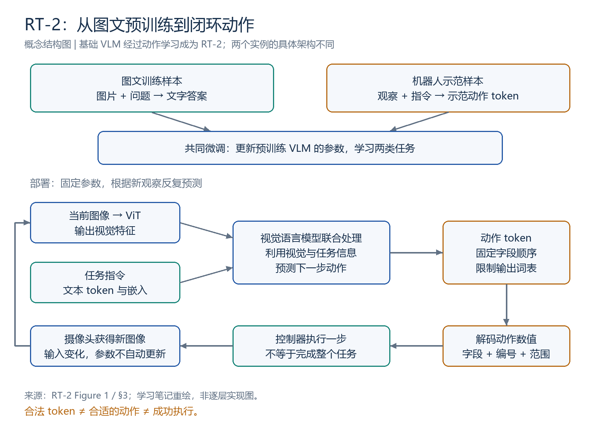
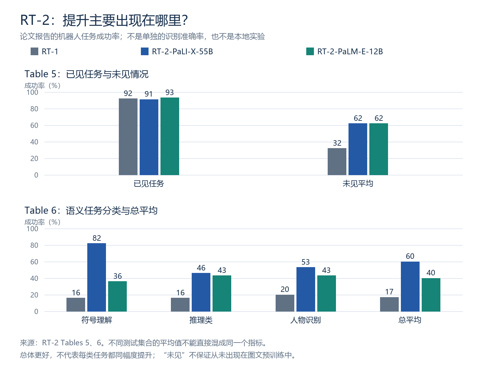
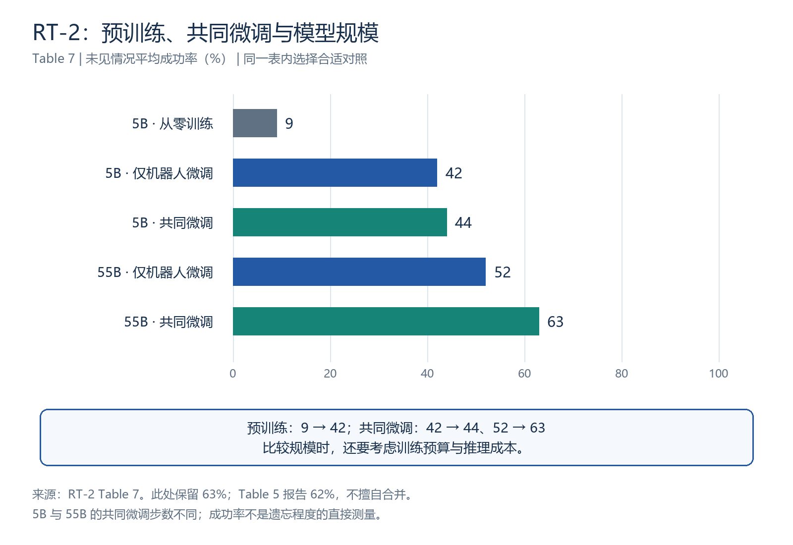

# RT-2 详细读书笔记：把视觉语言预训练连接到机器人动作

> **阅读状态：已读完，完成一轮核心正文、主要图表和相关附录的引导阅读与问答。** 独立回看继续巩固；尚未开展 RT-2 源码实践、训练或机器人评估。
>
> 更新：2026-10-29。论文：**RT-2: Vision-Language-Action Models Transfer Web Knowledge to Robotic Control**，CoRL 2023。
> [原论文](https://arxiv.org/abs/2307.15818) · [项目页](https://robotics-transformer2.github.io/) · [会议版本](https://proceedings.mlr.press/v229/zitkovich23a.html) · [学习进度](../RT-2学习进度.md) · [当天记录](../../weekly/2026-10-29.md)

本文依据本地阅读版本，按章节和图表号定位。成功率均为**论文作者报告的数据**；重绘图和教学例子不是新增模型实验。图 1 的流程讲解不代替两个基础模型的全部实现细节。原论文 PDF 留在本地，仓库提供来源链接。

## 阅读导航

| 想回看什么 | 入口 |
|---|---|
| 三分钟恢复主线 | [1. 一页速览](#s1) |
| 为什么做、与 RT-1 有何不同 | [2. 问题与贡献](#s2) |
| 图像、语言和模型怎样连接 | [3. 图 1 与基础模型](#s3) |
| token 怎样成为可执行动作 | [4. 动作表示与解码](#s4) |
| 两类数据、训练与闭环 | [5. 共同微调](#s5) · [6. 部署与速度](#s6) |
| 怎样读实验表 | [7. 泛化与涌现](#s7) · [8. 消融](#s8) |
| 计划、局限与研究启发 | [9. 文字计划](#s9) · [10. 局限与启发](#s10) |
| 本轮纠错与复习题 | [11. 纠错与自测](#s11) |
| 学习证据与原文定位 | [12. 阅读与实践](#s12) · [13. 回查索引](#s13) |

## 1. 一页速览

**一句话概括：RT-2 将机器人动作表示为预训练视觉语言模型能够生成的 token，通过机器人数据与图文数据共同微调，让图文预训练知识参与机器人动作预测。**

| 问题 | 回答 |
|---|---|
| 为什么做？ | 机器人示范昂贵、覆盖有限，互联网图文知识能否帮助控制泛化？ |
| 输入什么？ | 机器人相机图像和语言任务指令 |
| 基础模型是什么？ | PaLI-X、PaLM-E；微调后的实例叫 RT-2-PaLI-X、RT-2-PaLM-E |
| 输出什么？ | 当前一步动作对应的 token，解码为末端位移、旋转、夹爪和终止信息 |
| 怎样学习？ | 用示范动作作为目标，并保留视觉语言任务共同微调 |
| 主要收益？ | 论文测试中的新物体、背景、环境及语义指令泛化 |
| 不能推出什么？ | 互联网知识自动赋予全新运动技能，或任何场景都能可靠执行 |

**主线：图文预训练 → 动作 token 接入 → 共同微调 → 图像与语言条件下预测 → 解码执行 → 新观测闭环。**

| 数字 | 含义 | 不要误读 |
|---|---|---|
| 8 个字段 | 终止 + 3 平移 + 3 旋转 + 1 夹爪 | 8 个完整任务，或必然恰好 8 个含分隔符的词表 token |
| 256 档 | 连续动作维度均匀离散化 | 256 厘米、256 种技能 |
| 约 6000 次 | 论文整体评估试验规模 | 6000 条训练轨迹或每一行均有 6000 次试验 |
| 32% → 62% | Table 5 的 RT-1 与 RT-2 未见平均 | 所有任务能力翻倍 |
| 52% → 63% | Table 7，55B 仅机器人微调与共同微调 | 直接测得遗忘程度下降 11% |
| 1–3 Hz | 55B 模型系统的动作预测频率 | 底层电机伺服频率 |

## 2. 研究问题与贡献：从 RT-1 走到 RT-2

认识杯子不等于知道下一步末端移动多少、如何旋转、何时闭合夹爪。图文数据提供概念和关系，机器人示范建立观察、指令与实际动作之间的联系。

| 维度 | RT-1 | RT-2 |
|---|---|---|
| 起点 | 使用预训练组件，构建机器人策略 | 改造预训练的生成式视觉语言模型 |
| 输入任务条件 | 图像和语言 | 同样需要图像和语言 |
| 动作表示 | 已经使用离散动作 | 把离散动作接到 VLM 已有输出词表 |
| 训练重点 | 机器人多任务示范 | 机器人示范与原视觉语言任务共同微调 |
| 本轮关注点 | 多任务控制、紧凑表示、实时推理 | 图文预训练知识向控制的迁移 |

不能把“动作变成 token”单独当作 RT-2 的创新。关键是**让已经能生成语言的 VLM 直接生成动作，并通过共享模型和共同微调获得知识迁移**。它不是简单把 RT-1 的 Transformer 放大，也不是在 RT-2 前面放一个独立 VLM 输出描述。

作者沿用预训练模型的输出空间，不新增只用于动作的模型层组件（第 2、3 节）。这不表示系统没有解码程序或底层控制器，也不表示没有训练参数。

## 3. 图 1：模型内部怎样连接？

*依据 Figure 1 与第 3 节重绘，表示概念流程，不把 PaLI-X 和 PaLM-E 画成完全相同的具体架构。*

图 1 左边是**训练数据**，中间是**模型与动作解码**，右边是**部署场景**。左边不是在列“图像、语言”两种输入，而是图文问答和机器人示范两类训练任务。

~~~mermaid
flowchart TD
    I[机器人相机图像] --> V[ViT 图像编码器]
    V --> E[视觉特征与适配]
    L[任务指令] --> T[文本 token 与嵌入]
    E --> M[视觉语言模型联合处理]
    T --> M
    M --> A[受限词表中的动作 token]
    A --> D[按字段与范围解码]
    D --> C[控制器执行一步动作]
    C --> O[获得新图像]
    O --> I
~~~

ViT 输出视觉特征，不要求先生成一句图片描述。视觉特征和文本 token 的嵌入一起参与后续计算；不要把连续视觉向量与离散输出词表编号混为一谈。

**基础模型和 RT-2 是训练前后的关系。** VLM 的视觉与语言组件经过动作学习后构成 VLA 模型；不是前一个模型先回答、后一个模型再独立决定动作。

### 两个实例的区别（附录 D 补充）

| 模型 | 结构要点 | 本轮掌握边界 |
|---|---|---|
| PaLI-X | 图像经 ViT 与投影进入编码器—解码器主干，生成输出 token | 理解连接方式，未逐层阅读实现 |
| PaLM-E | 将视觉表示接入语言嵌入空间，使用 decoder-only 语言主干 | 理解多模态输入，未复现具体张量接口 |

附录 D 描述 PaLI-X 大模型使用 ViT-22B 和约 32B 的语言主干；PaLM-E-12B 使用 ViT-4B。各组件规模为近似描述，不作精确参数核算。本轮未逐项精读所有架构与超参数。

## 4. 第 3.2 节：动作如何编码与解码？

### 4.1 固定字段顺序

| 顺序 | 字段 | 含义 |
|---:|---|---|
| 1 | terminate | 是否终止任务的离散命令 |
| 2–4 | Δpos x / y / z | 末端三方向位移 |
| 5–7 | Δrot x / y / z | 末端三方向旋转变化 |
| 8 | gripper extension | 夹爪开合程度 |

连续维度按各自范围均匀离散为 256 档，编号为 0～255；终止命令本身是离散量。预测的是末端动作表示，不是直接给出每个关节角度。

**八个字段共同描述一个控制步。** token 生成的先后，不等于先执行完 x 方向，再执行整个 y 方向任务。字段顺序、范围、坐标约定必须在训练目标和解码端保持一致。

原文明确写出八个字段，但第 3.2 节的某条示例数字串只列了七个数；本笔记按字段定义解释，不把该短例子当成七维动作接口。

### 4.2 动作编号与词表 token 不是同一概念

| 模型 | 对应方式 |
|---|---|
| PaLI-X | 其词表中相关整数各有独立 token，直接用对应整数的 token 表示动作档位 |
| PaLM-E | 重新赋予 256 个低频 token 动作编号的用途 |

token 显示为 128，不代表移动 128 厘米，也不代表词表内部 ID 必为 128。符号—编号的对应关系由设计确定，什么时候输出哪个符号通过训练学习。

### 4.3 教学例子：编码与解码相反

下面仅用 **5 档**解释，不是 RT-2 实际范围、单位或精确量化公式：

| 编号 | 一个假定平移维度的数值 |
|---:|---:|
| 0 | −2 厘米 |
| 1 | −1 厘米 |
| 2 | 0 厘米 |
| 3 | +1 厘米 |
| 4 | +2 厘米 |

~~~mermaid
flowchart LR
    S[示范动作数值] --> Q[按维度量化为编号]
    Q --> T[映射为目标 token]
    P[模型预测 token] --> N[映射回编号]
    N --> D[按字段范围解码为数值]
    D --> C[交给控制器]
~~~

正确答案应为 3，却预测为 4，程序仍解码为 +2 厘米，不会自动改为 +1 厘米。解码是确定的规则转换，不是另一个模型重新判断目标。连续动作量化一般会引入误差，不应把解码值当作原连续值的无损恢复。

相同编号出现在位移和旋转字段，含义不同。解码需要**编号、字段位置和该字段的编码规则**。调换夹爪与位移字段，即使编号都合法，也可能形成错误命令。

### 4.4 输出约束解决什么？

动作任务中，仅允许输出合法动作 token；普通视觉语言任务仍可使用完整词表。这样约束可减少无法当作动作解析的普通文字输出。

**合法 token ≠ 合适的动作 ≠ 成功执行。** 词表限制本身不保证物理安全、语义正确或任务成功，也不能替代完整字段解析和控制接口检查。

## 5. 共同微调：训练数据、目标与参数更新

### 5.1 两类训练任务

| 任务 | 输入 | 监督答案 |
|---|---|---|
| 图文问答 | 图片 + 问题 | 文字答案 |
| 机器人示范 | 机器人观察图像 + 指令 | 示范动作对应的 token 序列 |

“图片和语言”是输入模态，“图文问答与机器人示范”是训练任务分类。共同微调不是要求每条机器人样本配一条内容相同的图文问答；论文在训练批次中混合数据，并提高机器人数据采样权重以平衡比例。

~~~mermaid
flowchart TD
    W[图文任务与文字答案] --> B[混合采样训练批次]
    R[机器人轨迹] --> A[动作量化与 token 编码]
    A --> B
    B --> M[同一个预训练 VLM]
    M --> P[预测目标 token 的概率]
    P --> L[与目标序列比较并计算损失]
    L --> U[反向传播与参数更新]
    U --> M
~~~

附录 E 指明采用下一 token 预测目标，在机器人动作任务上对应行为克隆损失。给定图像、指令与此前目标 token，训练提高下一个正确 token 的概率；共同微调还包含图文任务的目标。此处只解释目标，不代替不同模型的掩码、序列对齐与损失实现。

示范给出监督答案，不必每更新一次参数就先让机器人执行并获得奖励；不能把这段训练误写为在线强化学习。

### 5.2 三种训练方式

| 方式 | 初始权重 | 后续数据 |
|---|---|---|
| 从零训练 | 随机初始化 | 机器人数据 |
| 仅机器人微调 | 已有图文预训练权重 | 机器人数据 |
| 共同微调 | 已有图文预训练权重 | 机器人 + 图文数据 |

只用机器人数据微调，**仍然利用预训练知识**，不能等同从零训练。微调会更新参数，原有能力可能退化；继续图文训练有助于保留相关能力。但任务成功率表不是遗忘程度的直接测量，不能把效果结论与机制解释混成一件事。

## 6. 推理、闭环与实时性

~~~mermaid
flowchart TD
    I[当前图像与任务指令] --> P[固定参数的模型预测]
    P --> T[动作 token]
    T --> D[解码当前一步控制量]
    D --> R[机器人执行]
    R --> O[重新观察]
    O --> I
    R --> E[预测终止时结束回合]
~~~

物体被挪动、机械臂执行偏差或遮挡变化后，需要利用新图像重新预测。即使物体没有被别人移动，机器人自身运动也会改变观察。

| 阶段 | 示范答案 | 参数是否更新 |
|---|---|---|
| 训练 | 有 | 优化器更新 |
| 论文部署推理 | 没有，模型自己预测 | 不因每步观察而自动更新 |

“抓偏后调整动作”不证明现场学到新知识；输入改变就可以使固定模型产生不同输出。

第 3.3 节通过远程多 TPU 服务运行大模型：55B RT-2-PaLI-X 约 **1–3 Hz**，5B 版本约 **5 Hz**。55B 是约 550 亿参数，不是训练图片数。这些是论文系统条件下的频率，不是任意设备的性能保证，也不是底层电机控制频率。

闭环不仅需要重新观察，也需要及时预测、通信和执行。模型理解正确，仍可能因延迟无法跟上快速变化。

## 7. 主要实验：泛化与涌现能力

*按 Tables 5、6 重绘。图中所有数值均为论文任务成功率，不是本地测得结果。*

### 7.1 新物体、背景与环境（Table 5）

| 模型 | 已见任务 | 未见情况平均 |
|---|---:|---:|
| RT-1 | 92 | 32 |
| RT-2-PaLI-X-55B | 91 | 62 |
| RT-2-PaLM-E-12B | 93 | 62 |

单位为 %。未见测试分为物体、背景、环境，并有容易与困难设置。已见任务也改变物体位置、机器人位置、时间等，不是重播训练样本。

未见平均 32% → 62%，提升 **30 个百分点**，相对增幅约 94%，成功率接近两倍。已见结果接近，因此不能说所有能力都翻倍。

基线使用相同机器人训练数据，但模型规模、架构、预训练等并不完全相同；这组比较支持整体方案表现，不单独证明某个设计的因果贡献。

“未见”主要相对于机器人动作训练数据。Table 5 脚注明确说，PaLM-E 预训练混合中包含用于高层视觉问答规划的机器人图像，可能与泛化场景相似，但不含本实验评估的低层动作标签。不能宣称所有视觉场景在任何预训练中都未出现。

### 7.2 新语义指令（Table 6）

| 类别 | 任务例子 | 额外要求 |
|---|---|---|
| 符号理解 | 把苹果移到数字 3 旁边 | 将符号与位置对应 |
| 推理类 | 移到颜色相同的杯子旁；移到 2+1 的结果旁 | 关系、算术或语言理解 |
| 人物识别 | 移到戴眼镜的人那里 | 根据人物特征选择目标 |

“涌现”在这里指互联网预训练概念迁移到机器人示范未直接教过的任务，不意味着部署时参数突然更新，也不要求产生全新运动技能。

| 模型 | 符号理解 | 推理类 | 人物识别 | 总平均 |
|---|---:|---:|---:|---:|
| RT-1 | 16 | 16 | 20 | 17 |
| RT-2-PaLI-X-55B | 82 | 46 | 53 | 60 |
| RT-2-PaLM-E-12B | 36 | 43 | 43 | 40 |

这里是**完整机器人任务成功率**，不是独立符号识别准确率。“推理”也仅指作者规定的任务集合，不代表所有推理能力。

PaLI-X 总平均更高，但推理类只比另一版本高 3 个百分点；细分数学任务上 PaLM-E 是 35%，PaLI-X 是 25%。总体领先不等于每项都领先。任务要求主要是数字或符号定位时，应优先看对应类别结果。

作者让四个模型在相同条件下依次评估，减少场景差异带来的变动。这改善比较公平性，但不消除所有统计不确定性。

**认出 3，不等于会计算 2+1。** 两者可能用相同抓放技能，但额外理解能力不同，必须分别验证。

## 8. 消融：预训练、共同微调和规模（Table 7）

| 规模 | 训练方式 | 未见情况平均成功率 |
|---|---|---:|
| 5B | 从零训练 | 9% |
| 5B | 仅机器人微调 | 42% |
| 5B | 共同微调 | 44% |
| 55B | 仅机器人微调 | 52% |
| 55B | 共同微调 | 63% |

| 想研究的因素 | 合适的比较 | 支持到哪里 |
|---|---|---|
| 预训练 | 5B：9 → 42 | 此设置下，从预训练权重开始更好 |
| 共同微调 | 5B：42 → 44；55B：52 → 63 | 平均表现改善，但增幅依赖配置 |
| 模型规模 | 共同微调：5B 44 → 55B 63 | 该配置下大模型更好，需同时考虑训练与推理成本 |

预训练也意味着额外的数据与计算，不应声称 9→42 的比较具有相同总训练预算。附录 E 中 5B 与 55B 的共同微调步数不同（270K 与 80K）；规模比较不能解读成除参数量外一切严格相同的实验。

**Table 5 的 62% 与 Table 7 的 63% 分别照原表记录。** 两表对应 PaLI-X-55B 共同微调的六个分项显示值相同，但汇总平均不同；可见文本不足以确定差异原因，不擅自归因为已确认的汇总口径或四舍五入。比较尽量在同一表内进行。

55B 共同微调增加 **11 个百分点**。这组比较本身就是消融；它支持效果收益，但不能直接测量究竟保留了多少旧知识。要区分减少遗忘、语义迁移等机制，需要更有针对性的评估。

5B 的 2 个百分点差距不应被夸大为稳定的大幅提升；判断稳定性还需要重复训练、重复评估和不确定性信息。

## 9. 第 4.4 节：先输出文字计划，再输出动作

普通流程是“图像 + 指令 → 动作 token”。作者额外微调 PaLM-E 变体，在训练样本中加入 Plan，学习“文字计划 + 动作 token”的格式。

例如，“我饿了”先对应到“拿起能量棒”这样的具体目标，再生成下一步动作。这里是几百次额外梯度更新的变体，不是仅添加一句提示就等价实现，也不是所有主实验统一使用该格式。

文字计划说明操作目标，动作 token 给出控制量。计划合理不保证动作预测正确；动作合理也不保证硬件执行成功。

| 现象 | 能确认什么 | 仍不能确认什么 |
|---|---|---|
| 计划选对能量棒 | 可见目标选择合理 | 位移、姿态与夹爪预测是否正确 |
| 抓取失败 | 该次任务未成功 | 仅凭现象无法归因于模型或硬件 |
| 输出连贯计划 | 模型能生成这种文本 | 文本必然忠实反映全部内部计算 |

第 4.4 节主要是定性展示和潜力探索，不足以证明所有任务加入计划后都提升。选石头作潜在锤子，不等于可靠敲钉子已经学会。

## 10. 局限与我能学到的研究方法

### 10.1 三个层面分别看

| 层面 | 可能的问题 |
|---|---|
| 理解目标 | 选错物体、关系或符号 |
| 预测动作 | 移动距离、姿态、夹爪时机不合适 |
| 执行与时序 | 硬件偏差、滑动、延迟或环境改变 |

第 5 节强调：运动能力受机器人数据覆盖限制；高计算成本限制控制频率；可用于该配方的基础模型与微调条件也影响实现。最后一点是论文发表时讨论的条件，不能未经核查推广成今天的开源可用性结论。

### 10.2 值得迁移到后续论文的习惯

1. **区分知识和技能。** 理解“最小”帮助选择目标，不自动教会新运动。
2. **先定义接口再谈迁移。** 图像、语言、动作字段、单位、词表与解码需对齐。
3. **分开数据模态和训练任务。** 图像/文字不等于图文问答/机器人示范。
4. **比较具体设置。** 相同机器人数据不等于相同模型、总数据或计算预算。
5. **先看相关类别，再看总平均。** 总体领先可能掩盖局部劣势。
6. **效果与机制分开。** 成功率上升不直接证明“遗忘减少了多少”。
7. **计算成本也是证据。** 更大的模型是否值得使用，要同时看频率与目标场景。

可做的后续小练习：用自写编码表演示量化误差与字段交换，或检查一个开放模型的动作词表。这些是**计划，尚未执行**，不能写成 RT-2 复现完成。

## 11. 本轮纠错与复习卡

| 本轮易混点 | 准确表述 |
|---|---|
| RT-2 只看图，不需要语言 | 仍需要任务指令 |
| RT-2 前面另有一个 VLM | 从预训练 VLM 继续训练得到 RT-2 |
| 创新只是动作离散化 | RT-1 已离散化；关键是接入 VLM 输出并共同微调 |
| 左侧两类数据是图片和指令 | 两类训练任务是图文问答与机器人示范 |
| ViT 先输出图片描述 | 主要传递视觉特征 |
| 编号 128 就是 128 厘米 | 必须按字段、范围和编码规则解码 |
| token 显示数字就是词表 ID | 显示文本、内部 ID 与动作编号要区分 |
| 解码会纠正错误预测 | 规则转换不自动纠错 |
| 合法 token 就能成功 | 格式、动作合理性与执行成功分别检验 |
| 新图像导致动作变化就是学习 | 固定参数也能因输入改变而输出不同 |
| 只用机器人微调就是没有互联网知识 | 仍以预训练权重为起点 |
| 认出 3 必然会算 2+1 | 识别与算术需要不同证据 |
| 计划正确说明模型所有预测正确 | 只能确认文字计划合理，动作仍可能错 |
| 82% 是符号识别准确率 | 是该类完整机器人任务成功率 |
| 两表 62/63 可直接混用 | 分别照原表标注，原因未确定 |

### 三句话复述

> **问题：** 机器人示范昂贵且覆盖有限，能否把互联网图文知识用于机器人控制？
>
> **方法：** 将动作编码成预训练 VLM 能输出的 token，用机器人和图文数据共同微调，根据图像与语言生成下一步动作并闭环执行。
>
> **证据与边界：** 泛化、语义任务与消融支持该设置下的收益；运动技能、推理可靠性和实时性仍受数据与计算限制。

自测题：先独立回答，再展开核对

1. **图 1 左侧是什么？** 图文问答和机器人示范两类训练任务，不是仅列输入模态。
2. **ViT 输出什么？** 视觉特征，不要求先生成自然语言描述。
3. **模型与解码各负责什么？** 模型选择 token，解码按约定转成物理控制量。
4. **位移与夹爪字段能随意交换吗？** 不能，固定位置决定解释规则。
5. **重新观察后动作变了，参数一定变了吗？** 不一定；论文部署流程是固定参数推理。
6. **如何看预训练价值？** 同为 5B，对比从零训练 9% 与预训练后机器人微调 42%。
7. **共同微调是否保证没有遗忘？** 不保证；机器人成功率也不直接测量遗忘。
8. **符号任务该优先参考什么？** 对应类别任务成功率，而非只看总体平均。
9. **文字计划正确、抓取失败说明什么？** 目标计划合理但任务失败，动作与执行原因仍需检查。
10. **读完等于复现吗？** 不，独立实现、训练与机器人评估另记。

## 12. 我的阅读与实践状态

**2026-10-29 完成一轮引导阅读与主要图表问答。** 已覆盖研究动机、RT-1 对比、Figure 1、第 3.2 节、共同微调、闭环控制、Tables 5–7、文字计划变体及局限。

| 学习证据 | 本轮实际表现 |
|---|---|
| 动机 | 能解释认识物体仍不足以控制机械臂，需要动作示范 |
| 主线复述 | 能串起预训练 VLM、动作 token、共同微调与泛化效果 |
| 训练/推理 | 能明确新图像引发动作变化不等于参数更新 |
| 动作解码 | 能解释编号按规则转换，字段交换会造成错误 |
| 对照实验 | 能选出从零训练与预训练微调两行，并解释共同微调对照 |
| 证据边界 | 能区分效果提升与尚待研究的具体机制 |
| 待巩固 | 图 1 左侧曾把任务类型混成输入模态；纠正后尚需独立延迟复述 |

以上是辅助讲解后的学习表现，不等于逐页独立精读全部附录或独立掌握全部基础模型结构。未进行 RT-2 代码运行、权重加载、模型训练、模拟器或真机评估；RT-1 的既有测试不能移作 RT-2 证据。

下一步：合上讲解，独立复述 Figure 1 与 Table 7；回看第 3.2 节中的字段、词表和输出限制；按后续研究目标决定是否深读附录 D/E，而不是先背全部超参数。

## 13. 原文回查索引

| 内容 | 位置 | 核对重点 |
|---|---|---|
| 动机与贡献 | 摘要、第 1–2 节 | 图文知识进入低层控制 |
| 全流程 | Figure 1 | 两类训练任务、模型、解码与部署 |
| 基础模型 | 第 3.1 节、附录 D | PaLI-X 与 PaLM-E 的结构差异 |
| 动作表示 | 第 3.2 节 | 八字段、256 档、token 对应与输出限制 |
| 共同微调与损失 | 第 3.2 节、附录 E | 混合数据、采样、下一 token 目标 |
| 实时部署 | 第 3.3 节 | 远程 TPU、1–3 Hz 与约 5 Hz |
| 泛化 | 第 4.1 节、Figures 3–4、Table 5 | 已见/未见、场景分类和脚注 |
| 语义能力 | 第 4.2 节、Figure 6a、Table 6、附录 F | 任务集合、分项与评估条件 |
| 消融 | 第 4.3 节、Figure 6b、Table 7 | 预训练、共同微调、规模和预算 |
| 文字计划 | 第 4.4 节、Figure 7、附录 I | 额外微调变体与定性证据 |
| 局限 | 第 5 节、附录 G | 新运动、灵巧性、推理深度与频率 |

三张图由[重绘脚本](../../scripts/render_rt2_figures.py)生成；脚本只绘图，不运行模型。历史总览仍见[13 篇比较笔记](../../研/13篇文献详细总结_基础知识与方法对比_2026-10-15.md)，本页为此次阅读后的详细更新。
