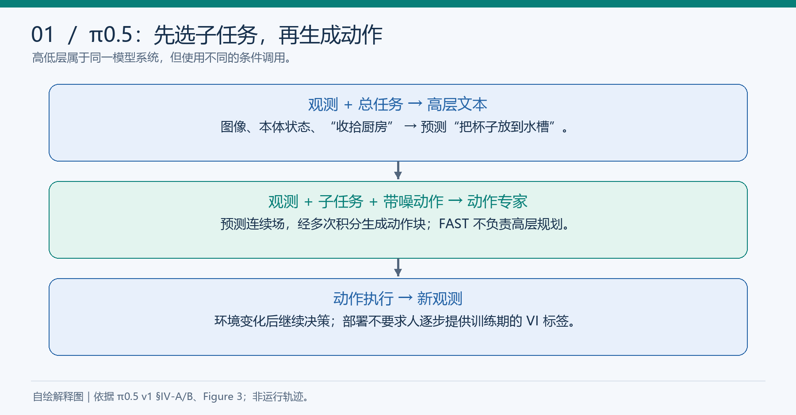
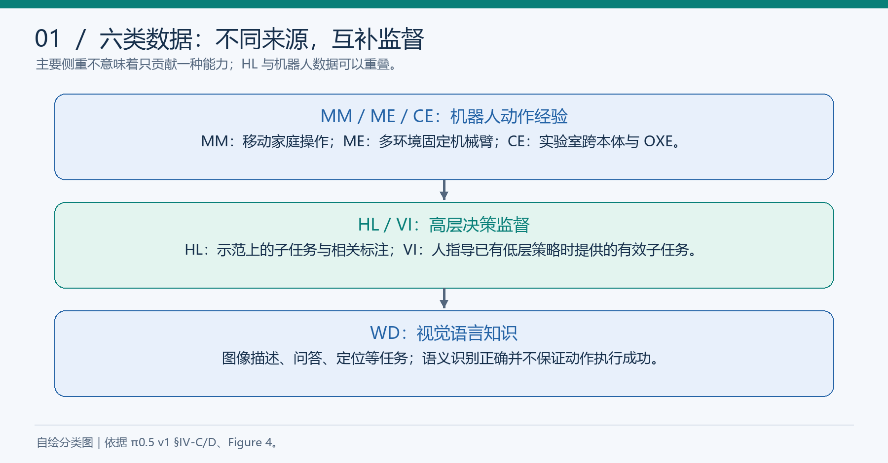
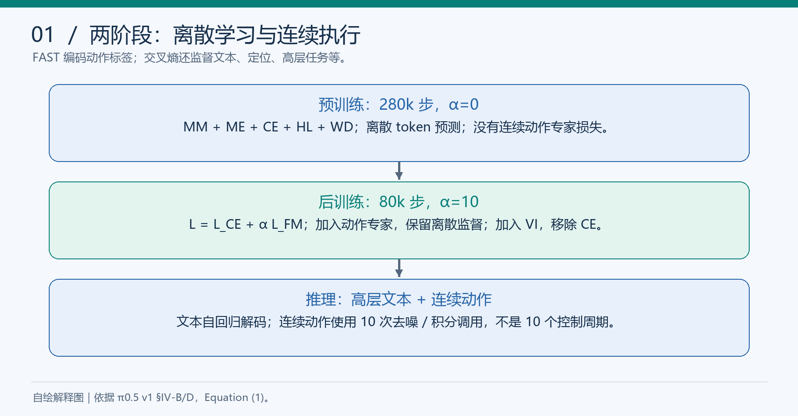
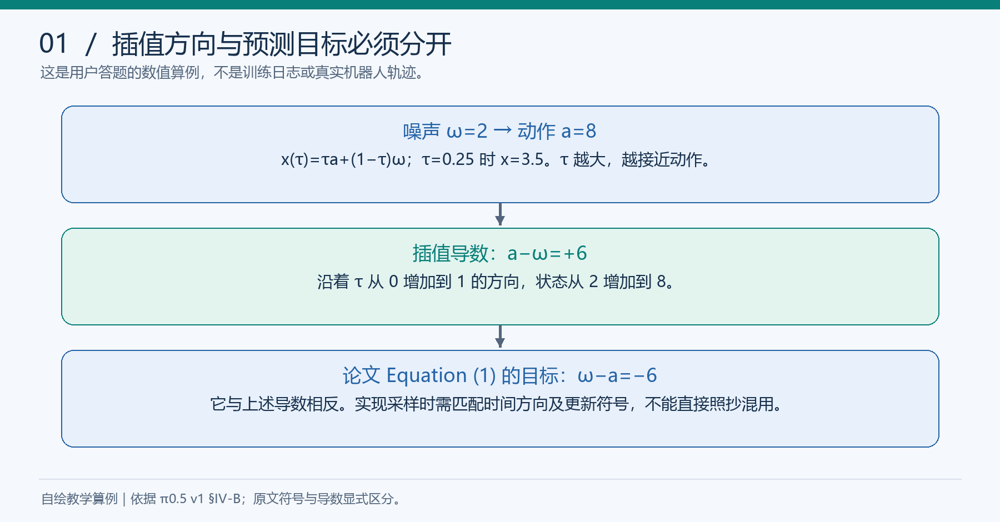
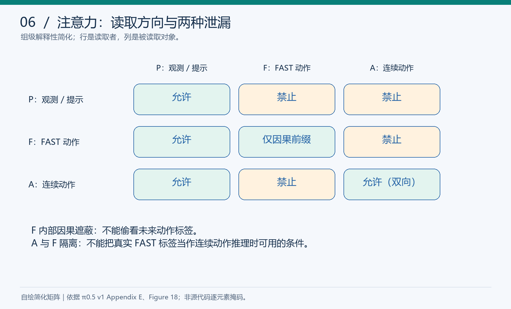
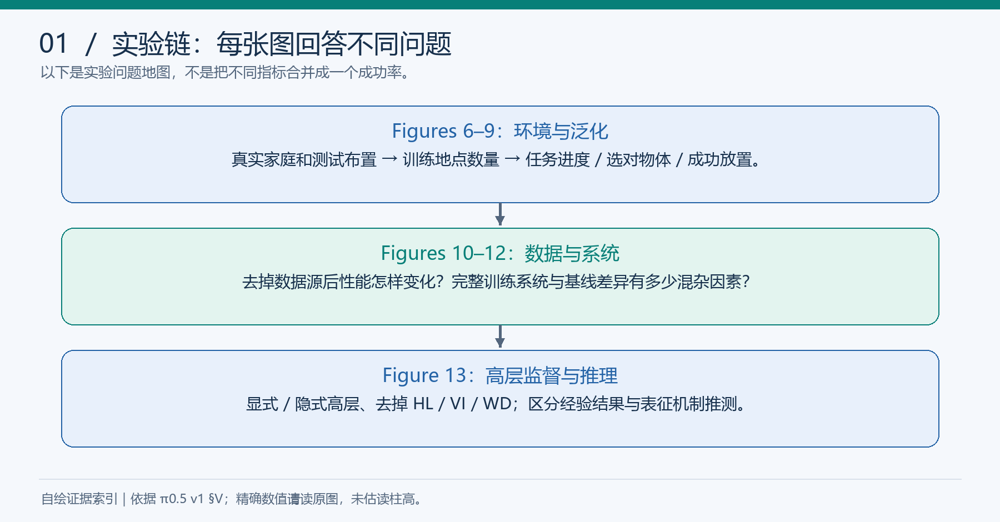

# π0.5：怎样把实验室里的能力带到新家庭？

阅读状态：已读完（完成一轮六讲引导阅读；独立掌握待巩固）。2026-11-20 依据用户提供的 2026-11-12 至 11-14 学习记录归档；无官方模型复现与本人独立实验运行证据。

[六讲问答、纠错与进度](../pi0.5学习进度.md) · [跨论文对照与研究计划](Diffusion-Policy与pi0.5对照与研究计划.md) · [图源与生成方法](../../assets/pi0.5/README.md)

[原文 / 项目页](https://arxiv.org/abs/2504.16054) · [完整比较笔记](../../研/13篇文献详细总结_基础知识与方法对比_2026-10-15.md)

来源：保留下方 2026-10-15 总结和 2026-10-25 归档的有效内容；2026-11-20 补充图解与证据分析。核对版本固定为 [arXiv v1](https://arxiv.org/html/2504.16054v1) 和 [PDF v1](https://arxiv.org/pdf/2504.16054v1)，不混入后续知识隔离等工作。新增推导和假设为助手整理，不冒充用户独立结论。

**论文问题。** 在熟悉环境里折衣服，与到一个未训练过的家庭完成多阶段整理，是不同难度。后者同时需要新物体识别、环境适应、任务分解和连续控制。

**核心改进并非只换一个动作头，而是训练配方。** π0.5 把不同知识来源组织成同一模型的训练任务：

| 缩写 | 数据来源 | 主要提供什么 |
|---|---|---|
| MM | 多环境移动操作数据 | 与目标移动机器人和家庭任务最直接相关的行为 |
| ME | 多环境固定机械臂数据 | 以较易部署的机器人扩大场景覆盖 |
| CE | 实验室跨身体数据，含 OXE | 多任务操作经验与跨身体迁移 |
| HL | 高层子任务、相关物体框等标注 | 当前情境下应该先做什么 |
| WD | 图文、问答、物体定位等网络数据 | 语义和视觉知识 |
| VI | 人通过语言逐步指导机器人执行的数据 | 在已有低层策略能力下，什么高层命令有效 |

**训练阶段一。** 用 FAST 将机器人动作变成离散 token，与文字、定位框、子任务等共同训练。此阶段统一成自回归预测，方便高效学习。

**训练阶段二。** 加入连续动作专家，并联合保留 token 预测和流匹配损失。后训练更聚焦移动操作及多环境数据，加入 VI；不是把全部原数据不加区别继续混合。原文设定先 280k 步离散预训练，再 80k 步后训练。

**进一步读结构细节。** 与 π0 相比，本体状态改成离散 token 输入主干；流匹配时间参数通过自适应 RMSNorm 注入动作专家各层。FAST 动作 token 与连续动作表示不能互相读取，避免训练时直接偷看另一种形式的答案。注意“注意力遮蔽”与后续知识隔离工作中的“阻断特定梯度传播”不是同一件事。

**执行时。** 同一模型先预测子任务，再根据子任务预测动作：

$$p(A,\hat\ell\mid o,\ell)=p(\hat\ell\mid o,\ell)\,p(A\mid o,\hat\ell).$$

`ℓ` 是“收拾厨房”，`ℓ̂` 可以是“把杯子放入水槽”。这个分解明确区分“接下来做什么”和“动作怎么做”。高低层由同一模型承担，但通常是不同条件下的推理调用，不应想象成每个动作都重新输出一大段文字计划。

**证据一：环境覆盖。** 移动操作数据约 400 小时、约 100 个环境；另有更多其他来源数据。第 8–9 页研究 3、12、22、53、82、104 个训练地点，发现随着地点覆盖增加，新场景表现改善。400 小时不是全部训练数据总量。

**证据二：不同数据的贡献不同。** 第 10 页 Figure 10，去掉 ME/CE 明显损害模拟家庭中的任务进度；去掉 WD 在这一实验中差异不显著。但 Figure 11 的新类别物体语言跟随、Figure 13 的高层能力测试，WD 作用更明显。不能把结论写成“网络数据对所有机器人指标都显著提升”。

**证据三：训练高层能力本身有价值。** 第 11 页 Figure 13 中，即使执行时不用显式高层推理，只要训练时包含高层任务数据，表现仍较强。这支持“辅助训练任务改善了表示”的解释，而不只是“多说一句计划就会变聪明”。

**泛化边界。** 论文在 3 个未见真实家庭中测试，另用模拟家庭房间做可控比较。这是重要进展，却不是任意家庭、任意指令、任意身体的可靠性保证。主要任务本身在训练数据中有对应类型，新的是环境、布局和物体条件。结果多是任务进度评分。首页 10–15 分钟的展示描述，也不等于量化实验每次都持续这么久；第 8 页说明不少量化任务约 2–5 分钟。

**仍然会失败。** 不熟悉的把手、难打开的柜门、手臂遮挡、反复开关抽屉、上下文不足等。新的挑战从“动作生成出来没有”进一步变成“是否知道完成到哪一步、失败后如何继续”。

**版本提醒。** 本地是 2025-04 的 v1。后续独立工作的知识隔离、实时动作段等改进，不应倒写成这份原稿已经提出的全部方法。

**定位。** 方法：第 4–7 页、Figure 3；泛化与消融：第 8–11 页、Figures 8–13；评分规则：第 17 页；注意力与实现细节：第 19 页。

## 1. 完整链路：模型在不同层级上分别解决什么？

图为原创教学示意，依据 v1 §IV-A/B、Figure 3。机器人进入陌生厨房后，仅会生成平滑抓取动作还不够：需要从总指令和当前场景选择正确对象、子任务，再完成运动。高层预测“做什么”，低层预测“怎么动”；两者来自同一模型系统，但条件与输出不同。

注意状态 s、物理时间 t、流匹配插值时间 τ 是不同变量。动作块中多个物理时刻的动作，可以在同一次积分调用中并行更新；10 次积分不等于执行 10 个机器人周期。这里的反馈循环不说明模型已经具备长期环境记忆。

## 2. 六类数据：样本形式、监督与边界

定位：§IV-C/D、Figure 4。下表的“作用”是主要侧重，不是独占能力归属；HL 可以由机器人示范标注得到，所以这六类不是互斥的六个文件夹。

| 数据 | 典型监督 | 预训练 / 后训练 | 易错点 |
|---|---|---|---|
| MM | 家庭移动操作观测→动作 | 两阶段；后训练筛选 | 约 400 小时指此部分，不是所有训练数据 |
| ME | 不同家庭的固定机械臂观测→动作 | 两阶段；后训练筛选 | 与 MM 本体不同，并非每次抓取都必须同时输入两类样本 |
| CE | 实验室多任务、跨本体动作，含 OXE | 预训练；后训练移除 | 与“交叉熵 CE”缩写重名，须看语境 |
| HL | 观测与总任务→子任务，含相关定位标注 | 两阶段，后训练聚焦相应数据 | 是监督任务，不只是推理时额外写一句话 |
| WD | 图像→描述、问答、定位等 | 两阶段 | 识别正确不等于抓取放置成功 |
| VI | 人通过语言指导已有低层策略，产生高层示例 | 后训练加入 | 部署不需要人逐步提供子任务真值 |

**对用户原误区的解释：** “陌生环境不知道步骤”是层级决策的动机；FAST 与 Flow Matching 的分工则是动作表示、训练效率和推理解码方式，不能用前者替代后者。

## 3. 两阶段目标：FAST、交叉熵与连续动作专家

定位：§IV-B/D、Equation (1)。FAST 先用 DCT 表示动作的时间结构，量化并用 BPE 压缩成离散 token；不是为机器人决定任务顺序的规划器。预训练除了动作 token，还预测文本、定位和子任务等输出。

以 C 表示观测及相应任务条件，以 A 表示整段干净动作，教学重写为：

$$
x_\tau=\tau A+(1-\tau)\omega,\quad\omega\sim\mathcal N(0,I),
$$

$$
\mathcal L=\mathcal L_{CE}+\alpha\,\mathbb E\big[\|\omega-A-f^a_\theta(x_\tau,C,\tau)\|^2\big].
$$

CE 监督离散输出；FM 监督连续动作专家；α 控制两者权重。预训练 α=0、280k 步，后训练 α=10、80k 步，动作专家从随机权重开始。保留 CE 有助于继续训练文本和高层输出，不是把离散动作“解码一下”就变成 Flow Matching。

**符号核对：** v1 将插值写为 `τA+(1−τ)ω`，但式 (1) 的预测目标为 `ω−A`。对该插值直接求 τ 导数为 `A−ω`，正好相反。为了教学一致，可以另定义噪声时间 `s=1−τ`，则 `x_s=(1−s)A+sω`、`dx_s/ds=ω−A`，从 s=1 向 0 积分即可匹配此目标。这是整理者的重参数化解释，不是声称已核对官方采样实现；实现时必须同时核对时间输入、方向和更新符号。

用户第一题 `A=12,ω=4,τ=.25` 答 `7,8`，应为插值 6、论文目标 −8；后续 `A=8,ω=2,τ=.25` 答 `3.5,−6` 正确。这个纠错说明“数值算对”和“符号方向理解”都应单独检验。

## 4. 注意力：两种答案泄漏

定位：Appendix E、Figure 18，p.19。P 是观测/提示/本体状态前缀，F 是 FAST 动作 token，A 是连续动作专家。图只表示组间允许读取关系，F 组内仍有逐 token 因果约束；并非官方代码逐元素掩码。

1. **未来 token 泄漏：** 训练预测下一个 FAST token 时若读到未来答案，推理就无法获得同样条件。教师强制使用已知前缀不等于允许看未来。
2. **跨动作表示泄漏：** 同一真值动作的 FAST 标签会直接透露连续分支目标，因此 A 不可读取 F，F 也不读取 A。两支仍可共同读取观测与提示。

动作专家内部可双向读取带噪动作，不能把这点误解为它在偷看干净未来动作。本体状态作为离散 token 进入主干，流时间通过 adaptive RMSNorm 注入动作专家；“分支隔离”是注意力可见性设计，不等于后续工作中的梯度阻断。

## 5. 实验地图：每张图的主张和边界

以下固定 v1 图号。任务进度是按评分规则累计完成程度；语言跟随是选对指令对象；成功率还要求正确操作/放置。三者分母与判据不同。没有把柱高肉眼估值写成精确数据，也没有省略误差线后重画“成绩榜”。

| 原图 / 位置 | 问题与设置 | 观察与证据边界 |
|---|---|---|
| Figures 6–7；§V-A | 测试布置及 3 个未见真实家庭；每任务与环境 10 次试验 | 支持指定家庭的多阶段任务泛化；不是任意家庭通用可靠性。首页 10–15 分钟展示不同于量化任务多为 2–5 分钟 |
| Figure 8；§V-B | 3/12/22/53/82/104 个训练地点；固定 40k 后训练步并控制见到的独特样本量 | 检验地点覆盖，而非简单“更多训练样本”；这是为消融简化的训练配方，不等于每组完整重跑主配方 |
| Figure 9；§V-B | ID 新实例与 OOD 新类别；语言跟随、成功放置分开 | 场景覆盖与多项指标改善相关；选择对象正确仍可能执行失败 |
| Figure 10；§V-C | 四类模拟家庭任务；每策略每任务 10 次；去掉 ME/CE/WD | 移除 ME/CE 损害表现；此指标中 No WD 差异不显著，不能推论 WD 在所有任务无效 |
| Figure 11；§V-C、附录 C | 相同对象选择/放置评测，ID/OOD 分开 | WD 对 OOD 更重要；语义知识迁移是合理解释，内部机制未直接测量 |
| Figure 12；§V-D | π0、π0-FAST+Flow、π0.5；相同跨本体机器人集、可比训练步 | 还改变 HL/WD、训练阶段与高层能力；不能把整体差距归于单一动作头 |
| Figure 13；§V-E | 显式/隐式高层、No HL/VI/WD、GPT-4 与人类高层 | 固定完整低层过程研究高层选择；Implicit HL 的强表现支持训练监督有价值，不等于证实某种内部表征机制 |

### 如何严谨解读 Figures 10–13

**Figure 10：** “删去一种数据后成绩下降”支持其对当前配方有贡献，但不是“任意数量、任意质量的该类数据必然有益”。应继续核对采样比例、预算、数据规模和模型选择是否一致。No WD 的不显著差异也不构成严格等效性检验。

**Figure 11：** 应分别比较选物与放置，再比较 ID 与 OOD。例如选对物体但放置失败，更可能提示操作执行瓶颈；这只是诊断思路，仍需逐轨迹证据验证。

**Figure 12：** π0-FAST+Flow 更接近 π0.5 的混合训练，但只用包含机器人动作的数据，缺少 HL/WD，不能执行相同高层推理。相同训练步数也不自动等于相同 FLOPs 或墙钟时间，因此“训练效率”比较应另记录计算成本。

**Figure 13：** Implicit HL 保留高层监督、去掉运行时显式高层；No HL 连训练监督也去掉。两者差异使“高层数据有学习价值”更可信。模型优于人类高层条件的某个结果，不说明机器人具有普遍超人规划能力，命令风格与低层策略匹配等仍可能影响结果。

## 6. 六要素、局限与术语

| 要素 | 本轮理解 | 证据等级 |
|---|---|---|
| 问题 | 将已学操作能力迁移到未见家庭与对象条件 | 原文任务定义 |
| 方法 | 异构任务共同训练，离散预训练与连续后训练，高低层推理 | §IV |
| 改进 | 数据与监督组织，不能概括成只换生成器 | 原文方法及对照 |
| 原理 | 多种知识在共享模型中训练，动作专家产生连续动作 | 方法说明；具体迁移机制仍需测量 |
| 效果来源 | 环境覆盖、数据删除与高层消融组成证据链 | §V 作者实验 |
| 启示 | 分别研究语义选择、动作执行、完成状态记忆 | 整理者研究假设 |

§VI 提到陌生把手、难打开的柜门、遮挡、重复开关抽屉以及上下文不足。新增记忆可能减少重复决策，但也可能保留错误状态，应设计扰动和恢复测试，而非仅展示成功视频。

术语：VLM 为视觉语言模型；VLA 加入动作输出；FAST 为动作压缩 token 化；DCT 是离散余弦变换；BPE 是频繁符号序列合并；Flow Matching 学习连续场；OOD 为分布外条件；消融是移除/改变组件作对照，正迁移指某来源对目标任务有帮助。来源与超参数均以本页固定 v1 为准。

正式延迟无提示自测、全部附录精读、官方源码、模型训练、真实机器人评估与本人独立小实验仍待完成。CPU 合成实验仅为计划，详见[研究计划](Diffusion-Policy与pi0.5对照与研究计划.md)。
