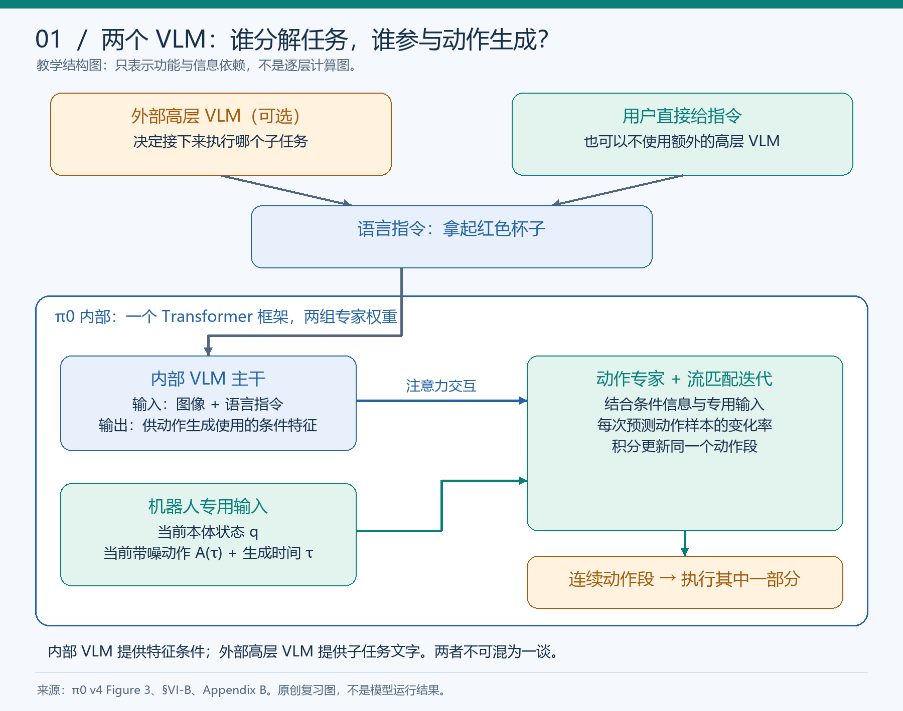
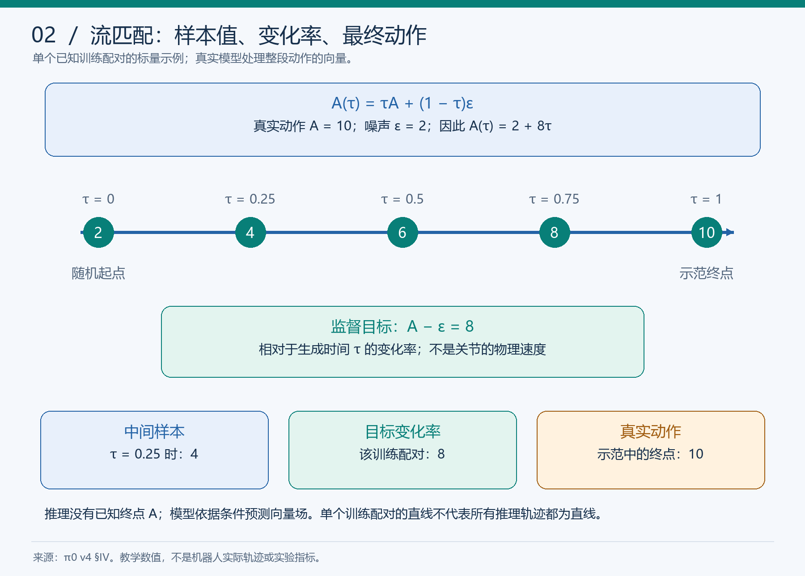
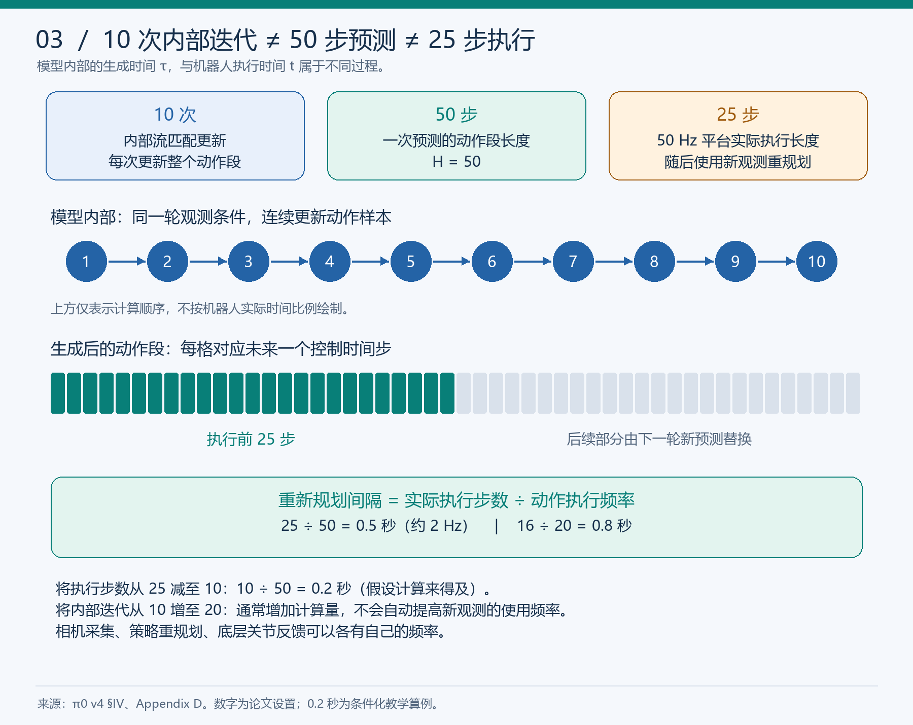
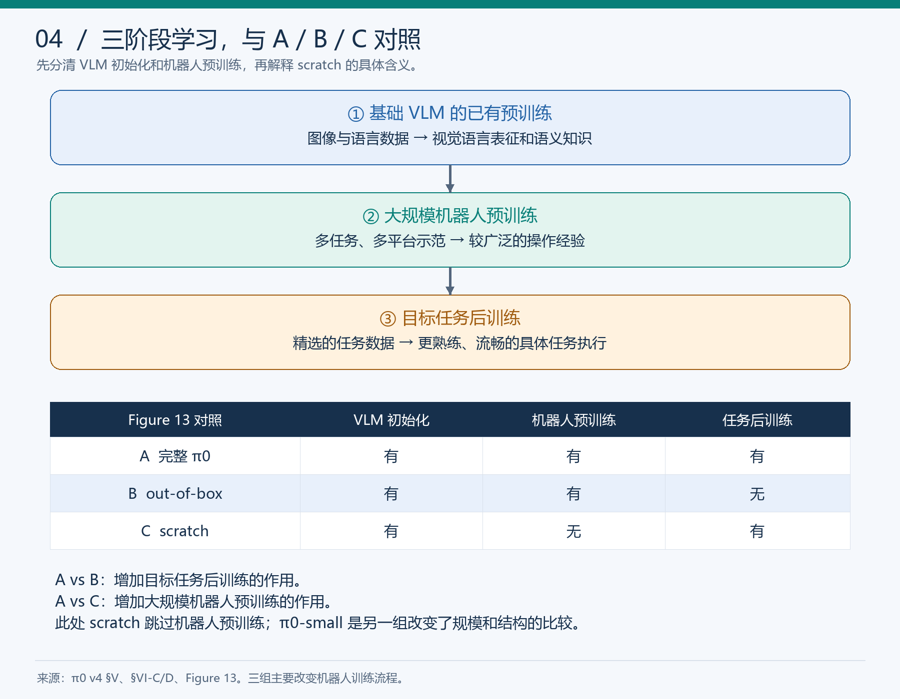
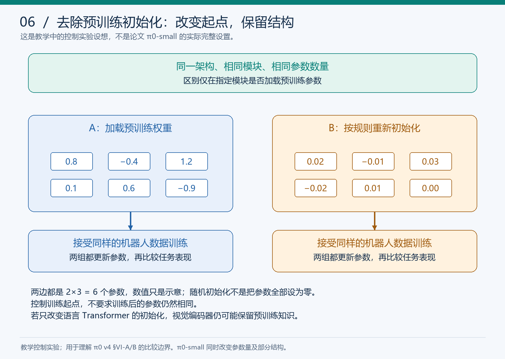
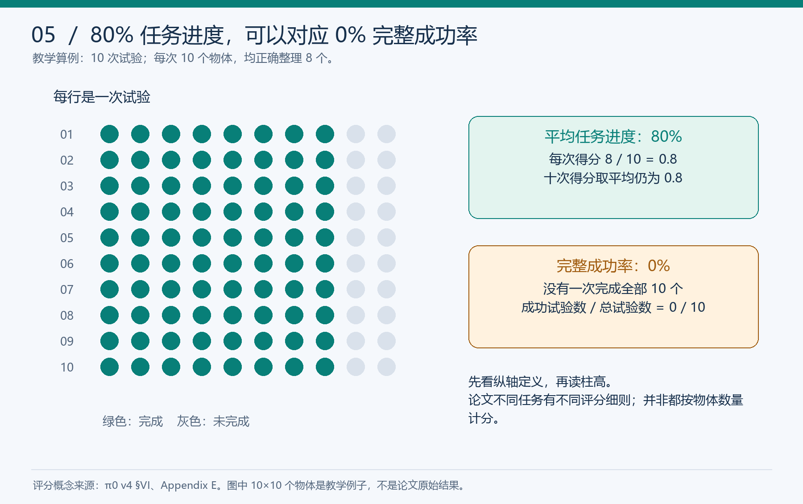

# π0 图文学习笔记：从视觉语言知识到连续机器人动作

> **已读完：完成一轮正文核心方法、主要实验与局限的引导阅读。** 归档：2026-11-10（北京时间）；学习发生于本轮 11 月 9—10 日对话。已完成互动问答、整体复述和纠错，尚不等于独立推导全部公式或掌握源码。
>
> 论文：*π0: A Vision-Language-Action Flow Model for General Robot Control*，Physical Intelligence。以本地 17 页 PDF 对应的 **arXiv:2410.24164v4，2026-01-08** 为准；首版发表于 2024 年。
>
> [版本固定的原文](https://arxiv.org/abs/2410.24164v4) · [PDF](https://arxiv.org/pdf/2410.24164v4) · [项目页](https://www.physicalintelligence.company/blog/pi0) · [学习进度与答题证据](../pi0学习进度.md) · [快速复习卡](../pi0复习卡.md) · [本次归档](../../weekly/2026-11-10.md)

**阅读方法：先看一页速览，再按图回忆，最后合上答案做自测。** 六张图是依据论文和课堂例子原创绘制的教学图；不包含本地模型训练、推理或机器人实验结果。所有“论文结果”“教学算例”“本人回答”分别标注。

## 导航

| 复习目标 | 入口 |
|---|---|
| 三分钟找回整篇主线 | [1. 一页速览](#s1) |
| 区分两个 VLM，理解缓存 | [2. 输入、输出与架构](#s2) |
| 看懂流匹配公式与数值例子 | [3. 流匹配](#s3) · [4. 训练与推理](#s4) |
| 分清 10 次、50 步、25 步和 50 Hz | [5. 执行与重规划](#s5) |
| 区分两层预训练及后训练 | [6. 数据与训练](#s6) |
| 理解“去除预训练初始化” | [7. 控制实验](#s7) |
| 读 Figure 7 / 9 / 11 / 13 | [8. 实验证据](#s8) |
| 不夸大论文结论 | [9. 局限](#s9) |
| 回看自己容易混淆的内容 | [10. 本轮纠错](#s10) |
| 合上笔记检查理解 | [11. 自测与答案](#s11) |
| 查原文位置和未学内容 | [12. 续学与来源](#s12) |

## 1. 一页速览

**一句话：π0 把预训练视觉语言模型的知识，与灵巧、连续的机器人动作生成结合起来，再通过多机器人预训练和任务后训练提升操作能力。**

| 问题 | 核心回答 |
|---|---|
| 为什么需要它？ | 能识别物体、解释步骤，还需要学会当前观察和身体状态对应的实际动作 |
| 输入？ | 多视角 RGB 图像、语言指令、本体状态；生成过程还输入带噪动作和流匹配时间 |
| 主体？ | PaliGemma VLM 主干 + 机器人动作专家，两组权重通过注意力交互 |
| 如何生成动作？ | 从随机动作样本出发，预测条件向量场并积分，得到连续动作段 |
| 一次生成多长？ | 论文使用 50 个未来控制时间步；执行时可以只执行其中一部分 |
| 如何训练？ | 已有 VLM 初始化 → 多样化机器人预训练 → 高质量任务后训练 |
| 主要证据？ | 基础模型直接使用、语言跟随、新任务数据效率、复杂任务训练流程消融 |
| 主要边界？ | 可靠性不完美；数据配方和泛化范围未解决；一些复杂任务依赖额外高层指导 |

这里的“通用”是研究方向和已验证范围内较广泛的能力，不是无需适配便能控制任意机器人、解决任意任务。

**联系前面的阅读：** OpenVLA 帮助理解如何利用 VLM 初始化进行动作学习；RDT-1B 帮助理解连续、多种可行方案的动作生成。π0 的贡献是具体的架构与训练体系组合，不能简化为“第一次提出动作段”或“把扩散换个名称”。这也不是证明流匹配在所有条件下都优于扩散。

来源：摘要、§I–IV，PDF 第 1–5 页。

## 2. 输入、输出与架构：两个 VLM 的角色

*教学结构图：表示功能依赖，不是逐层实现图；两组专家在一个 Transformer 框架内通过注意力交互。*

### 2.1 输入和输出

论文将当前条件记为：

$$
o_t=[I_t^1,\ldots,I_t^n,\ell_t,q_t].
$$

| 符号 | 含义 | 直观解释 |
|---|---|---|
| $I_t^i$ | 第 $i$ 个相机图像，本文通常 2 或 3 个视角 | 环境和物体现在是什么样 |
| $\ell_t$ | 语言指令 | 希望机器人完成什么 |
| $q_t$ | 本体状态，正文用关节角向量说明 | 机器人自身处于什么姿态 |
| $A_t$ | 未来动作段 | 未来多个控制时间步的数值指令 |

$$
A_t=[a_t,a_{t+1},\ldots,a_{t+H-1}],\qquad H=50.
$$

每个 $a$ 包含同一控制时刻的动作分量；50 指未来时间步数，不是 50 个关节，也不是 50 次内部积分。

**关节例子的纠正：** 起始姿态不同，不意味着最终关节目标一定不同。一个关节从 10° 到 60°，与从 40° 到 60°，终点相同，所需转角分别为 +50° 和 +20°。当前状态影响如何到达目标。本轮提问最初把“关节目标是否相同”说得过于绝对，已明确纠正，不能把这归为学习者独有的错误。

### 2.2 内部主干与外部高层模型

| 模块 | 职责 | 是否需要先输出一句自然语言计划？ |
|---|---|---|
| π0 内部 VLM 主干 | 处理图像、语言，提供动作生成所需的条件表征 | 不需要；通过内部特征和注意力参与动作生成 |
| π0 动作专家 | 处理本体状态、带噪动作与生成时间，预测变化率 | 输出用于积分的向量场，不是子任务句子 |
| 外部高层 VLM（π0-HL 设置） | 将总目标分解成中间语言指令 | 是，例如“拿起纸巾”；这个模块不是所有设置都使用 |

PaliGemma 主干约 3B 参数，动作专家约 300M，合计约 3.3B。动作专家从头初始化；VLM 使用已有预训练权重。附录 B 将图像和语言路由给较大的专家，将机器人专用输入路由给较小的专家。不是两个独立模型必须先后输出文字再动作。

学习者最终复述：“需要，他要处理图像和语言信息，为动作生成提供条件信息。”这正确描述了**没有额外高层 VLM 时，π0 内部主干仍然需要工作**。

### 2.3 缓存为什么可以复用？

生成同一个动作段时，观测 $o_t$ 固定，变化的是动作样本 $A_t^\tau$ 和生成时间 $\tau$。因此，观测前缀的注意力 K/V 可以计算一次并缓存，后续内部积分重复使用。新一轮观测改变后，应更新相应缓存。

附录 B 的注意力掩码把序列分为图文、状态、动作三个块：块内可双向注意，早先块不能关注后续块；动作块可读取前面的条件。这样的依赖关系支持缓存。**这部分为原文核对后的补充资料，尚未进行独立推导或代码实现自测。**

来源：§IV、Figure 3、§VI-B、Appendix B/D，PDF 第 4–5、8–9、15–16 页。

## 3. 流匹配：网络究竟预测什么？

*图中用 A(τ) 表示正文的 $A^\tau$，避免将生成时间误读为相乘的动作分量。*

### 3.1 构造训练样本

给定示范动作段 $A_t$ 和同形状高斯噪声 $\epsilon$：

$$
\epsilon\sim\mathcal N(0,I),\qquad
A_t^\tau=\tau A_t+(1-\tau)\epsilon,\qquad \tau\in[0,1].
$$

- $t$：机器人任务的物理时间索引。
- $\tau$：模型内部生成路径的位置；不是机器人已经运动多少秒。
- $\tau=0$：纯噪声；$\tau=1$：示范动作。
- 训练时知道示范答案，可以构造任意中间样本；推理时不知道答案。

**已答对的教学例子：** $A=10,\epsilon=2,\tau=0.25$ 时，中间值为 $4$，从 $2$ 走向 $10$。

### 3.2 监督的是变化率

对这个已知配对的直线路径：

$$
\frac{dA_t^\tau}{d\tau}=A_t-\epsilon.
$$

网络学习条件向量场。将时间条件显式写出，便于复习：

$$
\mathcal L(\theta)=\mathbb E_{(o_t,A_t),\epsilon,\tau}
\left[\left\|v_\theta(A_t^\tau,o_t,\tau)-(A_t-\epsilon)\right\|^2\right].
$$

原文在部分 $v_\theta$ 记号中省略时间参数，但实际网络编码了 $\tau$。该 MSE 约束变化率；不是让网络直接输出真实动作 $A_t$。

| 课堂例子 $A=12,\epsilon=2,\tau=0.5$ | 数值 |
|---|---:|
| 中间样本 $A^\tau$ | 7 |
| 监督目标 $A-\epsilon$ | 10 |
| 示范中的真实动作 $A$ | 12 |

学习者准确说出了 7、10、12；“训练目标输出动作是 10”被校正为“目标变化率是 10”。这里的变化率是相对于生成时间的向量场，不等同于真实关节速度或机器人运动速度。

### 3.3 推理时积分

$$
A_t^0\sim\mathcal N(0,I),\qquad
A_t^{\tau+\delta}=A_t^\tau+\delta\,v_\theta(A_t^\tau,o_t,\tau).
$$

论文使用 10 次 Euler 积分，$\delta=0.1$。例如当前样本 4、预测变化率 8，下一步是 $4+0.1\times8=4.8$。

**单个训练配对的理想直线，仅用于理解监督。** 真实推理时模型不知道终点，也没有已知的 $A-\epsilon$ 可直接计算；它根据条件和当前样本预测向量场，不保证轨迹总是一条直线或每次增加同一数值。噪声与中间样本留在模型内部，不能直接让真实机器人执行它们。

### 3.4 为什么 MSE 不自动等于“平均动作”？

补充解释（尚未独立自测）：只根据观测直接回归单一动作，与从随机起点学习条件向量场再生成动作分布，学习对象不同。流匹配的输入还包含当前随机样本和生成时间；不能只因损失都是平方误差就认为两者相同，也不能据此保证生成模型总能覆盖全部模式。

来源：§IV，PDF 第 5 页；时间嵌入和采样细节见附录 B。

## 4. 训练与推理：两种“更新”

| 项目 | 训练 | 推理 |
|---|---|---|
| 有真实示范动作 $A_t$ 吗？ | 有，用于构造样本和监督目标 | 没有当前任务的正确答案 |
| 网络接收什么？ | 条件观测、带噪动作、时间 | 条件观测、当前生成样本、时间 |
| 谁提供目标变化率？ | 示范动作与采样噪声给出 $A_t-\epsilon$ | 无监督答案，网络自行预测 |
| 主要更新什么？ | 用损失、反向传播、优化器更新参数 | 固定参数，积分更新动作样本 |
| 10 次内部迭代意味着什么？ | 不能当作训练更新次数理解 | 生成同一个动作段的 10 次计算 |

“机器人反复观察并行动”属于闭环推理，不自动意味着在线学习或参数更新。

学习者已正确回答：“这是推理中的流匹配迭代……更新动作样本，让随机初始值逐渐变成动作段。”

来源：§IV、Appendix D。

## 5. 预测、执行与反馈：四个数字不能混用

| 量 | 论文设置 / 含义 |
|---|---|
| 内部积分次数 $N$ | 10 次；每次都更新整个动作段 |
| 预测长度 $H$ | 50 个未来控制时间步 |
| 实际执行长度 $E$ | 50 Hz 平台执行 25 步；20 Hz 平台执行 16 步 |
| 动作执行频率 $f$ | 对应平台为 50 Hz 或 20 Hz |

在计算和调度能够跟上的前提下：

$$
\Delta t_{\mathrm{replan}}=\frac{E}{f},\qquad
f_{\mathrm{replan}}\approx\frac{f}{E}.
$$

- $25/50=0.5$ 秒：约每秒使用新观测重新规划 2 次。
- $16/20=0.8$ 秒：约 1.25 Hz。
- 教学改动 $E=10,f=50$：$10/50=0.2$ 秒；这不是把内部积分次数拿来相除。

生成 50 步不必全部执行。执行前一部分后，利用新观测生成新的动作段，后续未执行部分可被替换。论文采用动作段内开环执行，没有使用早期尝试但效果不佳的 temporal ensembling；这里的开环是相对于策略重规划而言，底层关节控制仍可有自己的反馈。

**增加内部积分次数通常增加计算量，不自动带来更频繁的环境反馈，也不保证更好的实际效果。** 反过来，缩短执行窗口也要求计算和调度能及时完成。

原文附录 D 的 RTX 4090、3 相机测量：图像编码约 14 ms，观测前向约 32 ms，10 次动作前向合计约 27 ms，机内总计约 73 ms；移动机器人离机推理另有约 13 ms 网络延迟。这些是该硬件配置的推理耗时，不是本机实测，也不等于论文实际采用的 0.5 / 0.8 秒重规划间隔。

**本人答题轨迹：** 曾选择“增加内部迭代”但计算 $10/50=0.2$，实为把选项与执行步数混淆；纠正后能回答 $16/20=0.8$，即使题目另给 8 次内部迭代也不再使用它作为分子。

来源：§IV、Appendix D，PDF 第 5、16 页。

## 6. 两层预训练与后训练

### 6.1 三个阶段

1. **基础 VLM 的已有预训练**：提供视觉语言表征与语义知识，作为 π0 的初始化来源。
2. **π0 的机器人预训练**：混合多任务、多平台示范，建立观察、指令、状态与动作之间的对应关系。
3. **目标任务后训练**：使用精选任务数据继续训练，让目标任务执行更熟练、连贯。

“新任务只用了 5 小时示范”说的是额外适配数据，不是整个模型从零学习的全部数据成本。学习者已正确指出此前预训练也使用了数据。

### 6.2 数据多样性与质量

作者希望多样数据提供丰富状态和恢复经验，高质量任务数据提供流畅策略。只保留一次成功的理想轨迹，可能缺少抓偏后的纠正经验；包含纠正过程也不等于任何低质量、错误示范都有帮助。这是训练设计动机，具体收益仍由实验检验。

论文自采数据约 1 万小时、903M 时间步，覆盖 7 类机器人配置和 68 个较宽泛的任务。任务名称不是把每种物体与动词组合都算一个新任务；时间步数也不是独立轨迹数。

**数据来源要以详细章节为准：** §III 概览使用了“entire OXE”字样，而 §V-A / Figure 4 明确描述 OXE 的筛选子集，并结合 Bridge、DROID 等数据。笔记采用详细数据节的口径，不能据概览断言完整使用所有 OXE 数据。

补充资料（未系统自测）：不同机器人状态/动作填充到本文采用的最大维度 18，缺失视角使用遮蔽；这不是 RDT-1B 的 128 维物理字段方案。完整映射、采样权重和数据混合实现尚未读代码。

来源：§III、§V，PDF 第 4–6 页。

## 7. “去除预训练初始化”怎样做？

**模块结构**决定层数、维度和连接；**参数数值**决定相同结构当前如何计算。去除某模块的预训练初始化，通常是保留结构，按相应初始化规则重新设置其参数，而不是删除模块或把所有数值清零。

| 要检验的因素 | 主动改变 | 尽量固定 |
|---|---|---|
| 整个 VLM 初始化 | 所有属于该 VLM 检查点的初始参数 | 架构、参数量、动作专家起点、数据、训练预算与评测 |
| 语言 Transformer 初始化 | 仅该模块的初始参数 | 视觉编码器、投影层及其他条件 |
| 视觉编码器初始化 | 仅视觉模块的初始参数 | 其他模块与训练条件 |

改变初始参数，不要求两组训练后的参数仍相同；最终差异正是要观察的结果。只重新初始化语言主干、保留视觉编码器预训练权重，不能称为完全没有预训练知识。

**这是课堂提出的更严格对照设想，不是已执行实验。** 实际 π0-small 约 470M，而 π0 约 3.3B；两者还存在架构差异。π0-small 仍使用预训练视觉和语言编码器。因此，π0 优于 π0-small 不能把全部收益单独归因于 VLM 初始化。

学习者主动追问了“如何去除、如何取舍模块”，之后能说明参数数量不变、参数值变化；“改变的是机器人训练开始前的初始参数值”由讲解进一步明确。独立实现仍未开展。

来源：§IV、§VI-A/B、Appendix C，PDF 第 5、7–8、16 页。

## 8. 四组实验：比较什么，能说明什么？

### 8.1 先看指标

图中 10 次试验、每次 10 个物体、每次正确整理 8 个，是**教学例子**：平均进度 80%，整次任务成功率 0%。学习者独立答对了这两个数。

论文按任务定义评分：例如折衣服的某些评测采用成功/失败，清桌按正确分类物体计分，其他任务按步骤或整洁程度计分。不能把所有“Average Task Progress”一律当作完整成功率。以下主要结果报告每项任务、每种设置平均 10 次试验；小差异不宜过度解释。

### 8.2 Figure 7：预训练基础模型直接使用

**问题：** 完成机器人预训练、没有目标任务后训练时，能直接做到什么？

任务为折 T 恤、简单/困难清理桌面、食品装袋、取出吐司。任务类型已经存在于预训练数据中；困难清桌包含部分未见物体等变化。因此 out-of-box 不等于完全没有见过任务或机器人。

| 方法 | 本组机器人训练更新次数 |
|---|---:|
| 完整 π0 | 700k |
| π0（parity） | 160k |
| OpenVLA | 160k |
| Octo | 320k |

本组将 OpenVLA、Octo 放到作者的数据混合上训练，还包含 UR5e-only OpenVLA。parity 减轻完整 π0 训练更多带来的问题，但相同更新次数不自动等于相同 FLOPs、墙钟时间或样本处理次数。原文称 compute parity，阅读时仍要看具体控制了什么。

结果支持 π0 在该组任务和设置下取得较高进度。架构、规模与初始化等仍存在差异，不能单独证明“流匹配一定优于扩散”或“所有提升都来自互联网知识”。

### 8.3 Figure 9：语言跟随与高层指导

这些语言任务使用经过相应微调的模型，不能与 Figure 7 的基础模型直接使用设置混为一谈。

| 设置 | 输入指导 |
|---|---|
| π0-flat | 总体指令，如“清理桌面” |
| π0-human | 人类专家逐步提供中间指令 |
| π0-HL | 额外高层 VLM 提供中间指令 |

左图看语言跟随率，右图看平均任务进度。π0 比 π0-small 有更好的语言跟随表现，人工中间指导改善 π0 的任务执行；高层模型指导的收益因任务而异，食品装袋中 HL 柱低于 flat，摆桌子中则明显提高。

π0-HL 的效果属于组合系统，不能全部归为 π0 单独完成了高层任务分解。本人已能区分“高层模型决定子任务，π0 生成连续动作”。VLM 初始化效应仍受规模和结构差异影响。

### 8.4 Figure 11：新任务和额外数据量

任务包括叠碗、折毛巾、保鲜盒入微波炉、更换纸卷、物品入抽屉。横轴 1 / 5 / 10 小时表示**任务示范数据时长**，不是训练耗时。纵轴仍为平均任务进度。

| 蓝线 | 新任务训练前的起点 |
|---|---|
| 实线 π0 | VLM 初始化 + 大规模机器人预训练 |
| 虚线 π0（scratch） | 保留 VLM 初始化，跳过大规模机器人预训练 |

这里的 scratch 依据 §VI-C 的上下文解释，不能自动理解为所有参数均从随机值起步。它主要检验**机器人预训练**的价值；学习者已答对这个证据归属。

平均而言预训练有帮助，但“物品入抽屉”在较多任务数据下两条蓝线接近。曲线也并非严格随数据量上升；不能从少数点断言更多数据必然有害，应检查样本组成、优化设置和重复评估。

本组 OpenVLA / Octo 使用公开预训练检查点再适配，而不是 Figure 7 中作者重新训练的同一混合比较；ACT / Diffusion Policy 只在目标任务数据上训练。作者明确这部分比较具体模型，而非严格隔离架构的因果效应。部分基线只在部分任务/数据量上评估，不能把图中缺失点当作零分。

### 8.5 Figure 13：复杂任务的训练流程

任务需要组合抓取、展开、折叠、堆放、装盒等多种行为。比较：

| 组别 | 机器人预训练 | 目标后训练 | 能用于什么对照 |
|---|---|---|---|
| A：完整 π0 | 有 | 有 | 完整流程 |
| B：out-of-box | 有 | 无 | A vs B：后训练整体作用 |
| C：scratch | 无 | 有 | A vs C：机器人预训练作用 |

完整流程在多数任务中更好；**Packing Eggs 的 scratch 柱略高于完整流程**，因此不写成“每项任务都必然提升”。本人正确选择 A 与 B 来检验后训练作用，并解释差别在于是否有目标任务后训练。

该对照不能单独区分“精选数据质量”与“额外训练量”的贡献；若研究数据质量，需要进一步控制数据量和训练预算。这属于对实验设计的补充分析，不是本轮已执行的消融。

**版本核对提醒：** v4 的 §VI-D 将更复杂的 Table bussing 描述为未在预训练中出现，但 Figure 13 将其放在“预训练中存在任务”的上半图。宽任务类别与复杂版本可能是解释方向，本文并未据此消除歧义；复习时不把这一项当作严格已确认的零样本证据。

来源：§VI、Figures 7/9/11/13、Appendix E，PDF 第 7–11、17 页。所有结果均来自论文，图表重绘和算例不构成本地模型实验。

## 9. 局限与可提出的研究问题

作者在 §VII 明确保留三类问题：

1. **数据配方**：哪些来源、任务和质量的数据更有用，如何分配采样权重，还没有完整规律。
2. **执行可靠性**：一些任务仍不能稳定完成，也不清楚要获得接近完美的表现需要多少、什么数据。
3. **迁移范围**：操作任务上的进展，不能直接证明能迁移到导航、自动驾驶、足式行走等更远领域。

本轮整体复述已准确指出验证范围有限、可靠性不足，以及通用能力的扩展范围不清楚。

以下只是可检验的研究问题，不是论文已证明的结论，也不是已开展的实验：固定预算比较不同数据混合；固定权重比较积分步数与延迟；固定控制频率比较执行窗口与扰动恢复；用相同架构隔离 VLM 初始化效应。若继续研究，需补充多次评估、统计不确定性和公平的训练预算。

来源：§VII，PDF 第 11–12 页。

## 10. 本轮纠错：复习时优先检查

| 容易混淆的表达 | 正确区分 | 当前证据 |
|---|---|---|
| 能解释折衣服，所以已经具备动作控制、只是精度不好 | 识别/理解与学好控制不同；抓偏也不能只归为数值精度 | 已讲解；最终能说出知识与动作结合的动机 |
| 姿态不同，最终关节目标必不同 | 最终目标可相同，到达过程不同 | 助手主动修正原题；未另做独立题 |
| 7、10、12 中，10 是动作本身 | 7 是中间样本，10 是目标变化率，12 是真实动作 | 数值答对，术语已纠正 |
| 内部迭代增加就预测更快 | 通常增加计算量，质量须实验验证；不自动提高反馈频率 | 原“变块了”表述有歧义，按可能指“变快”作澄清 |
| 选 B，却算 10/50=0.2 | 算式的 10 是执行步数，对应 A | 后续正确算出 16/20=0.8 |
| 去掉预训练要删模块 | 保留结构，改变指定模块的初始参数 | 本人追问后，确认参数数量不变、数值变化 |
| 5 小时新任务数据就是全部学习成本 | 还有此前 VLM 与机器人预训练 | 独立答对 |
| 平均进度 80% 等于成功率 80% | 教学例子中完整成功率可为 0% | 本人答对 80% / 0% |
| 内部 VLM 决定下一个子任务 | 可选高层 VLM 才提供子任务文字；内部主干提供条件特征 | 整体复述中混淆，再追问后答对 |
| π0 scratch 一律不含任何预训练 | Figure 11/13 重点去掉机器人预训练；仍区分 VLM 初始化 | 本人答对 Figure 11 的证据归属 |

“即时回答正确”“纠错后正确”“延迟后仍能独立复述”分别记录。完整问答状态见[学习进度](../pi0学习进度.md)，没有虚构总分，也没有把阅读记作模型复现。

## 11. 合上笔记自测

本轮已有答案的题目可用于延迟复习；下面的扩展情境尚未全部由本人回答，不能自动计为通过。

### Q1：没有外部高层 VLM，内部 VLM 是否仍工作？

展开答案

仍然工作。用户可以直接提供语言指令；内部 VLM 处理图像和语言，经注意力为动作生成提供条件。外部高层 VLM 是可选的任务分解模块。

### Q2：A=12、ε=2、τ=0.5，样本、监督目标、真实动作分别是多少？

展开答案

样本 7；目标变化率 10；真实动作 12。目标变化率是相对于生成时间的向量场，不是物理关节速度。

### Q3：当前样本 7，预测变化率 6，δ=0.1，下一步样本是多少？这会更新权重吗？

展开答案

7.6。普通推理积分改变动作样本，不更新网络参数；训练中优化器才依据损失更新参数。

### Q4：20 Hz，每执行 16 步重规划，内部迭代 8 次，间隔是多少？

展开答案

16/20=0.8 秒。8 是模型内部计算次数，不能作为执行步数参与这个除法。这里假设计算调度跟得上。

### Q5：衣服移动后，还能直接复用上一轮全部观测缓存吗？

展开答案

不能忽略新图像。需要更新相应观测条件；同一轮固定观测下的内部积分可以复用缓存，两者不同。

### Q6：重新初始化 VLM 会不会改变参数数量？

展开答案

若保留架构和维度，参数数量不变，改变的是机器人训练前的初始参数值。须明确哪些模块重新初始化、哪些保留已有权重。

### Q7：10 次试验，每次 10 个物体都只整理好 8 个，两个指标是多少？

展开答案

按此教学评分规则，平均任务进度为 80%；若必须全部整理才算成功，完整任务成功率为 0%。真实论文任务需分别查评分细则。

### Q8：Figure 11 的两条蓝线主要检验哪种预训练？

展开答案

大规模机器人预训练。两组都使用 VLM 初始化；实线先做机器人预训练再适配，scratch 跳过机器人预训练。不是移除所有 VLM 知识的实验。

### Q9：Figure 13 的 A/B/C 中，检验后训练应比较谁？

展开答案

A（机器人预训练 + 后训练）与 B（只有机器人预训练）。A 与 C（只有目标任务训练）主要检验机器人预训练。评价数据质量本身还需更严格控制训练量。

### Q10：为什么 π0 比 π0-small 好，仍不能说提升全部来自 VLM 初始化？

展开答案

规模、部分架构也改变了；π0-small 还保留预训练编码器。要隔离初始化因素，应尽量保持架构、参数量、数据、预算和评测一致，只改变指定的初始权重。

### Q11：50 个动作一次预测出来，能不能总等它们全部执行完再观察？

展开答案

可以选择长执行窗口，但环境变化时原计划可能失效。论文实际只执行一部分后重规划。缩短窗口通常增加新观测使用频率，也需要足够推理能力，并不保证所有任务都更好。

### Q12：用四句话复述研究问题、方法、训练、局限。

参考答案；先自己说再展开

π0 希望把视觉语言知识用于灵巧连续操作。它以 VLM 主干提供条件信息，由动作专家预测流匹配向量场，迭代生成动作段。已有 VLM 初始化之后，使用大规模机器人预训练和目标任务后训练。实验支持这套体系的价值，但数据配方、可靠性与更远任务的迁移范围仍未解决，部分复杂设置还有额外高层指导。

## 12. 续学起点与原文定位

| 内容 | 原文位置 | 本轮覆盖范围 |
|---|---|---|
| 动机、总体方案 | 摘要、§I、Figures 1/3，pp.1–4 | 已引导阅读 |
| 输入、动作段、流匹配公式 | §IV，pp.4–5 | 公式拆解与标量题已覆盖；未独立推导完整理论 |
| 数据与训练 | §V，pp.5–6 | 训练阶段已学；完整采样/接口未系统学习 |
| 基础能力、语言跟随 | §VI-A/B、Figures 7/9，pp.7–9 | 指标、对照和边界已学 |
| 新任务、复杂任务 | §VI-C/D、Figures 11/13，pp.9–11 | 已学，保留反例和版本表述差异 |
| 局限 | §VII，pp.11–12 | 已学，并有本人整体复述 |
| 注意力、时间采样 | Appendix B，pp.15–16 | 缓存及角色已学；完整掩码和 Beta 分布未独立自测 |
| 推理实现与时延 | Appendix D，p.16 | 核心时序已学；未测本机耗时 |
| 评分细则 | Appendix E，p.17 | 核对关键指标；未逐项独立复述 |

**下次先做延迟自测：** Q1/Q2/Q4/Q6/Q8，再尝试 Q12。之后按需要补学连续分布与向量场、注意力掩码、时间采样分布、动作映射或官方代码。尚未加载 π0 权重、运行模型、训练、仿真或进行真机评估。

图解由 [render_pi0_figures.py](../../scripts/render_pi0_figures.py) 生成，依赖 Pillow 与已安装中文字体；图形来源、重绘说明和复现方式见[图解目录](../../assets/pi0/README.md)。

## 附录：2026-10-15 初始整理（历史材料）

以下保留此前辅助整理。2026-10-25 归档时尚为“待读”；当前状态以本页顶部和独立学习进度为准。历史文字中的“本地 π0”是指本地论文版本，并非本机运行了模型。

[原文 / 项目页](https://www.physicalintelligence.company/download/pi0.pdf) · [完整比较笔记](../../研/13篇文献详细总结_基础知识与方法对比_2026-10-15.md)

来源：2026-10-15 本地文献总结的第 3.7 节；2026-10-25 整理上传，未新增论文实验。

**论文问题。** VLM 有通用知识，但直接逐个生成动作 token 难以充分应对高频双臂、折衣服等任务。小型扩散策略擅长连续控制，却未必充分利用大规模 VLM 的能力。能否兼得？

**具体改进。** 基于 PaliGemma VLM，加入约 300M 参数的 action expert（动作专家），以流匹配生成动作段。整体约 3.3B 参数。图像、文字主要走 VLM 权重；状态和带噪动作使用机器人专用权重，两组权重通过注意力交互，而非简单地把 VLM 最后一个向量接到线性动作头。

输入包含两到三个相机图像、语言和关节状态；一次预测 `H=50` 步连续动作。动作段中的动作位置可以相互关注，以建模整个段内的协调。

**把流匹配公式翻成人话。** 从真实动作段 `A` 和随机噪声 `ε` 构造中间样本：

$$A^\tau=\tau A+(1-\tau)\epsilon.$$

`τ=0` 是纯噪声，`τ=1` 是真实动作。网络学习给定图像和指令时，中间样本应该朝什么方向移动：

$$\mathcal L=\mathbb E\left[\|v_\theta(A^\tau,o)-(A-\epsilon)\|^2\right].$$

执行时从噪声出发，按预测方向迭代，得到符合场景和任务的动作段。本地 π0 用 10 次积分更新。**这是在模型内部生成动作，不是让真实机器人先随机抖动再把噪声消掉。**

为什么去噪训练也用了平方误差，却没有和简单 MSE 回归一样的问题？因为这里回归的是不同噪声状态下的条件向量场，最终从随机初始值生成分布；不是只用观测直接回归一个确定的平均动作。

**训练改进同样重要。** 先在覆盖多机器人、多任务的数据上预训练，再用高质量任务数据后训练。作者自采数据约 1 万小时、903M 时间步、7 类机器人配置、68 个较宽泛的任务。按详细数据节，混合中包含公开数据及其筛选/加权版本；不能只根据概览中的一句话认定完整使用所有 OXE 数据。

**证据。** Figure 7 比较直接使用预训练模型的任务表现，也比较相同更新步数的版本；Figure 11 改变微调数据量，考察预训练是否降低新任务的数据需求；Figure 13 比较完整训练、只有预训练、只用后训练数据三种流程。整体支持“模型结构与训练流程共同重要”。

**边界。** 与 π0-small 的比较同时改变 VLM 初始化、参数量和部分结构，作者自己也承认难以完全公平，因此不能把全部差距仅归因于互联网知识。复杂任务常用任务进度评分，且部分任务获得高层策略指导，不应泛化成无需分解、无需微调的万能机器人。

**关键速度概念。** 第 16 页 Appendix D：在 50 Hz 机器人上，实际每执行 25 步、约 0.5 秒重新生成一次动作段；在 20 Hz 平台上每 16 步、约 0.8 秒一次。50 Hz 是动作执行频率，不是视觉重新决策频率。整段生成在该 RTX 4090 配置下机内约 73 ms，也与实际采用的重规划频率不同。

**定位。** 方法与公式：第 4–5 页；数据与训练：第 5–6 页；实验：第 7–11 页；局限：第 11–12 页；架构和部署：第 15–16 页。
