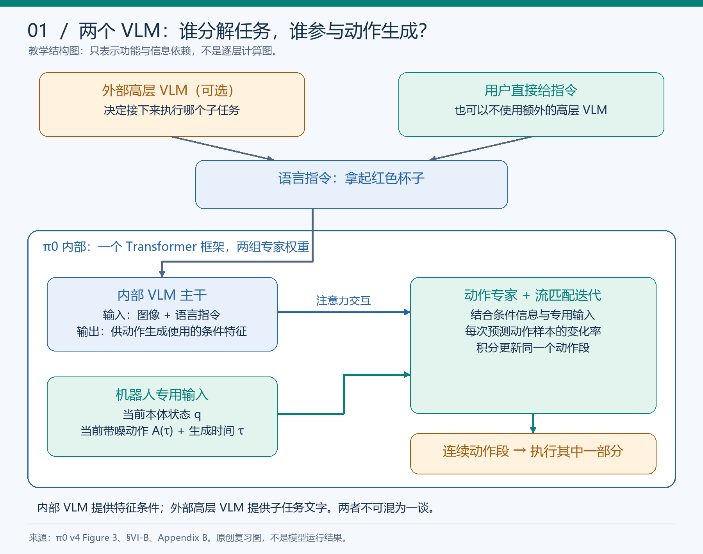
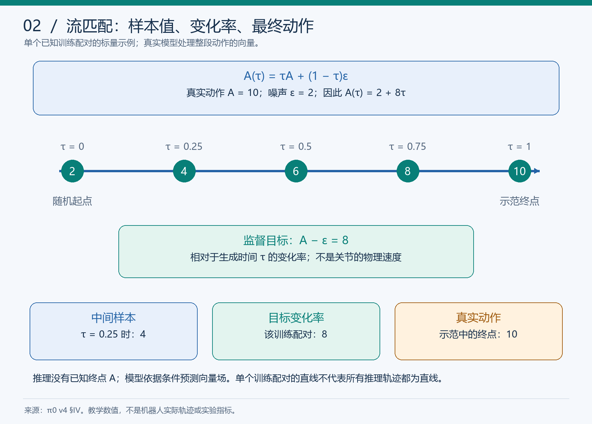
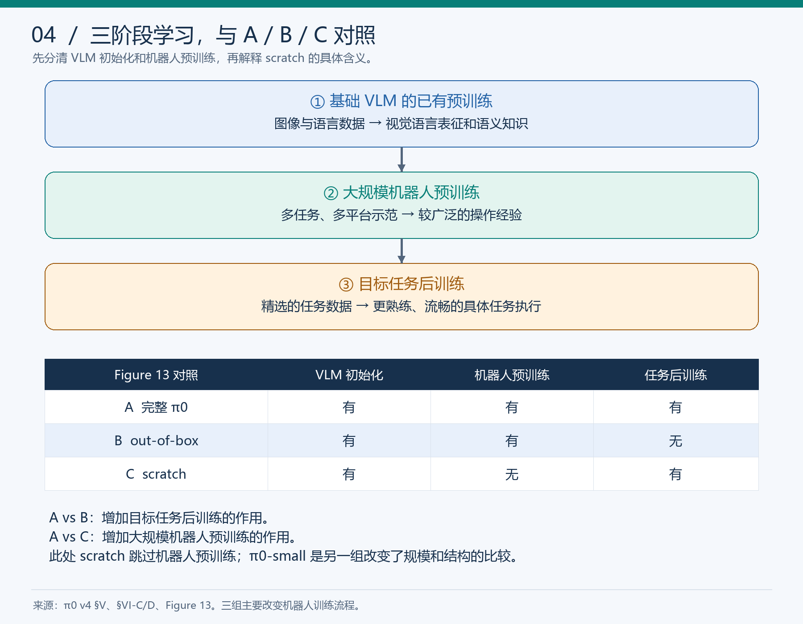

# π0 快速复习卡

更新：2026-11-10。用于完成本轮引导阅读后的复习；不表示以下题目已经全部独立通过。

[详细图文笔记](papers/pi0.md) · [实际学习进度与纠错](pi0学习进度.md) · [原文 v4](https://arxiv.org/abs/2410.24164v4)

## 先用一分钟说主线

**视觉语言知识 + 连续动作生成 + 多机器人预训练 + 任务后训练。**

内部 VLM 处理图像/语言，动作专家结合条件和本体状态预测向量场；从随机样本出发迭代得到动作段。执行其中一部分后，再根据新观测重规划。外部高层 VLM 在部分实验中另行提供子任务指令。

## 三张图找回关键区别

## 必须能解释的公式

$$
A^\tau=\tau A+(1-\tau)\epsilon,
\qquad v_{\mathrm{target}}=A-\epsilon.
$$

$$
A^{\tau+\delta}=A^\tau+\delta v_\theta(A^\tau,o,\tau),
\qquad \Delta t_{\mathrm{replan}}=E/f.
$$

前一个更新动作样本；后一个用实际执行步数除以控制频率。内部迭代次数不代入 $E$。

## 看到这些词，先问清范围

| 词 | 自问 |
|---|---|
| 预训练 | 指 VLM 已有预训练，还是机器人数据预训练？ |
| scratch | 具体跳过了哪一阶段？还有哪些预训练模块？ |
| 初始化 | 改参数起点，还是连架构/规模也改了？ |
| 成功率 | 真是完整成功比例，还是平均任务进度？ |
| 数据 5 小时 | 是新增示范时长，不是总学习成本，也不是训练耗时 |
| 50 Hz | 是动作执行频率，不等于每秒 50 次新观测重规划 |
| 高层 VLM | 是额外任务分解策略，还是 π0 内部主干？ |

## 五分钟闭卷题

先写答案，再打开[详细答案](papers/pi0.md#s11)。不要把“看懂答案”当作独立完成。

1. 没有高层 VLM，内部 VLM 是否仍工作？负责什么？
2. $A=12,\epsilon=2,\tau=0.5$：中间样本、监督目标、真实动作分别是多少？
3. 20 Hz、每执行 16 步重规划、内部迭代 8 次：重规划间隔是多少？
4. Figure 11 的两条蓝线主要检验哪层预训练？
5. 图中每次任务都完成 80%，是否能说完整成功率为 80%？
6. 保留所有模块，只重新初始化 VLM，会改变参数数量吗？
7. A=机器人预训练+后训练，B=只有机器人预训练，C=只有目标任务训练：检验后训练应比较谁？
8. 不看笔记，用四句话说明研究问题、方法、训练和一个局限。

## 本轮需要再巩固的个人易错点

- 内部 VLM 曾在整体复述时与外部高层 VLM 混淆；最终追问已答对，仍需延迟检查。
- 曾把“增加内部迭代”选项与执行步数 $10/50$ 混用；换数字题已纠正。
- 已能算出流匹配的数值，但“目标变化率”要与“动作本身”分开。
- 重新初始化保留结构；必须明确哪些模块改变，而非笼统说去掉全部预训练。

## 读实验的顺序

先看任务与数据 → 看横纵轴 → 看训练起点和对照 → 看试验次数 → 写结论与边界。

Figure 7 看基础模型；Figure 9 看语言指导；Figure 11 看新任务数据效率；Figure 13 看预训练/后训练流程。本文主要图表每项设置平均 10 次试验，不把小差异放大为普遍规律。

正文主线已完成引导阅读；完整推导、全部附录、官方源码和模型复现尚未完成。下次复习可将答案另存，保持本卡与原始学习记录不被覆盖。
