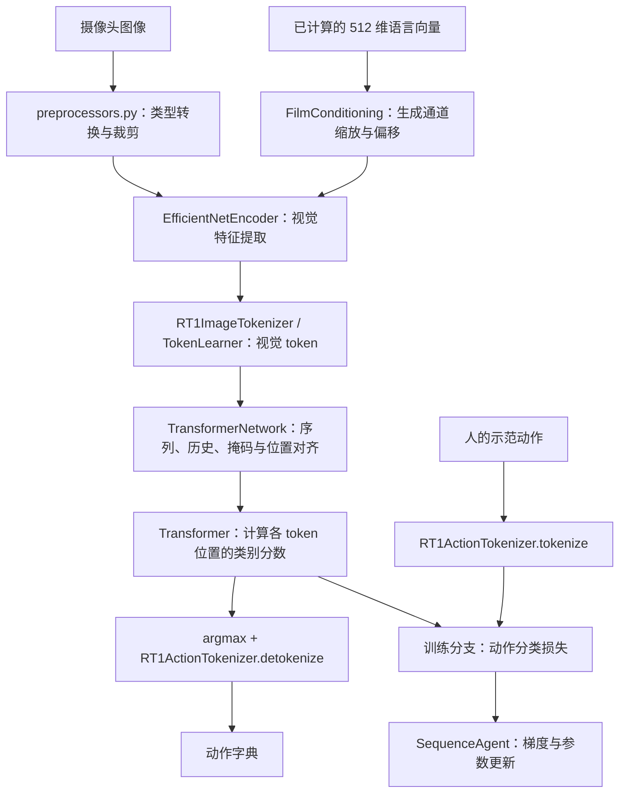

# RT-1 项目导读与学习路线

整理日期：2026-10-12。以本地固定版本源码和已完成的运行记录为依据。

你已经理解了语言条件、FiLM、视觉压缩、动作分档和训练与执行的区别。
接下来要做的是把这些概念对应到函数、张量和实际执行结果上，不必重新从头读所有理论。

真正吃透的标准：能追踪一条样本、解释关键设计、预测修改的影响，并用运行结果检验自己的判断。

## 1. 先分清两条运行路线

### A. 使用训练好的模型

```text
infer.py
  → SavedModelPyTFEagerPolicy
  → trained_checkpoints/rt1main 中的已导出计算图与权重
  → policy.action(当前观测, 上一步返回的状态)
  → 动作 + 新状态
```

这是上次已跑通的路线。计算发生在导出的 SavedModel 中。
**修改本地 transformer.py 不会自动改变 infer.py 加载的模型。**
学习源码时，应运行直接实例化这些 Python 类的测试或学习脚本；改动要用于预训练模型，还涉及重建兼容网络、恢复权重和重新导出。

### B. 理解和构造源码网络



图中训练标签进入损失计算。动作 token 同时参与源码的序列组织，但其输入嵌入会被清零，详见第 5 节。
自然语言到向量的编码器不在核心网络内部；它接收 `natural_language_embedding`。

当前仓库提供核心模型、训练 Agent 组件、测试与权重。
它没有组成完整的“数据下载 → 轨迹清洗 → 数据批处理 → 长期训练 → 机器人评估”应用。
学习训练组件不等于已经具备可直接运行的完整训练工程。

## 2. 文件地图：每个部分解决什么问题

### 核心算法

| 文件 | 职责 | 首先读哪里 |
|---|---|---|
| [tokenizers/action_tokenizer.py](robotics_transformer/tokenizers/action_tokenizer.py) | 动作数值与离散编号相互转换；按 action spec 确定范围和形状 | `tokenize`、`detokenize` |
| [film_efficientnet/film_conditioning_layer.py](robotics_transformer/film_efficientnet/film_conditioning_layer.py) | 把语言向量变成每个视觉通道的缩放与偏移 | `FilmConditioning.call` |
| [tokenizers/token_learner.py](robotics_transformer/tokenizers/token_learner.py) | 学习若干空间权重图，将多个视觉位置加权汇总成少量 token | `TokenLearnerModule.call`，然后 `MlpBlock` |
| [film_efficientnet/pretrained_efficientnet_encoder.py](robotics_transformer/film_efficientnet/pretrained_efficientnet_encoder.py) | 包装 EfficientNet：图像准备、语言条件、通道投影和可选池化 | `_prepare_image`、`_encode`、`call` |
| [film_efficientnet/film_efficientnet_encoder.py](robotics_transformer/film_efficientnet/film_efficientnet_encoder.py) | EfficientNet-B3 主干、卷积块、内部 FiLM、ImageNet 权重恢复 | `EfficientNetB3` → `maybe_restore_with_film` → `EfficientNet` → `block` |
| [film_efficientnet/preprocessors.py](robotics_transformer/film_efficientnet/preprocessors.py) | 转换 dtype、训练时随机裁剪/平移增强、按分支处理推理图像 | `convert_dtype_and_crop_images` |
| [tokenizers/image_tokenizer.py](robotics_transformer/tokenizers/image_tokenizer.py) | 串联视觉编码器与 TokenLearner；合并/恢复 batch 和时间维度 | `__call__`、`get_image_embeddings` |
| [transformer.py](robotics_transformer/transformer.py) | token 投影、位置编码、多头自注意力、残差和最终类别分数 | 先 `Transformer.call`，再 `_TransformerLayer.call` |
| [transformer_network.py](robotics_transformer/transformer_network.py) | RT-1 的总装：输入处理、历史状态、序列拼接、掩码、训练/推理分支、动作损失与解码 | `call`，再沿其调用展开 |
| [sequence_agent.py](robotics_transformer/sequence_agent.py) | 将网络接入 TF-Agents 的 Policy/Agent；组织训练样本、损失和优化器 | `SequencePolicy._action`、`SequenceAgent._loss`、`_train`、`_apply_gradients` |
| [configs/transformer_mixin.gin](robotics_transformer/configs/transformer_mixin.gin) | 模型和优化器的配置片段，例如 6 帧、8 层、256 类 | 与构造函数参数逐项比较 |

`transformer.py` 管理通用 token 计算；`transformer_network.py` 管理 RT-1 如何使用这些计算。
后者是理解整个模型的主线，但不建议从它的第一行硬读到最后一行。

`maybe_restore_with_film` 值得后期细读：先构建不带 FiLM 的 ImageNet 网络，再构建带 FiLM 的网络，
复制可匹配的视觉权重。它解决“增加语言条件层后怎样复用视觉预训练权重”的工程问题。

### 测试、模型文件和本地工具

| 文件或目录 | 用途 |
|---|---|
| 各 `*_test.py` | 各模块的输入输出、形状、数值或行为约束；可当成调用示例 |
| `sequence_agent_test_set_up.py` | 构造测试用动作/观测规格与 DummyActorNet；不是实际 RT-1 模型 |
| `transformer_network_test_set_up.py` | 构造测试样本、规格和辅助网络；包含测试替身，不要当生产路径 |
| `trained_checkpoints/rt1main/saved_model.pb` | 导出的模型图、函数和结构信息 |
| `trained_checkpoints/rt1main/variables/` | 训练好的变量；模型运行所需权重 |
| `trained_checkpoints/rt1main/policy_specs.pbtxt` | 模型观测、动作、状态等接口规格 |
| `trained_checkpoints/rt1main/assets/`、`fingerprint.pb` | 导出模型的附属元数据与指纹 |
| `film_efficientnet/efficientnet_checkpoints/` | ImageNet 视觉主干权重和分类标签，不是完整 RT-1 策略权重 |
| `infer.py` | 本地新增的 SavedModel 推理入口；处理输入、状态传递、输出检查和记录 |
| `learn_modules.py` | 本次新增的学习脚本；直接调用源码模块，观察小例子和 shape |
| `run_tests.py` | 逐模块执行官方测试并保存日志；没有启动入口的测试也会运行 |
| `download_official.py` | 下载固定版本官方文件，校验 Git/LFS 哈希 |
| `apply_compat.py`、`compatibility.patch` | 应用和记录本机的依赖导入、测试临时目录兼容修改 |
| `robotics_transformer/tensorspec_compat.py` | 支持本仓库所需的有序字典属性访问；不是神经网络层 |
| `verify_artifacts.py`、`upstream-manifest.json`、`upstream-tree.json` | 检查文件来源、完整性和允许的补丁 |
| `upstream_originals/` | 兼容修改前的官方文件备份 |
| `requirements-win-cpu.txt`、`requirements-lock-win-py311.txt` | 主要依赖与完整实装依赖版本 |
| `outputs/` | 测试日志、推理结果、文件校验结果；不会自动成为训练数据 |
| `.venv/` | Python 环境与第三方库；第一次学习可跳过 |
| `incomplete-clone-git/` | 上次失败克隆留下的元数据，不参与模型运行 |
| `__init__.py`、`LICENSE`、`CONTRIBUTING.md`、Git 配置文件 | 包结构、许可、贡献及版本管理辅助文件；不是算法主线 |

## 3. 先用 shape 把一条样本追到底

统一记号：`B` 是批量大小，`T` 是历史帧数，`N` 是每帧视觉 token 数，
`D` 是每个 token 的特征维数，`A` 是动作 token 数，`V` 是动作类别数。
在下表的示例配置中，`T=6, N=8, D=512, A=11, V=256`。

注意 `transformer.py` 注释中的 `T` 常表示**整个 token 序列长度**，不是历史帧数。
为了区分，下表把整个序列长度记为 `L=T×(N+A)`。

| 位置 | 示例形状 | 含义 |
|---|---|---|
| 源码网络的训练图像 | `[B, 6, H, W, 3]` | 一批轨迹窗口，每个窗口 6 帧 |
| 对应语言向量 | `[B, 6, 512]` | 各帧的语言条件 |
| 临时合并 batch/时间轴 | `[B×6, H, W, 3]` | 便于用同一视觉编码器处理所有帧 |
| 压缩前视觉 token | `[B×6, 81, 512]` | 每帧 81 个空间位置特征 |
| TokenLearner 输出 | `[B×6, 8, 512]` | 每帧变成 8 个加权汇总特征 |
| 恢复时间轴 | `[B, 6, 8, 512]` | 将帧重新放回各自窗口 |
| 加入动作位置、展平序列 | `[B, 114, 512]` | `6×(8+11)=114` 个位置 |
| Transformer 输出 logits | `[B, 114, 256]` | 每个位置对 256 类给出分数 |
| 取动作对应位置 | `[B, 6, 11, 256]` | 用于动作分类损失 |
| 取最后一帧并 argmax | `[B, 11]` | 当前一步的离散动作编号 |
| detokenize | 动作字典 | 将编号还原为各动作分量 |

这是帮助读源码的示例，不是声称每个测试或导出图都采用这套形状。
官方源码测试常用 3 帧、8 个动作 token；测试动作规格没有主模型的底座分量，模式长度也不同。
务必从当前实例的 `action_spec`、`time_sequence_length` 等确定维度。

图像在编码器内还会缩放到 `300×300`。若传入的是浮点图像，`convert_image_dtype` 不会把任意
`float32 [0,255]` 自动理解成 uint8 并除以 255；应确认输入 dtype 和数值范围。
`pad_then_crop=True` 的路径也不等于始终输出 `crop_size×crop_size`，须读实际分支。

源码中额外的大小为 1 的轴，例如 `[B,T,N,1,D]`，有上游兼容处理的注释。
先识别它不承载新的样本/动作含义，再练习 `reshape`、`squeeze` 和 `expand_dims`。

## 4. 你正在看的 transformer.py

这个文件不读取图片、不运行 USE、不知道夹爪是什么，也不直接调用机器人。
输入已经是 token 特征，输出是每个序列位置的类别分数。

### Transformer：总体流程

`Transformer.__init__` 先创建层，`Transformer.call` 再执行这些层。
在 Keras 中调用 `model(x, ...)` 会进入层的调用机制并执行 `call`。

```text
x: [B,L,D]
  → Dense：投影到 feed_forward_size
  + 位置 one-hot 经 Dense 得到的位置表示
  → 多个 _TransformerLayer
  → Dense(vocab_size)
  → logits: [B,L,V]，以及可选注意力分数列表
```

`positions` 表示“这个 token 在序列中的第几个位置”。
本实现使用位置 one-hot 加可学习 Dense，不是正弦位置编码，也不是 RoPE。
由于 Dense 的输入宽度与这里的序列长度有关，不能假设已建好的该层能随意接受不同的 `L`。

### _TransformerLayer：一个计算块

按代码实际顺序：

```text
x → LayerNorm → 多头自注意力 → 与原来的 x 相加
  → LayerNorm → Dense → Dropout → 再做一次相加
```

- **LayerNorm**：调整每个位置的特征数值尺度，有可学习参数。
- **自注意力**：Q、K、V 都来自同一个 token 序列；模型学习当前位置如何汇总允许访问的位置的信息。
- **多头**：并行学习多组注意力关系，不等于每个头固定对应一个物体或动作。
- **残差相加**：保留原有表示，并加入当前层算出的变化；相加两边形状必须兼容。
- **Dropout**：训练时随机丢弃部分激活；推理时关闭。它本身不执行梯度更新。
- **最终 Dense**：把特征变成各类别的 logits。logits 不是概率，softmax 后才是概率；argmax 选编号。

这一份代码有几个必须按实际实现理解的细节：

1. `layer_size` 被传给 `MultiHeadAttention(key_dim=...)`，表示**每个头的 Q/K 维度**，
   不能直接当作整个 token 的宽度。输出会投影回相应宽度，以便残差相加。
2. 这里 `_TransformerLayer.ff` 只有一个没有显式激活的 `Dense`。
   不要照搬“标准 Transformer 一定是两层 Dense + GELU”的描述。
3. `feed_forward_size` 在这里还被用于 token/位置投影，承担块内表示宽度的作用。
4. `call` 实际始终返回 `(x, scores)`；关闭返回注意力时，`scores` 是空列表。
5. 对三维序列，多头注意力分数形状为 `[B, heads, L, L]`；此文件部分注释写的形状并不准确。
6. 因果约束依赖传入的 `attention_mask`，不能仅凭类名 `decoder only` 就认为自动禁止访问未来。

这些都可用学习脚本观察，不能用文件名或熟悉的教科书结构代替检查代码。

## 5. transformer_network.py：理解 RT-1 的关键

建议按下面的调用关系读，而不是按文件顺序：

```text
call
 ├─ _get_outer_rank：区分输入是否带时间轴
 ├─ _get_tokens_and_mask
 │   ├─ _tokenize_images
 │   │   ├─ _extract_context_from_observation
 │   │   ├─ 图像预处理
 │   │   ├─ RT1ImageTokenizer
 │   │   └─ 更新视觉历史
 │   └─ _tokenize_actions
 ├─ 训练分支 / 推理分支
 │   └─ _transformer_call
 │       ├─ _assemble_input_token_sequence
 │       └─ Transformer
 └─ RT1ActionTokenizer.detokenize
```

### 训练分支和推理分支不是只看 training=True/False

源码通过 `outer_rank` 判断调用形式：

- 图像 `[B,H,W,3]`：外层只有 batch 轴，走单步推理分支。
- 图像 `[B,T,H,W,3]`：外层有 batch 和时间轴，走序列训练/损失分支。

`training` 另行控制 Dropout、增强等层行为。
因此“传了 training=False”不一定就进入单步推理分支，更不表示网络权重会更新或不会更新；
权重更新还要看是否执行优化器。

### 训练时动作标签从哪里来

`SequenceAgent._loss` 从经验样本拿出示范动作，通过 `policy.set_actions` 交给网络。
`_tokenize_actions` 再调用动作编码器，把连续分量变为分类标签。
如果没有设置动作，源码的序列分支会产生全零标签占位；正式训练必须检查标签确实传入。

`_loss_object` 是 `SparseCategoricalCrossentropy(from_logits=True)`。
`call` 中只选动作对应位置的 logits，先进行源码定义的额外缩放，再对动作维做均值；
Agent 又会用 `~time_steps.is_last()` 掩码和均值形成标量。
读损失时应逐层核对分母和掩码，不要只记住“交叉熵”三个字。

### 为什么有 48 个视觉 token，却可能得到 114 个位置

6 帧 × 每帧 8 个视觉 token = 48，是视觉部分。
源码还为每帧安排动作位置，按下面的顺序拼接：

```text
帧0视觉、帧0动作位置、帧1视觉、帧1动作位置、……
```

若每帧动作有 11 个 token，则总位置为 `6×(8+11)=114`。
这不意味着模型多看了 114 张图，也不意味着序列中的每个位置都是真实动作标签输入。

### 必须看到的三行代码

`_assemble_input_token_sequence` 中：

```python
action_tokens = tf.one_hot(action_tokens, self._vocab_size)
action_tokens = self._action_token_emb(action_tokens)
action_tokens = tf.zeros_like(action_tokens)
```

最后一行将动作输入嵌入清零；标签仍用于损失，但动作数值不会以这个嵌入直接进入 Transformer。
再结合 `_generate_masks` 中对动作位置的屏蔽，不能因为推理代码存在逐 token 循环，
就认为它一定像语言模型一样依赖此前预测的动作值。

这是很好的后期验证题：在相同视觉 token、掩码、模型权重和 `training=False` 下，
仅更改传入的动作 token，比较 `_transformer_call` 输出；先预测，再运行。
先保持源码原样验证理解，删除清零行将改变模型行为，属于新的实验。

### 掩码与输出位置错一位

`_generate_masks` 先创建下三角因果掩码，再添加对动作位置的限制。
它同时生成 `_action_tokens_mask`，后者是选取动作相关位置的**索引**，不是同一个二维注意力矩阵。

训练读取 `_action_tokens_mask - 1`；推理也有 `transformer_shift = -1`。
这是序列位置与预测目标的对齐约定，必须画出来看。
教学例子：2 帧，每帧 2 个视觉 token、2 个动作位置：

```text
位置：  0   1   2   3   4   5   6   7
内容： I00 I01 A00 A01 I10 I11 A10 A11
动作位置索引：       2, 3, 6, 7
用于预测它们的输出： 1, 2, 5, 6
```

再逐行对照二维掩码，确认每个预测位置允许访问哪些输入。不要只背“不能看未来”。

### 历史状态

源码网络状态主要是 `context_image_tokens`、`action_tokens`、`seq_idx`；
当前 SavedModel 的状态则是 `image`、`action_tokens`、`step_num`、`t`。
字段和缓存方式不同，不应把它们当作逐行一致的同一份执行实现。

它们都需要把上一步返回的状态送入下一步。
状态保存过去的输入/特征和位置信息；**状态更新不是参数训练**。
窗口装满之后，源码在时间轴上滚动并写入新信息。

## 6. 几个小模块要掌握到什么程度

### 动作编码

浮点动作先裁剪到规格中的 `[minimum, maximum]`，再执行：

```text
u = (a - minimum) / (maximum - minimum)
token = int(u × (vocab_size - 1))
```

由于裁剪后的 u 非负，这里的整数转换表现为向下截断，不是四舍五入到最近档位。
解码按相反的线性映射恢复数值，所以存在量化误差。

整型模式动作的实际处理是 one-hot → argmax，解码是编号 → one-hot。
超出模式数量的预测编号会回退到编号 0。
主模型的 3 维模式 one-hot 对应 1 个 token；不要直接按数组长度数 token。

### FiLM

从语言向量分别得到通道偏移 β 和通道缩放 γ：

```text
output = (1 + γ) × visual_features + β
```

对于 `[B,H,W,C]` 特征，把 `[B,C]` 的 γ、β 扩成 `[B,1,1,C]`，通过广播作用于各空间位置。
两条投影初始权重为零，所以刚初始化时是恒等变换。
这意味着拿一个没训练过的 FiLM 层换两条语言向量，初始输出可能完全不变，这是可预期的。

### TokenLearner

输入 `[B,81,512]` 经归一化和 MLP，为 8 个输出 token 计算各自对 81 个位置的分数。
转置后是 `[B,8,81]`，在最后一维 softmax，再对原特征加权求和，得到 `[B,8,512]`。

它把空间位置数从 81 降至 8；每个 token 的特征宽度仍然是 512。
不是直接选前 8 个位置，也没有规定一个 token 必须对应一个物体。

### SequenceAgent

`_loss` 组织样本、传入示范标签、调用网络、取出并汇总损失。
`_train` 增加步数，调用损失与梯度更新；`_apply_gradients` 调用优化器。
这里使用 `tf.gradients`，正式运行训练要检查图执行上下文；不能假定在任意 eager 脚本里直接调用都有效。

已有测试验证了一些构造、导出、前向和损失行为，没有验证长期训练能收敛。
“跑过训练分支前向”“梯度有效”“参数实际更新”“在新数据上表现好”是四个不同层次。

## 7. 学习顺序与每一步的验收标准

不用同时执行所有阶段。每次集中解决一项，并留下短记录。

| 阶段 | 阅读与动手 | 通过标准 |
|---|---|---|
| 1. 项目边界 | 对照 infer.py、policy_specs.pbtxt、outputs/inference.json；画两条运行路线 | 能解释源码、权重、输入、历史状态、动作输出分别在哪里；知道当前验证范围 |
| 2. 张量基础与动作编码 | 看 action_tokenizer；运行 action 学习例子；手算一个非整档动作 | 能解释 shape、dtype、范围、one-hot、argmax、量化误差；手算结果与代码一致 |
| 3. 语言怎样作用于视觉 | 看 FiLM；运行 film 例子；画 `[B,C] → [B,1,1,C]` 的广播 | 能解释作用在特征上、为何初始不改变输入、语言投影如何参与学习 |
| 4. 视觉 token 怎样得到 | 看 TokenLearner → image_tokenizer → 视觉编码器包装；运行 tokens 例子 | 能标出 81→8 的位置；解释 batch/时间折叠、softmax 轴和加权求和 |
| 5. Transformer 内部 | 看 transformer.py；运行 transformer 例子；理解 logits 与 attention scores | 能画出一个块，解释各维度、位置表示、因果掩码、残差及源码与常见教材结构的区别 |
| 6. 完整序列 | 看 TransformerNetwork.call 及辅助函数；手画两帧小序列与掩码 | 能从输入跟踪到输出，解释 48 与 114、索引减 1、动作嵌入清零及历史滚动 |
| 7. 真正完成一次学习 | 看 SequenceAgent；在独立练习脚本中构造少量合成样本，做一次更新，再尝试过拟合固定小数据 | 检查梯度/参数变化；能区分无梯度参数、数值问题与接线错误；固定批次损失可下降。此阶段尚未实现/运行 |
| 8. 真实数据与实验 | 接入少量真实轨迹及匹配语言表示；定义训练/验证划分，再做小规模实验 | 明确动作单位和坐标、按轨迹避免泄漏、评估离线预测；任务成功率须另行在仿真/机器人闭环中测量。此阶段尚未开展 |

第 7 阶段即使成功，也只证明小数据上的训练链条可工作。
第 8 阶段不要把同一条轨迹相邻帧随意分到训练与验证两侧，否则容易高估效果。
去掉 TokenLearner、改帧数等实验应使用可比较的数据、训练预算、随机种子和评价协议；
不能随手改结构后继续套原权重，便把差异解释成严谨消融结果。

建议先补足的基础并不多：Python 类与字典、张量形状与广播、Dense/卷积的输入输出、
softmax/交叉熵、梯度和优化器。遇到一处补一处，不用先学完一本深度学习教材才碰项目。

## 8. 现在就能运行的学习练习

新脚本 [learn_modules.py](learn_modules.py) 直接调用本地官方模块。
使用小型教学配置和随机初始化，不加载 RT-1 策略权重，不训练，不执行机器人动作。

```powershell
cd rt1
.\.venv\Scripts\python.exe learn_modules.py --stage action
.\.venv\Scripts\python.exe learn_modules.py --stage film
.\.venv\Scripts\python.exe learn_modules.py --stage tokens
.\.venv\Scripts\python.exe learn_modules.py --stage transformer
```

四个练习依次展示：

1. 5 档教学动作的裁剪、编号和解码，观察 `0.3` 实际落在哪一档。
2. FiLM 初始化为什么等于原特征。
3. TokenLearner 的 `[1,81,512] → [1,8,512]`。
4. Transformer 的输入、logits、注意力分数，以及替换未来输入不影响先前输出的检验。

第四个练习使用普通下三角掩码；完整 RT-1 源码还增加了动作位置规则。
学习脚本打印的 token 编号没有训练后的语义，不应解读成机器人应该做什么。

2026-10-12 已实际运行 `--stage all`，四个练习均成功完成。
观测到教学动作 `0.3 → 编号 2 → 数值 0.0`；FiLM 初始输出与输入最大差为 0；
TokenLearner 输出为 `(1,8,512)`；两层注意力分数均为 `(1,4,12,12)`；
替换最后 3 个输入 token 后，前 9 个位置的 logits 最大变化为 0。

每次学习采用同一个过程：**先写预测 → 跑小例子 → 对照源码解释 → 改一个条件再验证**。
记录四句话就够：输入是什么，输出是什么，关键计算是什么，拿掉或修改它会怎样。
这比看完代码后觉得“好像懂了”更容易检验，也方便下次接着学。

第一步建议从 `action_tokenizer.py` 配合 `--stage action` 开始：它最贴近你已经理解的动作分档，
代码短、结果能手算，很适合建立“概念—源码—实验”的联系；之后再回到你当前打开的 Transformer。
