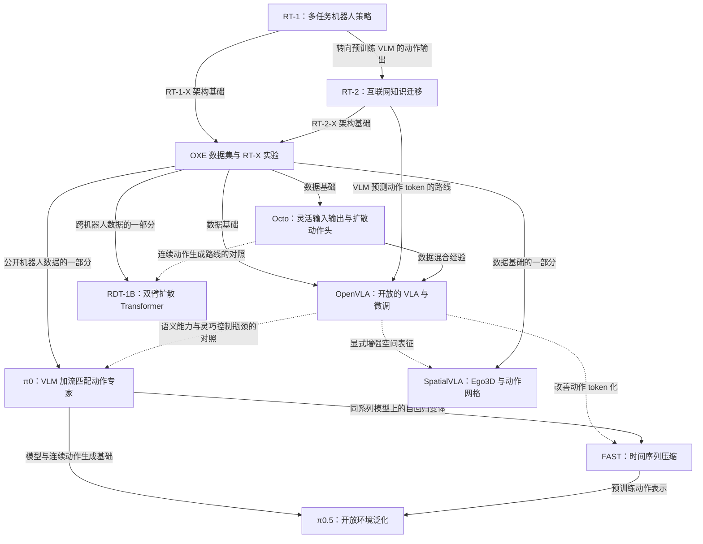
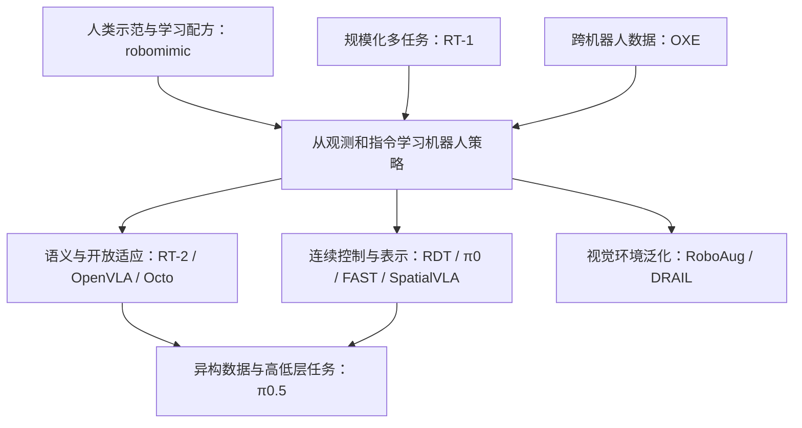

# “研”文件夹 13 篇文献详解：机器人怎样学会动作，又怎样适应新环境？

> GitHub 发布副本：来自本地学习资料，PDF 链接改为原文或项目页。整理笔记不等于已独立精读；原文中的本地页码和版本说明保留，在线版本可能不同。

整理日期：2026-10-15。范围：`D:/study/研` 及“机器人模仿学习与视觉数据增强”子文件夹中的全部 13 篇 PDF。

这份笔记重点回答：每篇研究什么问题、具体实现了什么、证据支持到什么程度，以及读懂它需要哪些基础知识。它承接原有 10 篇精读笔记，并补充 3 篇模仿学习与视觉增强论文；原笔记及续学记录保留。

**先抓住总问题：让机器人从有限的示范和其他可用数据中学会操作，并在任务、物体、环境或身体变化时仍能有效执行。** 不同论文解决其中不同环节，不能简单按年份排成能力榜单。

阅读导航：

- 第 1 节：领域常识，特别是训练与执行、动作表示、增强与泛化。
- 第 2 节：13 篇清单与研究关系。
- 第 3 节：逐篇解释问题、方法、实验、贡献和局限。
- 第 4–5 节：横向比较，怎样读懂实验与数字。
- 第 6–7 节：把论文串成主线，以及可选择的阅读顺序。
- 第 8 节：原文定位与版本说明。

“论文报告”指原文结果；“教学例子”用于帮助理解，不是新增实验。本文是阅读总结，没有进行模型训练或机器人复现。所有结论以本地文件版本为边界。

## 1. 先用一个例子理解整个研究方向

假设你对机器人说：“把桌上的红杯子放进抽屉。”机器人至少要解决五件事：

1. **看见**：找到杯子、抽屉和机械臂，识别遮挡与位置。
2. **听懂**：知道红杯子才是目标，而不是旁边的蓝杯子。
3. **决定步骤**：先开抽屉，抓杯子，再放进去，最后关抽屉。
4. **生成动作**：手臂怎么移动、手腕怎么旋转、夹爪何时闭合。
5. **根据结果纠正**：没抓住就重试，抽屉没打开就调整。

这些论文的共同目标是：让同一个学习系统在很多任务、物体、场景乃至机器人上工作，减少“每换一个任务都重新编程序或训练模型”的成本。

但它们强调的环节不同。**懂得杯子的用途，不等于夹得住杯子；能在实验室夹住杯子，也不等于换个家庭还能完成整个任务。**

### 1.1 你需要先认识的术语

| 英文 | 中文理解 | 在例子中是什么 |
|---|---|---|
| Embodiment | 机器人的身体及感知、执行配置 | 单臂、双臂、带轮子的双臂机器人 |
| Observation | 模型能获得的观测 | 摄像头图像、关节角、夹爪状态 |
| Proprioception | 本体感知 | 不看摄像头也知道手臂当前弯成什么样 |
| Action | 发给控制系统的命令 | 目标关节角、末端位移、夹爪开合等 |
| End effector / EEF | 末端执行器 | 机械臂最前面的夹爪或工具 |
| Policy | 策略，即从输入决定动作的规则或模型 | 根据图像和指令决定下一步 |
| Demonstration / Episode | 一次完整示范/交互回合 | 从开始抓杯子到任务结束的一段记录 |
| Timestep | 回合中的一个时间步 | 某个时刻的图像、状态和动作 |
| Imitation learning | 模仿学习 | 看人操作机器人留下的示范，学习怎么做 |
| Behavior cloning / BC | 行为克隆 | 把“当时看到了什么→示范者做了什么”当监督数据 |
| Reinforcement learning / RL | 强化学习 | 根据执行后的奖励改进策略；不是这些论文的主要训练路线 |
| VLM | 视觉语言模型 | 能结合图像理解文字、回答问题的模型 |
| VLA | 视觉语言动作模型 | 在视觉和语言之外，还能输出机器人动作 |
| Token | 模型处理的序列单元 | 可以是词片段、图像块、动作编号，也可以是连续向量槽位 |
| Backbone / Head | 主干 / 输出头 | 主干提取和融合信息，输出头生成最终动作 |
| Pre-training | 预训练 | 先从大量多样数据中学通用能力 |
| Fine-tuning / Post-training | 微调 / 后训练 | 再适应具体任务、身体或行为要求；这里不必然包含 RL |
| Zero-shot | 在明确的目标条件下不再训练便直接测试 | 不使用这个新家庭的数据适应模型 |
| Few-shot | 用少量目标示范适应 | 增加 1、5 或 100 条示范，数量必须说清楚 |
| Baseline | 基线 | 用来比较的已有方案 |
| Ablation | 消融 | 拿掉一个组件，观察性能是否下降 |

“零样本”一定要追问：是**新物体、新任务、新环境，还是新机器人**？这四种难度和证据完全不同。

### 1.2 一条公式贯穿这些论文

可以把机器人策略统一写成：

$$p_\theta(A_t\mid o_t,\ell),\qquad A_t=[a_t,a_{t+1},\ldots,a_{t+H-1}]$$

这里 `o` 是观测，`ℓ` 是语言指令，`θ` 是模型学到的参数，`A` 是要预测的一段动作，`H` 是动作段长度。`H=1` 时只预测下一步。

为什么写成概率分布 `p`？因为正确做法可能不止一种。绕过杯子时可以从左绕，也可以从右绕；双臂可以有不同分工。模型需要表达多种合理方案，而不是机械地取平均。

这组论文，大体在改五个部分：**输入信息、模型结构、动作表示、训练数据与流程、评估范围**。

### 1.3 三种动作生成方式

**逐维离散化。** 把连续数值切成若干格。例如允许位移在 -10 到 +10 厘米，切成 256 格，再预测应该选哪一格。RT-1、RT-2、原始 OpenVLA 都用到这种基本思路。优点是容易接入分类和语言模型训练，代价是量化误差和较长的输出序列。

**扩散或流匹配。** 从随机噪声形式的“候选动作段”开始，在观测条件下逐步生成合理的连续动作。Octo、RDT-1B 使用扩散，π0 使用流匹配。它们有关联，但训练目标和采样形式并不完全相同。

**更合适的离散动作表示。** FAST 压缩一段动作在时间上的冗余；SpatialVLA 用有空间意义的网格联合表示平移与旋转。它们说明：不能只问“离散还是连续”，还要问“离散的是哪个结构”。

另一个重要区分：**Transformer 是网络结构，扩散/流匹配是生成和训练方法。** 它们可以结合，RDT 的名字就同时包含 Diffusion 和 Transformer。

### 1.4 机器人究竟是怎样“学动作”的？

先把训练与实际执行分开。训练阶段，人通过遥操作等方式完成任务，系统同步记录“当时看到了什么、机器人处于什么状态、人给了什么控制命令”。一条示范是一串这样的记录，并非单张图片。

设记录为 `(图像 I_t, 状态 s_t, 指令 l, 动作 a_t)`，行为克隆学习的是：给定前面的输入，尽量预测示范动作。图像模型先把像素变为特征，语言模型编码指令，策略融合信息后预测动作；训练误差通过反向传播调整可训练权重。不同论文使用不同损失：离散 token 常用交叉熵，连续生成策略可用扩散或流匹配目标。

执行阶段无需拿到标准答案。机器人拍摄新图像、读取自身状态、预测动作、交给控制器执行，再读取反馈，循环进行。学习策略通常输出关节或末端目标，而不是直接计算每个电机的全部驱动细节；底层控制器负责跟踪这些目标。

这解释了为什么机器人学习比图片分类更复杂：预测会改变世界，也会改变下一次输入。一次抓偏之后，模型可能进入示范里很少出现的状态，后续继续出错，形成闭环误差累积。

### 1.5 先分清六个容易混淆的概念

| 概念对 | 应如何区分 |
|---|---|
| 模仿学习 / 强化学习 | 前者主要模仿示范行为；后者使用奖励或价值优化行为。离线 RL 也可从固定数据训练，并非必须现场试错 |
| 离线训练 / 离线强化学习 | “离线”只说明使用事先收集的数据；行为克隆也能离线训练，但不因此变成 RL |
| 策略 / 控制器 | 策略决定行为目标，底层控制器跟踪指令；论文动作接口决定两者具体分工 |
| VLM / VLA | VLM 处理视觉与语言；VLA 还学习机器人动作输出。视觉语言知识本身不提供完整的接触控制技能 |
| 动作段 / 长程规划 | 动作段是一小段连续控制命令；长程规划决定多步骤任务顺序。一次输出 50 个动作不等于完成 50 个子任务规划 |
| 图像扩散 / 动作扩散 | 前者生成图像，用于视觉数据增强；后者生成动作，用于策略控制。两者可以同时存在，也可以只用其中一种 |

### 1.6 数据增强为什么有效，又为什么可能有害？

**教学例子。** 训练照片里每次抓杯子都在红色桌布上，网络可能利用桌布纹理和固定画面位置预测动作。把同一段抓杯子示范配上多种背景，能使“只有红桌布时才会抓”的规律不再稳定，促使模型更多利用杯子、夹爪及两者相对位置。这叫抑制伪相关或捷径学习；实际是否做到了仍需实验。

增强数据可写为 `(T(I_t), s_t, a_t)`。复用动作标签的条件是：变换 `T` 之后，`a_t` 仍合理。保持任务语义和几何关系，是机器人视觉增强的重要约束。

| 变化 | 能否直接沿用动作标签 | 原因 |
|---|---|---|
| 只改不影响任务的桌布纹理 | 通常可以，但需检查合成质量 | 目标位置与物理关系保持不变 |
| 把杯子在画面中挪到另一边 | 通常不可以 | 原抓取动作仍朝旧位置执行 |
| 随意把整张图片旋转或水平翻转 | 不能自动假定可以 | 图像与机器人坐标、左右动作的关系可能改变 |
| “抓杯子”任务改变杯子颜色 | 在颜色不决定目标时可能可以 | 动作目标身份未变 |
| “抓红杯子”任务把目标变成蓝色 | 不能直接沿用原指令与动作 | 指令、图像和动作之间产生矛盾 |
| 在运动路径上新增真实障碍物 | 不可以当作纯背景变化 | 正确轨迹可能必须改变以避障 |

“任务相关”也不等于“目标物体”：夹爪、目的容器、需要避开的障碍、标记和缺陷区域都可能决定动作。物体在画面后面，也不意味着它一定是可随意替换的背景。

### 1.7 泛化至少有六个不同维度

| 泛化类型 | 测试时改变什么 | 不能自动推出什么 |
|---|---|---|
| 外观泛化 | 桌布、光照、颜色、纹理 | 学会新的操作技能 |
| 物体泛化 | 新个体或新类别物体 | 已掌握新物体的全部接触动力学 |
| 组合泛化 | 已学技能和物体的新搭配 | 学会训练中完全没有的新动作 |
| 环境泛化 | 新厨房、新家庭、布局变化 | 任何环境都可靠 |
| 跨身体迁移 | 不同机器人数据帮助目标机器人 | 未训练的新机器人可直接接上使用 |
| 长程泛化 | 多阶段任务或新的子任务顺序 | 能自动诊断所有失败并恢复 |

因此，“模型泛化很好”至少要补一句：对什么变化、在哪些任务、用了多少目标示范、成功率如何。RoboAug 和 DRAIL 的主要证据集中在视觉条件变化，RT-2 更关注语义与视觉迁移，π0.5 则进一步考察新家庭中的多阶段任务。


## 2. 论文关系：有继承，也有并行路线

### 2.1 文献清单与一句话定位

年份按最初公开工作的时间理解；本地 PDF 可能是后续修订版。

| 工作 | 本地文件 / 页数 | 定位 |
|---|---|---|
| RT-1，2022 | [rt1.pdf](https://arxiv.org/abs/2212.06817)，31 页 | 用可实时运行的 Transformer 学习大量机器人任务 |
| RT-2，2023 | [rt2.pdf](https://arxiv.org/abs/2307.15818)，19 页 | 把互联网视觉语言知识迁移到动作预测 |
| Open X-Embodiment / RT-X，2023 | [37_Open_X_Embodiment_Robotic_L.pdf](https://robotics-transformer-x.github.io/)，16 页 | 汇聚跨机器人数据，并验证正迁移 |
| Octo，2024 | [octo.pdf](https://octo-models.github.io/)，17 页；本地为 v2 | 构建容易适应新输入、新动作空间的通用策略 |
| OpenVLA，2024 | [openvla.pdf](https://openvla.github.io/)，37 页；本地为 v3 | 构建可开放研究、可有效微调的 VLA |
| RDT-1B，2024 / ICLR 2025 | [rtd-1b.pdf](https://rdt-robotics.github.io/rdt-robotics/)，28 页；本地为 v2 | 大规模扩散模型与统一动作空间支持双臂操作 |
| π0，2024 | [π0.pdf](https://www.physicalintelligence.company/download/pi0.pdf)，17 页 | 结合 VLM 和流匹配动作专家，支持灵巧连续控制 |
| FAST，2025 | [fast.pdf](https://www.pi.website/research/fast)，19 页；本地为 v1 | 改进动作 tokenization，提高高频轨迹学习效率 |
| SpatialVLA，2025 | [SpatialVLA.pdf](https://spatialvla.github.io/)，20 页；本地为 v5 | 在视觉输入和动作输出两端引入空间结构 |
| π0.5，2025 | [π0.5.pdf](https://arxiv.org/abs/2504.16054)，19 页；本地为 v1 | 结合异构数据、离散/连续训练和分层推理，泛化到新家庭 |
| robomimic 论文，2021 | [2108.03298v2](https://arxiv.org/abs/2108.03298v2)，36 页 | 系统研究人类示范学习中的算法、数据与实践条件 |
| RoboAug，2026 | [2602.14032v2](https://arxiv.org/abs/2602.14032v2)，31 页 | 参考区域匹配、背景生成与区域对比学习提升视觉泛化 |
| DRAIL，2026 | [2603.04845v1](https://arxiv.org/abs/2603.04845v1)，8 页 | 对任务相关和无关区域采用不同增强，改善农业操作泛化 |

文件名 `rtd-1b.pdf` 中的字母次序与正式名称不同，应记成 **RDT-1B**。OXE 本地文件有匿名投稿标记；数据规模、页码和措辞可能与正式公开版本有差异。根目录 10 篇共 223 页，子目录 3 篇共 75 页；合计 13 篇、298 页，包含参考文献和附录。

### 2.2 关系图

实线表示明确的模型路线、数据来源或方法采用；虚线仅表示可以对照理解的研究方向，不表示直接继承代码或权重。



不要把这张图读成排行榜。OXE 是数据基础设施加实证研究，FAST 是一个可组合的方法；它们和完整策略模型处于不同层级。

### 2.3 最重要的六条主线

| 主线 | 连接的论文 | 问题怎样变化 |
|---|---|---|
| 数据共享 | RT-1 → OXE → Octo / OpenVLA / RDT / π0 等 | 从单团队积累示范，走向跨机器人共享经验 |
| 语义迁移 | RT-2 → OpenVLA → π0 / π0.5 | 从会执行指令，走向利用互联网语义知识，再结合更灵巧控制和环境泛化 |
| 连续动作生成 | Octo、RDT、π0 | 用连续生成模型表达多种合理动作和高维动作段；三者不是简单版本迭代 |
| 动作表示 | RT-1 / RT-2 / OpenVLA → FAST、SpatialVLA | 从逐数值切格，分别转向时间压缩和空间结构 |
| 长任务与泛化 | RT-1+SayCan、π0、π0.5 | 从外部高层规划配合低层策略，走向同一模型内的高低层能力与新环境测试 |
| 视觉增强与学习配方 | robomimic、RoboAug、DRAIL | 从找出有效学习条件，走向有标签约束的视觉增强与区域表征 |

## 3. 逐篇精读

### 3.1 RT-1：先证明，一个机器人策略能吸收很多任务的数据

**论文问题。** 过去容易给每个任务训练一个专用模型。如果把抓取、放置、开关抽屉等示范合起来，一个模型能否同时学会它们，并泛化到新的指令组合？

**具体改进。** 输入是一小段图像历史和自然语言指令。语言经 Universal Sentence Encoder 编码，通过 FiLM 调整 EfficientNet 的视觉特征；TokenLearner 把每帧 81 个视觉 token 压成 8 个；6 帧得到 48 个视觉 token，送入 Transformer，输出离散动作。各动作维度使用 256 个桶。原始控制表示还包括移动底盘和控制模式，不只是后来常见的单臂 7 维动作。

**直观理解。** 指令告诉机器人“看图时重点找什么”，TokenLearner 则把图像中有用的信息提炼出来，降低实时控制所需计算。模型用示范动作做监督，属于行为克隆，不是靠在线试错奖励学会的。

**数据和证据。** 约 13 万条示范，13 台机器人，17 个月采集，744 条任务指令。注意“744 条指令”不等于 744 类完全不同的运动技能。第 10 页 Table 2 中，RT-1 在该评估里的已见任务、未见任务、干扰物、背景变化四项结果分别为 97、76、83、59%。第 14 页 Table 7 将数据数量与多样性分开研究：保留 97% 数据量却删除 25% 任务，泛化显著下降。

**为什么有意义。** 它同时给出可运行的多任务模型、数据收集方案和泛化评估，建立“大量多样机器人数据值得统一学习”的实证基础。

**边界。** 未见任务主要包括已见概念的新组合，不代表任意新动作。背景变化仍是明显弱项。长任务实验用了 SayCan 高层规划，不能把完整任务规划能力都归给 RT-1 网络本身。

**与后续关系。** RT-2 补互联网语义能力；OXE 将多机器人数据共享扩大；后续连续动作模型继续解决精细、高频和双臂操作问题。

**定位。** 方法：第 4–7 页、Figure 3；实验：第 9–14 页、Tables 2、5–7；局限：第 15 页。

### 3.2 RT-2：让“会看图说话的模型”学会输出动作

**论文问题。** 机器人示范很贵，无法覆盖互联网中所有物体和语义。能否直接利用已经经过大规模图文训练的 VLM？

**具体改进。** 将连续动作离散成 token，再把“图像+指令→动作 token”组织成类似视觉问答的数据。于是原本输出文字的 VLM，可以输出代表末端位移、旋转、夹爪及终止状态的 token。论文使用 PaLI-X、PaLM-E 两类基础模型，并在机器人动作数据与原来的视觉语言数据上共同微调。

**直观理解。** 原来模型会回答“这是一个苹果”，现在多教它一种输出格式：“要拿苹果，接下来执行这些动作数值”。真实动作能力仍需机器人数据提供；网络知识主要帮助判断“哪个东西、什么含义、什么关系”。

**最关键的区别。** RT-1 已有语言条件，但不等于 RT-2 这种直接改造生成式 VLM 的方式。RT-2 的变化不是简单把 RT-1 的 Transformer 放大。

**证据。** 论文约做了 6000 次评估。第 18 页 Table 5 中，在其未见物体、背景、环境的综合测试中，RT-1 的未见平均为 32%，两个 RT-2 实例均为 62%；已见任务则约为 91–93%，没有相应幅度的提升。第 19 页 Table 7 中，55B 模型仅机器人微调为 52%，共同微调为 63%，支持保留图文训练有益于该泛化评估。

这组结果更支持“增强语义和视觉泛化”，而不是“所有控制能力都翻倍”。不同表格的汇总口径有细小差别，不应把 Table 5 和 Table 7 的均值混作同一个数。

**边界。** 作者明确指出，互联网数据没有使机器人凭空掌握新运动技能。能选择石头作为潜在锤子，不等于学会可靠的敲钉子控制。链式语言规划是额外微调变体的定性展示，不等于所有主实验都使用了完整推理链。55B 版本控制频率约 1–3 Hz，依赖远程多 TPU 服务。

**定位。** 方法：第 3–5 页；泛化与消融：第 6–7、18–19 页；额外规划变体与局限：第 8 页。

### 3.3 Open X-Embodiment / RT-X：不同机器人可以共享经验吗？

**论文问题。** 每个实验室的数据都很有限，且身体、相机、动作单位、控制方式不同。把它们合起来，会学得更好，还是互相干扰？

**两个贡献要分开。** OXE 是标准化机器人数据集合；RT-1-X、RT-2-X 是基于已有 RT 架构，在跨机器人混合数据上训练的策略。它不是另造了一个叫“RT-X”的全新统一网络。

**具体改进。** 用 RLDS 等统一存储格式；在实验中选取相机观测，进行图像处理及动作归一化，把动作粗略整理成末端平移、旋转和夹爪表示。注意原文说的是“粗对齐”：没有把所有机器人的坐标系与绝对/相对/速度控制含义彻底统一。

**直观理解。** 多个学校把实验笔记整理成能一起阅读的格式。格式统一能促进共享，但并不意味着每个学校的机器操作方法完全相同。

**数据和证据。** 本地稿报告 22 种机器人、100 万以上轨迹；主要 RT-X 训练实验实际使用 9 种机械臂的混合数据，不能写成“模型在全部 22 种身体上完成了训练验证”。小数据域中，RT-1-X 相比原方法平均成功率相对提高约 50%；不是增加 50 个百分点。

第 7 页 Table 2 给出更有解释力的证据：跨身体技能测试中，RT-2 为 27.3%，RT-2-X 为 75.8%；从后者训练中去掉 Bridge 数据后降至 42.8%。这支持另一种机器人数据带来了有用技能。但同表常规泛化一列是 62% 对 61%，不能概括成“全部泛化都提升三倍”。

**边界。** 小模型在部分大数据域出现欠拟合/负迁移；增加混合数据不保证任何任务都提升。第 8 页明确说没有研究泛化到全新机器人。这里的“跨身体共享”与“没见过的身体直接上机”是两回事。

**与后续关系。** Octo、OpenVLA 等在此数据基础上设计模型和数据混合；RDT 进一步强调动作物理含义的统一；π0 系列还加入大量自采集数据。

**定位。** 数据和对齐：第 3–5 页；迁移证据：第 6–7 页；局限：第 7–8 页。

### 3.4 Octo：让预训练策略可以适应不同传感器和动作接口

**论文问题。** 一个模型即使多任务能力很强，如果换一只机械臂、加一个腕部相机就要大改网络，仍不好用。能否让策略像通用视觉模型一样，成为多种机器人任务的初始化？

**具体改进之一：模块化输入输出。** 不同相机、语言、目标图片分别转换成 token。Transformer 使用分块注意力，缺失输入被遮蔽；readout token 读取内部信息，再接动作头。适应新输入或动作空间时，可增补小模块并沿用大部分预训练权重。这里“沿用权重”不等于“微调时全部冻结”：论文默认更新策略模型。

**具体改进之二：扩散动作段。** 主干先计算一次条件特征，小型扩散头再进行多步去噪，预测一段连续动作。这样既能表达多种合理动作，也不必每次去噪都重跑整个大主干。

**具体改进之三：兼容目标图片。** 没有完整语言标注的数据也能通过未来目标图片提供学习条件。Octo 使用预训练 T5 语言编码器，但并不是拿一个完整生成式 VLM 直接改成动作模型。

**证据。** 使用 OXE 中筛选的 80 万轨迹，主要策略版本为 27M 和 93M 参数；这个口径不宜与包含全部冻结编码器的其他模型总参数直接比。第 7 页 Table I 中，约 100 条目标示范的六个微调设置，Octo 平均 72%，从头训练基线 20%，VC-1 基线 15%。这是指定任务上的结果，不是所有新机器人都能达到 72%。

Table II 在四个 WidowX 任务、合计 40 次测试上，完整方案约 83%，改用离散动作头为 18%，直接 MSE 动作回归为 35%。这支持其动作头选择，但不证明一切离散 VLA 都差；FAST 和 SpatialVLA 正是在改进离散表示。

**边界。** 第 17 页 Table VII 中，两项未见技能平均仅 5%。腕部相机与语言条件使用效果仍有不足。主文微调表统一写每域 20 次，附录对双臂任务写 10 次，存在报告细节差异；严谨复现时需要向代码/作者核对，而不是自行补齐。

**定位。** 方法：第 3–5 页；对比和消融：第 6–8 页；有价值的失败经验：第 15 页 Appendix E；泛化细分：第 17 页。

### 3.5 OpenVLA：把 VLA 做成可用、可研究、可微调的基础模型

**论文问题。** RT-2 证明 VLM 可以帮助机器人，但模型不易获得，面向新任务如何高效微调也缺少充分研究。

**具体改进。** 基于 Prismatic VLM，组合 DINOv2 与 SigLIP 视觉特征，经投影连接 Llama 2；在 97 万条机器人示范上训练动作预测。直观上，DINOv2 提供有用的视觉结构特征，SigLIP 提供图文对齐特征，但不能把这两者理解成绝对分工的“几何模块”和“语义模块”。

动作仍采用每维 256 桶，但用训练数据 1%–99% 分位数确定范围，减少异常值拉宽区间造成的精度损失。数据混合借鉴 Octo，并调查视觉编码器是否需要更新、LoRA 微调、量化推理等实际问题。

**LoRA 的直观理解。** 不是重写整个大模型，而是训练较小的低秩权重增量来适应任务。它减少可训练参数与相关状态的开销，但计算仍会经过大模型。

**证据。** 在论文选定的 29 个任务、两个机器人设置的汇总比较中，相比 RT-2-X 报告高 16.5 个百分点；但语义泛化类别仍有 RT-2-X 更强的情况。不能把汇总胜出改写成每个维度都更强。

第 34 页 Table 9 的一个重要消融：OpenVLA 76.3%，只用 Bridge 数据训练的变体 45.6%，再去掉 DINOv2 为 40.6%。在这组 80 次评估中，多机器人训练带来的差异大于双视觉编码器带来的差异。写创新总结时不应只盯着“多加一个编码器”。

**显存数字怎样读。** 第 10 页 Table 1，rank 32 的 LoRA 成功率 68.2±7.5%，全参数微调 69.7±7.2%；LoRA 训练约 1.4% 参数。该表 batch=16 时显存仍约 59.7 GB。Table 2 的 int4 约 7 GB 是推理，不是这个微调实验的显存需求。脚注还说明，这些效率实验用的是较小数据混合、仅 SigLIP 的变体。

**边界。** 原始 OpenVLA 只使用单帧图像，不包含完整的多相机、本体状态与动作段设计。低频单步自回归动作不适合直接承担所有高频灵巧任务。狭窄、精细的单指令任务上，从头训练的 Diffusion Policy 仍可能更好。

**与后续关系。** FAST 改它所代表路线的动作编码瓶颈；SpatialVLA 显式补空间信息；π0 把预训练语义主干与连续动作专家结合。后续代码新增功能不能倒写成这篇原论文已有的贡献。

**定位。** 方法：第 4–6 页；主实验：第 7–9 页；高效适应及脚注：第 10–11 页；消融：第 33–35 页；LIBERO：第 36–37 页。

### 3.6 RDT-1B：双臂操作需要表达多种协调方式

**论文问题。** 双臂的动作维度更高，协调方式更多，专用示范却更稀缺。怎样利用大量主要来自单臂机器人的数据，帮助双臂操作？

**直观理解多峰分布。** 抓住一个盒子，可以左手固定、右手抓，也可以相反。这些方案都合理，但它们的数值平均不一定合理。这里的“多模态/多峰动作分布”指多种动作方案，和“输入包含图像、文字等多种模态”不是同一个概念。

**改进一：大规模扩散 Transformer。** 使用可扩展的 DiT 来生成连续动作段；QKNorm、RMSNorm 改善训练数值稳定性；非线性 MLP 输出层增强动作映射能力。视觉使用冻结 SigLIP，语言使用冻结 T5-XXL，不是把整个现成的生成式 VLM 改造成自回归动作模型。

**改进二：交替注入条件。** 图像 token 通常远多于语言 token。作者在相邻层交替让动作表示关注图像或语言，减少视觉信息压过指令的情况；配合随机模态遮蔽，避免只依赖一个输入。

**改进三：有物理意义的统一动作空间。** 创建 128 维统一向量，为关节位置、末端位置、旋转表示、左右手和底盘等分配明确位置。各机器人将自己已有的量填入对应槽位，缺失部分填充。128 维是统一表示大小，不代表目标机器人真的有 128 个自由度，也不意味着模型已经发现了所有机器人的物理规律。

**训练流程。** 46 个数据集、100 万以上轨迹进行预训练，再用 6000 多条自采双臂示范做目标机器人微调。主要 RDT 网络约 1.2B 参数，比较显存时还应考虑冻结编码器等组件。

**证据。** 第 9 页 Table 2 中，未见物体测试的完整 RDT 为 50%，直接回归变体为 12.5%，无预训练变体为 0%；但未见场景一列大、小 RDT 同为 62.5%，所以不能声称每项指标都严格随规模上升。第 10 页 Table 3：折短裤新增 1 条该技能示范后，完整 RDT 为 68%，无预训练变体为 40%，各测试 25 次。

**怎样理解“一条示范”。** 是在已有多机器人预训练和目标机器人多任务数据的基础上，该新技能只有一条示范。不是从一张白纸开始，看一次就学会任意双臂任务。

**边界。** 某些测试只有 8 次试验，改变一次结果就是 12.5 个百分点；不能仅凭小差异过度推断。原文明确目标是借助跨机器人数据提升双臂能力，而不是证明无需适应便可控制各种未见机器人。对 OpenVLA、Octo 的比较涉及适配双臂和输入配置差异，不能只归因于“扩散一定优于其他方法”。

**速度数字。** 第 8 页报告约 6 个动作段/秒、约 381 个动作/秒的摊销生成吞吐。381 不是 381 次/秒的感知闭环决策。

**定位。** 动机与方法：第 3–7 页、Figure 3；训练与测试配置：第 8–10 页；统一空间：第 19–20 页、Table 4；对比配置：第 25–27 页。

### 3.7 π0：把语义知识与灵巧的连续动作生成结合

**论文问题。** VLM 有通用知识，但直接逐个生成动作 token 难以充分应对高频双臂、折衣服等任务。小型扩散策略擅长连续控制，却未必充分利用大规模 VLM 的能力。能否兼得？

**具体改进。** 基于 PaliGemma VLM，加入约 300M 参数的 action expert（动作专家），以流匹配生成动作段。整体约 3.3B 参数。图像、文字主要走 VLM 权重；状态和带噪动作使用机器人专用权重，两组权重通过注意力交互，而非简单地把 VLM 最后一个向量接到线性动作头。

输入包含两到三个相机图像、语言和关节状态；一次预测 `H=50` 步连续动作。动作段中的动作位置可以相互关注，以建模整个段内的协调。

**把流匹配公式翻成人话。** 从真实动作段 `A` 和随机噪声 `ε` 构造中间样本：

$$A^\tau=\tau A+(1-\tau)\epsilon.$$

`τ=0` 是纯噪声，`τ=1` 是真实动作。网络学习给定图像和指令时，中间样本应该朝什么方向移动：

$$\mathcal L=\mathbb E\left[\|v_\theta(A^\tau,o)-(A-\epsilon)\|^2\right].$$

执行时从噪声出发，按预测方向迭代，得到符合场景和任务的动作段。本地 π0 用 10 次积分更新。**这是在模型内部生成动作，不是让真实机器人先随机抖动再把噪声消掉。**

为什么去噪训练也用了平方误差，却没有和简单 MSE 回归一样的问题？因为这里回归的是不同噪声状态下的条件向量场，最终从随机初始值生成分布；不是只用观测直接回归一个确定的平均动作。

**训练改进同样重要。** 先在覆盖多机器人、多任务的数据上预训练，再用高质量任务数据后训练。作者自采数据约 1 万小时、903M 时间步、7 类机器人配置、68 个较宽泛的任务。按详细数据节，混合中包含公开数据及其筛选/加权版本；不能只根据概览中的一句话认定完整使用所有 OXE 数据。

**证据。** Figure 7 比较直接使用预训练模型的任务表现，也比较相同更新步数的版本；Figure 11 改变微调数据量，考察预训练是否降低新任务的数据需求；Figure 13 比较完整训练、只有预训练、只用后训练数据三种流程。整体支持“模型结构与训练流程共同重要”。

**边界。** 与 π0-small 的比较同时改变 VLM 初始化、参数量和部分结构，作者自己也承认难以完全公平，因此不能把全部差距仅归因于互联网知识。复杂任务常用任务进度评分，且部分任务获得高层策略指导，不应泛化成无需分解、无需微调的万能机器人。

**关键速度概念。** 第 16 页 Appendix D：在 50 Hz 机器人上，实际每执行 25 步、约 0.5 秒重新生成一次动作段；在 20 Hz 平台上每 16 步、约 0.8 秒一次。50 Hz 是动作执行频率，不是视觉重新决策频率。整段生成在该 RTX 4090 配置下机内约 73 ms，也与实际采用的重规划频率不同。

**定位。** 方法与公式：第 4–5 页；数据与训练：第 5–6 页；实验：第 7–11 页；局限：第 11–12 页；架构和部署：第 15–16 页。

### 3.8 FAST：问题可能出在动作的“写法”

**论文问题。** 高频动作序列每一步变化很小。逐维、逐时刻离散，会制造大量冗余 token，让自回归模型容易学会复制相邻值，却不容易学到真正的轨迹结构。

例如双臂 14 维动作，每秒 50 步，一秒就有 `14×50=700` 个数。如果每个数都独立变成 token，输出非常长。

**具体改进。** FAST 全称 Frequency-space Action Sequence Tokenization，处理过程为：

```text
连续动作段
  → 按动作维度归一化
  → 每个维度沿时间做离散余弦变换 DCT
  → 缩放并取整，得到稀疏频域系数
  → 按低频优先、交错动作维度的次序展开
  → 用 BPE 合并常见系数组合
  → 更短的动作 token 序列
```

**直观理解。** 与其逐时刻说“手在这里、稍微前一点、再前一点”，不如用几个系数概括一段轨迹的主要变化形状，再补必要细节。DCT 可表示低频趋势与高频变化，不等于固定丢掉全部高频信号。

**有损和无损要分开。** DCT 变换本身可逆；系数量化会引入误差；BPE 对量化后的离散序列做无损压缩。因此整个 FAST 流程一般是有损表示，不能因为 BPE 无损就说机器人动作被完全无损压缩。

**FAST、FAST+、π0-FAST 的区别。** FAST 是方法；FAST+ 是在约 100 万个一秒动作段上训练的通用 tokenizer；π0-FAST 是使用这种动作表示进行自回归动作预测的策略。这里的百万数据单位是动作段，不能与 OXE 的百万完整轨迹直接相加或比较。

**证据。** 第 7 页 Table I，在一秒动作段、可比重建精度下：

| 数据 | 原始逐维逐步 token 数 | FAST 平均 token 数 | 压缩比 |
|---|---:|---:|---:|
| BridgeV2，7 维，5 Hz | 35 | 20 | 1.75 倍 |
| DROID，7 维，15 Hz | 105 | 29 | 3.6 倍 |
| 清桌，7 维，20 Hz | 140 | 28 | 5.0 倍 |
| 折衬衫，14 维，50 Hz | 700 | 53 | 13.2 倍 |

第 9 页消融显示，去掉 BPE 后表现下降；把 FAST 应用于改造为多图像、动作段输出的 OpenVLA，也能改善高频任务训练。因此贡献主要在表示方法，不局限于一种主干。

**“训练快”不等于“推理快”。** 第 10 页报告通用 π0-FAST 达到相近任务表现所用 GPU 小时可约少 5 倍；第 9 页同时报告，当时实现中自回归 FAST 每动作段约 750 ms，而连续 π0 通常不足 100 ms。前者解码 30–60 个 token 需多次运行较大的语言主干，后者主要迭代较小动作专家。

**研究意义。** 大模型训练失败不一定说明网络不够大，也可能是监督目标表示得不好。这是很适合入门者学习的科研思路：先设计一个简单可控的信号预测实验，把原因讲清楚，再去机器人任务验证。

**定位。** 高频失败案例：第 3–4 页、Figure 3；算法：第 4–6 页、Figure 4、Algorithm 1；对比及局限：第 7–10 页；重建误差：第 16 页。

### 3.9 SpatialVLA：既要知道“是什么”，也要知道“在哪里、怎么移动”

**论文问题。** 通用视觉语言表征可以识别杯子，但对深度、高度、相对距离和精细运动的表征未必足够。如何显式增强机器人所需要的空间结构？

**改进一：Ego3D 位置编码。** 用 ZoeDepth 估计深度，结合相机内参，把像素位置反投影到相机坐标系中的三维位置；再把三维位置编码与 SigLIP 的视觉特征相加：

$$\text{空间视觉特征}=\text{视觉特征}+\operatorname{MLP}(\text{三维位置的频率编码}).$$

直观上，每块视觉特征不仅带着“看上去像杯子”，还带着“在相机前方多远、什么方向”。它不需要机器人到相机的外参标定，并不等于完全不需要相机信息；反投影仍使用内参。估计深度也不是精确的真实几何测量。

**改进二：Adaptive Action Grids。** 将 7 维单臂动作分为平移、旋转、夹爪三组。平移用方向与距离的坐标表示；根据训练动作的统计分布，划分非均匀网格，常见动作区域分配更细的分辨率。每组由一个 token 表示，所以一个动作需要 3 个 token。

“3 个 token”不是“只有 3 个可选动作”。其动作词表包含 4096 个平移格、4096 个旋转格和 2 个夹爪类别，总计 8194 个 token。更少的序列长度对应更有结构、也更大的分类词表。

**改进三：新机器人的网格适应。** 微调前重新拟合目标动作分布、划分网格，并通过三线性插值初始化新网格 embedding，而不是把原来学好的动作表示全部丢掉。

**证据。** 预训练基于 PaliGemma 2，约 110 万条 OXE/RH20T 机器人示范。第 9 页 Table IV 的小规模预训练消融中，去掉 Ego3D 后，Pick Coke Can 的 variant aggregation 从 81.6% 降到 68.9%；其 visual matching 则从 70.7% 到 70.3%，变化很小。这说明收益与测试变化类型有关，不是每个条件都大涨。

同页 Table V，在 LIBERO-Spatial 中，LoRA 为 83.6%，加空间 embedding 适应为 88.2%。这个比较更直接地支持适应方法。第 8 页 Table III 总体均值 78.1% 对 OpenVLA 76.5%，但 LIBERO-Goal 不是 SpatialVLA 最优，所以也不是全任务胜出。

**本地版本的动作段细节。** 第 5、16 页明确写一次预测 4 步动作、共 12 个空间动作 token。不要把“每步 3 个”误写成“每次调用总共只输出 3 个”。

**边界。** 高斯拟合不一定适合偏斜、多峰或集中在某个轴的动作分布；深度误差、坐标表示、离散分辨率都会影响效果。空间感知增强也不自动解决长时记忆与任务切换。论文报告约 20 Hz 部署速度，但跨论文比较前还要核对动作段、深度预测开销和测速口径。

**与 FAST 的区别。** FAST 主要压缩“时间上怎么变化”，SpatialVLA 主要结构化“空间上怎么移动”。二者可能有互补性，但不能直接把两个 tokenizer 串起来就认定有效，必须解决表示接口并做实验。

**定位。** 方法：第 3–5 页；主要结果：第 6–9 页；局限：第 10 页；动作编码和深度消融：第 15–16 页。

### 3.10 π0.5：怎样把实验室里的能力带到新家庭？

**论文问题。** 在熟悉环境里折衣服，与到一个未训练过的家庭完成多阶段整理，是不同难度。后者同时需要新物体识别、环境适应、任务分解和连续控制。

**核心改进并非只换一个动作头，而是训练配方。** π0.5 把不同知识来源组织成同一模型的训练任务：

| 缩写 | 数据来源 | 主要提供什么 |
|---|---|---|
| MM | 多环境移动操作数据 | 与目标移动机器人和家庭任务最直接相关的行为 |
| ME | 多环境固定机械臂数据 | 以较易部署的机器人扩大场景覆盖 |
| CE | 实验室跨身体数据，含 OXE | 多任务操作经验与跨身体迁移 |
| HL | 高层子任务、相关物体框等标注 | 当前情境下应该先做什么 |
| WD | 图文、问答、物体定位等网络数据 | 语义和视觉知识 |
| VI | 人通过语言逐步指导机器人执行的数据 | 在已有低层策略能力下，什么高层命令有效 |

**训练阶段一。** 用 FAST 将机器人动作变成离散 token，与文字、定位框、子任务等共同训练。此阶段统一成自回归预测，方便高效学习。

**训练阶段二。** 加入连续动作专家，并联合保留 token 预测和流匹配损失。后训练更聚焦移动操作及多环境数据，加入 VI；不是把全部原数据不加区别继续混合。原文设定先 280k 步离散预训练，再 80k 步后训练。

**进一步读结构细节。** 与 π0 相比，本体状态改成离散 token 输入主干；流匹配时间参数通过自适应 RMSNorm 注入动作专家各层。FAST 动作 token 与连续动作表示不能互相读取，避免训练时直接偷看另一种形式的答案。注意“注意力遮蔽”与后续知识隔离工作中的“阻断特定梯度传播”不是同一件事。

**执行时。** 同一模型先预测子任务，再根据子任务预测动作：

$$p(A,\hat\ell\mid o,\ell)=p(\hat\ell\mid o,\ell)\,p(A\mid o,\hat\ell).$$

`ℓ` 是“收拾厨房”，`ℓ̂` 可以是“把杯子放入水槽”。这个分解明确区分“接下来做什么”和“动作怎么做”。高低层由同一模型承担，但通常是不同条件下的推理调用，不应想象成每个动作都重新输出一大段文字计划。

**证据一：环境覆盖。** 移动操作数据约 400 小时、约 100 个环境；另有更多其他来源数据。第 8–9 页研究 3、12、22、53、82、104 个训练地点，发现随着地点覆盖增加，新场景表现改善。400 小时不是全部训练数据总量。

**证据二：不同数据的贡献不同。** 第 10 页 Figure 10，去掉 ME/CE 明显损害模拟家庭中的任务进度；去掉 WD 在这一实验中差异不显著。但 Figure 11 的新类别物体语言跟随、Figure 13 的高层能力测试，WD 作用更明显。不能把结论写成“网络数据对所有机器人指标都显著提升”。

**证据三：训练高层能力本身有价值。** 第 11 页 Figure 13 中，即使执行时不用显式高层推理，只要训练时包含高层任务数据，表现仍较强。这支持“辅助训练任务改善了表示”的解释，而不只是“多说一句计划就会变聪明”。

**泛化边界。** 论文在 3 个未见真实家庭中测试，另用模拟家庭房间做可控比较。这是重要进展，却不是任意家庭、任意指令、任意身体的可靠性保证。主要任务本身在训练数据中有对应类型，新的是环境、布局和物体条件。结果多是任务进度评分。首页 10–15 分钟的展示描述，也不等于量化实验每次都持续这么久；第 8 页说明不少量化任务约 2–5 分钟。

**仍然会失败。** 不熟悉的把手、难打开的柜门、手臂遮挡、反复开关抽屉、上下文不足等。新的挑战从“动作生成出来没有”进一步变成“是否知道完成到哪一步、失败后如何继续”。

**版本提醒。** 本地是 2025-04 的 v1。后续独立工作的知识隔离、实时动作段等改进，不应倒写成这份原稿已经提出的全部方法。

**定位。** 方法：第 4–7 页、Figure 3；泛化与消融：第 8–11 页、Figures 8–13；评分规则：第 17 页；注意力与实现细节：第 19 页。

### 3.11 robomimic 论文：人类示范到底怎样才能被机器人有效学会？

**论文身份。** *What Matters in Learning from Offline Human Demonstrations for Robot Manipulation*，2021；本地为 v2、36 页。这里用“robomimic 论文”作为简称。原文：[2108.03298v2（机器人怎么学）](https://arxiv.org/abs/2108.03298v2)。

**要解决的问题。** 给机器人一批人类示范，训练时动作预测误差下降，机器人实际执行却不一定成功。原因可能来自算法，也可能来自示范质量、历史信息、相机配置、超参数或者选错了模型检查点。缺少统一数据和实现，就很难知道究竟是哪一项在起作用。

**这篇具体完成的工作。** 它建立了可以系统比较的任务、数据和算法实现，研究 6 类离线学习算法在 5 个仿真任务和 3 个真实任务上的表现。仿真任务包含抬起方块、罐子放置、方形螺母套杆、双臂搬运、工具悬挂；真实任务为抬块、罐子放置、工具悬挂。任务同时覆盖简单抓取、精细对准和多阶段协作。它的主要贡献是基准、系统实验和实践结论，不是提出一个全新的机器人基础大模型。

**数据怎样设计。** 区分机器生成数据 MG、熟练操作员示范 PH、多人示范 MH。PH 的主要仿真设置每任务 200 条示范；MH 每任务 300 条，由 6 名不同熟练度的操作员提供。作者还构造 Better、Okay、Worse 子集及其组合，以比较“更多数据”和“更高质量数据”的作用。这里示范质量较低常表现为动作绕路、犹豫、修正等，不应自动等同于整条轨迹失败；Can-Paired 才专门构造了配对的成功与失败示范。

**六类方法怎样理解。**

| 方法 | 核心做法 | 为什么要放进比较 |
|---|---|---|
| BC | 根据观测模仿示范动作 | 判断简单监督学习本身能做到什么 |
| BC-RNN | 在 BC 中加入循环网络，利用观测历史 | 检验时间上下文能否减少歧义 |
| BCQ | 限制动作偏离离线数据支持范围，并学习价值 | 检验离线强化学习能否利用混合质量数据 |
| CQL | 保守地学习动作价值，降低分布外动作过估计 | 检验另一类离线强化学习方法 |
| HBC | 分层行为克隆，高层选择子目标、低层执行 | 检验时间抽象与分层结构 |
| IRIS | 结合分层模仿与价值学习 | 检验高层决策能否利用离线回报信息 |

**实现链条。** 图像由视觉编码器提取特征，机器人状态提供本体信息；BC-RNN 再用 RNN 处理一段历史，最后预测动作分布。作者研究了 GMM（高斯混合分布）动作头：一个观测可以对应多种可行动作，不必压缩成一个平均值。低维实验使用物体状态等信息，图像实验改用原始视觉输入，两种设置应分别阅读。

**为什么历史有用：教学例子。** 两张几乎一样的图片里，夹爪都停在杯子旁边，但一个时刻是“准备闭爪”，另一个时刻是“抓取失败后准备退出”。仅看当前图片容易混淆；结合前几步更容易判断任务进展。这是直观例子，不是论文给出的具体测试轨迹。

**关键证据一：历史信息改善复杂任务。** 第 6 页 Table 3 的图像观测实验中，PH 的 Tool Hang：BC 为 20.0%，BC-RNN 为 67.3%；MH 的 Transport：BC 为 18.7%，BC-RNN 为 42.0%。这些是仿真图像实验，报告跨 3 个种子的平均结果；不能把 67.3% 写成真实工具悬挂成功率。

**关键证据二：相机和图像随机化很重要。** 第 8 页真实 Can 任务，完整 BC-RNN 成功率 73.3%；去掉像素平移随机化降到 26.7%，去掉腕部相机降到 43.3%。每个配置评估 30 次。腕部相机能补充近距离对准信息；小幅图像变化帮助模型不过度依赖固定像素位置。这提供了与后面两篇视觉增强论文的直接概念连接。

**关键证据三：真实困难任务仍很难。** 真实 Lift 为 96.7%，Can 为 73.3%，Tool Hang 只有 3.3%。作者没有针对这些真实任务额外调参，并使用最终检查点评估。这说明某些设计经验可以迁移到现实，但不能把“发现有效经验”写成“已经解决精细装配”。

**关键证据四：训练损失不能代替执行效果。** 仿真实验允许对训练检查点进行在线评估，再研究不同选择规则。按最低验证损失或直接取最后检查点，可能明显差于在线表现最好的检查点。因为离线动作误差衡量的是“在示范状态下像不像示范者”，而真实执行还涉及误差累积、状态偏移和失败恢复。

**应该学到的常识。** 多人数据并非天然优于单人数据；增加信息也并非必然有益；复杂算法并非必然优于认真配置的 BC。算法是否有效，必须和数据来源、历史窗口、视觉输入、动作分布及评估协议放在一起判断。

**局限与准确结论。** BCQ、CQL 在这篇 2021 年的人类示范设置中表现不佳，不代表所有离线 RL 在所有时间和任务中都不如模仿学习。它也没有训练语言条件通用策略。论文揭示了选检查点的困难，但没有彻底解决这个问题。

**原文定位。** 数据与算法：第 3–5 页，第 3 节；图像结果：第 6 页 Table 3；超参数、相机与模型选择：第 7 页；真实实验与经验总结：第 8 页，第 4.7、5 节。

### 3.12 RoboAug：少量区域标注，怎样帮助原有动作适应新场景？

**论文身份。** *RoboAug: One Annotation to Hundreds of Scenes via Region-Contrastive Data Augmentation for Robotic Manipulation*。本地为 2026-10-08 的 v2、31 页，不能用早期版本的结构或实验覆盖它。原文：[2602.14032v2（扩充视觉场景）](https://arxiv.org/abs/2602.14032v2)。版本日期已与 [arXiv 记录](https://arxiv.org/abs/2602.14032v2)核对。

**要解决的问题。** 机器人在干净桌面上学会抓取后，可能一换桌布、光照或干扰物就失败。重新在每种环境采集机器人示范很贵。已有图像生成增强又依赖可靠的检测与分割：如果漏掉目标、把夹爪涂掉或生成出错误物体，图像与原动作就不匹配。

**工作不是单纯“生成更多图片”。** 作者连接了三个环节：低标注成本地找到应当保留的区域；生成多样背景；通过区域对比损失引导视觉表征。另构建了 RoboAug-D 检测数据集，用于评估机器人视角下的物体定位困难。

**第一步：每个任务标注一张参考图。** 在任务相关实体清晰可见的一帧上画框，覆盖机器人、目标物体、放置容器等。使用 DINOv2 把这些裁剪区域编码成参考特征。其他示范轨迹的第一帧由 GroundingDINO 提供候选框，再用特征余弦相似度与参考区域匹配。SAM2 把框转成像素级掩码，并沿视频传播。

因此，“one annotation”更准确的含义是**每任务一张带多个所需框的参考帧**，不是整个项目只画一次框，也不是机器人只需要一次动作示范。它依然需要原始示范轨迹、候选检测和分割跟踪模型。

**第二步：保留前景，替换背景。** 用文字提示及 Stable Diffusion v3 生成完整背景，再把原来的任务相关像素合成回去：

$$I_{aug}=M\odot I+(1-M)\odot I_{bg}.$$

`M=1` 的地方保留原图，`M=0` 的地方使用新背景。作者准备了 500 个背景模板，涵盖木质、石材与复合材料。这里的生成模型用于训练数据构造，和策略模型生成动作不是同一个阶段。

它保护的是**掩码选中的像素**。如果掩码漏掉了物体的一部分，公式不会自动修复漏标。背景替换也没有改变原来的关节状态与示范动作，所以主要扩展的是视觉环境覆盖，而非运动技能覆盖。

**第三步：加入区域对比学习。** 原图和单个区域遮罩图通过共享视觉编码器。来自整图的空间注意力权重用于突出区域特征，并作用于送给策略的整图特征。同一区域身份的样本构成正样本对，不同区域身份构成负样本对，联合优化：

$$L_{total}=L_{action}+\lambda L_{RC}.$$

前一项要求动作做对；后一项鼓励相同区域的表征接近、不同区域的表征可区分。**“区域身份”不等于“任务编号”**：同一个任务中的夹爪、目标物体、容器可以提供不同身份，单任务训练也能构造正负对。不能简单解释成“所有前景拉近、所有背景推远”。

**训练与执行的区别。** 掩码区域分支用于训练；部署时使用完整图像分支及空间注意力模块，不需要逐帧先人工分割。它保留底层策略的基本形式，但确实包含训练分支和注意力机制，概括为“整个系统绝对没有增加任何模块”并不准确。

**作者具体做了哪些实验。** 在 UR-5e、AgileX、天工 2.0 三个平台，每个平台设计 5 个操作任务；每任务采集 50 条真实专家轨迹。主比较采用 ACT 策略；各增强方法使用相同的扩充比例：在 50 条真实轨迹之外增加 250 条视觉增强轨迹。后者不等于又采集了 250 条独立的物理交互。论文还在部分任务上接入 π0。

第 8 页 Table 3，在背景、灯光、干扰物同时变化的设置中：

| 平台 | ACT 不增强 | GenAug | RoboAug |
|---|---:|---:|---:|
| UR-5e | 9% | 31% | 47% |
| AgileX | 16% | 34% | 60% |
| 天工 2.0 | 19% | 42% | 67% |

这些是各平台任务汇总，比较范围是这张表的测试协议。比如 UR 从 31% 到 47% 是增加 16 个百分点，相对提高约 51.6%；不是增加 51.6 个百分点，也不是任意陌生环境下都有 47% 成功率。实验协议写每配置 20 次执行，主文报告总计超过 3.5 万次真实试验；不能把总试验数当成每个单任务的样本数。

**消融更能说明具体贡献。** 第 8 页 Table 4 选取 3 个任务，RoboAug 不含区域对比学习的平均成功率为 46%，加入后为 56%。它支持区域对比目标在该设置中有额外收益；主表整体提升也涉及背景增强、掩码质量等，不能全部归因于对比损失。

**检测数据集要与策略数据区分。** RoboAug-D 包括 33 个任务、7,576 条轨迹、73,749 个关键帧、46 个物体类别和 366,835 个框。这些是检测基准统计，不能直接说主策略训练用了这 7,576 条轨迹。检测比较中本方法额外使用参考框监督，而对比模型采用零样本设定；参考图排除在测试集外。性能提升应连同这个监督条件一起报告。

**原文一个需要留意的表格问题。** 第 8 页 Table 2 的天工两项 π0+RoboAug 结果写为 0.60、0.65，Average 一格写为 0.65；如果取这两项简单平均应为 0.625。表格没有解释额外权重，因此本笔记不引用该平均格，保留逐项结果与这一待核实点。这不会抹去逐项改善，但影响精确汇总。

**边界。** 本地稿明确按单任务分别训练和评估，尚未验证多任务统一训练效果；2D 背景生成没有显式建模时间一致性及真实接触物理。测试了灯光与干扰物变化，不等于训练时已经显式合成了这两类变化。掩码质量、真实障碍与任务相关区域的划分仍会影响效果。

**这篇应记住的科研思路。** 先找“数据增强为什么会失败”的上游原因，再同时改数据质量与学习目标，并用固定扩充比例、组件消融和多种视觉变化检验收益。

**原文定位。** 第 4 页 Figure 2、3.2 节；第 5–6 页 3.3–3.5 节；第 7–9 页实验、Tables 2–4、局限；补充分析见附录 6.9。

### 3.13 DRAIL：不同区域应该怎样增强，才能保留动作所需信息？

**论文身份。** *Task-Relevant and Irrelevant Region-Aware Augmentation for Generalizable Vision-Based Imitation Learning in Agricultural Manipulation*，2026-03，v1、8 页。DRAIL 全称 Dual-Region Augmentation for Imitation Learning。原文：[2603.04845v1（不同区域怎末增强）](https://arxiv.org/abs/2603.04845v1)。

**要解决的问题。** 农业操作中，视觉变化同时来自作物本身和背景。只更换背景，模型仍可能认不出颜色改变的作物或陌生叶片；如果整张图任意改色、贴图，又可能破坏决定抓哪里的重要信息。机器人示范还受到季节、作物个体和采集成本限制。

**核心想法。** 把画面分为任务相关区域与任务无关区域：相关区域根据任务知识做有约束的增强，无关区域进行较强随机化。核心条件是：增强之后，原示范动作仍然是合理动作。

**实现第一步：逐轨迹生成掩码。** 每条示范的初始帧用人工标注结合 SAM 得到相关区域，使用 XMem++ 传播到后续帧。与 RoboAug 的每任务一张参考图跨轨迹匹配不同，本实现需要每条示范的首帧标注。掩码主要用于训练数据增强，不能把它理解成每次执行动作都要人工标注。

**实现第二步：为相关区域设计任务专属变化。**

| 任务 | 相关区域和增强操作 | 需要保留什么 |
|---|---|---|
| 人工番茄采收 | 相关区域包括番茄及盆内区域；改变番茄颜色 | 原目标及抓取位置，颜色变化后仍执行同一抓取 |
| 人工胡萝卜采收 | 在盆内以不同角度、尺度合成叶片裁剪图 | 标记叶片仍是目标，不能被遮掉或替换成其他目标 |
| 真实生菜缺陷叶抓取准备 | 相关区域为生菜与夹爪；合成无缺陷或小缺陷叶片 | 缺陷最大的目标叶及叶基部仍决定动作 |

这里“相关区域增强”不等于只修改目标物体；例如在相关区域内增加非目标叶片，是为了让模型学会区分真正的目标特征与其他外观信息。

**实现第三步：无关区域强随机化。** 使用 PixMix，把具有复杂几何结构的分形纹理混入背景。其目的不一定是生成逼真的农田照片，而是降低模型依靠固定背景纹理猜动作的可能。

**实现第四步：训练视觉动作策略。** 增强后的图片与原状态、动作标签组成训练样本；实验策略采用 Diffusion Policy，视觉编码器为 ResNet，去噪网络为 U-Net。机器人为 UR5e，使用腕部摄像头，文中控制频率为 10 Hz。输入包含图像及末端位姿，动作是目标位姿。

**注意论文中两种“扩散”的区别。** 这里 Diffusion Policy 在动作空间生成动作，DRAIL 的数据增强主要是任务指定的改色、合成和 PixMix。不要因为策略使用扩散，就把图像增强写成“大模型扩散生成所有农业场景”。论文第 2 页用一般动作预测平方误差介绍问题，实际实验的策略选择在第 3 页明确为 Diffusion Policy。

**实验一：人工番茄与胡萝卜。** 两个任务各收集 40 条训练示范，每个测试条件执行 10 次。另采集的测试环境示范用于 ARG 表征指标评估，不属于策略训练数据。

第 5 页 Tables I、II：

| 测试条件 | 完整 DRAIL | 仅相关区域增强 | 仅无关区域增强 | 无双区域增强 |
|---|---:|---:|---:|---:|
| 番茄 G1 | 100% | 70% | 0% | 0% |
| 番茄 G2 | 100% | 90% | 0% | 0% |
| 胡萝卜 G1 | 100% | 0% | 0% | 0% |
| 胡萝卜 G2 | 90% | 70% | 40% | 0% |

“仅相关区域增强”对应论文 w/o task-irr.；“仅无关区域增强”对应 w/o task-rel.，阅读表格时很容易看反。训练环境中多数方法成功率都较高，差异主要出现在新视觉条件下，支持该方法改善泛化，而不只是让训练场景表现更好。

**实验二：真实生菜。** 使用 23 条训练示范，在不同的生菜上测试，每种方法评估 15 次；另有 70 条测试环境示范用于 ARG 计算。第 7 页 Table V：

| 指标 | 完整 DRAIL | 仅相关区域增强 | 仅无关区域增强 | 无双区域增强 |
|---|---:|---:|---:|---:|
| 选对目标叶片 | 80% | 67% | 53% | 47% |
| 夹爪对准叶片基部 | 73% | 47% | 40% | 40% |

这项任务是**缺陷叶摘取之前的选择、接近和对准准备**，不能把 73% 写成完整摘叶成功率。番茄和胡萝卜实验使用人工蔬菜，也不能概括为已经在真实农田验证了所有采收操作。

**作者怎么解释改善。** 除了成功率，还展示 saliency map（显著性图），检查模型对哪些画面区域敏感；同时提出 ARG，即训练环境与测试环境图像的 RND 误差均值差的绝对值。RND 使用固定随机网络和预测该网络输出的可训练网络。ARG 较小，在该评价设计下意味着两组视觉表征的这种差异较小。

**这些解释指标的边界。** 热力图靠近目标是辅助证据，并不单独证明因果机制。ARG 不是任务成功率，也不能仅凭它保证模型保留了所有动作所需信息。Table VI 中，完整 DRAIL 与“仅相关区域增强”的 ARG 差异没有显著性标记，不能写成对全部消融都统计显著。指标重新随机化 20 次也不等于训练并测试了 20 个独立机器人策略。

**局限。** 相关区域定义和任务增强规则依赖人工领域知识；实验只覆盖这 3 类任务，测试次数有限。方法增强的是 RGB 视觉，深度和触觉增强列为未来方向。不能由 10 次测试全成功推断真实成功概率必为 100%。

**这篇应记住的科研思路。** 增强强度应由任务语义决定。“颜色是否能改”“叶片是否能加”“背景是否真的无关”都必须先回答：改完后，原动作还对不对？

**原文定位。** 第 3 页 Figure 2 和第 III 节；第 4–5 页农业任务及 Tables I–II；第 6–7 页真实生菜、Tables V–VI；第 8 页讨论与局限。


## 4. 横向比较：究竟改的是哪一层？

### 4.1 按技术位置比较

| 论文 | 主要改动位置 | 动作建模 | 最适合学习的科研思路 |
|---|---|---|---|
| RT-1 | 高效网络与规模化示范训练 | 逐维离散单步动作 | 让模型容量、数据多样性与实时约束一起工作 |
| RT-2 | 预训练知识迁移及共同微调 | VLM 自回归动作 token | 把新任务写成基础模型能学习的形式 |
| OXE / RT-X | 数据格式、数据混合与迁移验证 | 沿用 RT 架构 | 数据基础设施本身也能构成重要贡献 |
| Octo | 模块化接口与动作头 | 小型扩散头生成动作段 | 预训练模型的价值还取决于能否方便适应 |
| OpenVLA | 开放 VLM、数据与高效适应配方 | 逐维离散动作 token | 系统性验证数据、微调和推理的实际选择 |
| RDT-1B | 扩散主干、条件融合、物理动作空间 | 扩散 Transformer 生成动作段 | 根据机器人物理量特点改造已有生成模型 |
| π0 | VLM 与动作专家联合结构、两阶段训练 | 流匹配生成连续动作段 | 将语义预训练与灵巧控制相结合 |
| FAST | 训练目标的序列表示 | 压缩后的离散动作段 | 改表示有时比单纯增大网络更有效 |
| SpatialVLA | 三维视觉编码、动作网格与适应 | 三组空间 token，支持动作段 | 在输入输出两端加入有用的空间结构 |
| π0.5 | 异构任务共同训练与高低层推理 | 预训练离散，后训练兼容连续生成 | 通过不同监督来源提升新环境泛化 |
| robomimic 论文 | 数据、基准与学习系统配置 | 比较 BC、历史模型、分层方法和离线 RL | 系统控制变量，识别有效实践条件 |
| RoboAug | 区域提取、背景生成与训练目标 | 配合 ACT，也测试部分 π0 任务 | 同时改进增强数据质量和视觉表征 |
| DRAIL | 任务相关 / 无关区域的增强规则 | 配合 Diffusion Policy | 依据任务语义保持动作标签有效 |

### 4.2 四组容易混淆的关系

**Octo 与 OpenVLA：** 二者都开放，也都利用 OXE，但主要关注点不同。Octo 强调灵活的输入输出接口和小型扩散策略；OpenVLA 强调完整 VLM 的语义迁移与高效微调。在原始设置中，不能说 OpenVLA 已经包含了 Octo 的全部接口灵活性。

**RDT 与 π0：** 都生成连续动作段，都能做双臂任务；RDT 以大型扩散 Transformer 为核心，预训练视觉/语言编码器提供条件；π0 以预训练 VLM 与专门动作专家的结合为核心。不是仅仅“一个用扩散，一个把名字换成流匹配”。

**FAST 与 SpatialVLA：** 都改动作 token，但压缩/组织的结构不同。FAST 从时间序列冗余入手，SpatialVLA 从空间联合表示与动作分布入手。前者不解决三维视觉理解本身，后者也没有自动消除长序列的所有时间冗余。

**π0 与 π0.5：** 后者不是“把前者训练久一点”。动作表示的阶段安排、异构任务数据、高层子任务学习、后训练数据选择和部分架构细节都发生变化。

### 4.3 数据单位不能混用

13 万完整示范、100 万一秒动作段、903M 时间步、1 万小时是不同单位。假设两份数据各有 1000 条轨迹，一份每条 5 秒、一份每条 5 分钟，数据量和任务覆盖可以相差很大。50 Hz 采样产生的时间步比 5 Hz 多十倍，也不代表包含十倍独立知识。

所以比较数据至少记下：轨迹数、时长、控制频率、机器人种类、场景数、任务定义、采样权重。

## 5. 怎样读懂一篇论文的实验，而不是只记住宣传结论

### 5.1 三层问题：有效吗、为什么有效、在哪里有效

主结果表通常回答“整个系统有没有用”。消融试图回答“哪个组件起作用”。泛化、失败案例和附录帮助回答“结论适用到哪里”。这三层证据缺一不可。

以 OpenVLA 为例：

- 对比 RT-2-X 的结果说明其整体配方在选定任务上有竞争力。
- Table 9 更适合讨论数据和双视觉编码器各自的作用。
- 单指令任务中 Diffusion Policy 仍强，说明任务类型会影响方法选择。

不能从第一个结论直接推出“DINOv2 就是全部提升的原因”。

### 5.2 九个必须核对的细节

| 看到的表述 | 应该继续检查什么 |
|---|---|
| 成功率提升 50% | 是相对提升还是百分点？从 40% 到 60% 是相对 +50%，绝对 +20 个百分点 |
| 得分 80% | 是整次成功率，还是拿到 80% 的任务进度分？ |
| Zero-shot | 对哪个维度零样本？身体、场景、物体、技能是否已见？ |
| 只要一条示范 | 是否已有大规模预训练和同机器人其他任务数据？ |
| 运行 50 Hz | 是底层执行、动作生成吞吐，还是视觉重规划频率？ |
| 训练更快 | 比的是迭代数、墙钟时间、GPU 小时，还是达到同样成功率所需成本？ |
| 模型更小 | 是否包含冻结编码器、深度模型、视觉主干、动作专家？ |
| 更低显存 | 测的是训练还是推理？batch、精度、量化和变体是否相同？ |
| 全面超越基线 | 是否同数据、同输入、同动作接口、同调参预算、同测试初始条件？ |

例如动作段长 50、机器人执行 50 Hz，一次预测覆盖一秒。模型仍可能半秒才重新看图规划一次。动作段可以提高吞吐和连贯性，但在物体被突然移动时，较长的开环执行也可能更难及时纠正。

### 5.3 学会解释一张消融表

以 SpatialVLA 第 9 页 Table IV 为例：

1. 找到完整方法行。
2. 找到只移除 Ego3D 的行。
3. 先比较完全相同的任务与指标列。
4. 记录哪些变化大、哪些变化小，不只选最大的一列。
5. 看实验是否还改变数据、模型规模、训练步数或其他配置。
6. 给出有限结论：“该设置下 Ego3D 对部分场景变化更有帮助。”

这比“3D 信息全面提升泛化能力”更精确，也更像科研论证。

### 5.4 怎样看样本量与不确定性

8 次测试得到 75%，其实是成功 6 次。下一次如果失败，结果就发生明显变化。多次训练种子和多次测试回合也不是同一种重复：前者反映训练随机性，后者主要反映测试状态与执行随机性。

`±` 可能是标准差、标准误或置信区间，必须看表注。比如 OpenVLA 的表注有 StdErr，FAST 图中使用 95% CI，不能当成相同统计量直接比较。误差区间重叠与否也不是通用的显著性检验替代品。

**训练损失低也不一定更会做事。** FAST 的相邻动作复制问题、OpenVLA 的量化推理延迟问题、SpatialVLA 的离散化消融，都提示需要把离线指标与闭环任务表现分开。

## 6. 把 13 篇文献串起来：它们分别补哪块短板？

### 6.1 用一个任务看清各篇分工

假设任务是“把桌上的杯子放进柜子”，下面是教学拆解，不是声称 13 篇论文都做过这项相同实验。

1. **先让机器人能从示范学会。** robomimic 研究历史、示范质量、观测和超参数怎样影响学习；RT-1 研究一个策略如何学习更多任务。
2. **让机器人更好理解目标。** RT-2 把预训练视觉语言知识引入动作预测，OpenVLA 将这条路线做成可开放研究和微调的模型。
3. **扩大可学习的经验。** OXE 汇集不同机器人的数据；Octo 研究如何把通用策略适应到不同输入、输出和机器人设置。
4. **把动作做得协调、连贯。** RDT-1B 与 π0 生成连续动作段，面向双臂及灵巧操作；FAST 改善动作序列的离散表示效率。
5. **更准确处理空间位置。** SpatialVLA 在视觉特征和动作表示中加入空间结构。
6. **换环境后还能执行。** RoboAug 与 DRAIL 利用视觉增强降低场景依赖；π0.5 从异构数据及高低层任务学习推进新家庭中的多阶段操作。

这些贡献可以组合，但组合之后仍要重新验证。不能因为两个方法各自有效，就保证叠加后一定更好。



图中连线表示本文的概念组织，不全部代表直接模型继承、代码依赖或论文引用。

### 6.2 新增三篇放在一起怎么看？

| 比较项 | robomimic 论文 | RoboAug | DRAIL |
|---|---|---|---|
| 研究层级 | 学习系统与评估基准 | 数据构造和表征目标 | 按任务划分区域的增强策略 |
| 主要问题 | 同样是人类示范，为什么训练效果差别很大？ | 如何低成本获得可信增强图像，并让模型聚焦相关区域？ | 如何同时应对作物外观和背景变化？ |
| 关键做法 | 历史、数据质量、视觉输入等系统对照 | 参考框匹配、掩码传播、背景生成、区域对比学习 | 相关区域任务增强、无关区域 PixMix |
| 标注成本 | 收集与组织示范数据 | 每任务一张参考帧的所需框 | 每条示范首帧的相关区域标注 |
| 实验策略 | BC、BC-RNN、HBC、IRIS、BCQ、CQL | 主实验 ACT，另测部分 π0 任务 | Diffusion Policy |
| 主要评价 | 操作成功率、设计消融、模型选择 | 检测指标、视觉变化下操作成功率、消融 | 操作成功率、显著性图、ARG |
| 没有证明 | 任意示范都能学好；RL 一概不如 BC | 多任务统一策略和任意物理变化都可靠 | 完整真实农业采收已解决；不再需要领域知识 |

这三篇最值得连着读的逻辑是：**先理解有效学习依赖哪些条件，再理解环境变化如何破坏这些条件，最后理解怎样构造仍然保留正确动作标签的新视觉样本。**

### 6.3 领域内最需要建立的十条判断习惯

1. **先问输入和输出。** 同样叫机器人模型，输入可能是单图、多相机、历史或状态，输出可能是单步位移、关节目标或动作段。
2. **把知识与技能分开。** 知道杯子是容器，并不直接提供夹持力度和碰撞处理经验。
3. **区分视觉多样性与行为多样性。** 换 100 种背景不等于增加 100 种新技能。
4. **检查增强的标签一致性。** 图像看起来合理不够，还要与指令、状态、动作一致。
5. **记住训练与执行的输入可能不同。** 训练中的掩码、特权状态或辅助目标不一定在执行时可得。
6. **用闭环任务检验策略。** 预测误差、动作重建误差、检测精度、ARG 都不能独自替代实际执行成功率。
7. **看数据质量与覆盖。** 示范总量、任务种类、操作者习惯、环境数量都有影响。
8. **对齐比较条件。** 多了参考标注、相机或预训练数据，结果提升不能只归因于一个网络层。
9. **看失败及样本量。** 十次全成功是实验结果，尚不足以证明所有新条件下都可靠。
10. **把作者结果与自己的结果分开。** 本笔记是在阅读论文，没有完成训练、复现或机器人测试。

## 7. 从哪篇开始读，怎样读到能讲清楚？

这是一份可选择的阅读路线，不改动你原有 RT-1 续学记录，也不代表以下内容都已经掌握。原学习断点已汇总到 [RT-1 学习进度](../notes/RT-1学习进度.md)。

| 阶段 | 阅读内容 | 读完应能回答 |
|---|---|---|
| 第一阶段：原理 | 本笔记第 1 节、robomimic、第 3.1 节 RT-1 | 一条示范是什么？模型怎样训练？为什么要用历史？ |
| 第二阶段：泛化 | RoboAug、DRAIL，结合 RT-1 的背景与干扰物实验 | 哪些变化能保留动作标签？两个区域为什么不能同样处理？ |
| 第三阶段：基础模型 | RT-2、OXE、Octo、OpenVLA | 互联网知识、跨机器人数据、微调分别帮助什么？ |
| 第四阶段：动作与空间 | RDT-1B、π0、FAST、SpatialVLA | 如何表示多种动作方案？时间压缩和空间表示有什么区别？ |
| 第五阶段：复杂任务 | π0.5 | 子任务选择与动作执行如何协作？新家庭泛化的证据边界是什么？ |

如果当前重点是视觉数据增强，第二阶段可以作为精读主线；理解它并不要求先掌握所有大模型结构。Diffusion Policy 和 ACT 在这些文献中是重要策略基础，但其独立原论文没有放在本文件夹，本笔记只解释这里使用它们的必要背景。

每篇用同一张阅读卡整理：

| 问题 | 应记录的内容 |
|---|---|
| 为什么做 | 以前方法在哪种具体条件下失败？ |
| 做了什么 | 是改数据、模型、表示、损失、训练流程，还是评估？ |
| 怎样实现 | 输入→中间模块→输出；训练用什么监督？ |
| 有何证据 | 一张主结果表、一张关键消融表，附评价条件 |
| 解决到什么程度 | 哪些测试变好了，仍会在哪些条件失败？ |
| 我学到什么 | 一个可复述的概念，一条方法选择原则 |

一个合格的简短总结例子是：“DRAIL 针对农业模仿学习在作物外观和背景变化下的失败，把画面分成相关与无关区域，分别做保留任务特征的增强和强背景随机化。在三类任务的限定测试中优于去掉任一部分的版本，但依赖人工任务规则，真实生菜实验评估的是摘取前准备。”

## 8. 原文定位、版本与本次核对说明

本文以本地 13 篇 PDF 为主要证据。前 10 篇内容承接原有精读笔记，并回查关键方法和实验页；新增 3 篇补充了方法流程、实验条件、结果和局限。数字为作者报告，除明确标明的简单算术外，没有独立复现。

| 论文 | 优先回查的原文位置 |
|---|---|
| RT-1 | Figure 3；Tables 2、6、7 |
| RT-2 | 第 3 节；Tables 5–7 |
| OXE / RT-X | 数据与对齐部分；Table 2；局限 |
| Octo | Figure 2；Tables I、II、VII |
| OpenVLA | Figure 2；Tables 1、2、9 及表注 |
| RDT-1B | Figure 3；Tables 2–4；统一动作空间附录 |
| π0 | Figure 3；Figures 11、13；Appendix D |
| FAST | Figures 3–4；Table I；算法与推理延迟讨论 |
| SpatialVLA | Figure 2；Tables IV、V |
| π0.5 | Figure 3；Figures 8–13；Appendices B、E |
| robomimic | 第 3–5 节；Table 3；第 4.7 节真实实验 |
| RoboAug | 第 3 节；Tables 1–4；第 5 节及附录 6.9 |
| DRAIL | Figure 2；Tables I、II、V、VI；第 V 节 |

页码均从本地 PDF 第一页起计；表号、章节号用于辅助定位。此发布副本提供在线原文或项目入口，在线版本分页可能不同。

三篇新增文献的书目信息亦核对了官方记录：[robomimic 论文 v2](https://arxiv.org/abs/2108.03298v2)、[RoboAug v2](https://arxiv.org/abs/2602.14032v2)、[DRAIL v1](https://arxiv.org/abs/2603.04845v1)。详细分析依照本地全文，版本差异不能混写。文件夹内其他模型的后续新版本不属于本次总结范围。
