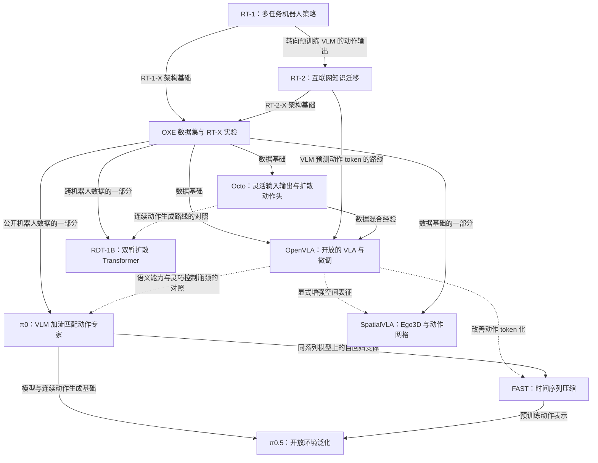

# 这 10 篇具身智能论文到底在解决什么？

> GitHub 发布副本：来自本地学习资料，PDF 链接改为原文或项目页。整理笔记不等于已独立精读；原文中的本地页码和版本说明保留，在线版本可能不同。

面向科研入门的中文精读笔记 | 整理日期：2026-10-07

阅读范围：本目录 10 篇英文 PDF。重点核对方法、核心实验、消融、局限及相关附录；不是逐句翻译，也不把这些论文当作截至整理日的全部最新进展。下面的“PDF 第 n 页”均从文件第一页计数，便于在阅读器中定位。

文中用三种措辞区分证据：**论文报告**是原文实验结果；**直观理解**是帮助理解的类比；**研究设想**是尚需验证、也尚未完成新颖性检索的想法。

## 阅读导航

第一次读：先看第 1、2 节，建立概念和关系；再按第 3 节的顺序读每篇。

准备组会：重点看各篇的“问题—方法—证据—边界”和第 5 节。

准备动手：看第 6、7 节，先做一个能检验假设的小实验。

## 1. 先用一个例子理解整个研究方向

假设你对机器人说：“把桌上的红杯子放进抽屉。”机器人至少要解决五件事：

1. **看见**：找到杯子、抽屉和机械臂，识别遮挡与位置。
2. **听懂**：知道红杯子才是目标，而不是旁边的蓝杯子。
3. **决定步骤**：先开抽屉，抓杯子，再放进去，最后关抽屉。
4. **生成动作**：手臂怎么移动、手腕怎么旋转、夹爪何时闭合。
5. **根据结果纠正**：没抓住就重试，抽屉没打开就调整。

这些论文的共同目标是：让同一个学习系统在很多任务、物体、场景乃至机器人上工作，减少“每换一个任务都重新编程序或训练模型”的成本。

但它们强调的环节不同。**懂得杯子的用途，不等于夹得住杯子；能在实验室夹住杯子，也不等于换个家庭还能完成整个任务。**

### 1.1 你需要先认识的术语

| 英文 | 中文理解 | 在例子中是什么 |
|---|---|---|
| Embodiment | 机器人的身体及感知、执行配置 | 单臂、双臂、带轮子的双臂机器人 |
| Observation | 模型能获得的观测 | 摄像头图像、关节角、夹爪状态 |
| Proprioception | 本体感知 | 不看摄像头也知道手臂当前弯成什么样 |
| Action | 发给控制系统的命令 | 目标关节角、末端位移、夹爪开合等 |
| End effector / EEF | 末端执行器 | 机械臂最前面的夹爪或工具 |
| Policy | 策略，即从输入决定动作的规则或模型 | 根据图像和指令决定下一步 |
| Demonstration / Episode | 一次完整示范/交互回合 | 从开始抓杯子到任务结束的一段记录 |
| Timestep | 回合中的一个时间步 | 某个时刻的图像、状态和动作 |
| Imitation learning | 模仿学习 | 看人操作机器人留下的示范，学习怎么做 |
| Behavior cloning / BC | 行为克隆 | 把“当时看到了什么→示范者做了什么”当监督数据 |
| Reinforcement learning / RL | 强化学习 | 根据执行后的奖励改进策略；不是这些论文的主要训练路线 |
| VLM | 视觉语言模型 | 能结合图像理解文字、回答问题的模型 |
| VLA | 视觉语言动作模型 | 在视觉和语言之外，还能输出机器人动作 |
| Token | 模型处理的序列单元 | 可以是词片段、图像块、动作编号，也可以是连续向量槽位 |
| Backbone / Head | 主干 / 输出头 | 主干提取和融合信息，输出头生成最终动作 |
| Pre-training | 预训练 | 先从大量多样数据中学通用能力 |
| Fine-tuning / Post-training | 微调 / 后训练 | 再适应具体任务、身体或行为要求；这里不必然包含 RL |
| Zero-shot | 在明确的目标条件下不再训练便直接测试 | 不使用这个新家庭的数据适应模型 |
| Few-shot | 用少量目标示范适应 | 增加 1、5 或 100 条示范，数量必须说清楚 |
| Baseline | 基线 | 用来比较的已有方案 |
| Ablation | 消融 | 拿掉一个组件，观察性能是否下降 |

“零样本”一定要追问：是**新物体、新任务、新环境，还是新机器人**？这四种难度和证据完全不同。

### 1.2 一条公式贯穿这些论文

可以把机器人策略统一写成：

$$p_\theta(A_t\mid o_t,\ell),\qquad A_t=[a_t,a_{t+1},\ldots,a_{t+H-1}]$$

这里 `o` 是观测，`ℓ` 是语言指令，`θ` 是模型学到的参数，`A` 是要预测的一段动作，`H` 是动作段长度。`H=1` 时只预测下一步。

为什么写成概率分布 `p`？因为正确做法可能不止一种。绕过杯子时可以从左绕，也可以从右绕；双臂可以有不同分工。模型需要表达多种合理方案，而不是机械地取平均。

这 10 篇论文，大体在改五个部分：**输入信息、模型结构、动作表示、训练数据与流程、评估范围**。

### 1.3 三种动作生成方式

**逐维离散化。** 把连续数值切成若干格。例如允许位移在 -10 到 +10 厘米，切成 256 格，再预测应该选哪一格。RT-1、RT-2、原始 OpenVLA 都用到这种基本思路。优点是容易接入分类和语言模型训练，代价是量化误差和较长的输出序列。

**扩散或流匹配。** 从随机噪声形式的“候选动作段”开始，在观测条件下逐步生成合理的连续动作。Octo、RDT-1B 使用扩散，π0 使用流匹配。它们有关联，但训练目标和采样形式并不完全相同。

**更合适的离散动作表示。** FAST 压缩一段动作在时间上的冗余；SpatialVLA 用有空间意义的网格联合表示平移与旋转。它们说明：不能只问“离散还是连续”，还要问“离散的是哪个结构”。

另一个重要区分：**Transformer 是网络结构，扩散/流匹配是生成和训练方法。** 它们可以结合，RDT 的名字就同时包含 Diffusion 和 Transformer。

## 2. 论文关系：有继承，也有并行路线

### 2.1 文献清单与一句话定位

年份按最初公开工作的时间理解；本地 PDF 可能是后续修订版。

| 工作 | 本地文件 / 页数 | 定位 |
|---|---|---|
| RT-1，2022 | [rt1.pdf](https://arxiv.org/abs/2212.06817)，31 页 | 用可实时运行的 Transformer 学习大量机器人任务 |
| RT-2，2023 | [rt2.pdf](https://arxiv.org/abs/2307.15818)，19 页 | 把互联网视觉语言知识迁移到动作预测 |
| Open X-Embodiment / RT-X，2023 | [37_Open_X_Embodiment_Robotic_L.pdf](https://robotics-transformer-x.github.io/)，16 页 | 汇聚跨机器人数据，并验证正迁移 |
| Octo，2024 | [octo.pdf](https://octo-models.github.io/)，17 页；本地为 v2 | 构建容易适应新输入、新动作空间的通用策略 |
| OpenVLA，2024 | [openvla.pdf](https://openvla.github.io/)，37 页；本地为 v3 | 构建可开放研究、可有效微调的 VLA |
| RDT-1B，2024 / ICLR 2025 | [rtd-1b.pdf](https://rdt-robotics.github.io/rdt-robotics/)，28 页；本地为 v2 | 大规模扩散模型与统一动作空间支持双臂操作 |
| π0，2024 | [π0.pdf](https://www.physicalintelligence.company/download/pi0.pdf)，17 页 | 结合 VLM 和流匹配动作专家，支持灵巧连续控制 |
| FAST，2025 | [fast.pdf](https://www.pi.website/research/fast)，19 页；本地为 v1 | 改进动作 tokenization，提高高频轨迹学习效率 |
| SpatialVLA，2025 | [SpatialVLA.pdf](https://spatialvla.github.io/)，20 页；本地为 v5 | 在视觉输入和动作输出两端引入空间结构 |
| π0.5，2025 | [π0.5.pdf](https://arxiv.org/abs/2504.16054)，19 页；本地为 v1 | 结合异构数据、离散/连续训练和分层推理，泛化到新家庭 |

文件名 `rtd-1b.pdf` 中的字母次序与正式名称不同，应记成 **RDT-1B**。OXE 本地文件有匿名投稿标记；数据规模、页码和措辞可能与正式公开版本有差异。10 个文件合计 223 页，包含参考文献和附录。

### 2.2 关系图

实线表示明确的模型路线、数据来源或方法采用；虚线仅表示可以对照理解的研究方向，不表示直接继承代码或权重。



不要把这张图读成排行榜。OXE 是数据基础设施加实证研究，FAST 是一个可组合的方法；它们和完整策略模型处于不同层级。

### 2.3 最重要的五条主线

| 主线 | 连接的论文 | 问题怎样变化 |
|---|---|---|
| 数据共享 | RT-1 → OXE → Octo / OpenVLA / RDT / π0 等 | 从单团队积累示范，走向跨机器人共享经验 |
| 语义迁移 | RT-2 → OpenVLA → π0 / π0.5 | 从会执行指令，走向利用互联网语义知识，再结合更灵巧控制和环境泛化 |
| 连续动作生成 | Octo、RDT、π0 | 用连续生成模型表达多种合理动作和高维动作段；三者不是简单版本迭代 |
| 动作表示 | RT-1 / RT-2 / OpenVLA → FAST、SpatialVLA | 从逐数值切格，分别转向时间压缩和空间结构 |
| 长任务与泛化 | RT-1+SayCan、π0、π0.5 | 从外部高层规划配合低层策略，走向同一模型内的高低层能力与新环境测试 |

## 3. 逐篇精读

### 3.1 RT-1：先证明，一个机器人策略能吸收很多任务的数据

**论文问题。** 过去容易给每个任务训练一个专用模型。如果把抓取、放置、开关抽屉等示范合起来，一个模型能否同时学会它们，并泛化到新的指令组合？

**具体改进。** 输入是一小段图像历史和自然语言指令。语言经 Universal Sentence Encoder 编码，通过 FiLM 调整 EfficientNet 的视觉特征；TokenLearner 把每帧 81 个视觉 token 压成 8 个；6 帧得到 48 个视觉 token，送入 Transformer，输出离散动作。各动作维度使用 256 个桶。原始控制表示还包括移动底盘和控制模式，不只是后来常见的单臂 7 维动作。

**直观理解。** 指令告诉机器人“看图时重点找什么”，TokenLearner 则把图像中有用的信息提炼出来，降低实时控制所需计算。模型用示范动作做监督，属于行为克隆，不是靠在线试错奖励学会的。

**数据和证据。** 约 13 万条示范，13 台机器人，17 个月采集，744 条任务指令。注意“744 条指令”不等于 744 类完全不同的运动技能。第 10 页 Table 2 中，RT-1 在该评估里的已见任务、未见任务、干扰物、背景变化四项结果分别为 97、76、83、59%。第 14 页 Table 7 将数据数量与多样性分开研究：保留 97% 数据量却删除 25% 任务，泛化显著下降。

**为什么有意义。** 它同时给出可运行的多任务模型、数据收集方案和泛化评估，建立“大量多样机器人数据值得统一学习”的实证基础。

**边界。** 未见任务主要包括已见概念的新组合，不代表任意新动作。背景变化仍是明显弱项。长任务实验用了 SayCan 高层规划，不能把完整任务规划能力都归给 RT-1 网络本身。

**与后续关系。** RT-2 补互联网语义能力；OXE 将多机器人数据共享扩大；后续连续动作模型继续解决精细、高频和双臂操作问题。

**定位。** 方法：第 4–7 页、Figure 3；实验：第 9–14 页、Tables 2、5–7；局限：第 15 页。

### 3.2 RT-2：让“会看图说话的模型”学会输出动作

**论文问题。** 机器人示范很贵，无法覆盖互联网中所有物体和语义。能否直接利用已经经过大规模图文训练的 VLM？

**具体改进。** 将连续动作离散成 token，再把“图像+指令→动作 token”组织成类似视觉问答的数据。于是原本输出文字的 VLM，可以输出代表末端位移、旋转、夹爪及终止状态的 token。论文使用 PaLI-X、PaLM-E 两类基础模型，并在机器人动作数据与原来的视觉语言数据上共同微调。

**直观理解。** 原来模型会回答“这是一个苹果”，现在多教它一种输出格式：“要拿苹果，接下来执行这些动作数值”。真实动作能力仍需机器人数据提供；网络知识主要帮助判断“哪个东西、什么含义、什么关系”。

**最关键的区别。** RT-1 已有语言条件，但不等于 RT-2 这种直接改造生成式 VLM 的方式。RT-2 的变化不是简单把 RT-1 的 Transformer 放大。

**证据。** 论文约做了 6000 次评估。第 18 页 Table 5 中，在其未见物体、背景、环境的综合测试中，RT-1 的未见平均为 32%，两个 RT-2 实例均为 62%；已见任务则约为 91–93%，没有相应幅度的提升。第 19 页 Table 7 中，55B 模型仅机器人微调为 52%，共同微调为 63%，支持保留图文训练有益于该泛化评估。

这组结果更支持“增强语义和视觉泛化”，而不是“所有控制能力都翻倍”。不同表格的汇总口径有细小差别，不应把 Table 5 和 Table 7 的均值混作同一个数。

**边界。** 作者明确指出，互联网数据没有使机器人凭空掌握新运动技能。能选择石头作为潜在锤子，不等于学会可靠的敲钉子控制。链式语言规划是额外微调变体的定性展示，不等于所有主实验都使用了完整推理链。55B 版本控制频率约 1–3 Hz，依赖远程多 TPU 服务。

**定位。** 方法：第 3–5 页；泛化与消融：第 6–7、18–19 页；额外规划变体与局限：第 8 页。

### 3.3 Open X-Embodiment / RT-X：不同机器人可以共享经验吗？

**论文问题。** 每个实验室的数据都很有限，且身体、相机、动作单位、控制方式不同。把它们合起来，会学得更好，还是互相干扰？

**两个贡献要分开。** OXE 是标准化机器人数据集合；RT-1-X、RT-2-X 是基于已有 RT 架构，在跨机器人混合数据上训练的策略。它不是另造了一个叫“RT-X”的全新统一网络。

**具体改进。** 用 RLDS 等统一存储格式；在实验中选取相机观测，进行图像处理及动作归一化，把动作粗略整理成末端平移、旋转和夹爪表示。注意原文说的是“粗对齐”：没有把所有机器人的坐标系与绝对/相对/速度控制含义彻底统一。

**直观理解。** 多个学校把实验笔记整理成能一起阅读的格式。格式统一能促进共享，但并不意味着每个学校的机器操作方法完全相同。

**数据和证据。** 本地稿报告 22 种机器人、100 万以上轨迹；主要 RT-X 训练实验实际使用 9 种机械臂的混合数据，不能写成“模型在全部 22 种身体上完成了训练验证”。小数据域中，RT-1-X 相比原方法平均成功率相对提高约 50%；不是增加 50 个百分点。

第 7 页 Table 2 给出更有解释力的证据：跨身体技能测试中，RT-2 为 27.3%，RT-2-X 为 75.8%；从后者训练中去掉 Bridge 数据后降至 42.8%。这支持另一种机器人数据带来了有用技能。但同表常规泛化一列是 62% 对 61%，不能概括成“全部泛化都提升三倍”。

**边界。** 小模型在部分大数据域出现欠拟合/负迁移；增加混合数据不保证任何任务都提升。第 8 页明确说没有研究泛化到全新机器人。这里的“跨身体共享”与“没见过的身体直接上机”是两回事。

**与后续关系。** Octo、OpenVLA 等在此数据基础上设计模型和数据混合；RDT 进一步强调动作物理含义的统一；π0 系列还加入大量自采集数据。

**定位。** 数据和对齐：第 3–5 页；迁移证据：第 6–7 页；局限：第 7–8 页。

### 3.4 Octo：让预训练策略可以适应不同传感器和动作接口

**论文问题。** 一个模型即使多任务能力很强，如果换一只机械臂、加一个腕部相机就要大改网络，仍不好用。能否让策略像通用视觉模型一样，成为多种机器人任务的初始化？

**具体改进之一：模块化输入输出。** 不同相机、语言、目标图片分别转换成 token。Transformer 使用分块注意力，缺失输入被遮蔽；readout token 读取内部信息，再接动作头。适应新输入或动作空间时，可增补小模块并沿用大部分预训练权重。这里“沿用权重”不等于“微调时全部冻结”：论文默认更新策略模型。

**具体改进之二：扩散动作段。** 主干先计算一次条件特征，小型扩散头再进行多步去噪，预测一段连续动作。这样既能表达多种合理动作，也不必每次去噪都重跑整个大主干。

**具体改进之三：兼容目标图片。** 没有完整语言标注的数据也能通过未来目标图片提供学习条件。Octo 使用预训练 T5 语言编码器，但并不是拿一个完整生成式 VLM 直接改成动作模型。

**证据。** 使用 OXE 中筛选的 80 万轨迹，主要策略版本为 27M 和 93M 参数；这个口径不宜与包含全部冻结编码器的其他模型总参数直接比。第 7 页 Table I 中，约 100 条目标示范的六个微调设置，Octo 平均 72%，从头训练基线 20%，VC-1 基线 15%。这是指定任务上的结果，不是所有新机器人都能达到 72%。

Table II 在四个 WidowX 任务、合计 40 次测试上，完整方案约 83%，改用离散动作头为 18%，直接 MSE 动作回归为 35%。这支持其动作头选择，但不证明一切离散 VLA 都差；FAST 和 SpatialVLA 正是在改进离散表示。

**边界。** 第 17 页 Table VII 中，两项未见技能平均仅 5%。腕部相机与语言条件使用效果仍有不足。主文微调表统一写每域 20 次，附录对双臂任务写 10 次，存在报告细节差异；严谨复现时需要向代码/作者核对，而不是自行补齐。

**定位。** 方法：第 3–5 页；对比和消融：第 6–8 页；有价值的失败经验：第 15 页 Appendix E；泛化细分：第 17 页。

### 3.5 OpenVLA：把 VLA 做成可用、可研究、可微调的基础模型

**论文问题。** RT-2 证明 VLM 可以帮助机器人，但模型不易获得，面向新任务如何高效微调也缺少充分研究。

**具体改进。** 基于 Prismatic VLM，组合 DINOv2 与 SigLIP 视觉特征，经投影连接 Llama 2；在 97 万条机器人示范上训练动作预测。直观上，DINOv2 提供有用的视觉结构特征，SigLIP 提供图文对齐特征，但不能把这两者理解成绝对分工的“几何模块”和“语义模块”。

动作仍采用每维 256 桶，但用训练数据 1%–99% 分位数确定范围，减少异常值拉宽区间造成的精度损失。数据混合借鉴 Octo，并调查视觉编码器是否需要更新、LoRA 微调、量化推理等实际问题。

**LoRA 的直观理解。** 不是重写整个大模型，而是训练较小的低秩权重增量来适应任务。它减少可训练参数与相关状态的开销，但计算仍会经过大模型。

**证据。** 在论文选定的 29 个任务、两个机器人设置的汇总比较中，相比 RT-2-X 报告高 16.5 个百分点；但语义泛化类别仍有 RT-2-X 更强的情况。不能把汇总胜出改写成每个维度都更强。

第 34 页 Table 9 的一个重要消融：OpenVLA 76.3%，只用 Bridge 数据训练的变体 45.6%，再去掉 DINOv2 为 40.6%。在这组 80 次评估中，多机器人训练带来的差异大于双视觉编码器带来的差异。写创新总结时不应只盯着“多加一个编码器”。

**显存数字怎样读。** 第 10 页 Table 1，rank 32 的 LoRA 成功率 68.2±7.5%，全参数微调 69.7±7.2%；LoRA 训练约 1.4% 参数。该表 batch=16 时显存仍约 59.7 GB。Table 2 的 int4 约 7 GB 是推理，不是这个微调实验的显存需求。脚注还说明，这些效率实验用的是较小数据混合、仅 SigLIP 的变体。

**边界。** 原始 OpenVLA 只使用单帧图像，不包含完整的多相机、本体状态与动作段设计。低频单步自回归动作不适合直接承担所有高频灵巧任务。狭窄、精细的单指令任务上，从头训练的 Diffusion Policy 仍可能更好。

**与后续关系。** FAST 改它所代表路线的动作编码瓶颈；SpatialVLA 显式补空间信息；π0 把预训练语义主干与连续动作专家结合。后续代码新增功能不能倒写成这篇原论文已有的贡献。

**定位。** 方法：第 4–6 页；主实验：第 7–9 页；高效适应及脚注：第 10–11 页；消融：第 33–35 页；LIBERO：第 36–37 页。

### 3.6 RDT-1B：双臂操作需要表达多种协调方式

**论文问题。** 双臂的动作维度更高，协调方式更多，专用示范却更稀缺。怎样利用大量主要来自单臂机器人的数据，帮助双臂操作？

**直观理解多峰分布。** 抓住一个盒子，可以左手固定、右手抓，也可以相反。这些方案都合理，但它们的数值平均不一定合理。这里的“多模态/多峰动作分布”指多种动作方案，和“输入包含图像、文字等多种模态”不是同一个概念。

**改进一：大规模扩散 Transformer。** 使用可扩展的 DiT 来生成连续动作段；QKNorm、RMSNorm 改善训练数值稳定性；非线性 MLP 输出层增强动作映射能力。视觉使用冻结 SigLIP，语言使用冻结 T5-XXL，不是把整个现成的生成式 VLM 改造成自回归动作模型。

**改进二：交替注入条件。** 图像 token 通常远多于语言 token。作者在相邻层交替让动作表示关注图像或语言，减少视觉信息压过指令的情况；配合随机模态遮蔽，避免只依赖一个输入。

**改进三：有物理意义的统一动作空间。** 创建 128 维统一向量，为关节位置、末端位置、旋转表示、左右手和底盘等分配明确位置。各机器人将自己已有的量填入对应槽位，缺失部分填充。128 维是统一表示大小，不代表目标机器人真的有 128 个自由度，也不意味着模型已经发现了所有机器人的物理规律。

**训练流程。** 46 个数据集、100 万以上轨迹进行预训练，再用 6000 多条自采双臂示范做目标机器人微调。主要 RDT 网络约 1.2B 参数，比较显存时还应考虑冻结编码器等组件。

**证据。** 第 9 页 Table 2 中，未见物体测试的完整 RDT 为 50%，直接回归变体为 12.5%，无预训练变体为 0%；但未见场景一列大、小 RDT 同为 62.5%，所以不能声称每项指标都严格随规模上升。第 10 页 Table 3：折短裤新增 1 条该技能示范后，完整 RDT 为 68%，无预训练变体为 40%，各测试 25 次。

**怎样理解“一条示范”。** 是在已有多机器人预训练和目标机器人多任务数据的基础上，该新技能只有一条示范。不是从一张白纸开始，看一次就学会任意双臂任务。

**边界。** 某些测试只有 8 次试验，改变一次结果就是 12.5 个百分点；不能仅凭小差异过度推断。原文明确目标是借助跨机器人数据提升双臂能力，而不是证明无需适应便可控制各种未见机器人。对 OpenVLA、Octo 的比较涉及适配双臂和输入配置差异，不能只归因于“扩散一定优于其他方法”。

**速度数字。** 第 8 页报告约 6 个动作段/秒、约 381 个动作/秒的摊销生成吞吐。381 不是 381 次/秒的感知闭环决策。

**定位。** 动机与方法：第 3–7 页、Figure 3；训练与测试配置：第 8–10 页；统一空间：第 19–20 页、Table 4；对比配置：第 25–27 页。

### 3.7 π0：把语义知识与灵巧的连续动作生成结合

**论文问题。** VLM 有通用知识，但直接逐个生成动作 token 难以充分应对高频双臂、折衣服等任务。小型扩散策略擅长连续控制，却未必充分利用大规模 VLM 的能力。能否兼得？

**具体改进。** 基于 PaliGemma VLM，加入约 300M 参数的 action expert（动作专家），以流匹配生成动作段。整体约 3.3B 参数。图像、文字主要走 VLM 权重；状态和带噪动作使用机器人专用权重，两组权重通过注意力交互，而非简单地把 VLM 最后一个向量接到线性动作头。

输入包含两到三个相机图像、语言和关节状态；一次预测 `H=50` 步连续动作。动作段中的动作位置可以相互关注，以建模整个段内的协调。

**把流匹配公式翻成人话。** 从真实动作段 `A` 和随机噪声 `ε` 构造中间样本：

$$A^\tau=\tau A+(1-\tau)\epsilon.$$

`τ=0` 是纯噪声，`τ=1` 是真实动作。网络学习给定图像和指令时，中间样本应该朝什么方向移动：

$$\mathcal L=\mathbb E\left[\|v_\theta(A^\tau,o)-(A-\epsilon)\|^2\right].$$

执行时从噪声出发，按预测方向迭代，得到符合场景和任务的动作段。本地 π0 用 10 次积分更新。**这是在模型内部生成动作，不是让真实机器人先随机抖动再把噪声消掉。**

为什么去噪训练也用了平方误差，却没有和简单 MSE 回归一样的问题？因为这里回归的是不同噪声状态下的条件向量场，最终从随机初始值生成分布；不是只用观测直接回归一个确定的平均动作。

**训练改进同样重要。** 先在覆盖多机器人、多任务的数据上预训练，再用高质量任务数据后训练。作者自采数据约 1 万小时、903M 时间步、7 类机器人配置、68 个较宽泛的任务。按详细数据节，混合中包含公开数据及其筛选/加权版本；不能只根据概览中的一句话认定完整使用所有 OXE 数据。

**证据。** Figure 7 比较直接使用预训练模型的任务表现，也比较相同更新步数的版本；Figure 11 改变微调数据量，考察预训练是否降低新任务的数据需求；Figure 13 比较完整训练、只有预训练、只用后训练数据三种流程。整体支持“模型结构与训练流程共同重要”。

**边界。** 与 π0-small 的比较同时改变 VLM 初始化、参数量和部分结构，作者自己也承认难以完全公平，因此不能把全部差距仅归因于互联网知识。复杂任务常用任务进度评分，且部分任务获得高层策略指导，不应泛化成无需分解、无需微调的万能机器人。

**关键速度概念。** 第 16 页 Appendix D：在 50 Hz 机器人上，实际每执行 25 步、约 0.5 秒重新生成一次动作段；在 20 Hz 平台上每 16 步、约 0.8 秒一次。50 Hz 是动作执行频率，不是视觉重新决策频率。整段生成在该 RTX 4090 配置下机内约 73 ms，也与实际采用的重规划频率不同。

**定位。** 方法与公式：第 4–5 页；数据与训练：第 5–6 页；实验：第 7–11 页；局限：第 11–12 页；架构和部署：第 15–16 页。

### 3.8 FAST：问题可能出在动作的“写法”

**论文问题。** 高频动作序列每一步变化很小。逐维、逐时刻离散，会制造大量冗余 token，让自回归模型容易学会复制相邻值，却不容易学到真正的轨迹结构。

例如双臂 14 维动作，每秒 50 步，一秒就有 `14×50=700` 个数。如果每个数都独立变成 token，输出非常长。

**具体改进。** FAST 全称 Frequency-space Action Sequence Tokenization，处理过程为：

```text
连续动作段
  → 按动作维度归一化
  → 每个维度沿时间做离散余弦变换 DCT
  → 缩放并取整，得到稀疏频域系数
  → 按低频优先、交错动作维度的次序展开
  → 用 BPE 合并常见系数组合
  → 更短的动作 token 序列
```

**直观理解。** 与其逐时刻说“手在这里、稍微前一点、再前一点”，不如用几个系数概括一段轨迹的主要变化形状，再补必要细节。DCT 可表示低频趋势与高频变化，不等于固定丢掉全部高频信号。

**有损和无损要分开。** DCT 变换本身可逆；系数量化会引入误差；BPE 对量化后的离散序列做无损压缩。因此整个 FAST 流程一般是有损表示，不能因为 BPE 无损就说机器人动作被完全无损压缩。

**FAST、FAST+、π0-FAST 的区别。** FAST 是方法；FAST+ 是在约 100 万个一秒动作段上训练的通用 tokenizer；π0-FAST 是使用这种动作表示进行自回归动作预测的策略。这里的百万数据单位是动作段，不能与 OXE 的百万完整轨迹直接相加或比较。

**证据。** 第 7 页 Table I，在一秒动作段、可比重建精度下：

| 数据 | 原始逐维逐步 token 数 | FAST 平均 token 数 | 压缩比 |
|---|---:|---:|---:|
| BridgeV2，7 维，5 Hz | 35 | 20 | 1.75 倍 |
| DROID，7 维，15 Hz | 105 | 29 | 3.6 倍 |
| 清桌，7 维，20 Hz | 140 | 28 | 5.0 倍 |
| 折衬衫，14 维，50 Hz | 700 | 53 | 13.2 倍 |

第 9 页消融显示，去掉 BPE 后表现下降；把 FAST 应用于改造为多图像、动作段输出的 OpenVLA，也能改善高频任务训练。因此贡献主要在表示方法，不局限于一种主干。

**“训练快”不等于“推理快”。** 第 10 页报告通用 π0-FAST 达到相近任务表现所用 GPU 小时可约少 5 倍；第 9 页同时报告，当时实现中自回归 FAST 每动作段约 750 ms，而连续 π0 通常不足 100 ms。前者解码 30–60 个 token 需多次运行较大的语言主干，后者主要迭代较小动作专家。

**研究意义。** 大模型训练失败不一定说明网络不够大，也可能是监督目标表示得不好。这是很适合入门者学习的科研思路：先设计一个简单可控的信号预测实验，把原因讲清楚，再去机器人任务验证。

**定位。** 高频失败案例：第 3–4 页、Figure 3；算法：第 4–6 页、Figure 4、Algorithm 1；对比及局限：第 7–10 页；重建误差：第 16 页。

### 3.9 SpatialVLA：既要知道“是什么”，也要知道“在哪里、怎么移动”

**论文问题。** 通用视觉语言表征可以识别杯子，但对深度、高度、相对距离和精细运动的表征未必足够。如何显式增强机器人所需要的空间结构？

**改进一：Ego3D 位置编码。** 用 ZoeDepth 估计深度，结合相机内参，把像素位置反投影到相机坐标系中的三维位置；再把三维位置编码与 SigLIP 的视觉特征相加：

$$\text{空间视觉特征}=\text{视觉特征}+\operatorname{MLP}(\text{三维位置的频率编码}).$$

直观上，每块视觉特征不仅带着“看上去像杯子”，还带着“在相机前方多远、什么方向”。它不需要机器人到相机的外参标定，并不等于完全不需要相机信息；反投影仍使用内参。估计深度也不是精确的真实几何测量。

**改进二：Adaptive Action Grids。** 将 7 维单臂动作分为平移、旋转、夹爪三组。平移用方向与距离的坐标表示；根据训练动作的统计分布，划分非均匀网格，常见动作区域分配更细的分辨率。每组由一个 token 表示，所以一个动作需要 3 个 token。

“3 个 token”不是“只有 3 个可选动作”。其动作词表包含 4096 个平移格、4096 个旋转格和 2 个夹爪类别，总计 8194 个 token。更少的序列长度对应更有结构、也更大的分类词表。

**改进三：新机器人的网格适应。** 微调前重新拟合目标动作分布、划分网格，并通过三线性插值初始化新网格 embedding，而不是把原来学好的动作表示全部丢掉。

**证据。** 预训练基于 PaliGemma 2，约 110 万条 OXE/RH20T 机器人示范。第 9 页 Table IV 的小规模预训练消融中，去掉 Ego3D 后，Pick Coke Can 的 variant aggregation 从 81.6% 降到 68.9%；其 visual matching 则从 70.7% 到 70.3%，变化很小。这说明收益与测试变化类型有关，不是每个条件都大涨。

同页 Table V，在 LIBERO-Spatial 中，LoRA 为 83.6%，加空间 embedding 适应为 88.2%。这个比较更直接地支持适应方法。第 8 页 Table III 总体均值 78.1% 对 OpenVLA 76.5%，但 LIBERO-Goal 不是 SpatialVLA 最优，所以也不是全任务胜出。

**本地版本的动作段细节。** 第 5、16 页明确写一次预测 4 步动作、共 12 个空间动作 token。不要把“每步 3 个”误写成“每次调用总共只输出 3 个”。

**边界。** 高斯拟合不一定适合偏斜、多峰或集中在某个轴的动作分布；深度误差、坐标表示、离散分辨率都会影响效果。空间感知增强也不自动解决长时记忆与任务切换。论文报告约 20 Hz 部署速度，但跨论文比较前还要核对动作段、深度预测开销和测速口径。

**与 FAST 的区别。** FAST 主要压缩“时间上怎么变化”，SpatialVLA 主要结构化“空间上怎么移动”。二者可能有互补性，但不能直接把两个 tokenizer 串起来就认定有效，必须解决表示接口并做实验。

**定位。** 方法：第 3–5 页；主要结果：第 6–9 页；局限：第 10 页；动作编码和深度消融：第 15–16 页。

### 3.10 π0.5：怎样把实验室里的能力带到新家庭？

**论文问题。** 在熟悉环境里折衣服，与到一个未训练过的家庭完成多阶段整理，是不同难度。后者同时需要新物体识别、环境适应、任务分解和连续控制。

**核心改进并非只换一个动作头，而是训练配方。** π0.5 把不同知识来源组织成同一模型的训练任务：

| 缩写 | 数据来源 | 主要提供什么 |
|---|---|---|
| MM | 多环境移动操作数据 | 与目标移动机器人和家庭任务最直接相关的行为 |
| ME | 多环境固定机械臂数据 | 以较易部署的机器人扩大场景覆盖 |
| CE | 实验室跨身体数据，含 OXE | 多任务操作经验与跨身体迁移 |
| HL | 高层子任务、相关物体框等标注 | 当前情境下应该先做什么 |
| WD | 图文、问答、物体定位等网络数据 | 语义和视觉知识 |
| VI | 人通过语言逐步指导机器人执行的数据 | 在已有低层策略能力下，什么高层命令有效 |

**训练阶段一。** 用 FAST 将机器人动作变成离散 token，与文字、定位框、子任务等共同训练。此阶段统一成自回归预测，方便高效学习。

**训练阶段二。** 加入连续动作专家，并联合保留 token 预测和流匹配损失。后训练更聚焦移动操作及多环境数据，加入 VI；不是把全部原数据不加区别继续混合。原文设定先 280k 步离散预训练，再 80k 步后训练。

**进一步读结构细节。** 与 π0 相比，本体状态改成离散 token 输入主干；流匹配时间参数通过自适应 RMSNorm 注入动作专家各层。FAST 动作 token 与连续动作表示不能互相读取，避免训练时直接偷看另一种形式的答案。注意“注意力遮蔽”与后续知识隔离工作中的“阻断特定梯度传播”不是同一件事。

**执行时。** 同一模型先预测子任务，再根据子任务预测动作：

$$p(A,\hat\ell\mid o,\ell)=p(\hat\ell\mid o,\ell)\,p(A\mid o,\hat\ell).$$

`ℓ` 是“收拾厨房”，`ℓ̂` 可以是“把杯子放入水槽”。这个分解明确区分“接下来做什么”和“动作怎么做”。高低层由同一模型承担，但通常是不同条件下的推理调用，不应想象成每个动作都重新输出一大段文字计划。

**证据一：环境覆盖。** 移动操作数据约 400 小时、约 100 个环境；另有更多其他来源数据。第 8–9 页研究 3、12、22、53、82、104 个训练地点，发现随着地点覆盖增加，新场景表现改善。400 小时不是全部训练数据总量。

**证据二：不同数据的贡献不同。** 第 10 页 Figure 10，去掉 ME/CE 明显损害模拟家庭中的任务进度；去掉 WD 在这一实验中差异不显著。但 Figure 11 的新类别物体语言跟随、Figure 13 的高层能力测试，WD 作用更明显。不能把结论写成“网络数据对所有机器人指标都显著提升”。

**证据三：训练高层能力本身有价值。** 第 11 页 Figure 13 中，即使执行时不用显式高层推理，只要训练时包含高层任务数据，表现仍较强。这支持“辅助训练任务改善了表示”的解释，而不只是“多说一句计划就会变聪明”。

**泛化边界。** 论文在 3 个未见真实家庭中测试，另用模拟家庭房间做可控比较。这是重要进展，却不是任意家庭、任意指令、任意身体的可靠性保证。主要任务本身在训练数据中有对应类型，新的是环境、布局和物体条件。结果多是任务进度评分。首页 10–15 分钟的展示描述，也不等于量化实验每次都持续这么久；第 8 页说明不少量化任务约 2–5 分钟。

**仍然会失败。** 不熟悉的把手、难打开的柜门、手臂遮挡、反复开关抽屉、上下文不足等。新的挑战从“动作生成出来没有”进一步变成“是否知道完成到哪一步、失败后如何继续”。

**版本提醒。** 本地是 2025-04 的 v1。后续独立工作的知识隔离、实时动作段等改进，不应倒写成这份原稿已经提出的全部方法。

**定位。** 方法：第 4–7 页、Figure 3；泛化与消融：第 8–11 页、Figures 8–13；评分规则：第 17 页；注意力与实现细节：第 19 页。

## 4. 横向比较：究竟改的是哪一层？

### 4.1 按技术位置比较

| 论文 | 主要改动位置 | 动作建模 | 最适合学习的科研思路 |
|---|---|---|---|
| RT-1 | 高效网络与规模化示范训练 | 逐维离散单步动作 | 让模型容量、数据多样性与实时约束一起工作 |
| RT-2 | 预训练知识迁移及共同微调 | VLM 自回归动作 token | 把新任务写成基础模型能学习的形式 |
| OXE / RT-X | 数据格式、数据混合与迁移验证 | 沿用 RT 架构 | 数据基础设施本身也能构成重要贡献 |
| Octo | 模块化接口与动作头 | 小型扩散头生成动作段 | 预训练模型的价值还取决于能否方便适应 |
| OpenVLA | 开放 VLM、数据与高效适应配方 | 逐维离散动作 token | 系统性验证数据、微调和推理的实际选择 |
| RDT-1B | 扩散主干、条件融合、物理动作空间 | 扩散 Transformer 生成动作段 | 根据机器人物理量特点改造已有生成模型 |
| π0 | VLM 与动作专家联合结构、两阶段训练 | 流匹配生成连续动作段 | 将语义预训练与灵巧控制相结合 |
| FAST | 训练目标的序列表示 | 压缩后的离散动作段 | 改表示有时比单纯增大网络更有效 |
| SpatialVLA | 三维视觉编码、动作网格与适应 | 三组空间 token，支持动作段 | 在输入输出两端加入有用的空间结构 |
| π0.5 | 异构任务共同训练与高低层推理 | 预训练离散，后训练兼容连续生成 | 通过不同监督来源提升新环境泛化 |

### 4.2 四组容易混淆的关系

**Octo 与 OpenVLA：** 二者都开放，也都利用 OXE，但主要关注点不同。Octo 强调灵活的输入输出接口和小型扩散策略；OpenVLA 强调完整 VLM 的语义迁移与高效微调。在原始设置中，不能说 OpenVLA 已经包含了 Octo 的全部接口灵活性。

**RDT 与 π0：** 都生成连续动作段，都能做双臂任务；RDT 以大型扩散 Transformer 为核心，预训练视觉/语言编码器提供条件；π0 以预训练 VLM 与专门动作专家的结合为核心。不是仅仅“一个用扩散，一个把名字换成流匹配”。

**FAST 与 SpatialVLA：** 都改动作 token，但压缩/组织的结构不同。FAST 从时间序列冗余入手，SpatialVLA 从空间联合表示与动作分布入手。前者不解决三维视觉理解本身，后者也没有自动消除长序列的所有时间冗余。

**π0 与 π0.5：** 后者不是“把前者训练久一点”。动作表示的阶段安排、异构任务数据、高层子任务学习、后训练数据选择和部分架构细节都发生变化。

### 4.3 数据单位不能混用

13 万完整示范、100 万一秒动作段、903M 时间步、1 万小时是不同单位。假设两份数据各有 1000 条轨迹，一份每条 5 秒、一份每条 5 分钟，数据量和任务覆盖可以相差很大。50 Hz 采样产生的时间步比 5 Hz 多十倍，也不代表包含十倍独立知识。

所以比较数据至少记下：轨迹数、时长、控制频率、机器人种类、场景数、任务定义、采样权重。

## 5. 怎样读懂一篇论文的实验，而不是只记住宣传结论

### 5.1 三层问题：有效吗、为什么有效、在哪里有效

主结果表通常回答“整个系统有没有用”。消融试图回答“哪个组件起作用”。泛化、失败案例和附录帮助回答“结论适用到哪里”。这三层证据缺一不可。

以 OpenVLA 为例：

- 对比 RT-2-X 的结果说明其整体配方在选定任务上有竞争力。
- Table 9 更适合讨论数据和双视觉编码器各自的作用。
- 单指令任务中 Diffusion Policy 仍强，说明任务类型会影响方法选择。

不能从第一个结论直接推出“DINOv2 就是全部提升的原因”。

### 5.2 九个必须核对的细节

| 看到的表述 | 应该继续检查什么 |
|---|---|
| 成功率提升 50% | 是相对提升还是百分点？从 40% 到 60% 是相对 +50%，绝对 +20 个百分点 |
| 得分 80% | 是整次成功率，还是拿到 80% 的任务进度分？ |
| Zero-shot | 对哪个维度零样本？身体、场景、物体、技能是否已见？ |
| 只要一条示范 | 是否已有大规模预训练和同机器人其他任务数据？ |
| 运行 50 Hz | 是底层执行、动作生成吞吐，还是视觉重规划频率？ |
| 训练更快 | 比的是迭代数、墙钟时间、GPU 小时，还是达到同样成功率所需成本？ |
| 模型更小 | 是否包含冻结编码器、深度模型、视觉主干、动作专家？ |
| 更低显存 | 测的是训练还是推理？batch、精度、量化和变体是否相同？ |
| 全面超越基线 | 是否同数据、同输入、同动作接口、同调参预算、同测试初始条件？ |

例如动作段长 50、机器人执行 50 Hz，一次预测覆盖一秒。模型仍可能半秒才重新看图规划一次。动作段可以提高吞吐和连贯性，但在物体被突然移动时，较长的开环执行也可能更难及时纠正。

### 5.3 学会解释一张消融表

以 SpatialVLA 第 9 页 Table IV 为例：

1. 找到完整方法行。
2. 找到只移除 Ego3D 的行。
3. 先比较完全相同的任务与指标列。
4. 记录哪些变化大、哪些变化小，不只选最大的一列。
5. 看实验是否还改变数据、模型规模、训练步数或其他配置。
6. 给出有限结论：“该设置下 Ego3D 对部分场景变化更有帮助。”

这比“3D 信息全面提升泛化能力”更精确，也更像科研论证。

### 5.4 怎样看样本量与不确定性

8 次测试得到 75%，其实是成功 6 次。下一次如果失败，结果就发生明显变化。多次训练种子和多次测试回合也不是同一种重复：前者反映训练随机性，后者主要反映测试状态与执行随机性。

`±` 可能是标准差、标准误或置信区间，必须看表注。比如 OpenVLA 的表注有 StdErr，FAST 图中使用 95% CI，不能当成相同统计量直接比较。误差区间重叠与否也不是通用的显著性检验替代品。

**训练损失低也不一定更会做事。** FAST 的相邻动作复制问题、OpenVLA 的量化推理延迟问题、SpatialVLA 的离散化消融，都提示需要把离线指标与闭环任务表现分开。

## 6. 从“读懂改进”走到“自己提出可检验的改进”

以下是根据上述局限提出的**研究设想和入门练习**。它们不是已验证结果，更不自动具有发表新颖性。完整选题还需要检索后续论文、限定具体条件，并确认实验资源。

### 6.1 最适合先做：动作压缩是否掩盖了关键接触动作？

**来源。** FAST 压缩时间序列，但总体重建误差可能低估瞬时夹爪开合、接触、速度突变的重要性。

**假设。** 在相近 token 预算下，对夹爪变化或接触邻域保留更高精度，可能比所有维度统一量化更有利于任务成功。

**最小实验。** 先做离线轨迹分析：比较逐维分桶、DCT+量化、DCT+量化+BPE。再加入一个候选方案，例如将夹爪离散事件与平滑手臂轨迹分开编码。控制词表、训练数据和总 token/存储预算。BPE 词表、量化尺度及归一化统计只在训练集上学习。

**指标。** token 数与编码耗时、整体重建误差、关键事件时间偏差、事件附近误差、夹爪开合顺序是否正确。最终还要在同一策略和闭环环境中验证成功率；仅离线误差改善不够。

**可能失败。** 事件分离可能增加序列长度，损害维度间协调；更准确的数值未必带来更好的策略学习。

**适合程度。** 很适合先做 CPU 数据实验，再决定是否投入策略训练。第一阶段是理解与复现练习，不应包装为已经发现新算法。

### 6.2 数据越多越好吗：固定预算下的混合与筛选

**来源。** RT-1 强调多样性；OXE 显示部分小模型欠拟合；OpenVLA 的数据消融收益很大；π0.5 强调环境覆盖。

**假设。** 对一个明确目标任务，选取动作接口兼容、环境多样、质量较高的子集，可能优于简单扩大数据量。

**对照。** A：只用目标机器人数据；B：加随机跨机器人数据；C：加质量筛选数据；D：加相同数量但更多场景的数据。保持训练步数、实际见到的样本数与主干一致；补充相同计算成本的比较。

**指标。** 新场景成功率、目标任务成功率、原任务是否退化、数据量与计算成本。单独报告每种身体结果，避免平均值掩盖负迁移。

**防止错误结论。** 按完整轨迹和场景拆分训练/验证/测试，不要把同一轨迹相邻帧分到不同集合。若目标是场景泛化，应留出整个场景。

**适合程度。** 有现成小策略和可用数据时较适合入门。完整 OXE 预训练不是必要的第一步。

### 6.3 模型究竟有没有听语言：做成对指令测试

**来源。** RT-2 的语义泛化、RDT 的条件注入、FAST 的语言跟随、π0.5 的 WD 消融都涉及指令。

**假设。** 训练数据中“看到某场景就固定执行某动作”的相关性，会让模型忽视语言。更好的条件融合或少量对比式指令样本可能改善这一点。

**最小实验。** 固定同一个有红杯和蓝杯的场景，只改变“拿红杯/拿蓝杯”指令；另设同义改写、错误/空指令测试。比较原模型、更多语言数据、一个明确的融合改动。训练集应有视觉相同但任务不同的有效监督，不能给相同动作随意贴相反标签。

**指标。** 选对目标的比例、实际完成的比例、语义改写一致性。选错物体是语义错误，选对却掉落是执行错误，应分开计数。

**可能失败。** 语言增强可能只记住模板，遇到新的属性组合仍失败。测试集应包含未见组合，而不只是换同义词。

**适合程度。** 很适合先做评估与失败分析；比直接训练新基础模型更容易形成清楚结论。

### 6.4 深度不可靠时，空间特征应该怎么用？

**来源。** SpatialVLA 借助估计深度，但透明物体、反光和遮挡等条件可能使深度质量改变。

**假设。** 随深度不确定性调节三维特征权重，比始终等强度加入三维位置编码更稳健。

**最小对照。** RGB 基线；原始 Ego3D；加入深度扰动增强；置信度加权的 Ego3D。让模型容量和训练数据尽量一致，避免把参数增加当成新机制收益。

**指标。** 不同遮挡、深度噪声、物体高度变化下的成功率与位置误差；额外深度计算耗时。需要在真实或可信扰动上验证，不只在一种人为高斯噪声上得到好结果。

**可能失败。** 深度模型的置信度未必真实可靠。若没有可校准的不确定性来源，这个方案可能退化成又一个不稳定门控。

**适合程度。** 已理解相机几何、有预训练空间模型和 GPU 后再考虑。

### 6.5 动作段多长才合适：效率与及时纠错的折中

**来源。** Octo、RDT、π0 都使用动作段。更长动作段提高连贯性和摊销吞吐，但执行中途的扰动需要及时重新决策。

**假设。** 根据任务阶段或外部扰动调整已预测动作的执行长度，可能在相同延迟预算下提高成功率。

**对照。** 固定短执行段、固定长执行段、按阶段调整执行段。区分预测长度 `H` 与实际执行后再规划的长度 `K`，不要同时乱改两者。将感知、推理与通信延迟注入同一测试系统，比较移动目标或抓取失败后的恢复。

**指标。** 任务成功、完成时间、重规划次数、抖动、延迟分位数和扰动恢复时间。

**新颖性提醒。** 这方向已有后续工作，例如 PI 的 [Real-Time Action Chunking](https://www.pi.website/research/real_time_chunking)。不能把“异步推理/动态动作段”作为未经检索的原创点；应先复现，再寻找清楚的未覆盖条件。

### 6.6 长任务为什么绕圈：记住已完成的事情

**来源。** π0.5 提到反复开关抽屉和有限上下文。

**假设。** 记录近期子任务、完成状态与失败事件，可能减少无意义重复，尤其在目标被暂时遮挡时。

**对照。** 当前帧；固定长度图像历史；简洁的事件记忆。用相同低层策略比较高层规划，避免因为同时更换低层模型而无法解释提升。

**指标。** 全任务成功率、重复操作次数、额外动作数、丢失目标后的恢复、记忆错误造成的失败。

**可能失败。** 错误记忆会让模型固执地认为任务已完成。记忆需要更新和纠错，而不是一直累积。

**新颖性提醒。** 后续已有 [VLAs with Long and Short-Term Memory](https://www.pi.website/research/memory) 等工作。因此“给 VLA 加记忆”本身过于宽泛，适合作为学习方向，不是直接成立的论文创新。

### 6.7 对初学者的优先建议

如果尚无机器人和大 GPU，优先做 **6.1 动作表示的小实验**；已经能运行策略评估，则优先做 **6.3 语言跟随诊断** 或 **6.2 数据混合**。先把一个失败现象稳定重现，并做出能排除其他解释的对照，再考虑叠加新模块。

一项可信的研究可以写成：

> 在明确的条件 X 下，基线出现失败 Y；我们怀疑原因是 Z；只改变与 Z 对应的机制 M，并用对照实验和失败分析检验它。

“给模型加一个模块，平均成功率高一点”还不够。需要解释它针对什么失败、为什么应该起作用、付出了什么代价，以及在哪些场景无效。

## 7. 与你当前 random_agent.py 的学习路线怎样接起来

你当前文件中的核心是：

```python
def act(self) -> Action:
    return self._random.choice(list(Action))
```

它从动作集合随机选动作，没有读图像、目标或历史，也没有训练过程。这是理解闭环的起点：环境产生状态，智能体做动作，环境发生变化。但它还不是 VLA。

按概念逐步前进，可以这样学习；下面是建议，没有改动现有代码。

| 阶段 | 练习 | 对应论文里的概念 | 做完应能解释什么 |
|---|---|---|---|
| 1 | 比较随机动作与朝目标移动的规则 | 策略、观测、闭环 | 为什么动作应依赖观测 |
| 2 | 用规则/规划器生成状态—动作示范，训练小分类器 | 行为克隆 | 为什么示范可以变成监督学习数据 |
| 3 | 同一地图设两个目标，用任务标签指定目标 | 条件策略 | 模型究竟根据场景还是指令行动 |
| 4 | 保留整张地图作为测试集 | 泛化评估 | 记住训练地图与适应新地图的区别 |
| 5 | 一次预测多步，执行部分后再观察 | Action chunking | 连贯性和反应速度怎样折中 |
| 6 | 对连续合成轨迹做量化与 DCT 压缩 | FAST 的表示思想 | 采样频率、token 数和误差的关系 |
| 7 | 在合适的机器人仿真基准上运行已有策略 | VLA 适应与评估 | 真实图像和连续动作比栅格任务多了哪些难点 |

栅格世界的上下左右动作本身不具有机械臂连续轨迹的全部性质，因此阶段 6 适合单独构造连续信号，不能把栅格上 DCT 的结果直接当作 FAST 的机器人结论。

已有的 Q-learning 示例可以帮助理解 RL，但不必先把强化学习全部学完才阅读这组论文。对于当前文献，先掌握**监督学习、模仿学习、Transformer、动作表示与泛化评估**更直接。

### 一个可调整的四周安排

| 周次 | 阅读重点 | 小练习 / 可交付成果 |
|---|---|---|
| 第 1 周 | RT-1、RT-2；本笔记第 1 节 | 画出图像、语言到动作的流程；说清 VLM 与 VLA 的区别；完成一页对比 |
| 第 2 周 | OXE、Octo、OpenVLA | 整理数据来源与模型组件；选一张消融表解释每行改变了什么 |
| 第 3 周 | RDT、π0、FAST | 解释多峰动作分布；画出离散动作与连续生成流程；做动作压缩练习 |
| 第 4 周 | SpatialVLA、π0.5 | 写一份两页实验提案：现象、假设、基线、变量、指标、资源与失败标准 |

时间只是节奏参考，不代表四周能完整复现所有大模型。每周以能否清楚解释和检验一个问题为目标。

## 8. 你能否真的讲懂：自测与阅读卡片

### 8.1 十个自测问题

1. RT-1 已经有语言输入，为什么还需要 RT-2？
2. OXE 和 RT-X 分别是什么？跨身体训练和未见身体零样本控制有何不同？
3. Octo 的模块化设计，解决了实际使用中的什么麻烦？
4. OpenVLA 的 7 GB 推理显存能证明 7 GB 显卡足够完成论文微调吗？
5. 两个合理动作的平均值为什么可能不是合理动作？
6. π0 中的随机噪声是否真的发给机器人执行？
7. FAST 为什么既能训练更快，又可能比连续 π0 推理更慢？
8. SpatialVLA 每步只有 3 个 token，为什么仍有 8194 个动作词表项？
9. π0.5 的新家庭泛化，为什么不等于掌握所有未见技能？
10. 如果加一个模块提高成功率，怎样排除“只是多训练了一倍”的解释？

参考要点依次为：完整 VLM 知识迁移；数据集与模型、已见身体与未见身体；适应新输入输出；训练与推理开销不同；多峰分布；模型内部生成；训练目标效率与解码成本不同；序列长度与词表大小不同；泛化维度不同；控制计算预算及其他变量。

### 8.2 以后每读一篇，填写这张卡

```text
论文名 / 版本 / 日期：
一句话研究问题：
先前方法在哪种明确情境下失败：
作者具体改变了什么：
输入 / 输出 / 动作坐标与单位：
训练数据 / 初始化 / 目标函数：
最重要的一张结果表及页码：
最有解释力的一个消融及页码：
零样本指的是哪个维度：
结果的样本量、指标和不确定性：
尚未排除的其他解释：
局限与可检验的后续假设：
我能做的最小复现：
```

## 9. 原文回查与官方资源

下表是回查索引，不是额外依赖的二手解读。本文的详细数值与版本判断以本地 PDF 为主；项目站点用于定位官方论文、代码和演示。代码会更新，复现时还应固定版本、权重与数据配置。

| 论文 | 先看哪张图/表 | 官方入口 |
|---|---|---|
| RT-1 | Figure 3；Tables 2、7 | [项目页](https://robotics-transformer1.github.io/) |
| RT-2 | Section 3；Tables 5–7 | [项目页](https://robotics-transformer2.github.io/) |
| OXE / RT-X | Figure 2；Table 2 | [项目页](https://robotics-transformer-x.github.io/) |
| Octo | Figure 2；Tables I、II、VII | [项目页](https://octo-models.github.io/) |
| OpenVLA | Figure 2；Tables 1、2、9 | [项目页](https://openvla.github.io/) |
| RDT-1B | Figure 3；Tables 2、3、4 | [项目页](https://rdt-robotics.github.io/rdt-robotics/) |
| π0 | Figure 3；Figures 11、13；Appendix D | [官方论文](https://www.physicalintelligence.company/download/pi0.pdf) |
| FAST | Figure 3；Figure 4；Table I | [官方讲解](https://www.pi.website/research/fast) |
| SpatialVLA | Figure 2；Tables IV、V | [项目页](https://spatialvla.github.io/) |
| π0.5 | Figure 3；Figures 8–13；Appendix B | [论文记录](https://arxiv.org/abs/2504.16054) |

补充版本辨析：[Knowledge Insulation 官方说明](https://www.pi.website/research/knowledge_insulation)单独讨论了离散动作学习、连续动作专家与梯度隔离。它有助于理解后续实现，但不属于本目录 π0.5 v1 的同一份原文。

你在组会上可以用这一段组织主线：

> 这组工作研究通用机器人策略。RT-1 建立大规模多任务学习的基础，RT-2 引入互联网视觉语言知识，OXE 提供跨机器人数据和迁移证据。随后 Octo 关注灵活适应，OpenVLA 关注开放 VLA 与高效微调，RDT 和 π0 发展连续动作段生成。FAST 与 SpatialVLA 分别从时间压缩和空间结构改进表示。π0.5 将异构数据、离散预训练、连续执行和高层子任务学习结合，推进新家庭中的多阶段操作。各项工作提升的能力和评估范围不同，需要用消融与失败案例理解其贡献边界。
